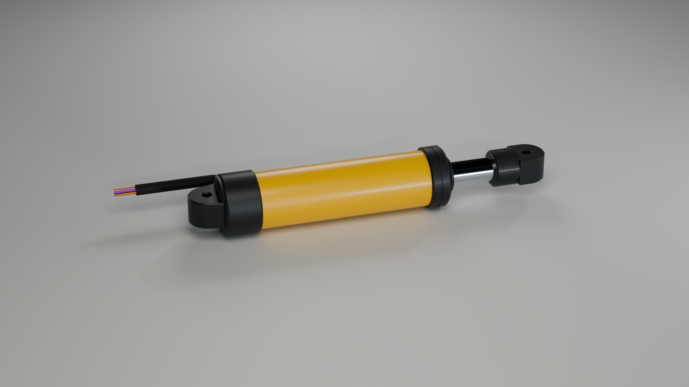
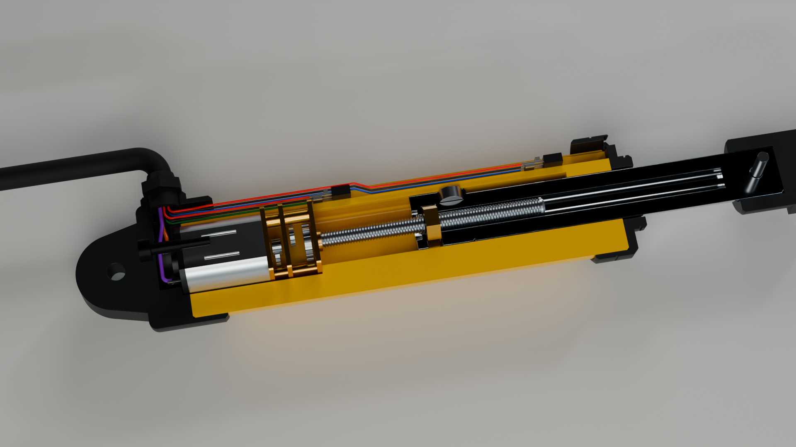
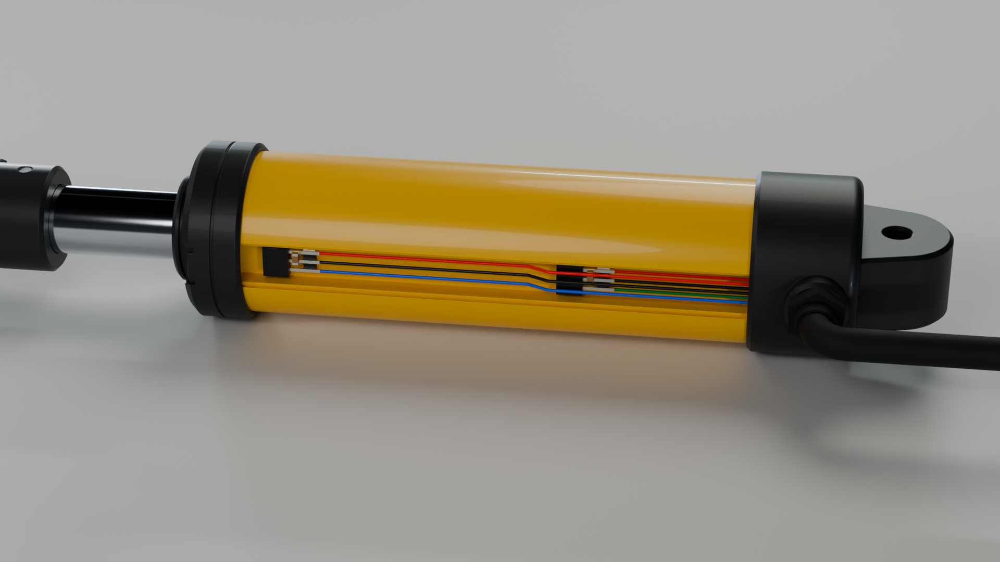
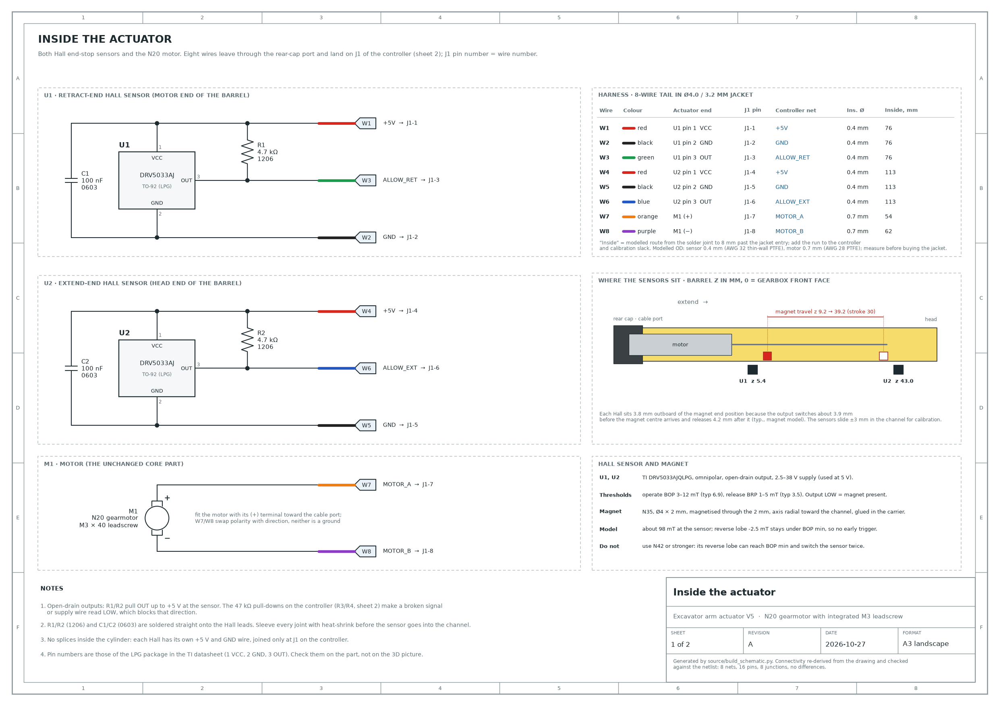
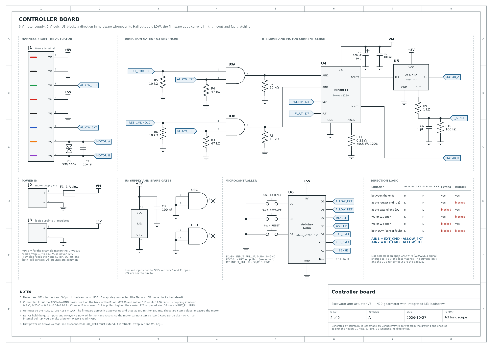

# n20-leadscrew-cylinder

**A 3D-printable linear actuator for a model excavator that looks like a hydraulic cylinder.** It is driven by a standard N20 gearmotor with an integrated M3 leadscrew, used exactly as bought.

The [Sand / Lab application](excavator_app/README.md) turns the existing ARM60 / Track R4 model into a Docker-deployable digging sandbox. A desktop displays the complete CAD assembly and a live granular fluid simulation; a phone pairs by QR code and controls the boom, stick, bucket, slew and tracks over WebSocket. It includes touch joysticks, keyboard controls, emergency stop, connection watchdogs, and verified scoop-and-pour physics. Run `docker compose up --build -d` from `excavator_app/` to start it.

The [complete tracked arm60 excavator](excavator_60mm/README.md) adds independent track drives, steel-pinned links, sprung idlers, bearing-supported geared slewing and a recessed slew cover around the existing 60 mm arm. Its R3 upper body follows the Cat 320 layout: cab front-left, tank housing and stepped toolbox front-right, an engine hood with a battery hatch, and a curved counterweight on the 189 mm tail-swing radius holding steel ballast. Two 18650 cells sit in a cradle sized from manufacturer datasheets. Track R4 adds Berco-referenced sprockets engaging steel bushings, rollers with two outer guide flanges, and a 394 mm track stance around the 308 mm upper platform. Offline playback shows the loaded contact simulation, including passive wheel rotation, idler take-up, forward/reverse travel and braking. The preview allows independent boom and slew travel; track clearance is managed by the operator. Its folder includes parametric CAD, printable parts, a complete STEP assembly, an offline preview, mechanical assembly instructions and reproducible geometry, load and physics simulations. Physical fit, powered operation and payload still require prototype testing.

The [R10 arm with two boom actuators and a deeper boomerang profile](excavator_arm_dual/README.md) implements the user's latest revision: symmetric boom drives at Y = ±50 mm and a hollow, tapered boom with a 76.7 mm middle section, retaining the original joint coordinates and five replaceable teeth. All four actuators are modeled independently. Fixed-base rigid-body simulations track both unloaded and 150 g cycles under an assumed 100 N limit per drive; each boom drive peaks at 58.4 N with the example load. CAD, printable parts, assembly instructions, an offline viewer and a 54-second motion video are included. A feedback-offset case demonstrates unequal load sharing; hardware synchronization, structural strength and soil interaction remain unverified.

R6–R9 and their motion-review files have been removed from the workspace at the user's request. The current arm is R10 in `excavator_arm_dual/`, with actuator dependencies in `actuator_v6/`. Earlier tracked designs remain in Git history. The complete vehicle and sandbox still use the earlier ARM60 model; R10 has not been integrated into them.

The new [ground-mounted excavator arm](excavator_arm/README.md) follows Cat 320 proportions at 1:12, with a 475 mm bent box boom, 241.7 mm stick and inward-facing bucket. Four V6 actuators use 100/120/75 mm leadscrews with regenerated matching parts and end-stop boards. It includes an [offline motion preview](excavator_arm/3D_preview.html), [STEP assembly](excavator_arm/step/excavator_arm_assembly.step), STL meshes, manufacturer references, dimensioned drawings and geometric validation. There is no vehicle chassis.

A separate [60 mm stroke edition](excavator_arm_60mm/README.md) uses four identical actuators and smaller 1:15 proportions: 380 mm boom, 193.3 mm stick and 80 mm bucket. Its [offline preview](excavator_arm_60mm/3D_preview.html), CAD and drawings are kept in their own folder; the 1:12 version remains available. Its actuator, V6-U60, is one of the three lengths (V6-S, V6-U60, V6-L) of the general-purpose [two-wire V6 actuator](actuator_v6/README.md). The current R4 model integrates the upper lift mounts into broad supports on the boom, with thicker cheeks and a shared steel cross-pin.



The motor's own leadscrew drives a brass nut inside the rod. Two Hall-effect end stops hide in a covered channel along the barrel. A small controller blocks each direction in hardware once that end is reached.

The geometry, STL/STEP files, wire routes, schematic and a self-contained 3D preview are all generated from parametric Python (CadQuery).

> **Status:** the design is complete and checked in CAD, but it has not been printed or powered yet. See [Status](#status).

## Features

- **Unmodified N20 leadscrew motor.** There is no coupler, bearing or separate screw. The brass M3 nut in the rod's carrier rides directly on the motor's screw. The gearbox seats on a step in the barrel and the rear cap backs the motor can.
- **Hydraulic-cylinder look:**
  - a round Ø21 mm yellow barrel;
  - Ø23 mm graphite end caps, with a wiper lip at the rod end;
  - a Ø9 mm chrome-look rod;
  - Ø14 mm clevis eyes for Ø3 mm pins;
  - a hose-style cable port with a TPU boot.
- **Hidden end stops.** Two DRV5033AJ Hall sensors sit in a dovetail channel under a flush cover strip, along with their resistors, capacitors and wiring. Each sensor slides ±3 mm for calibration.
- **Hardware direction gating.** A 74HC08 blocks motion toward an end as soon as that end's sensor trips, regardless of the firmware. The Arduino adds a current trip (ACS712), a 30 s run timeout and latching faults.
- **Parametric.** Change the leadscrew length and the stroke, barrel, rod, sensor positions, cover strip and wire routes all follow.
- **Self-checking outputs.**
  - The CAD build checks for interference over the full stroke, checks that every wire lands on its terminal, and checks that every STL is watertight.
  - The schematic generator rebuilds the connections from the drawing itself. It compares them with the netlist and with the firmware's pin constants.

## Specifications

Default build, for a 40 mm leadscrew:

| | |
|---|---|
| Stroke | 30 mm, plus 2 / 3 mm mechanical over-travel at retract / extend |
| Pin centres | 108 mm retracted → 138 mm extended |
| Barrel | Ø21 × 76 mm, end caps Ø23 mm |
| Rod | Ø9 mm |
| Clevis eyes | Ø14 mm, 10.4 mm thick, Ø3.2 mm holes |
| Motor | N20 gearmotor (10 × 12 mm body) with integrated M3 × 0.5 leadscrew |
| End stops | 2 × TI DRV5033AJQLPG and an N35 Ø4 × 2 mm magnet |
| Electronics | 6 V motor supply, 5 V logic: DRV8833, ACS712-05B, SN74HC08, Arduino Nano |

A longer screw gives a longer stroke. For example, a 60 mm screw gives 50 mm of stroke and 128 → 178 mm pin centres. See the [full table](actuator_v5/README.md#rebuild).

## A look inside

<p align="center">
  
  
</p>

The left image is a section on the pin plane, showing the motor, leadscrew, brass nut in the rod's carrier, and magnet. The right image shows the sensor channel with the cover strip removed.

For an interactive view, download [`actuator_v5/3D_preview.html`](actuator_v5/3D_preview.html) and open it in any browser. It is a single 7 MB file that works offline; GitHub can't run it in the page. The preview includes:

- exterior, section, wiring and core-part views;
- a stroke slider;
- a live demo of the end stops and the overcurrent trip.

## Electronics

| Sheet 1: inside the actuator | Sheet 2: controller board |
|---|---|
| [](actuator_v5/electronics/schematic_sheet1.svg) | [](actuator_v5/electronics/schematic_sheet2.svg) |

- Full schematic: [`schematic.pdf`](actuator_v5/electronics/schematic.pdf) (A3).
- Harness, pin tables and commissioning: [`wiring.md`](actuator_v5/electronics/wiring.md).
- Firmware: [`actuator_protection.ino`](actuator_v5/electronics/actuator_protection/actuator_protection.ino).

## Repository layout

```
actuator_v5/
├── README.md           build guide: print settings, assembly order, calibration, rebuild
├── BOM.md              everything to buy, with reference designators
├── 3D_preview.html     offline interactive 3D viewer
├── stl/                printable parts (PETG); soft/ = TPU boot; fit_samples/ = test slices
├── step/               single parts plus the full assembly with wiring
├── electronics/        schematic, netlist, wiring.md, Arduino sketch, logic tests
├── images/             renders and analysis plots
├── references/         motor drawing and photo the design is based on
├── parameters.json     key dimensions of the current build
├── validation.json     geometric check report
└── source/             generators (CadQuery, schemdraw, Blender, three.js viewer)
```

## Building one

1. **Measure your leadscrew** from the gearbox front face to the tip. If it is not 40 mm, rebuild with `--screw-length` (see below).
2. **Print** the parts in `actuator_v5/stl/` in PETG and the boot in `stl/soft/` in TPU 95A. Print the four fit samples first.
3. **Buy** the parts in [`BOM.md`](actuator_v5/BOM.md).
4. **Assemble, wire and calibrate** by following the [build guide](actuator_v5/README.md#assembly-order). Check the motor direction first. Then set each Hall sensor so that it stops the motor just before the mechanical stop.

## Rebuilding from source

Tested with Python 3.11 and the packages in [`requirements.txt`](actuator_v5/source/requirements.txt) (CadQuery 2.8, trimesh, schemdraw, matplotlib, ReportLab, PyMuPDF). The renders need Blender 4.2.

```sh
cd actuator_v5
pip install -r source/requirements.txt
python source/build_v5.py --screw-length 40         # STEP/STL, meshes, validation (about 3 minutes)
python source/magnet_trigger.py                     # magnet model and Hall placement
python source/build_schematic.py                    # schematic, plus connectivity and firmware checks
python source/build_viewer.py                       # 3D_preview.html
blender -b -P source/render_v5.py -- --out images   # optional renders
```

`build_v5.py` stops with an error if any geometric check fails.

The logic tests need no hardware (run them from `actuator_v5/` too):

```sh
python electronics/check_direction_gates.py         # 74HC08 gates: all 16 input states
c++ -std=c++17 -UNDEBUG electronics/protection_logic_test.cpp -o /tmp/protection_test && /tmp/protection_test
```

## Status

Checked:

- **CAD** (results in [`validation.json`](actuator_v5/validation.json)):
  - no interference between parts, hardware and wires anywhere in the stroke;
  - all eight wires land on their terminals;
  - wire routes still clear with each sensor moved ±3 mm;
  - every STL is watertight.
- **Electronics:**
  - the schematic's connections match the netlist and the firmware's pin map;
  - the 74HC08 truth table passes;
  - the protection-logic unit test passes;
  - the Arduino sketch compiles against a stub of the Arduino API.

Not verified yet:

- printing and fit;
- the real motor's ratings, the gearbox's axial load capacity and PETG creep under load;
- magnetic switching on real parts (the magnet model ignores the steel screw and nut);
- the firmware running on a board.

The current trip (550 mA for 150 ms) is a starting value. Set it against the real motor during commissioning.

To do:

- the remaining renders (stroke positions and close-ups);
- an illustrated assembly guide PDF.

## License

No license has been chosen yet. The bundled three.js is MIT-licensed (see [`THREE_LICENSE.txt`](actuator_v5/source/vendor/THREE_LICENSE.txt)).
