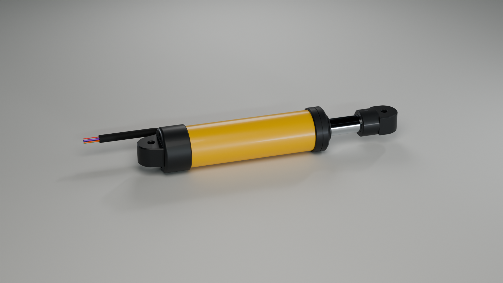
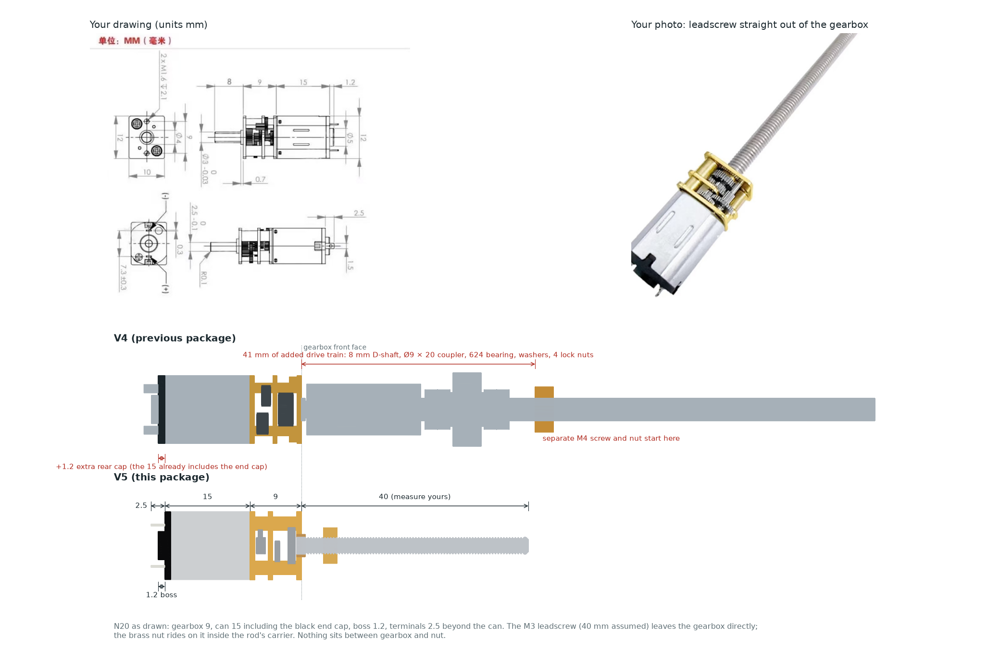
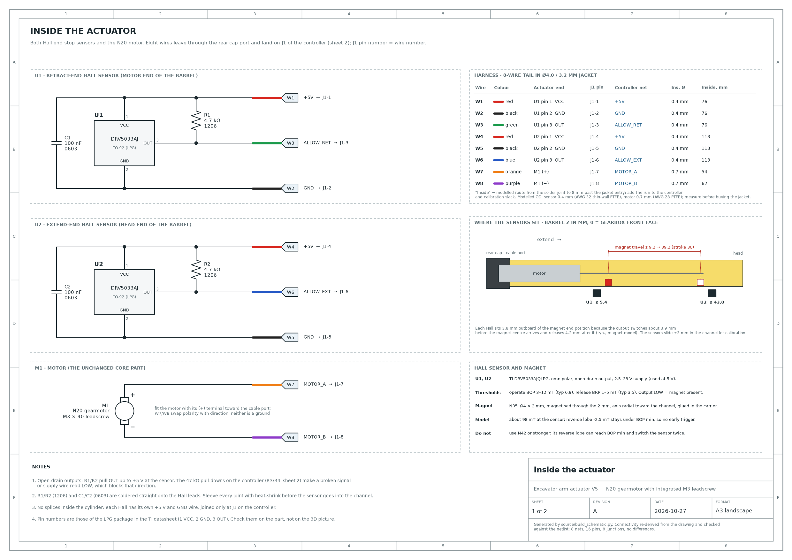
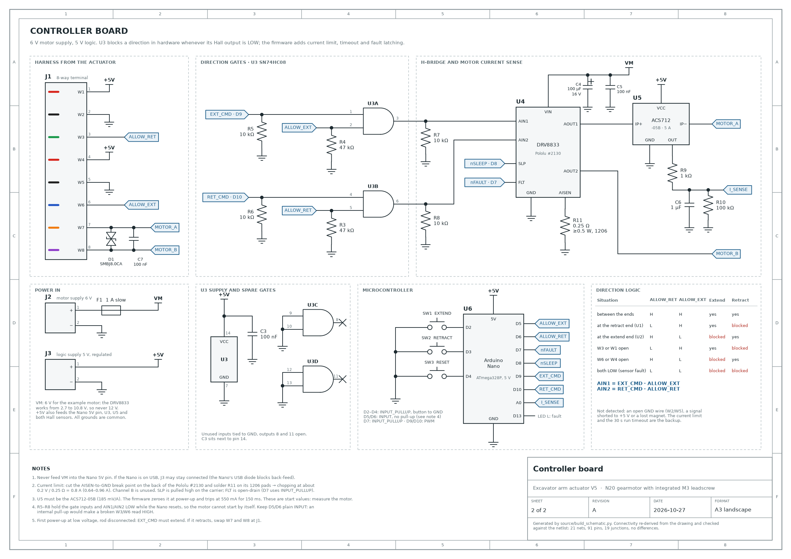

# Excavator arm actuator V5: a leadscrew cylinder that looks hydraulic



V5 is a rebuild of the V4 rod around your **N20 gearmotor with integrated M3 leadscrew**. The motor is used exactly as supplied. It sits in a round Ø21 mm barrel and drives a Ø9 mm chrome-look rod through a brass nut. Two Hall end stops hide in a covered channel along one side of the barrel. Mount that side facing down or away from view.

| | V5 (this package, 40 mm screw) | V4 |
|---|---|---|
| Stroke | 30 mm (50 mm with a 60 mm screw) | 50 mm |
| Pin centres, retracted → extended | 108 → 138 mm (128 → 178 with a 60 mm screw) | 153 → 203 mm |
| Body | Ø21 round barrel, Ø23 end caps | 19 × 24 flat rounded box |
| Clevis | Ø14 eyes, 10.4 thick, Ø3.2 holes (unchanged, so the same pins and brackets fit) | same |
| Drive | M3 leadscrew straight from the gearbox | 8 mm D-shaft → coupler → bearing → separate M4 screw |

**Before you print, measure your leadscrew** from the gearbox front face to its tip, then rebuild with that length (see *Rebuild*). The photo has no scale, so 40 mm is an estimate: about 75–80 thread crests at 0.5 mm pitch.

## What changed: your three points

### 1. "The rod looks too ugly" → hydraulic-cylinder styling

- A round yellow barrel with graphite end caps, a wiper lip and a design groove on the head collar, a Ø9 chrome-look rod and round clevis eyes.
- The cable leaves through a hose-style port with a TPU boot instead of a flat slot.
- The Hall sensors, resistors, capacitors and six sensor wires sit in a dovetail channel along the barrel's −Y side, under a flush cover strip. With that side facing down, nothing technical shows.
- It is 25 mm shorter than V4 for the same 50 mm stroke, because the coupler/bearing drive train is gone (point 2).

Views: `images/hero.png`, `service_side.png`, `stroke_retracted.png`, `stroke_extended.png`, `detail_rod_end.png`, `detail_cap_end.png`. You can also open `3D_preview.html` in a browser.

### 2. "The core part seems to have an extra section" → yes, two of them, both removed



1. **The motor was 1.2 mm too long.** V4 modelled a 15 mm can, *plus* a separate 1.2 mm rear cap, *plus* the 1.2 mm boss. In your drawing the 15 mm already includes the black end cap; only the Ø5 boss adds 1.2 mm. V5 uses the drawing's chain exactly: Ø4 × 0.7 bushing, 9 mm gearbox, 15 mm can including the end cap, 1.2 mm boss, terminals 2.5 mm beyond the can. The terminal blades (1.5 × 0.3 mm, 7.3 mm apart) were also turned 90° in V4. They now match the drawing.
2. **There was a whole extra drive train.** V4 was built for a plain Ø3 × 8 D-shaft. It added 41 mm of parts between the gearbox and the nut: an Ø9 × 20 coupler, a 624 bearing, washers and four lock nuts driving a separate M4 screw. Your photo shows the leadscrew coming straight out of the gearbox. V5 drops all of it: the brass M3 nut in the rod's carrier runs directly on the motor's own screw.

Load path: the gearbox front face seats on a step in the barrel, which takes pulling loads. The rear cap backs the motor can and takes pushing loads through two M2 screws. The rectangular pocket stops the motor from turning. The rod cannot turn because its carrier has a flat-sided section.

The *Core part* tab of `3D_preview.html` shows the motor on its own. `source/n20_screw_motor.py` is the dimensioned model.

### 3. "The wiring has no circuit schematic" → `electronics/schematic.pdf`

A two-sheet A3 schematic with reference designators, values, pin numbers and net names:

- **Sheet 1, inside the actuator:** U1/U2 DRV5033AJ Hall sensors with their 4.7 kΩ pull-ups and 100 nF caps, M1 motor, wires W1–W8 with colours, a harness table, where the sensors sit, and the magnet data.
- **Sheet 2, controller board:** J1 harness terminal, U3 74HC08 direction gates, U4 DRV8833 H-bridge with its current limit, U5 ACS712 current sensor, U6 Arduino Nano, buttons, power input, a direction-logic truth table and notes.

Sheet 1:



Sheet 2:



The schematic is generated, not hand-drawn. `source/build_schematic.py` rebuilds the connectivity from the drawn lines (wire ends, T-junctions, power symbols and net flags) and compares it with one netlist (`electronics/netlist.csv`). It also checks the pin constants in the Arduino sketch against that netlist. In a negative test, the check caught swapped nets, a missing junction dot, a wire that stopped short, a stray wire and a wrong net flag. Wire IDs and colours are the same as in the 3D model, `wiring_routes.json` and `wire_lengths.csv`.

## Files

| Path | What it is |
|---|---|
| `3D_preview.html` | Offline 3D viewer with exterior, section, wiring and core-part views; a stroke slider with live pin distance; extend/retract buttons with the Hall end-stop logic and a jam/overcurrent demo |
| `images/` | Blender renders of the exported CAD, the core-part check and the magnet switching plot |
| `assembly_guide.pdf` | Illustrated assembly, wiring and calibration guide; the schematic sheets are appended |
| `stl/` | 6 PETG parts, 1 of each, already oriented for printing |
| `stl/soft/07_TPU_cable_boot.stl` | Cable boot, TPU 95A |
| `stl/fit_samples/` | Short test slices of the critical fits; print these first |
| `step/` | Single-part STEP files, plus `assembly_retracted.step` with the motor, hardware, Hall modules and all eight wires |
| `BOM.md` | Everything to buy |
| `electronics/` | Schematic (PDF/SVG/PNG), netlist, `wiring.md`, Arduino sketch, protection-logic unit test, gate truth-table check |
| `parameters.json`, `validation.json` | Key dimensions and the full geometric check report |
| `wiring_routes.json`, `wire_lengths.csv` | Wire routes, terminals and modelled lengths |
| `magnet_trigger.json` | Magnet model results used to place the Hall sensors |
| `references/` | Your drawing and photo |
| `source/` | Everything that generates the above |
| `SHA256SUMS.txt` | Checksums of every file in the package |

## Parts and print settings

| STL | Material and setup | Notes |
|---|---|---|
| `01_barrel` | PETG yellow, rear face down, 0.2 mm, 4 walls, 30 % gyroid | Channel and motor pocket print without supports |
| `02_rear_cap` | PETG black, collar opening down, 0.16 mm, 4 walls, 40 % gyroid | Support only under the cable-port boss |
| `03_head_collar` | PETG black, nose down, 0.16 mm, 4 walls | |
| `04_pushrod` | PETG silver, carrier down, 0.16 mm, 100 % infill | Rod and nut carrier in one piece |
| `05_rod_eye` | PETG black, socket opening down, 0.16 mm, 100 % infill | |
| `06_sensor_cover` | PETG black, flat inner face down, 0.12 mm | 76.6 mm strip |
| `07_TPU_cable_boot` | TPU 95A, taper end down | |

Use 0.4 mm nozzle, mm units, 100 % scale. Do not scale parts to fit hardware; change the parameters and rebuild instead. Print the four `fit_samples` first:

- motor step and sensor channel
- nut carrier in the barrel bore
- front lip guide
- cover-strip dovetail

The parts have not been sliced or printed yet.

## Assembly order

1. **Head collar:** glue `03` onto the front of the barrel with its strip slot over the channel (on the −Y side, under the barrel).
2. **Pushrod:** push the M3 brass nut into the side slot of the carrier. Glue the Ø4 × 2 magnet into the hole on the channel side with a little epoxy. Let it cure.
3. **Rod in:** slide the pushrod into the barrel from the rear, rod first, through the head collar.
4. **Rod eye:** press `05` onto the rod end and drive the Ø2 × 13.8 dowel through the neck. Both ends sit flush.
5. **Motor wires:** solder W7 (orange) to the motor's **(+)** terminal and W8 (purple) to **(−)**. Sleeve both.
6. **Motor in:** hold the rod and turn the motor so its leadscrew threads into the nut. Push it in from the rear until the gearbox front face sits on the step. Put the (+) terminal toward the channel/cable port (−Y), where the wire slot is.
7. **Hall modules:** solder R1/C1 and R2/C2 onto the Hall leads and three wires to each sensor (see sheet 1), then heat-shrink every joint. With the cover strip off, the channel is open along its full length. Lay U1 (retract end, W1–W3, z 5.4) and U2 (extend end, W4–W6, z 43.0) in from below, branded face toward the rod and leads pointing to the rear. Tape them in place for now. Run their wires rearward along the channel into the rear cap's wire passage.
8. **Cable:** feed all eight wires through the rear-cap port, the TPU boot and the Ø4/3.2 jacket.
9. **Rear cap:** fit `02` and tighten the two M2 × 10 screws. They cut their own thread in the barrel's Ø1.7 pilot holes, so do not overtighten.
10. **Calibrate** the end stops with the controller connected (next section).
11. **Cover strip:** slide `06` in from the front through the head-collar slot and fix it with a dab of neutral-cure silicone so it can come out again.

## Calibrating the end stops

The magnet model (`source/magnet_trigger.py`, `images/magnet_trigger.png`) predicts that a DRV5033AJ switches LOW about **3.9 mm before** the magnet centre reaches the sensor centre and releases about 4.3 mm after it. The sensors are therefore placed 3.8 mm outboard of the wanted end positions: U1 at z 5.4 mm and U2 at z 43.0 mm, with the magnet travelling from z 9.2 to 39.2. The model ignores the steel screw and nut, so treat it as a starting point:

1. **Direction first.** Remove the cover strip. Power the logic (J3) and the motor at low voltage (about 3 V on J2) so the rod moves slowly. With the rod mid-stroke, tap EXTEND: the rod must move out. If it moves in, swap W7/W8 at J1 before anything else. Otherwise the gates guard the wrong end. The fine-pitch screw is self-locking, so the rod can only be moved by the motor, not by hand.
2. Measure ALLOW_RET (W3) and ALLOW_EXT (W6) against GND. Expect about 4.5 V away from the ends and near 0 V when the magnet is at that sensor.
3. Jog toward the retract end. U1 should cut the motor shortly before the mechanical stop, which leaves 2 mm of overtravel. If the stop comes too early or too late, slide U1 along the channel (±3 mm) and repeat. Do the same for U2 at the extend end, which has 3 mm of overtravel.
4. At each end, check that the blocked direction stays blocked after a power cycle and that the other button still drives the rod out of the end.
5. Unplug W3, then W6, at J1: the matching direction must be blocked.
6. Fix the sensors with a dab of neutral-cure silicone, dress the wires, then slide in the cover strip.

Use **N35** for the magnet. With N42 the field's small reverse lobe can reach the sensor's minimum switch-on threshold (BOP), and the sensor may then switch twice.

## Rebuild

```sh
pip install -r source/requirements.txt          # CadQuery 2.8, trimesh, schemdraw, matplotlib, reportlab, ...
python source/build_v5.py --screw-length 40      # STEP/STL, meshes, validation (about 3 minutes)
python source/magnet_trigger.py                  # magnet model and Hall placement plot
python source/build_schematic.py                 # schematic, netlist and connectivity/firmware checks
python source/build_viewer.py                    # 3D_preview.html
python source/core_part_check.py                 # images/core_part_check.png
blender -b -P source/render_v5.py -- --out images   # renders (Blender 4.2, Cycles)
python source/build_guide.py                     # assembly_guide.pdf
```

Everything along the axis follows the screw length: stroke, barrel, rod, sensor positions, cover strip and harness routes.

| Leadscrew from the gearbox face | 30 | 35 | 40 | 45 | 50 | 55 | 60 | 70 | 80 mm |
|---|---|---|---|---|---|---|---|---|---|
| Stroke | 20 | 25 | 30 | 35 | 40 | 45 | 50 | 60 | 70 mm |
| Pin centres, retracted | 98 | 103 | 108 | 113 | 118 | 123 | 128 | 138 | 148 mm |
| Barrel length | 66 | 71 | 76 | 81 | 86 | 91 | 96 | 106 | 116 mm |

A build for screw length *L* accepts screws up to *L* + 16.5 mm before the tip touches the end of the rod bore. A longer screw needs a rebuild with its own length. If your screw is not M3 × 0.5, the nut slot and carrier must change as well.

## What was checked

`validation.json`, current build:

- **Fixed parts:** no interference between any pair of printed parts, hardware, Hall modules and the jacket.
- **Motion:** no interference of the rod, nut, magnet and dowel against any static part at −2, 0, 5, …, 30 and 33 mm. The only allowed contact is the screw in its own nut.
- **Wires:** all eight wires clear every part and each other, and each starts exactly on its terminal (gap 0.000 mm).
- **Calibration room:** with each sensor moved ±3 mm, the re-routed wires still clear everything.
- **Meshes:** every STL is watertight and a single solid after a STEP round trip.
- **Electronics:**
  - The schematic connectivity matches the netlist: 29 nets, 107 pins.
  - The firmware pin constants match the netlist.
  - `check_direction_gates.py`: all 16 gate states pass.
  - `protection_logic_test.cpp` compiled with asserts on and passed (inrush, overload, spikes, latching, reset, reversal, timeout, faults, timer wrap).
  - The Arduino sketch compiles against an Arduino API stub.
- **3D preview:** extend stops at 29.96 mm (U2), retract at 0.04 mm (U1), a jam latches the fault.

## Not verified

- Your real screw length and thread, motor voltage, speed and stall current. Rebuild once you have measured them. The electronics assume a 6 V motor and 5 V logic.
- Printing, fit and strength: nothing has been printed. The fit samples exist for this.
- Axial load capacity of the N20 gearbox, and PETG creep under constant load.
- Magnetic switching on real parts: the model ignores the steel screw and nut. Calibrate as above.
- The firmware has not been flashed to a board. Current-limit values (0.8 A hardware, 550 mA / 150 ms firmware) are commissioning start points.
- The protection does not detect an open GND wire (W2/W5), a signal shorted to +5 V or a lost magnet. The current limit and the 30 s run timeout are the backup.

Three.js and OrbitControls are MIT licensed (`source/vendor/THREE_LICENSE.txt`).
