# V6 assembly guide

The same steps apply to V6-S, V6-U60 and V6-L; only the body, the rod, the motor's leadscrew length and the board length differ. Parts and wire lengths are in `BOM.md`. The pictures are renders of the exported CAD. `3D_preview.html` shows every step's parts in 3D, and its **Assembly ▶** view plays the steps below as an animation. `images/assembly_V6-S.mp4` is a recording of it.

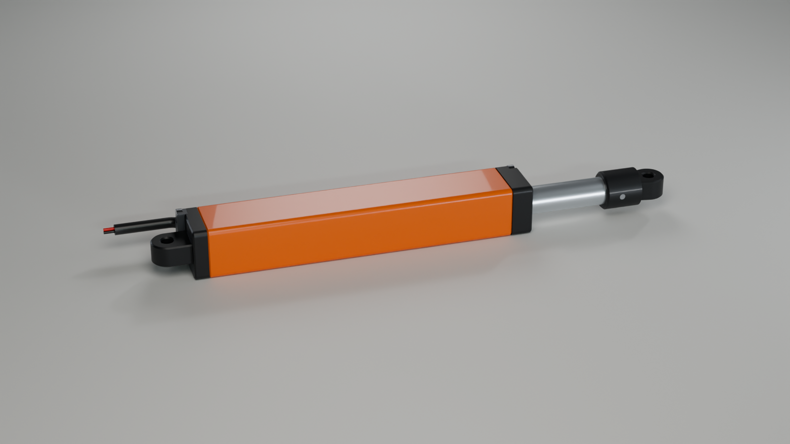

## What you need

- **Tools:**
  - a fine-tip soldering iron;
  - a **PH0 screwdriver with a long, thin blade**: 3 mm thick or less, and at least 70 mm long for V6-S, 90 mm for V6-U60, 115 mm for V6-L. It reaches the motor screws through the bore. A Wera 350 PH 0 × 100 mm (item 05008706001) suits V6-S and V6-U60; for V6-L, see Known limits in `README.md`.
  - a PH1 screwdriver for the M2 screws;
  - small pliers.
- **Power for testing:** a 6 V supply with a reversing switch (DPDT) or any H-bridge motor driver. A current limit of about 0.5 A is useful for the first test.

## 1. Print and check the fit samples

Print `stl/fit_samples/08_fit_body_wall.stl` and `09_fit_carrier.stl` first. Check these fits before printing the real parts:

- **Motor bay:** the N20 gearbox slides into the bay without force, and its front face sits flat on the wall.
- **Motor screws:** the M1.6 countersunk screws sit flush with the bore-side face of the wall.
- **Carrier:** sample 09 slides through the bore of sample 08 without binding, and only one way round: turned 180°, the key rib in one corner of the bore stops it.
- **Nut:** the brass nut drops into the hex slot.
- **Magnet:** it presses into its pocket.
- **Board slot:** the bare board, or a 0.8 mm card, slides into the slot behind the partition.

If anything binds, adjust your slicer's hole or horizontal-expansion compensation first. The carrier has only 0.15 mm of clearance per side in the bore.

## 2. Print the parts

Print the six parts from `stl/V6-S/`, `stl/V6-U60/` or `stl/V6-L/`; the files are already oriented, the body standing on its flat rear end. The print settings are in `BOM.md`. In the slicer's preview, check that the 1 mm partition between the bore and the board slot prints as a solid wall over its whole length.

## 3. Board and wires

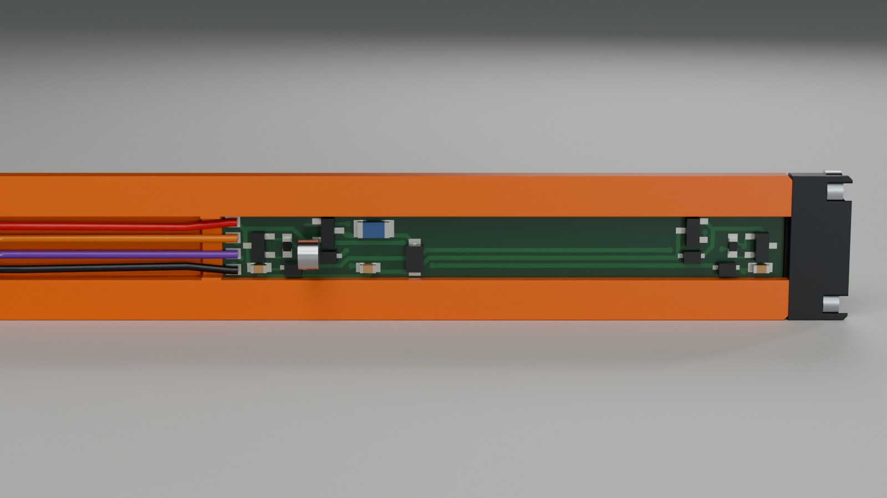

U1 is the Hall switch at the wire end of the board, the retract end. U2 is at the front end. Cut the four PTFE wires:
- **W3 and W4:** 44 mm each.
- **W1 and W2:** 52 mm, plus the lead you need to your driver. Mark each one 31 mm from the end you solder to the board: the knot goes there in step 6.

Solder the wires to the pads at the board's rear edge. In order across the board, the pads are:

| Pad | Wire | Net |
|---|---|---|
| J_A | W1 red | A: positive extends |
| J_M+ | W3 orange | motor + |
| J_M− | W4 purple | motor − |
| J_B | W2 black | B: positive retracts |

The silkscreen marks A and B next to the outer pads. The wires leave the board toward its rear edge, lying flat.

## 4. Board into the body

Thread the four wires into the board slot from the front end of the body. Push them down the slot, through the passage in the motor wall, and out at the rear of the motor bay. Then slide the board in after them, wire end first, with the **parts facing the partition**. Stop when it rests on the motor wall. The parts clear the partition by 0.3 mm, so keep the board flat against the outer side of the slot while you slide it.

## 5. Motor

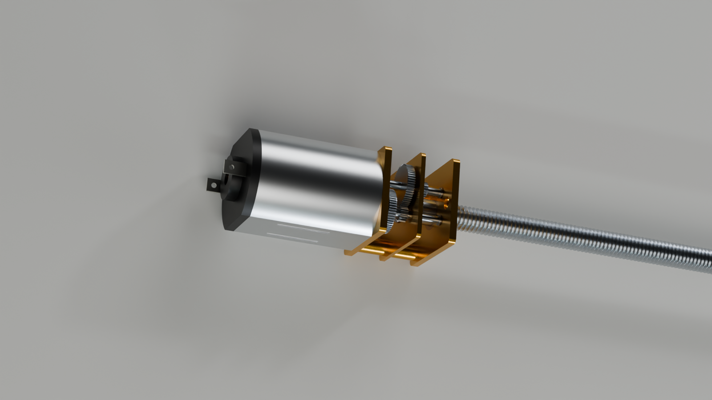

1. Insert the N20 into the motor bay from the rear, gearbox first, with the leadscrew passing through the hole in the wall. The motor fits two ways round, 180° apart, and either way works mechanically.
2. Through the bore from the front, drive the two **M1.6 × 4 countersunk screws** through the wall into the gearbox's tapped holes.
   - **Do it now:** the bore is still empty; the rod and the front cap go in later.
   - **Carrying the screw:** hold it on the tip of the long PH0 driver with a small dab of putty, or a magnetised tip if the screws are steel.
   - **Driving:** slide the blade down the bore beside the leadscrew. A 3 mm blade has 0.15 mm to the bore wall and 1.5 mm to the leadscrew, so the wall guides it.
   - **Tightening:** tighten gently until the heads sit flush with the wall.

   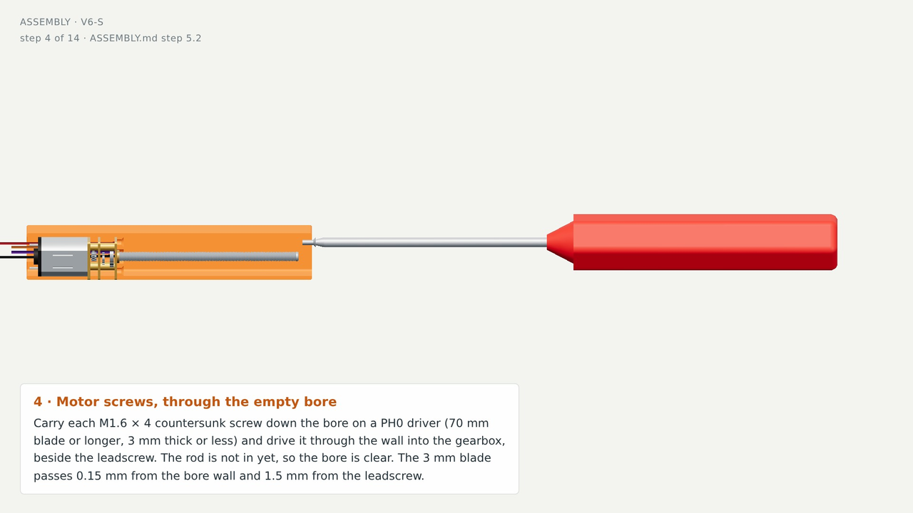

   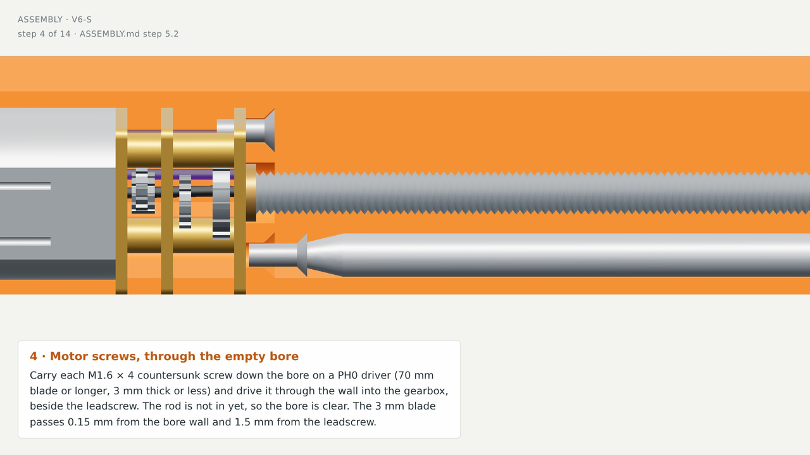
3. Lead W3 (orange) and W4 (purple) around the back of the can. Solder W3 to the motor terminal marked + (often a red dot) and W4 to the other terminal. If the motor has no mark, solder either way round; step 7 tells you whether to swap them.

## 6. Rear cap and cable clamp

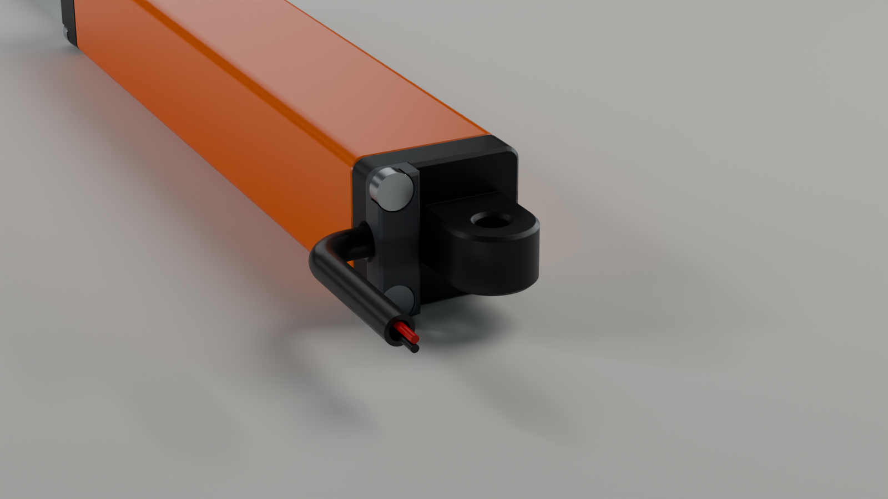

1. Tie an **overhand knot** in W1 and in W2 at the mark, 31 mm from the board. Pull each knot tight.
2. Pass both wires through the slot in the rear cap, from its flat front face, so that the knots stay on the body side. The knots cannot pass the slot.
3. Slide the **3 mm sleeve** over both wires from their free ends. Push it into the groove in the cap's pocket until it reaches the slot.
4. Lay `06_cable_clamp` in the pocket over the sleeve, ridges toward the sleeve. Hold the cap on the body's flat rear face, with the sleeve pointing out on the board side.
5. Fit **2 × M2 × 10** through the clamp and the cap into the body. Tighten until the clamp sits flat in its pocket. The sleeve is then squeezed by 0.4 mm.
6. Pull the sleeve firmly. It must not move, and the wires must not slide out.

## 7. Rod, nut and magnet

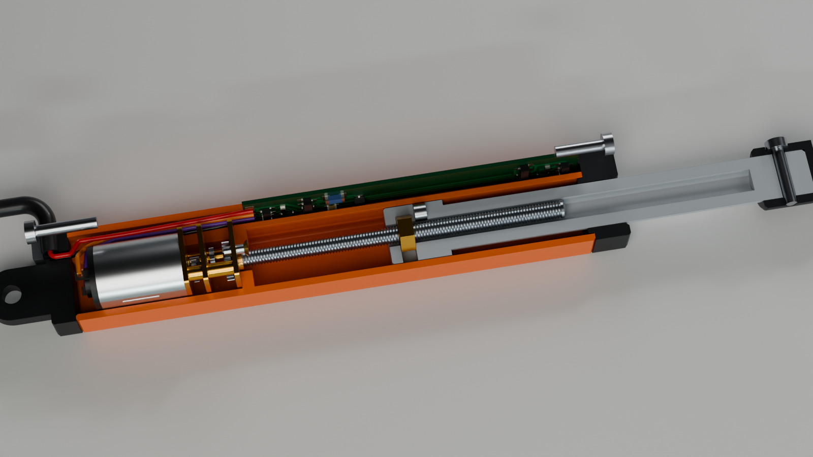

1. Press the **Ø3 × 2 magnet** into the pocket in the side of the carrier until it is flush. Either pole may face forward.
2. Slide the **brass M3 nut** into the hex slot.
3. Insert the rod into the bore, carrier first, with the **magnet facing the board side**. The key rib in one corner of the bore admits the carrier only that way round; if it stops at the mouth, turn it 180°.
4. Push the rod in until the nut touches the end of the leadscrew. Apply **B positive** (retract) for a moment while pressing the rod lightly.
   - **Correct:** the nut picks up the thread, and the carrier pulls itself in until U1 stops it at the retract end.
   - **Wrong:** the screw turns but pushes the nut away instead of catching it. Then the motor is reversed: swap W3 and W4 at the motor terminals, and try again.

## 8. Front cap and rod eye

1. Slide the front cap over the rod. Its tongue enters the board slot and holds the board's front edge, and its spigot enters the bore.
2. Fix the cap with **2 × M2 × 8**.
3. Push the rod eye onto the rod, line up the cross holes, and fit the **M2 × 10** from the clearance side. It threads into the pilot on the far side.

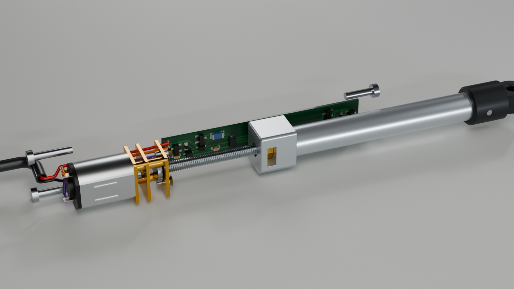

## 9. First power-up

1. Start at the retract end, where step 7 left the rod. Apply **A positive** (red +, black −) for a few seconds.
   - **Correct:** the rod moves out.
   - **Wrong:** the rod moves in instead. It stalls against the motor wall within 3 mm, and the fuse trips after about 1.6 s. Then the motor is reversed: swap W3 and W4 at the motor terminals.
2. Run to each end. The rod must stop by itself, and the supply current must drop from about 0.1 A to about 2 mA. Reverse the polarity, and the rod must leave the end.
3. Measure the pin centres at both ends:

   | Length | Closed | Open |
   |---|---|---|
   | V6-S | 120 mm | 160 mm |
   | V6-U60 | 140 mm | 200 mm |
   | V6-L | 165 mm | 250 mm |

   The magnet model allows −2.15 to +1.65 mm per end. Steel near the actuator, such as brackets or screws, shifts the switching points, so check the ends again once it is installed.

4. For the 60 mm excavator arm, write each V6-U60's measured ends on it. Use the two units with the closest ends as the boom pair, which must stay equal in length.

| Retracted | Extended |
|---|---|
| 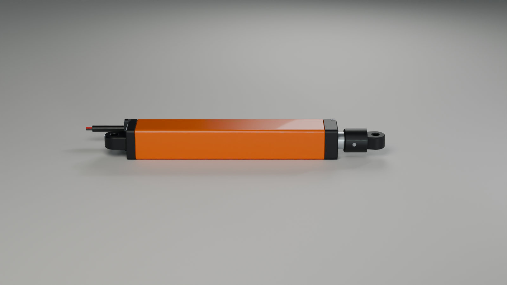 | 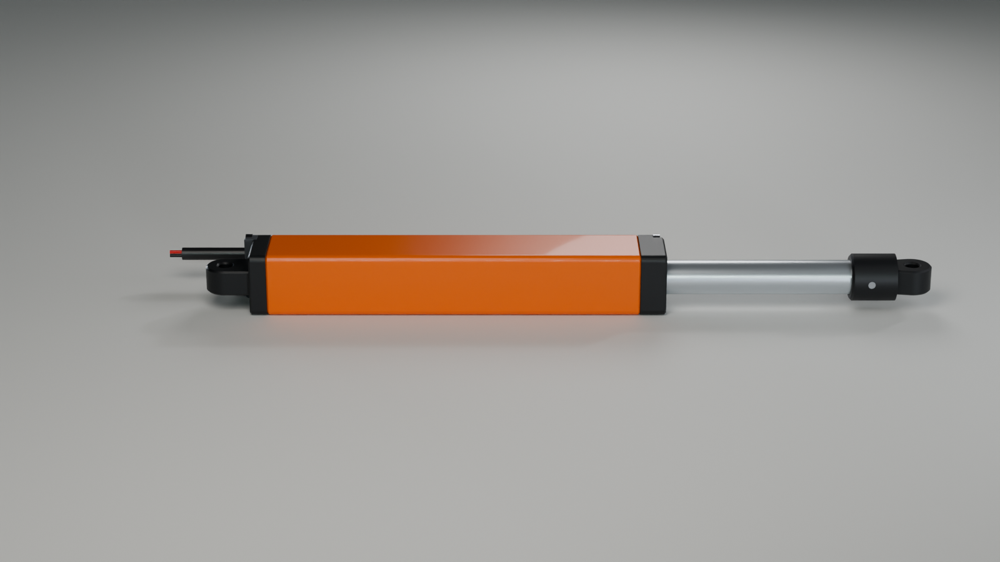 |
| 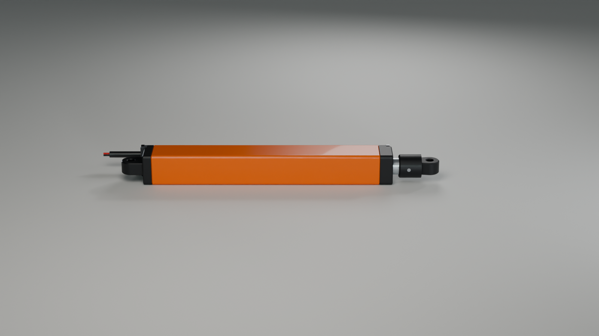 | 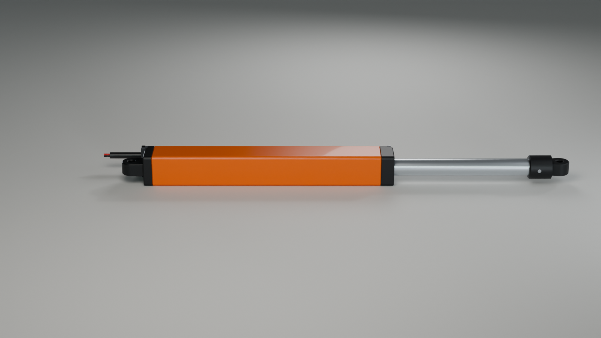 |

## In use

- **Drive:** any H-bridge or reversing switch at 6 V nominal and **7 V maximum**. PWM up to 20 kHz was simulated, with braking or coasting.
- **Fuse trips:** if the rod jams, the 0.12 A resettable fuse trips after about 1.6 s. Remove the power for a few seconds to reset it.
- **Holding position:** the leadscrew is self-locking, so the rod holds its position with the power off.
- **Rod loads:** avoid side loads on the rod, especially on V6-L at full extension.
