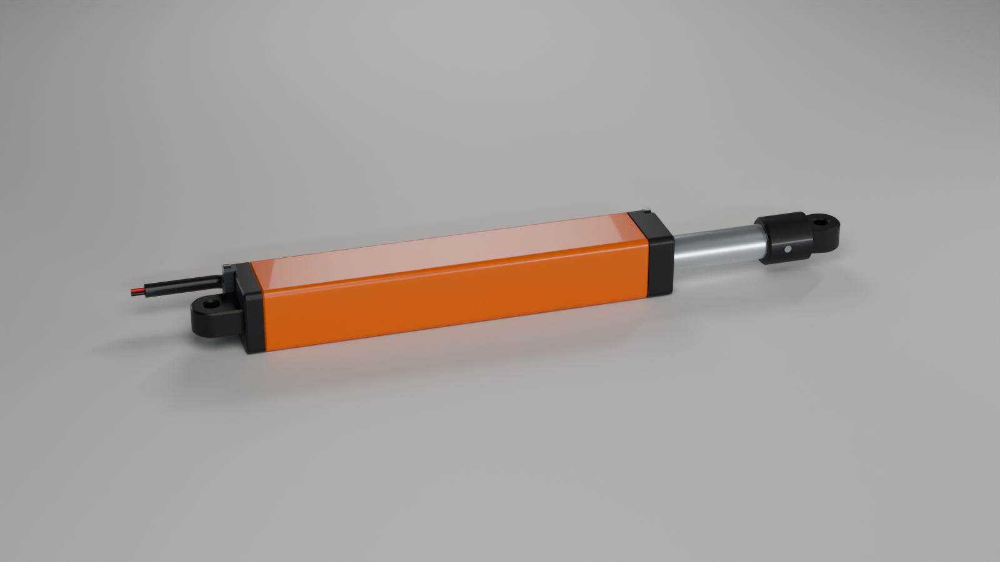
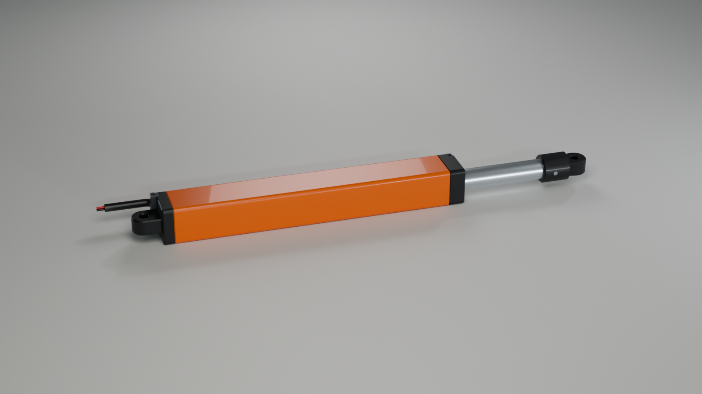
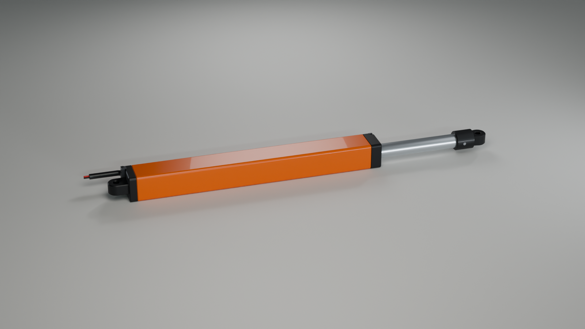
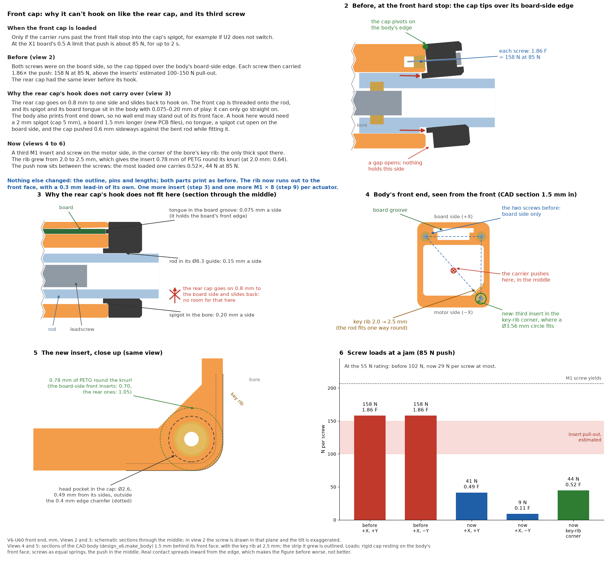
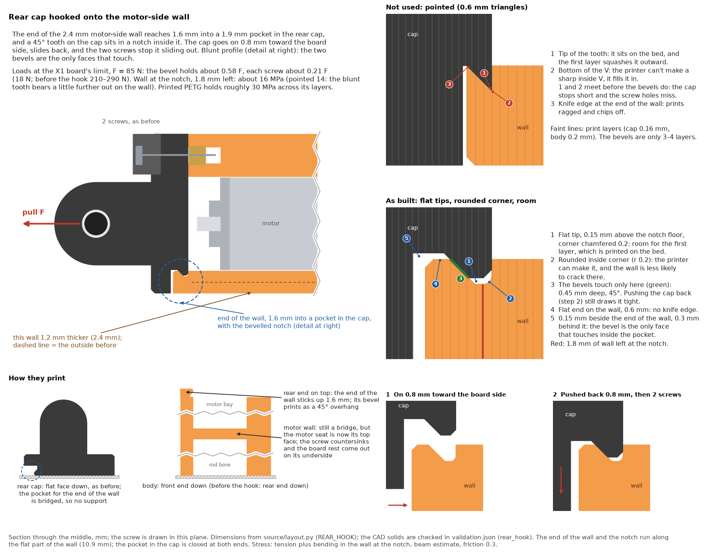
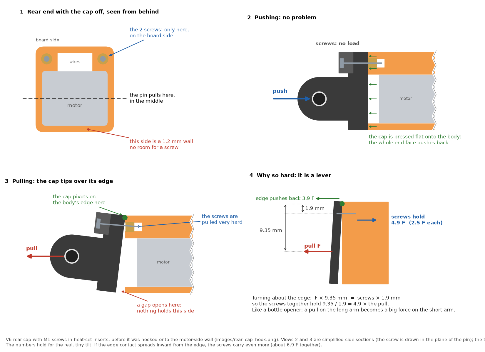
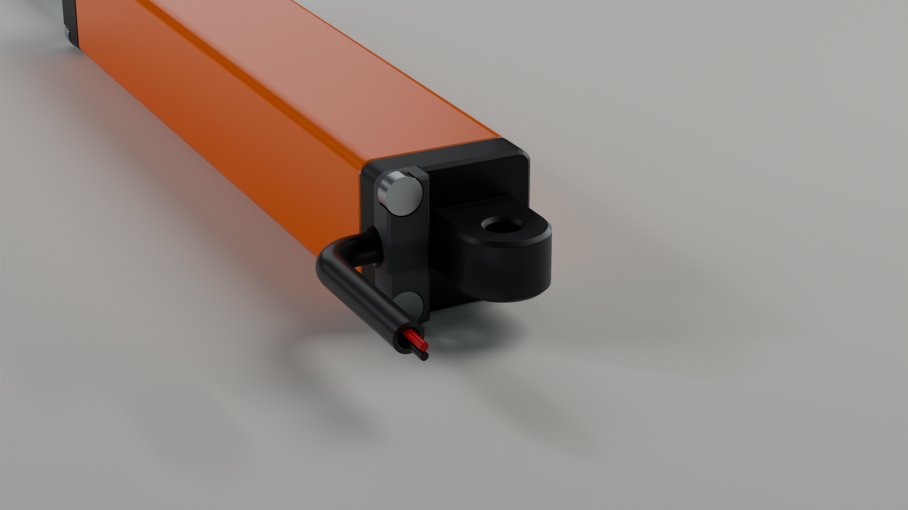
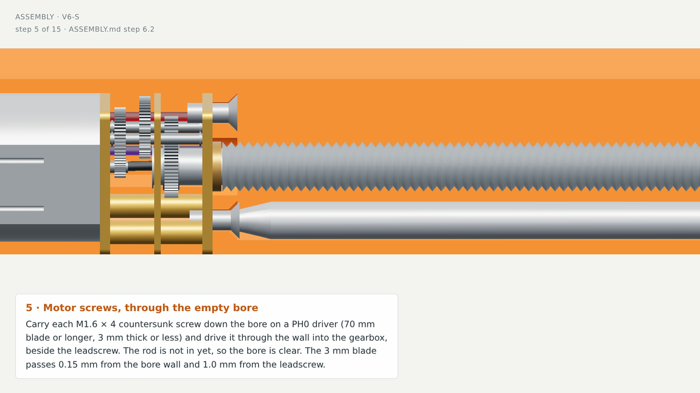
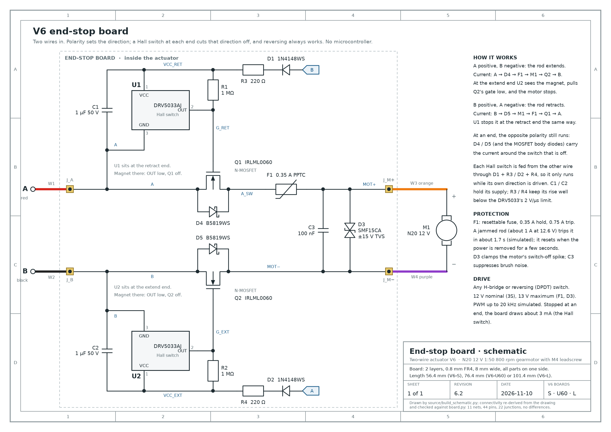
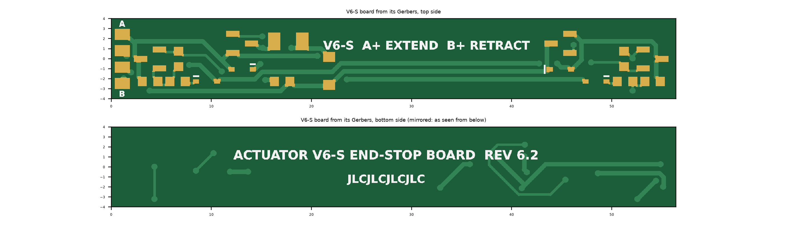

# V6 two-wire leadscrew actuator

A general-purpose linear actuator built around the N20 gearmotor with its own leadscrew: since rev 6.2 the 12 V, 1:50, 800 rpm motor with an M4 × 0.7 screw.

The [motor gear update](MOTOR_UPDATE.md) replaces the internal motor model in all three lengths with the supplied meshed gearbox. Open **Motor gears** in the [offline preview](3D_preview.html) to inspect the three stages and their motion.

- **Control:** two wires. The polarity sets the direction, a Hall switch at each end stops the rod by itself, and reversing always drives it back out.
- **Construction:** every custom part is printed in PETG and held together with standard screws.
- **Electronics:** the end-stop circuit sits on a small board inside the body. It has 17 parts and no microcontroller.

Three lengths share every part except the body, the rod, the board and the length of the motor's leadscrew (cut from the motor's 100 mm screw):

| Version | Leadscrew | Stroke |
|---|---|---|
| **V6-S** | 55 mm | 40 mm |
| **V6-U60** | 75 mm | 60 mm |
| **V6-L** | 100 mm | 85 mm |

V6-U60 is also the common actuator of the 60 mm excavator arm in `../excavator_arm_60mm/`, which uses four of them. The arm's `source/build_actuators.py` builds V6-U60 here and checks it against the arm's kinematics.

This folder holds the **partition revision**. It adds a continuous **1.00 mm printed PETG wall between the moving carrier and the PCB components**.
- **Construction:** the partition is part of `01_body`, not a separate insert. It runs from the motor mounting wall to the front of the body and covers the whole circuit compartment.
- **Sensing:** the Hall switches see the magnet through the plastic; there are no openings in the wall.
- **Provenance:** this revision was generated in checkout `14c0f3ad` on 28 October 2026 and replaced the earlier V6 files in this folder.

| V6-S | V6-U60 | V6-L |
|---|---|---|
|  |  |  |

## Rod-eye screw threads into the rod, 15 November 2026

- **Why:** the M2 × 10 cross screw used to cut its thread in the rod eye's far wall. That wall is only 1.45 mm thick (Ø11 eye on a Ø8.1 socket), so the screw held by 1.35 mm of thread, about 3½ turns in printed PETG, and stripped easily when tightened.
- **Now:** the Ø1.7 mm hole goes straight through the solid Ø8 rod, and the screw cuts about 7.9 mm of thread there (about 20 turns). Both eye walls have Ø2.2 mm clearance holes and bear on the screw like a pin; the head still sits in the Ø4 counterbore, and the tip stops 0.1 mm short of the eye's outside. Same screw, outline and assembly step.
- **Loads, unchanged:** the screw carries only pull (retracting under load); a push goes from the rod's end face onto the socket bottom. The thread only has to keep the screw in.
- **Why no heat-set insert:** an M2 insert does not fit the eye's 1.45 mm wall (an M2 × 3 × 3.2 would stick 1.55 mm into the socket). One fits in the rod, but the melt it pushes up at the hole mouth would have to be trimmed flush, because the rod is a 0.05 mm sliding fit in the socket. The cut thread is ample for this screw.
- **Checked in CAD** (`validation.json`, all three lengths): the screw's only overlap is its thread in `04_rod` (an intended overlap); it is clear of `05_rod_eye`.
- **Changed prints:** `04_rod` (13 mm³ more PETG) and `05_rod_eye` (2 mm³ less), both on plate 3. Print them together: a rod printed before this change has a Ø2.2 hole, which leaves the screw nothing to grip in a new eye.
- **Step 8.4 clarified:** keep B positive (W2 black to +) on until the rod stops by itself, 5–10 s depending on the length. The front Hall switch may see the magnet at the start, but it only stops extending.
- **Pictures:** the 3D preview and its **Assembly ▶** animation carry the new captions. The assembly video `images/assembly_V6-S.mp4` was not re-recorded: its step 14 caption still says that the screw threads into the far wall.

## Front cap held on the motor side too, 14 November 2026

The front cap's two screws sat on the board side only, like the rear cap's before its hook. The front cap takes load only if the carrier runs past the front Hall stop into its spigot, for example if U2 does not switch. At the X1 board's 0.5 A limit that push is about 85 N. It tipped the cap about the body's board-side edge, and each screw carried about 1.9× the push: 158 N, above the inserts' estimated 100–150 N pull-out. Now **a third M1 screw holds the motor side**.



- **Why not a hook like the rear cap's:** the front cap is threaded onto the rod, and its spigot and board tongue sit in the body with 0.075–0.20 mm of play, so it can only go straight on. The body also prints front end down, so nothing may stand out of its front face.
- **Where:** the key rib in the bore's motor-side corner makes that corner the only thick spot on the motor side. The rib grew from 2.0 to 2.5 mm, and the third insert sits at (−5.76, −5.56) with **0.78 mm of PETG round its knurl** (1.78× the knurl; the two board-side front inserts have 0.70 mm). The rod still goes in one way round only.
- **The rib now reaches the front face:** the bore's 0.3 mm lead-in used to cut the rib off in its last 0.3 mm, which would have opened the new hole into the bore at the face. The lead-in now follows the rib's face with a 0.3 mm 45° chamfer of its own, and leaves 0.56 mm of wall round the hole at the face. `cap_inserts` now measures that wall at every insert hole; the board-side front ones have 0.47 mm there.
- **Loads at a jam:** the push now sits inside the screws' triangle. The most loaded screw carries 0.52× the push: 44 N at 85 N, and 29 N at the 55 N rating (158 N and 102 N before). These are estimates, with a rigid cap on the body's face and the screws as equal springs.
- **Checked in CAD** (`validation.json`, all three lengths; every check passes):
  - `cap_inserts`: 0.78 mm of PETG round the new knurl and 0.56 mm of wall round its hole at the face; the screw runs through its whole insert and stops 0.5 mm short of the hole bottom, like the others;
  - tool access: the soldering iron reaches the new insert, and the PH000 driver the new screw, without touching anything fitted before; the driver passes 0.71 mm from the cap and 2.76 mm from the rod;
  - a rod turned 180° overlaps the bigger rib by 23 mm³ (13 mm³ before), so it still goes in one way round only;
  - the assembly has no overlaps at any sampled travel position.
- **Parts:** five inserts and five M1 × 8 per actuator, one more of each (`ASSEMBLY.md` steps 3 and 9).
- **Changed prints:** `01_body` (the rib and the third hole, 0.1 g heavier), `02_front_cap` (the third screw hole and head pocket), `04_rod` (its carrier's corner keeps its 0.2 mm from the bigger rib), and fit samples 08, 09 and 11. Sample 11 now has the third hole and the rib: after pressing the inserts in, slide sample 09 through it. The outline, pins, strokes and lengths are unchanged, so the arms fit as before.
- **Not compatible:** rods and front caps printed before this change jam on the bigger rib of a new body.
- **Pictures:** the 3D preview and its **Assembly ▶** animation show the third insert and screw. The assembly video `images/assembly_V6-S.mp4` was not re-recorded (about 2 h of software rendering): it shows two front inserts and two front screws.

## Parts showcase and print plates for four V6-U60, 14 November 2026

For the R12 arm's four drives:
- **`parts_showcase.html`:** every part to print and to buy, and the tools, in 3D. A printed part is shown on the print bed or as fitted, can be cut open, and has its dimensions drawn on the model, with its settings and its plate. The bought parts come from the CAD. "In the actuator" and "Cut open" show where each part sits. The page works offline.
- **`print_plates/`:** the printed parts of four V6-U60 on four plates for a 180 × 180 mm bed, as PrusaSlicer 3MF files that carry each part's settings, and as STL. Plate 1 is the fit test. `print_plates/PRINT_PLATES.md` lists the plates, their settings and PrusaSlicer 2.9.2's estimate: 105 g of PETG and about 20 hours in all.
- **Checks:** every dimension drawn in the showcase was checked against the part's mesh when the page was built (`parts_showcase_report.json`). A headless-browser run checked the page against `BOM.md`, `ASSEMBLY.md`, the plate files and the STL files (`parts_showcase_browser.json`). The plates hold exactly the released STL files, moved but not turned, at least 6 mm apart and 10 mm inside the bed (`print_plates/V6-U60_x4/plates.json`).

## Rear cap hooked on the motor side, 11 November 2026

The rear cap's two screws sit on the board side only, so a pull used to tip the cap about the body's edge, and each screw carried 2.5–3.4× the pull (see the next section). Now **the end of the motor-side wall hooks the cap**. The structure is the user's own design.



- **Shape:**
  - The motor-side (−X) wall is now 2.4 mm thick instead of 1.2 mm.
  - Its end reaches 1.6 mm beyond the rear face into a 1.9 mm pocket in the rear cap, along the flat part of the wall (10.9 mm).
  - A 45° tooth on the cap sits in a 0.6 mm notch cut into the inside of the wall end. Nothing stands in the motor bay, so the motor still goes in from the rear.
- **Printable profile:** there are no knife edges and no sharp inside V.
  - The tooth has a flat tip with 0.15 mm of room under it, and a 0.2 mm chamfer where it meets the print bed.
  - The notch has an r 0.2 inside corner, and the wall end has a 0.6 mm flat.
  - There is 0.15 mm beside the wall end and 0.3 mm behind it, because the pocket's roof prints as a bridge and may sag.
  - The bevels touch only on their middle 0.45 mm. The first, pointed version (0.6 mm triangles) was dropped as too sharp to print true.
- **Fitting:** set the cap on 0.8 mm toward the board side, so the wall end goes into the pocket, then slide it back. The tooth drops into the notch and the screw holes line up. The two screws then stop the cap sliding out (`ASSEMBLY.md` step 7).
- **Loads at the X1 board's 0.5 A limit (a pull of about 85 N):**
  - the hook takes about 0.58 of the pull;
  - each screw takes about 0.21, about 18 N, against 210–290 N before;
  - the wall has 1.8 mm left at the notch, where a beam estimate gives about 16 MPa. Printed PETG holds roughly 30 MPa across its layers.
  
  These are estimates; the hook has not been pull-tested.
- **Printing:**
  - The wall end stands out of the rear face, so **the body now prints front end down** (before, rear end down). The motor wall is still a bridge, but the motor seat is now its top face; the M1.6 countersinks and the board rest are on its underside.
  - 0.3 mm lead-ins at the bore and board-slot mouths take the first layer's squash on the bed.
  - The rear cap still prints flat face down without support.
- **Checked in CAD** (`validation.json`, `rear_hook`, all three lengths):
  - the tooth catches the wall when the cap is pulled 0.05 mm, and wedges if it is pushed toward the motor side;
  - the four clearances are as drawn;
  - the cap goes on along its fitting path without touching anything already fitted;
  - the motor's way in from the rear is clear.
- **Outside:** the body section is 17.30 × 14.70 mm (16.10 × 14.70 before); the end caps follow it. The pins, strokes and lengths are unchanged. In the R12 arm the 3D clash check still passes with no contact, and its closest gaps (1.10 and 1.32 mm) are unchanged. In the side view, the stick drive's body now clears the boom nose by 1.88 mm (3.05 mm before; 1.0 mm required).
- **Fit sample:** `10_fit_insert_rear` now includes the wall end with its notch, so you can try the rear cap on it.
- **Not compatible:** bodies and caps printed before this change do not fit the new ones.
- **Pictures:** the 3D preview shows the hook, and its **Assembly ▶** animation fits the rear cap in the two moves of step 7.4. The assembly video `images/assembly_V6-S.mp4` and the two `assembly_motor_screws` pictures taken from it were recorded before the hook: they show the thinner motor-side wall, and the video puts the rear cap straight on. They were not re-recorded (about 2 h of software rendering). The Blender renders in `images/` do not show the hook either.

## End caps on M1 heat-set inserts, 11 November 2026

Each end cap is now held by **two M1 × 8 screws in brass heat-set inserts**. Before, M2 screws cut their own thread in the body's corners, but an M2 thread there left only 0.6 mm of PETG to the side face: too thin to tap or self-tap without splitting the layers.

- **Inserts:** M1 × 0.25, 1.8 mm long and 2.0 mm across the knurl (sold as M1 × 1.8 × 2), four per actuator. A soldering iron presses them into Ø1.7 mm holes in the body's end faces before anything else goes in (`ASSEMBLY.md` step 3).
- **Holes moved to the thickest part of each corner**, measured on the body section:
  - **rear end, (7.45, ±5.30):** 1.05 mm of PETG round the knurl. Behind the motor wall there is no board groove, so the corner is 4.1 mm tall;
  - **front end, (6.85, ±5.65):** 0.70 mm. The board groove runs out to the front face and limits the corner there;
  - insert makers ask for a boss of at least 1.5×, ideally 2×, the knurl diameter: 2.05× at the rear, 1.70× at the front.
- **Screws:** M1 × 8 pan head, A2-70 stainless, PH000. Each runs through its whole insert and 1.1 mm beyond it. The heads sit in Ø2.6 mm pockets inside the outline; the old M2 heads stood 0.3 mm proud of the side faces.
- **Loads (corrected on 11 November):** only the two rear screws carry the actuator's pull, and they carry it off-centre.
  - **Why:** the rear pin pulls on the centre line, 7.45 mm from the screws. The cap's other (−X) side is not fastened, so a pull tips the cap about its +X edge, 1.9 mm beyond the screws, like a lever.
  - **Screw load:** each rear screw carries at least 2.5× the pull, and about 3.4× if the contact spreads over that edge:
    - 45–63 N at the R12 stick's largest pull (18 N);
    - 135–190 N at the 55 N rating;
    - 210–290 N at the X1 board's 0.5 A limit (about 85 N).
  - **Limits:** an A2-70 M1 screw yields at about 207 N. The inserts' pull-out from PETG is not tested; about 100–150 N each is estimated. At the screw line the cap bends at about 0.5 MPa per newton of pull, 29 MPa at 55 N.
  - **What it meant:** the joint suited the R12 arm's pulls but not the full 55 N rating in pull. The earlier M2 design had the same lever, at 3.5× or more. The hook added the same day takes most of the pull now (see above).
  - **Other cases:** a push presses the cap onto the end face and does not load the screws. The front cap only takes load if the rod runs past the Hall stop into it.


- **Fit samples:** `10_fit_insert_rear` and `11_fit_insert_front`, the last 5 mm of each end, try the hole size and the insert before you print a body.
- **Pictures:** the 3D preview, the assembly video (now 2 min, with the soldering iron) and the `assembly_motor_screws` pictures show the inserts and the new step numbers. The Blender renders in `images/` still show the old M2 cap screws.
- **Unchanged:** the outside, the pins and the strokes, so the arms fit as before; the rod-eye cross screw is still an M2 × 10.
- **Not compatible:** bodies printed before this change have M2 pilot holes in the old places and do not fit the new caps.

## 12 V motor and M4 leadscrew, 10 November 2026 (rev 6.2)

The motor is now the **12 V N20 gearmotor, 1:50, 800 rpm without load, with an M4 × 0.7 leadscrew**. Its screw comes 100 mm long: cut it to 55 mm for V6-S and 75 mm for V6-U60; V6-L uses it uncut. The outside of the actuator, its pins and its strokes are unchanged, so the arms that use it fit as before.

- **Mechanics:**
  - the rod bore and the motor-wall hole are Ø4.8 for the M4 screw;
  - the carrier takes an M4 thin brass nut (ISO 4035, 7 mm across flats × 2.2 mm);
  - the magnet is an N35 block 3 × 2 × 2 mm, because the Ø3 × 2 cylinder has no room beside an M4 screw;
  - each Hall switch sits 5.10 mm beyond the magnet's end position.
- **Board (rev 6.2), re-rated for 12 V:**
  - Q1 and Q2 are IRLML0060 (60 V, ±16 V gate);
  - D3 is an SMF15CA (15 V stand-off);
  - F1 is an MF-NSMF035X-2 (0.35 A hold, 16 V);
  - new R3 and R4 (220 Ω) in series with D1 and D2 keep the Hall supply's rise far below the DRV5033's 2 V/µs limit.

  It has 17 parts and 10 part numbers, and the boards are 0.2 mm shorter.
- **Simulated at 12.6 V, all nine cases pass:**
  - 6.9 mm/s lifting 49 N;
  - a jam (about 1 A) trips F1 in 1.7 s;
  - the Hall supply rises at most 0.04 V/µs;
  - the rod overshoots an end stop by at most 0.04 mm;
  - the MOSFETs and Schottky diodes see at most 31.5 V, just under the 32 V limit (80 % of the B5819WS's 40 V rating; the MOSFETs are 60 V parts).
- **Not updated:** the Blender renders in `images/` still show the M3 screw, the cylinder magnet and the earlier board parts (no Blender here). The outside is unchanged. The 3D preview, the assembly video `images/assembly_V6-S.mp4` and the two `assembly_motor_screws` pictures taken from it (re-recorded on 11 November), the STEP and STL files and the board images are current.
- **Measure before printing:** no seller drawing of the M4 version was found. The model assumes the standard N20 gearbox face with the Ø4 bushing that the seller's photos show, and the M4 thread starting just in front of it (0.1 mm clear of the bushing face).

## Enclosure revision, 29 October 2026

The housing was reworked so that it is easier to print and assemble, and so that the cable cannot easily be pulled loose. The mechanism, the board, the wiring inside and every pin-to-pin length are unchanged, so the 60 mm arm still fits.



- **Cable clamp:**
  - **Exit:** the two cable wires now leave sideways on the board side, inside a 3 mm sleeve (silicone or PVC tube, 2 mm bore).
  - **New part:** the printed `06_cable_clamp` plate sits in a pocket in the rear cap.
  - **Grip:** the two rear-cap screws (M2 × 10 then, M1 × 8 into inserts since 11 November) pass through the plate and press it onto the sleeve. The groove is 2.6 mm high with three ridges, so the sleeve is squeezed by 0.4 mm. The groove's mouth is flared so the cable bends gently instead of over an edge.
  - **Wires:** a knot in each wire stops it at the cap's wire slot.
  - **Result:** a pull on the cable is taken by the clamp and the knots, not by the solder joints. The two loose 28 AWG wires through 1.2 mm holes are gone.
- **Body printed rear end down** (front end down since 11 November, for the rear-cap hook):
  - The rear locating rim is gone, so the body stands on a flat face.
  - The motor wall's countersinks, the carrier's hard stop and the board's resting face are now top surfaces instead of the underside of a bridge.
  - A 0.3 mm chamfer at the motor-bay mouth absorbs first-layer squash and guides the motor in.
- **Rear cap:** it prints flat face down and no longer has to be fitted over a rim; its two screws locate it.
- **Rod fits one way round only:** a 2 mm key rib in one bore corner, with matching chamfers on the carrier and the front-cap spigot, admits the rod only with its magnet facing the board. Turned 180°, it stops at the bore mouth. This rules out the wrong way round, which ran the rod into the hard stops.
- **Unchanged:** the M1.6 motor screws still go in through the bore with a long PH0 driver. They are the motor's own mounting holes, and their heads must sit on the bore side of the wall. Reaching them from outside would need a split body joined by M2 × 40 screws through 0.6 mm corner walls.

## Printed parts and assembly animation, 29 October 2026

- **Printed parts view:** `3D_preview.html` has a **Printed parts** view that lays the six printed parts out side by side on a print bed. Each part is shown as its STL prints, labelled with its mass. Click a part for its slicer settings, its size on the bed and its file.
- **Assembly view:** the **Assembly ▶** view plays the order of `ASSEMBLY.md` part by part with the screwdrivers and the soldering iron, in 2 min.
  - **Controls:** play or pause, step forward and back, scrub the timeline, or click a step in the info card. You can rotate the view at any point.
  - **Video:** `images/assembly_V6-S.mp4` is a 1280 × 720 recording of the same animation for V6-S. The steps are the same for every length.
- **The screws inside the body:** the two M1.6 motor screws sit at the bottom of the bore, behind the carrier, so in the finished actuator they look impossible to reach. They go in at step 6, while the bore is still empty: the rod and the front cap are fitted only afterwards. A PH0 driver carries each screw down the bore beside the leadscrew.
  - **Tool access, checked in CAD:** every driver is swept in along its screw axis against the parts already fitted at that step (`validation.json`, `tool_access`).
  - **PH0:** its 3 mm blade passes 0.15 mm from the bore wall and 1.0 mm from the M4 leadscrew. It needs at least 57 / 77 / 102 mm of blade for V6-S / U60 / L so the handle stays out of the bore. The assembly guide asks for 70 / 90 / 115 mm.
  - **Which PH0:** a Wera 350 PH 0 × 100 mm (3 mm blade, item 05008706001) does V6-S and V6-U60. For V6-L no driver long and thin enough turned up; see Known limits.
  - **PH000:** the four M1 cap screws are reached from outside with a 40 mm precision driver (2.5 mm blade). Nothing comes within 0.71 mm of it, and 8.5 mm (rear) or 12.3 mm (front) of blade keeps the handle clear.
  - **PH1:** the M2 rod-eye screw takes an ordinary 80 mm driver; nothing comes within 1.03 mm of its blade.
  - **Soldering iron:** its fine conical tip presses each insert in; the tip clears the body by 0.41 mm at the hole mouth.



## Files

| Path | Contents |
|---|---|
| `3D_preview.html` | Offline 3D preview with the schematic linked to the board, the printed parts and the assembly animation. Open it in any WebGL browser. |
| `parts_showcase.html` | Offline page of every part to print and to buy for four V6-U60, with dimensions, materials, print plates and where each part goes |
| `print_plates/` | Print plates for four V6-U60 (3MF with each part's settings, and STL), `PRINT_PLATES.md`, and PrusaSlicer's estimates |
| `stl/V6-S/`, `stl/V6-U60/`, `stl/V6-L/`, `stl/fit_samples/` | Print-ready STL files, oriented for printing |
| `step/` | STEP file for each part, plus an assembly with the board and wires |
| `BOM.md` | Printed parts, hardware and the board's parts list |
| `ASSEMBLY.md` | Illustrated assembly and first power-up |
| `electronics/schematic.pdf` (`.svg`, `.png`), `electronics/netlist.csv` | Schematic, checked against the board's netlist |
| `electronics/pcb/V6-S/`, `V6-U60/`, `V6-L/` | Gerbers and drill file, JLCPCB BOM and placement files, KiCad board file, board check report |
| `electronics/pcb/actuator_v6_*_gerbers.zip` | Gerbers and drill file zipped for upload to the board maker |
| `electronics/simulation/` | ngspice circuit simulations |
| `images/` | Renders, board images, the magnet model plot and the assembly video `assembly_V6-S.mp4` |
| `parameters.json`, `validation.json`, `viewer_check.json`, `magnet_trigger.json`, `wire_lengths_*.csv`, `parts_showcase_report.json`, `parts_showcase_browser.json` | Design data and check results |
| `source/` | Scripts that generate all of the above |
| `SHA256SUMS.txt` | Checksums of the files above |

## Dimensions and compatible parts

| Dimension | V6-S | V6-U60 | V6-L |
|---|---:|---:|---:|
| M4 × 0.7 leadscrew length (cut from 100 mm) | 55 mm | 75 mm | 100 mm |
| Nominal stroke | 40 mm | 60 mm | 85 mm |
| Pin centres, closed → open | 120 → 160 mm | 140 → 200 mm | 165 → 250 mm |
| Body section | 17.30 × 14.70 mm | 17.30 × 14.70 mm | 17.30 × 14.70 mm |
| Body length | 86.5 mm | 106.5 mm | 131.5 mm |
| PCB length × width × thickness | 56.4 × 8 × 0.8 mm | 76.4 × 8 × 0.8 mm | 101.4 × 8 × 0.8 mm |
| Mechanical overtravel beyond each nominal end | 3 mm | 3 mm | 3 mm |

Compared with the original V6:
- **Board and body:** the PCB moves outward by 1.15 mm, and the body becomes 1.15 mm wider on that side. Since 11 November the motor-side wall is also 1.2 mm thicker, for the rear-cap hook.
- **Length:** the body and the pin spacing grow by 2 mm along the axis.
- **Revised parts:** the two end caps, the rod and the PCB layouts. Use the matching files from this package.
- **Unchanged:** the rod is still 8 mm in diameter, with holes for 3 mm clevis pins.

- **Magnet:** use an **N35 block magnet, 3 × 2 × 2 mm, magnetised through a 2 mm face along the travel** (rev 6.2). It replaces the Ø3 × 2 mm cylinder, which has no room beside the M4 screw; that one had replaced a Ø2 × 2 mm magnet, which failed a modelled weak-field tolerance case once the PCB moved outward.
- **Component clearance:** the component faces are 0.43 mm from the partition, or 0.38 mm with the PCB shifted fully inward in its retaining slot (rev 6.2's SOT-23 parts are 1.12 mm tall).
- **Carrier clearance:** the carrier's full travel envelope is 1.58 mm from the components. Its nominal clearance to the printed partition is 0.15 mm, the existing sliding-guide fit, so it can only slide against plastic, never reach the circuit.
- **Positions across the body:** the printed wall occupies X = 5.15–6.15 mm. The component-side PCB surface is at X = 7.70 mm, and 1.25 mm is allowed for the tallest component (the SOT-23 parts are 1.12 mm at most).
- **Board retention:** the board is inserted from the front and held by the front-cap tongue. The wires pass through the motor wall on the circuit side of the partition.

## Magnetic sensing and two-wire control

Ordinary unfilled PETG is approximately non-magnetic, and the model treats its permeability as that of air. The wall does not shield the sensors, but the larger magnet-to-sensor distance changes their switching points:
- **Gap across the board:** 2.20 mm from the magnet face to the Hall element.
- **Offset along the axis:** each Hall centre sits 5.10 mm beyond the nominal end position of the magnet.

All 54 modelled combinations of magnet strength, sensor threshold and placement offset detect the magnet.
- **Stop spread:** −1.97 to +1.45 mm relative to each nominal end.
- **Margin:** 1.55 mm between the latest predicted stop and the mechanical limit.

These are model results, not calibrated hardware accuracy. Nearby steel and real print and assembly errors still need physical testing.

| External supply | Requested motion |
|---|---|
| A positive, B negative | Extend |
| B positive, A negative | Retract |
| Supply disconnected | Motor unpowered; the self-locking leadscrew holds the rod |

An external H-bridge or reversing switch selects the polarity. The internal Hall and MOSFET circuit blocks motion into an end and lets the rod reverse out through its diode paths. The supply is 12 V nominal (a 3S pack, 12.6 V full), with 13 V as the design limit. There is no position-feedback signal.

## Schematic and board



`electronics/schematic.pdf` is a single A4 sheet. `source/build_schematic.py` draws it from the same netlist as the board (`source/board.py`). After drawing, the script rebuilds the connectivity from the drawn wires, junctions and net flags, and stops if it differs from the board: 9 nets, 40 pins, no differences.

How the circuit works:
- **Switching:** each motor lead has an N-MOSFET (Q1 in lead A, Q2 in lead B) with a Schottky diode across it (D4, D5).
- **Stopping:** at the extend end, U2 sees the magnet and pulls Q2's gate low, which cuts off extending. U1 and Q1 do the same at the retract end.
- **Reversing:** the opposite direction always runs through the diode beside the switch that is off.
- **Hall supply:** each Hall switch is fed from the other wire through D1 and R3, or D2 and R4, and held up by C1 or C2, so it only runs while its own direction is driven. R3 and R4 slow the supply's rise: the DRV5033 allows at most 2 V/µs above 5 V, and a 12 V edge through a diode alone would be far faster.
- **Protection:**
  - F1, a resettable fuse (0.35 A hold, 0.75 A trip), trips on a jam;
  - D3 clamps the motor's switch-off spike;
  - C3 suppresses brush noise.

| Board files | V6-S | V6-U60 | V6-L |
|---|---|---|---|
| Gerbers, drill, BOM, CPL, KiCad board | `electronics/pcb/V6-S/` | `electronics/pcb/V6-U60/` | `electronics/pcb/V6-L/` |
| Design-rule check, Gerber read-back | `check_S.json`: 0 errors | `check_U60.json`: 0 errors | `check_L.json`: 0 errors |

Each board carries both Hall switches: U1 sits 3.9 mm from the wire end (the retract end), and U2 2.3 mm from the front end (the extend end).



## 3D preview

Open `3D_preview.html`; it works offline. Choose V6-S, V6-U60 or V6-L at the top.

- **Views:**
  - **Exterior**;
  - **Cutaway**, a section on the pin plane that shows the partition;
  - **Internals**, with the housing and partition hidden;
  - **Circuit board**, the board seen from the bore with the body and partition cut away and every part labelled;
  - **Core part**, the N20 alone;
  - **Printed parts**, the six printed parts on a print bed in their STL orientation;
  - **Assembly ▶**, the build order as an animation (see above).
- **Linked schematic:** the schematic panel is linked to the 3D board. Click a part, wire or net in either the schematic or the model to highlight it in both. An info card shows its part number, LCSC code, pins, nets and live state.
- **Drive panel:**
  - Choose A+ (extend), off or B+ (retract), and watch the end stops act.
  - The current path lights up in the schematic and on the board copper.
  - "Jam the rod" shows the fuse tripping.
  - Motion runs at the simulated speed of 6.9 mm/s (12.6 V, lifting 49 N), with adjustable playback; the currents come from the circuit simulation.

## Printing and verification

1. **Fit samples:** print the shared fit samples before the full parts. Use ordinary unfilled PETG. Samples 10 and 11 try the M1 inserts in both end faces; sample 10, with a rear cap, also tries the hook.
2. **Partition:** check the slicer's toolpaths to make sure the full 1 mm partition is kept.
3. **Carrier fit:** check the 0.15 mm carrier guide clearance on your printer. The partition does not make up for an undersized bore or for excessive deformation.
4. **Settings and assembly:** the print setup for each part is in `BOM.md` and `validation.json`; the print plates for four V6-U60 are in `print_plates/PRINT_PLATES.md`. The assembly steps are in `ASSEMBLY.md`.

`validation.json` records the CAD checks for all three lengths:
- a solid-volume check that the whole partition exists;
- clearance to a continuous carrier travel envelope;
- interference checks of the assembly at sampled travel positions;
- wire contacts, including both cable wires running out through the clamp inside the sleeve;
- the cable clamp: the sleeve is squeezed by both halves;
- the cap inserts (`cap_inserts`): the PETG round each insert's knurl on the body section, the wall round each hole within 0.3 mm of its face, each hole open straight to its face, and each M1 screw through its whole insert and short of the hole bottom;
- the rear-cap hook (`rear_hook`): the tooth catches the wall when the cap is pulled, the clearances round the tooth and the wall end, the cap's fitting path, the wall left at the notch, and the motor's way in from the rear;
- the key: a rod turned 180° would overlap the key rib (23 mm³; 13 mm³ before the rib grew on 14 November);
- tool access: each screw's driver, swept in along the screw axis, against the parts fitted before it (`source/assembly.py` gives the order). No driver touches a part; the report gives the nearest parts and the shortest blade that keeps the handle clear;
- watertight, single-solid STL checks.

`viewer_check.json` records a headless-browser run of `3D_preview.html` for all three lengths:
- every view opens without a script error;
- the drivers appear only while their screws go in;
- the last frame of the animation is the assembled actuator, with no part missing or left over.

`electronics/pcb/V6-*/check_*.json` records the board checks and the Gerber read-back comparison. `magnet_trigger.json` holds the magnet model.

The nine circuit simulations in `electronics/simulation/` (`results.json`, all pass) cover the rev 6.2 circuit with the 12 V motor at 12.6 V. They drive it into both ends in DC, at 20 kHz with brake, and at 1 kHz and 100 Hz with coast, power it up at an end, run it mid-stroke with and without D4/D5, and jam it. They use an assumed motor and fuse model and a 45 mm example stroke, so they are not a simulation of these exact assemblies. The Hall supply's rise is measured with a 0.1 µs slope monitor, because ngspice's `deriv()` on the solver's own time points turns microvolt solver noise at the PWM edges into thousands of V/µs.

## Known limits

- **Not yet built:** printing, load capacity, temperature and the powered end stops are unverified on hardware.
- **Motor polarity:** A positive must extend the rod. If the motor is wired reversed, the end stops act on the wrong ends. `ASSEMBLY.md` step 8 catches this before the first run.
- **Magnet orientation:** the key rib admits the carrier only with its magnet facing the board side.
- **Cable clamp:** the grip is designed for a 3.0 mm sleeve, plus or minus 0.3 mm, and has not been pull-tested.
- **Supply:** 12 V nominal, 13 V maximum: F1 is rated 16 V and D3 starts to conduct at 16.7 V. The circuit is meant for 12 V. Below about 6 V at the wire pads the MOSFETs are no longer fully on: the Hall supply loses about 1.3 V in D1 or D2 and R3 or R4, and the MOSFETs' on-resistance is specified from 4.5 V of gate drive.
- **Performance estimates:** 9.3 mm/s without load at 12 V, 6.9 mm/s lifting 49 N at 12.6 V (simulated). Thrust is about 55 N continuously, limited by the fuse's hold current, and about 85 N at the X1 main board's 0.5 A limit. With no current limit it can reach about 180 N at 12.6 V, briefly, before the fuse trips. These figures come from an assumed motor model (the seller's table; the 1.1 A stall current is assumed), not measurements.
- **Fuse behaviour:** the fuse holds 0.35 A and trips by 0.75 A; real parts trip anywhere between, and sooner when warm (0.30 A hold at 40 °C). At the X1's 0.5 A limit it may hold, so the X1 firmware's stall cut-out watches the actuators too. After a trip it needs a few seconds without power, and its resistance stays higher for a while.
- **Rod buckling (V6-L):** the Euler load of the Ø8 PETG rod at full extension is about 320 N with pinned ends. Avoid side loads.
- **Motor screws:** the two M1.6 screws go in through the bore on a PH0 driver.
  - **Blade thickness:** 3 mm or less. It passes 0.15 mm from the bore wall, so a 4 mm blade does not fit beside the leadscrew. In an undersize bore the blade slides along the wall.
  - **Blade length:** at least as long as the bore is deep, 57 / 77 / 102 mm for V6-S / U60 / L. The guide asks for 13 mm more. For a custom length, see `min_blade_len_mm` in `validation.json`.
  - **V6-S and V6-U60:** a Wera 350 PH 0 × 100 mm (item 05008706001) has a 3 mm blade and fits.
  - **V6-L: no suitable driver found.** In current catalogues (October 2026), 3 mm PH0 drivers stop at a 100 mm blade. The 150 mm ones, such as the PB Swiss PB 8190.0-150, have 4 mm blades. V6-L needs a change to the bore or a special driver before it is built.
- **End-cap inserts:** the two front inserts on the board side have only 0.70 mm of PETG round their knurl (1.70× the knurl diameter, below the insert makers' preferred 2×), because the board groove runs out to the front face; the third, by the key rib, has 0.78 mm (1.78×). Press them in slowly. The inserts' pull-out from printed PETG is not tested: about 100–150 N each is estimated.
- **Rear cap in pull:** the hook on the motor side and the two screws share the pull, about 0.58 and 0.21 each. These figures are estimates; the hook has not been pull-tested.
  - **At a jam at the X1's 0.5 A limit** (about 85 N, up to 2 s before its stall cut-out), the wall at the notch sees an estimated 16 MPa, about half of what printed PETG holds across its layers, and each screw about 18 N.
  - **Before the hook** each screw carried 2.5–3.4× the pull, so about 30 N was the safe pull. Caps and bodies printed before 11 November still have that limit.
  - **Print quality matters:** the hook relies on the 45° bevels. Try the cap on fit sample 10 first.
- **Board files:**
  - the KiCad board file is written by script and was not opened in KiCad, and there is no KiCad schematic;
  - the 8 mm board needs a panel with rails for assembly;
  - check part stock, JLCPCB basic or extended status, and the placement rotations before ordering.

## Rebuild

Use Python 3.11 with CadQuery 2.8, NumPy, trimesh, shapely, matplotlib, schemdraw, pygerber and kiutils. The renders use Blender 4.2 and the circuit simulation uses ngspice. Run the scripts in this order:

```sh
python source/magnet_trigger.py
python source/pcb_export.py
python source/build_v6.py
python source/build_schematic.py
python source/build_viewer.py
node source/assembly_video.cjs check          # needs Playwright (NODE_PATH) -> viewer_check.json
blender -b -P source/render_v6.py -- --variant S
blender -b -P source/render_v6.py -- --variant U60 --views hero,cutaway,internal,board,retracted,extended,rear_end
blender -b -P source/render_v6.py -- --variant L --views hero,extended,board,cutaway
```

- **The print plates and the parts showcase** (V6-U60, after the steps above; standard library only):
  ```sh
  python source/build_print_plates.py           # print_plates/, PRINT_PLATES.md
  python source/slice_plates.py                 # optional: PrusaSlicer in Docker -> slicer_estimate.json; then rerun build_print_plates.py
  python source/build_parts_showcase.py         # parts_showcase.html, parts_showcase_report.json
  node source/check_parts_showcase.cjs          # needs Playwright (NODE_PATH) -> parts_showcase_browser.json, images/showcase_*.png
  ```
  The browser check takes about 10 minutes in software WebGL.
- `pcb_export.py` and `build_v6.py` build all three lengths unless given one, for example `pcb_export.py U60` and `build_v6.py --variant U60`.
- `build_v6.py` writes the meshes that `build_viewer.py` and `render_v6.py` use.
- `pcb_export.py` also writes the Gerber upload zips.
- The renders take about 2 minutes per view.
- `source/simulate_circuit.py` reruns the ngspice suite; it is not part of the normal rebuild.
- `source/draw_rear_cap_load.py` draws `images/rear_cap_pull.png`, the rear cap's push and pull lever diagram before the hook.
- `source/draw_rear_cap_hook.py` draws `images/rear_cap_hook.png`, the rear-cap hook, from `REAR_HOOK` in `source/layout.py`.
- `source/build_preview.py` builds the earlier partition-only preview under the same file name. `build_viewer.py` supersedes it.
- **The assembly video:**
  1. `node source/assembly_video.cjs frames --variant S --fps 25 --out DIR` writes the frames, rendered at 1920 × 1080 without shadows. It takes about 1 s per frame in software WebGL; split long runs with `--from` and `--to`.
  2. `ffmpeg -framerate 25 -i DIR/f_%05d.jpg -vf scale=1280:720:flags=lanczos -c:v libx264 -crf 20 -pix_fmt yuv420p -movflags +faststart images/assembly_V6-S.mp4` encodes them.

### Other leadscrew lengths

The design is parametric in the stock leadscrew length:
- **New standard length:** add it to `VARIANTS` in `source/layout.py`, as V6-U60 was, and rerun the steps above. `build_v6.py` stops if any check fails for it.
- **Separate folder:** `build_v6.py --custom NAME=SCREW:STROKE --root DIR` builds a length into another folder without changing this package, for example `--custom X80=80:65`.
  - `build_schematic.py`, `build_viewer.py` and `render_v6.py` take the same `--root` and use the lengths in `DIR/parameters.json`.
  - That length's board files still need it in `VARIANTS`, because `pcb_export.py` reads only that list.
