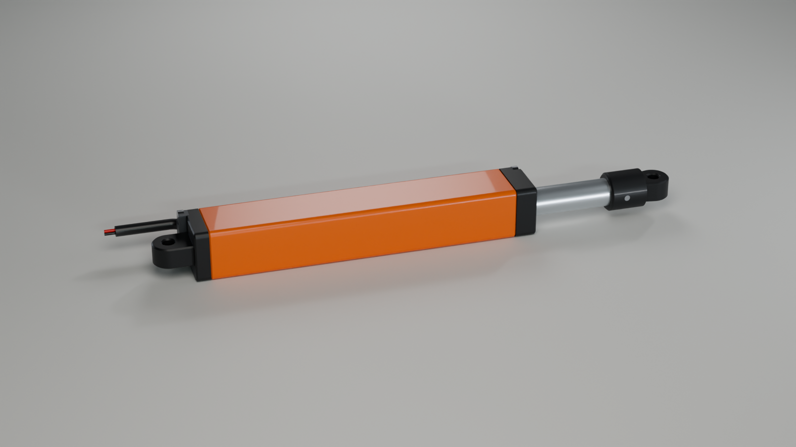
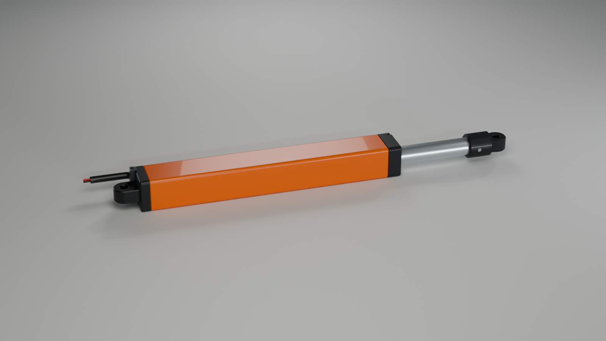
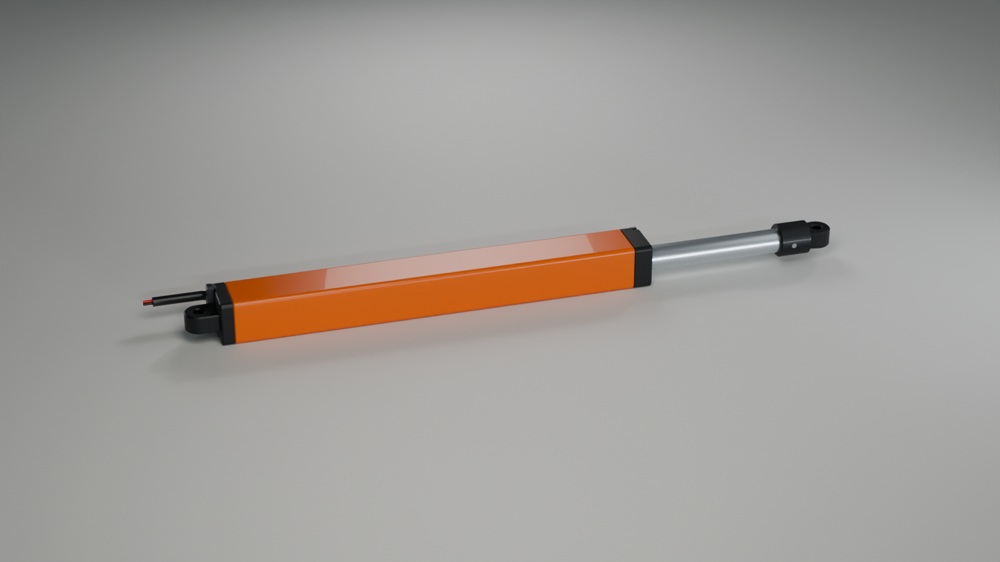
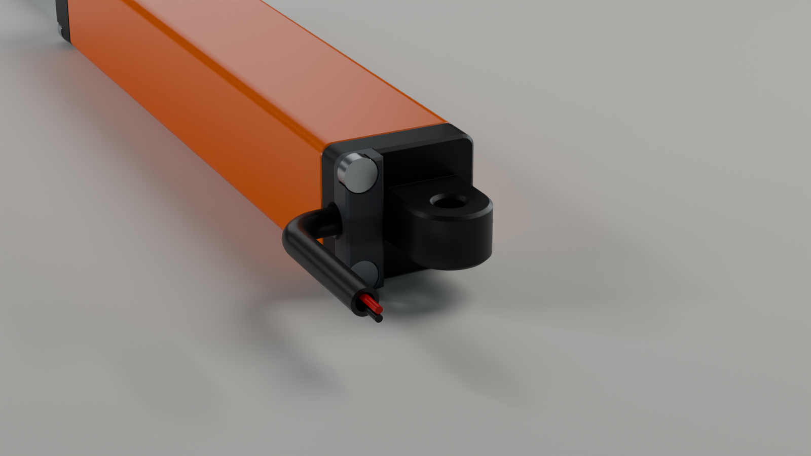
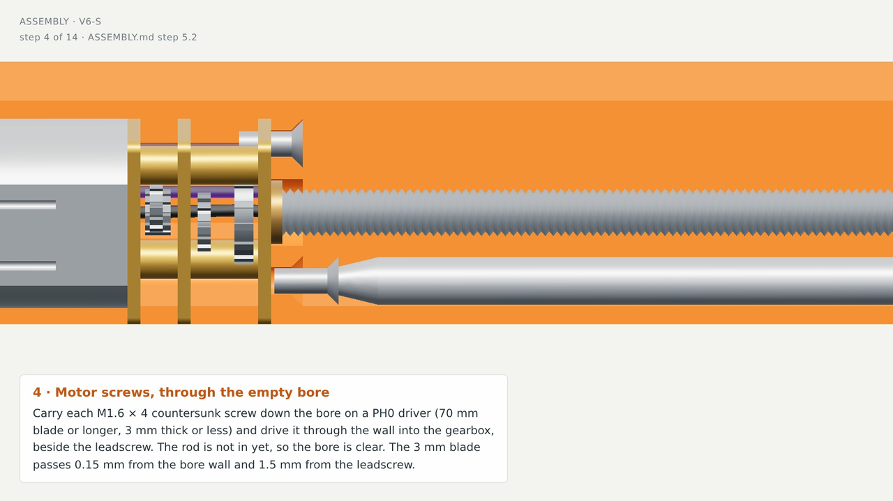
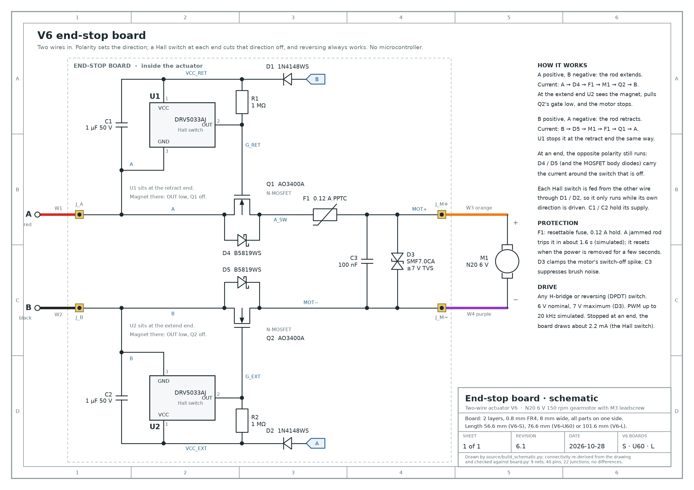
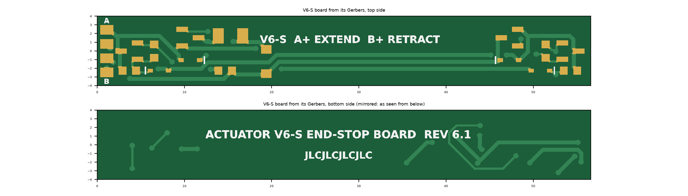

# V6 two-wire leadscrew actuator

A general-purpose linear actuator built around the unmodified N20 gearmotor with its own M3 leadscrew.

The [motor gear update](MOTOR_UPDATE.md) replaces the internal motor model in all three lengths with the supplied meshed gearbox. Open **Motor gears** in the [offline preview](3D_preview.html) to inspect the three stages and their motion.

- **Control:** two wires. The polarity sets the direction, a Hall switch at each end stops the rod by itself, and reversing always drives it back out.
- **Construction:** every custom part is printed in PETG and held together with standard screws.
- **Electronics:** the end-stop circuit sits on a small board inside the body. It has 15 parts and no microcontroller.

Three lengths share every part except the body, the rod, the board and the motor's leadscrew:

| Version | Leadscrew | Stroke |
|---|---|---|
| **V6-S** | 55 mm | 40 mm |
| **V6-U60** | 75 mm | 60 mm |
| **V6-L** | 100 mm | 85 mm |

V6-U60 is also the common actuator of the 60 mm excavator arm in `../excavator_arm_60mm/`, which uses four of them. The arm's `source/build_actuators.py` builds V6-U60 here and checks it against the arm's kinematics.

This folder holds the **partition revision**. It adds a continuous **1.00 mm printed PETG wall between the moving carrier and the PCB components**.
- **Construction:** the partition is part of `01_body`, not a separate insert. It runs from the motor mounting wall to the front of the body and covers the whole circuit compartment.
- **Sensing:** the Hall switches see the magnet through the plastic; there are no openings in the wall.
- **Provenance:** this revision was generated in checkout `14c0f3ad` on 28 October 2026 and replaced the earlier V6 files in this folder.

| V6-S | V6-U60 | V6-L |
|---|---|---|
|  |  |  |

## Enclosure revision, 29 October 2026

The housing was reworked so that it is easier to print and assemble, and so that the cable cannot easily be pulled loose. The mechanism, the board, the wiring inside and every pin-to-pin length are unchanged, so the 60 mm arm still fits.



- **Cable clamp:**
  - **Exit:** the two cable wires now leave sideways on the board side, inside a 3 mm sleeve (silicone or PVC tube, 2 mm bore).
  - **New part:** the printed `06_cable_clamp` plate sits in a pocket in the rear cap.
  - **Grip:** the two rear-cap screws, now M2 × 10, pass through the plate and press it onto the sleeve. The groove is 2.6 mm high with three ridges, so the sleeve is squeezed by 0.4 mm. The groove's mouth is flared so the cable bends gently instead of over an edge.
  - **Wires:** a knot in each wire stops it at the cap's wire slot.
  - **Result:** a pull on the cable is taken by the clamp and the knots, not by the solder joints. The two loose 28 AWG wires through 1.2 mm holes are gone.
- **Body printed rear end down:**
  - The rear locating rim is gone, so the body stands on a flat face.
  - The motor wall's countersinks, the carrier's hard stop and the board's resting face are now top surfaces instead of the underside of a bridge.
  - A 0.3 mm chamfer at the motor-bay mouth absorbs first-layer squash and guides the motor in.
- **Rear cap:** it prints flat face down and no longer has to be fitted over a rim; its two screws locate it.
- **Rod fits one way round only:** a 2 mm key rib in one bore corner, with matching chamfers on the carrier and the front-cap spigot, admits the rod only with its magnet facing the board. Turned 180°, it stops at the bore mouth. This rules out the wrong way round, which ran the rod into the hard stops.
- **Unchanged:** the M1.6 motor screws still go in through the bore with a long PH0 driver. They are the motor's own mounting holes, and their heads must sit on the bore side of the wall. Reaching them from outside would need a split body joined by M2 × 40 screws through 0.6 mm corner walls.

## Printed parts and assembly animation, 29 October 2026

- **Printed parts view:** `3D_preview.html` has a **Printed parts** view that lays the six printed parts out side by side on a print bed. Each part is shown as its STL prints, labelled with its mass. Click a part for its slicer settings, its size on the bed and its file.
- **Assembly view:** the **Assembly ▶** view plays the order of `ASSEMBLY.md` part by part with the screwdrivers, in 1 min 43 s.
  - **Controls:** play or pause, step forward and back, scrub the timeline, or click a step in the info card. You can rotate the view at any point.
  - **Video:** `images/assembly_V6-S.mp4` is a 1280 × 720 recording of the same animation for V6-S. The steps are the same for every length.
- **The screws inside the body:** the two M1.6 motor screws sit at the bottom of the bore, behind the carrier, so in the finished actuator they look impossible to reach. They go in at step 5, while the bore is still empty: the rod and the front cap are fitted only afterwards. A PH0 driver carries each screw down the bore beside the leadscrew.
  - **Tool access, checked in CAD:** every driver is swept in along its screw axis against the parts already fitted at that step (`validation.json`, `tool_access`).
  - **PH0:** its 3 mm blade passes 0.15 mm from the bore wall and 1.5 mm from the leadscrew. It needs at least 57 / 77 / 102 mm of blade for V6-S / U60 / L so the handle stays out of the bore. The assembly guide asks for 70 / 90 / 115 mm.
  - **Which PH0:** a Wera 350 PH 0 × 100 mm (3 mm blade, item 05008706001) does V6-S and V6-U60. For V6-L no driver long and thin enough turned up; see Known limits.
  - **PH1:** the five M2 screws are reached from outside with an ordinary 80 mm driver; nothing comes within 0.47 mm of its blade.



## Files

| Path | Contents |
|---|---|
| `3D_preview.html` | Offline 3D preview with the schematic linked to the board, the printed parts and the assembly animation. Open it in any WebGL browser. |
| `stl/V6-S/`, `stl/V6-U60/`, `stl/V6-L/`, `stl/fit_samples/` | Print-ready STL files, oriented for printing |
| `step/` | STEP file for each part, plus an assembly with the board and wires |
| `BOM.md` | Printed parts, hardware and the board's parts list |
| `ASSEMBLY.md` | Illustrated assembly and first power-up |
| `electronics/schematic.pdf` (`.svg`, `.png`), `electronics/netlist.csv` | Schematic, checked against the board's netlist |
| `electronics/pcb/V6-S/`, `V6-U60/`, `V6-L/` | Gerbers and drill file, JLCPCB BOM and placement files, KiCad board file, board check report |
| `electronics/pcb/actuator_v6_*_gerbers.zip` | Gerbers and drill file zipped for upload to the board maker |
| `electronics/simulation/` | ngspice circuit simulations |
| `images/` | Renders, board images, the magnet model plot and the assembly video `assembly_V6-S.mp4` |
| `parameters.json`, `validation.json`, `viewer_check.json`, `magnet_trigger.json`, `wire_lengths_*.csv` | Design data and check results |
| `source/` | Scripts that generate all of the above |
| `SHA256SUMS.txt` | Checksums of the files above |

## Dimensions and compatible parts

| Dimension | V6-S | V6-U60 | V6-L |
|---|---:|---:|---:|
| Stock M3 × 0.5 leadscrew length | 55 mm | 75 mm | 100 mm |
| Nominal stroke | 40 mm | 60 mm | 85 mm |
| Pin centres, closed → open | 120 → 160 mm | 140 → 200 mm | 165 → 250 mm |
| Body section | 16.10 × 14.70 mm | 16.10 × 14.70 mm | 16.10 × 14.70 mm |
| Body length | 86.5 mm | 106.5 mm | 131.5 mm |
| PCB length × width × thickness | 56.6 × 8 × 0.8 mm | 76.6 × 8 × 0.8 mm | 101.6 × 8 × 0.8 mm |
| Mechanical overtravel beyond each nominal end | 3 mm | 3 mm | 3 mm |

Compared with the original V6:
- **Board and body:** the PCB moves outward by 1.15 mm, and the body becomes 1.15 mm wider on that side.
- **Length:** the body and the pin spacing grow by 2 mm along the axis.
- **Revised parts:** the two end caps, the rod and the PCB layouts. Use the matching files from this package.
- **Unchanged:** the rod is still 8 mm in diameter, with holes for 3 mm clevis pins.

- **Magnet:** use an **axially magnetised N35 Ø3 × 2 mm magnet**, replacing the earlier Ø2 × 2 mm magnet. The Ø2 magnet failed a modelled weak-field tolerance case once the PCB moved outward.
- **Component clearance:** the component faces are 0.30 mm from the partition, or 0.25 mm with the PCB shifted fully inward in its retaining slot.
- **Carrier clearance:** the carrier's full travel envelope is 1.45 mm from the components. Its nominal clearance to the printed partition is 0.15 mm, the existing sliding-guide fit, so it can only slide against plastic, never reach the circuit.
- **Positions across the body:** the printed wall occupies X = 5.15–6.15 mm. The component-side PCB surface is at X = 7.70 mm, and the tallest component is 1.25 mm high.
- **Board retention:** the board is inserted from the front and held by the front-cap tongue. The wires pass through the motor wall on the circuit side of the partition.

## Magnetic sensing and two-wire control

Ordinary unfilled PETG is approximately non-magnetic, and the model treats its permeability as that of air. The wall does not shield the sensors, but the larger magnet-to-sensor distance changes their switching points:
- **Gap across the board:** 2.20 mm from the magnet face to the Hall element.
- **Offset along the axis:** each Hall centre sits 5.30 mm beyond the nominal end position of the magnet.

All 54 modelled combinations of magnet strength, sensor threshold and placement offset detect the magnet.
- **Stop spread:** −2.15 to +1.65 mm relative to each nominal end.
- **Margin:** 1.35 mm between the latest predicted stop and the mechanical limit.

These are model results, not calibrated hardware accuracy. Nearby steel and real print and assembly errors still need physical testing.

| External supply | Requested motion |
|---|---|
| A positive, B negative | Extend |
| B positive, A negative | Retract |
| Supply disconnected | Motor unpowered; the self-locking leadscrew holds the rod |

An external H-bridge or reversing switch selects the polarity. The internal Hall and MOSFET circuit blocks motion into an end and lets the rod reverse out through its diode paths. The supply is 6 V nominal, with 7 V as the design limit. There is no position-feedback signal.

## Schematic and board



`electronics/schematic.pdf` is a single A4 sheet. `source/build_schematic.py` draws it from the same netlist as the board (`source/board.py`). After drawing, the script rebuilds the connectivity from the drawn wires, junctions and net flags, and stops if it differs from the board: 9 nets, 40 pins, no differences.

How the circuit works:
- **Switching:** each motor lead has an N-MOSFET (Q1 in lead A, Q2 in lead B) with a Schottky diode across it (D4, D5).
- **Stopping:** at the extend end, U2 sees the magnet and pulls Q2's gate low, which cuts off extending. U1 and Q1 do the same at the retract end.
- **Reversing:** the opposite direction always runs through the diode beside the switch that is off.
- **Hall supply:** each Hall switch is fed from the other wire through D1 or D2 and held up by C1 or C2, so it only runs while its own direction is driven.
- **Protection:**
  - F1, a 0.12 A resettable fuse, trips on a jam;
  - D3 clamps the motor's switch-off spike;
  - C3 suppresses brush noise.

| Board files | V6-S | V6-U60 | V6-L |
|---|---|---|---|
| Gerbers, drill, BOM, CPL, KiCad board | `electronics/pcb/V6-S/` | `electronics/pcb/V6-U60/` | `electronics/pcb/V6-L/` |
| Design-rule check, Gerber read-back | `check_S.json`: 0 errors | `check_U60.json`: 0 errors | `check_L.json`: 0 errors |

Each board carries both Hall switches: U1 sits 3.7 mm from the wire end (the retract end), and U2 2.3 mm from the front end (the extend end).



## 3D preview

Open `3D_preview.html`; it works offline. Choose V6-S, V6-U60 or V6-L at the top.

- **Views:**
  - **Exterior**;
  - **Cutaway**, a section on the pin plane that shows the partition;
  - **Internals**, with the housing and partition hidden;
  - **Circuit board**, the board seen from the bore with the body and partition cut away and every part labelled;
  - **Core part**, the N20 alone;
  - **Printed parts**, the six printed parts on a print bed in their STL orientation;
  - **Assembly ▶**, the build order as an animation (see above).
- **Linked schematic:** the schematic panel is linked to the 3D board. Click a part, wire or net in either the schematic or the model to highlight it in both. An info card shows its part number, LCSC code, pins, nets and live state.
- **Drive panel:**
  - Choose A+ (extend), off or B+ (retract), and watch the end stops act.
  - The current path lights up in the schematic and on the board copper.
  - "Jam the rod" shows the fuse tripping.
  - Motion runs at the simulated speed of 0.82 mm/s, with adjustable playback; the currents come from the circuit simulation.

## Printing and verification

1. **Fit samples:** print the shared fit samples before the full parts. Use ordinary unfilled PETG.
2. **Partition:** check the slicer's toolpaths to make sure the full 1 mm partition is kept.
3. **Carrier fit:** check the 0.15 mm carrier guide clearance on your printer. The partition does not make up for an undersized bore or for excessive deformation.
4. **Settings and assembly:** the print setup for each part is in `BOM.md` and `validation.json`. The assembly steps are in `ASSEMBLY.md`.

`validation.json` records the CAD checks for all three lengths:
- a solid-volume check that the whole partition exists;
- clearance to a continuous carrier travel envelope;
- interference checks of the assembly at sampled travel positions;
- wire contacts, including both cable wires running out through the clamp inside the sleeve;
- the cable clamp: the sleeve is squeezed by both halves, and the rear screws keep 5.8 mm of thread in the body;
- the key: a rod turned 180° would overlap the key rib (13 mm³);
- tool access: each screw's driver, swept in along the screw axis, against the parts fitted before it (`source/assembly.py` gives the order). No driver touches a part; the report gives the nearest parts and the shortest blade that keeps the handle clear;
- watertight, single-solid STL checks.

`viewer_check.json` records a headless-browser run of `3D_preview.html` for all three lengths:
- every view opens without a script error;
- the drivers appear only while their screws go in;
- the last frame of the animation is the assembled actuator, with no part missing or left over.

`electronics/pcb/V6-*/check_*.json` records the board checks and the Gerber read-back comparison. `magnet_trigger.json` holds the magnet model.

The nine passing circuit simulations in `electronics/simulation/` cover the original V6 circuit, which is unchanged. They use an assumed motor and fuse model, and a 45 mm example stroke with older mechanical limits, so they are not a new simulation of these exact assemblies.

## Known limits

- **Not yet built:** printing, load capacity, temperature and the powered end stops are unverified on hardware.
- **Motor polarity:** A positive must extend the rod. If the motor is wired reversed, the end stops act on the wrong ends. `ASSEMBLY.md` step 7 catches this before the first run.
- **Magnet orientation:** the key rib admits the carrier only with its magnet facing the board side.
- **Cable clamp:** the grip is designed for a 3.0 mm sleeve, plus or minus 0.3 mm, and has not been pull-tested.
- **Supply:** 6 V nominal, 7 V maximum because of D3's rating. The end-stop circuit needs about 3.3 V or more at the wire pads.
- **Performance estimates:** speed is 0.82–1.25 mm/s and thrust about 50 N continuously, limited by the fuse's hold current. Thrust can reach about 200 N briefly before the fuse trips. These figures come from an assumed motor model, not measurements.
- **Fuse behaviour:** the fuse trips anywhere between 0.12 and 0.29 A, and sooner when warm. After a trip it needs a few seconds without power, and its resistance stays higher for a while.
- **Rod buckling (V6-L):** the Euler load of the Ø8 PETG rod at full extension is about 320 N with pinned ends. Avoid side loads.
- **Motor screws:** the two M1.6 screws go in through the bore on a PH0 driver.
  - **Blade thickness:** 3 mm or less. It passes 0.15 mm from the bore wall, so a 4 mm blade does not fit beside the leadscrew. In an undersize bore the blade slides along the wall.
  - **Blade length:** at least as long as the bore is deep, 57 / 77 / 102 mm for V6-S / U60 / L. The guide asks for 13 mm more. For a custom length, see `min_blade_len_mm` in `validation.json`.
  - **V6-S and V6-U60:** a Wera 350 PH 0 × 100 mm (item 05008706001) has a 3 mm blade and fits.
  - **V6-L: no suitable driver found.** In current catalogues (October 2026), 3 mm PH0 drivers stop at a 100 mm blade. The 150 mm ones, such as the PB Swiss PB 8190.0-150, have 4 mm blades. V6-L needs a change to the bore or a special driver before it is built.
- **Cap screw heads:** the M2 pan heads stand about 0.3 mm proud at the body corners, where the counterbores break through the edge of the front cap and the clamp plate. This is cosmetic.
- **Board files:**
  - the KiCad board file is written by script and was not opened in KiCad, and there is no KiCad schematic;
  - the 8 mm board needs a panel with rails for assembly;
  - check part stock, JLCPCB basic or extended status, and the placement rotations before ordering.

## Rebuild

Use Python 3.11 with CadQuery 2.8, NumPy, trimesh, shapely, matplotlib, schemdraw, pygerber and kiutils. The renders use Blender 4.2 and the circuit simulation uses ngspice. Run the scripts in this order:

```sh
python source/magnet_trigger.py
python source/pcb_export.py
python source/build_v6.py
python source/build_schematic.py
python source/build_viewer.py
node source/assembly_video.cjs check          # needs Playwright (NODE_PATH) -> viewer_check.json
blender -b -P source/render_v6.py -- --variant S
blender -b -P source/render_v6.py -- --variant U60 --views hero,cutaway,internal,board,retracted,extended,rear_end
blender -b -P source/render_v6.py -- --variant L --views hero,extended,board,cutaway
```

- `pcb_export.py` and `build_v6.py` build all three lengths unless given one, for example `pcb_export.py U60` and `build_v6.py --variant U60`.
- `build_v6.py` writes the meshes that `build_viewer.py` and `render_v6.py` use.
- `pcb_export.py` also writes the Gerber upload zips.
- The renders take about 2 minutes per view.
- `source/simulate_circuit.py` reruns the ngspice suite; it is not part of the normal rebuild.
- `source/build_preview.py` builds the earlier partition-only preview under the same file name. `build_viewer.py` supersedes it.
- **The assembly video:**
  1. `node source/assembly_video.cjs frames --variant S --fps 25 --out DIR` writes the frames, rendered at 1920 × 1080 without shadows. It takes about 1 s per frame in software WebGL; split long runs with `--from` and `--to`.
  2. `ffmpeg -framerate 25 -i DIR/f_%05d.jpg -vf scale=1280:720:flags=lanczos -c:v libx264 -crf 20 -pix_fmt yuv420p -movflags +faststart images/assembly_V6-S.mp4` encodes them.

### Other leadscrew lengths

The design is parametric in the stock leadscrew length:
- **New standard length:** add it to `VARIANTS` in `source/layout.py`, as V6-U60 was, and rerun the steps above. `build_v6.py` stops if any check fails for it.
- **Separate folder:** `build_v6.py --custom NAME=SCREW:STROKE --root DIR` builds a length into another folder without changing this package, for example `--custom X80=80:65`.
  - `build_schematic.py`, `build_viewer.py` and `render_v6.py` take the same `--root` and use the lengths in `DIR/parameters.json`.
  - That length's board files still need it in `VARIANTS`, because `pcb_export.py` reads only that list.
