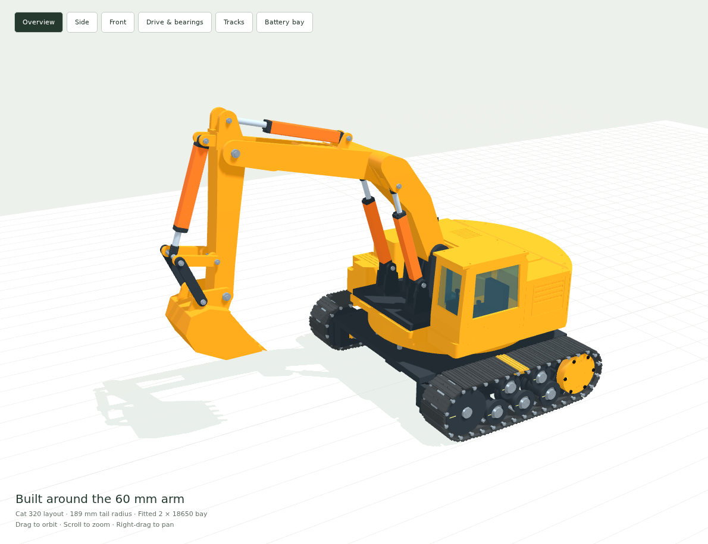
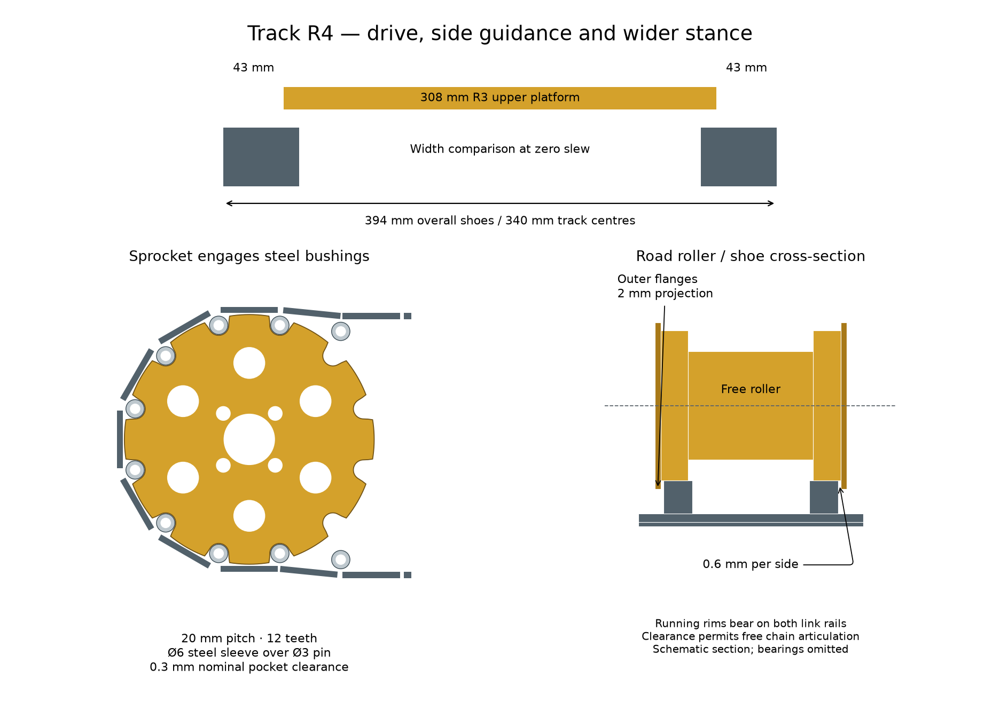
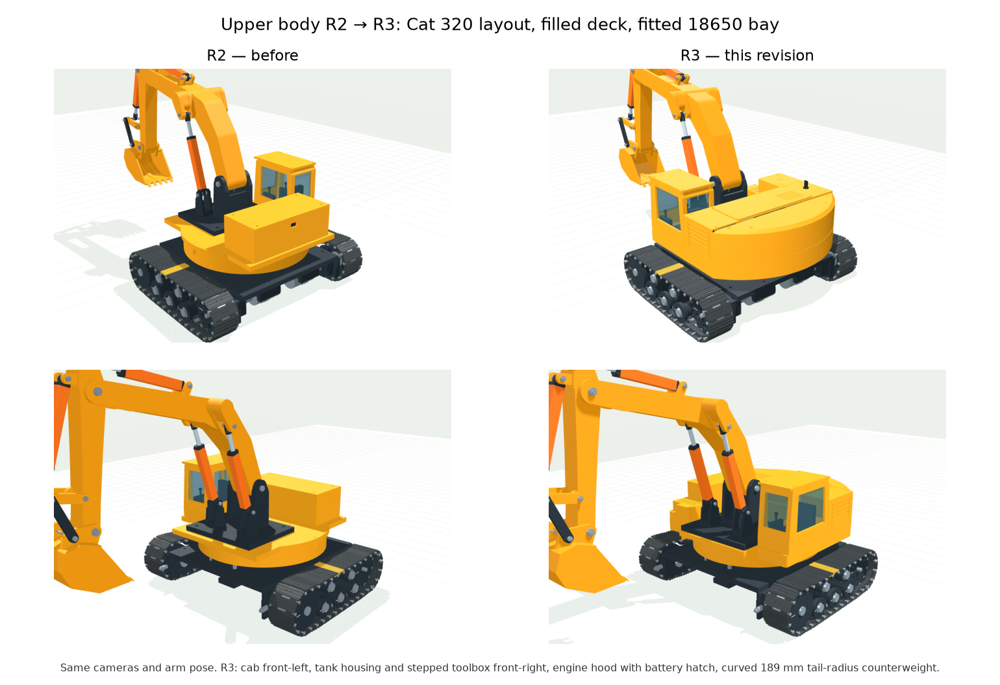
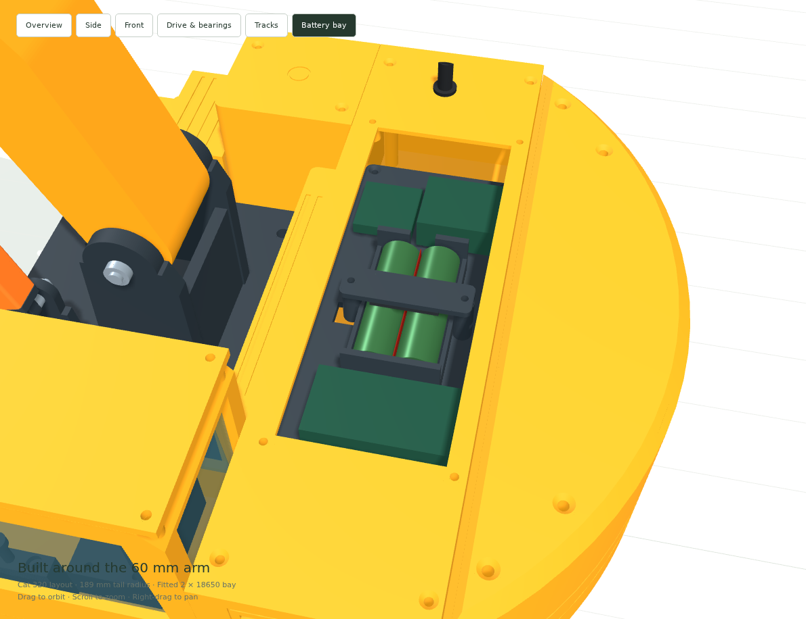

# Complete tracked excavator — arm60 R3 / Track R4

A complete mechanical vehicle built around the unchanged R4 arm60 and four V6-U60 actuators. It includes independent track drives, pinned steel track joints, sprung idlers, road/return rollers and a recessed bearing-supported geared slew. The R3 upper body follows the Cat 320 layout: cab front-left, tank housing and stepped toolbox front-right, an engine hood with a battery hatch, and a curved counterweight on the 189 mm tail-swing radius. Two 18650 cells sit in a cradle sized from manufacturer datasheets.

**Digital validation: PASS. Physical prototype testing has not been performed.** CAD clearance passes apply to the documented reference samples; full independent boom/slew travel includes known bucket/track collisions managed by the operator. The 0.15 kg bucket load used in calculations is a study case, not a payload rating. Motor torque/thrust, printing tolerances, layer strength, harness clearance and coordinated boom control require hardware verification before loaded operation.



## Open and build

- Open `3D_preview.html` directly in a browser; it works offline. Arm and slew controls, a battery-bay view with the hood hatch removed and a mechanism view are included. The preview permits full 0–60 mm boom stroke at every angle within ±150°, with independent controls. Track controls replay the loaded contact simulation, with pause, time scrub, playback speed and a highlighted shoe. Shoes, pins, bushings, sprockets, rollers, idler take-up and ground travel move together.
- Import `step/excavator_complete.step` for the full assembly. `step/` also contains every new printed part; `stl/` contains their print orientations, including mirrored left rail/carriage files.
- Build the retained arm from `../excavator_arm_60mm/` and four actuators from `../actuator_v6/stl/V6-U60/`. The delivery ZIP preserves these relative paths and includes the actuator boards and guides.
- Read [assembly and commissioning](ASSEMBLY.md), [BOM](BOM.md), `build_guide.pdf`, `dimension_sheet.pdf` and `simulation_report.pdf` before making parts. Printer-bed splitting is deferred as requested.

## Track R4 optimization

The drive now follows Berco pin-and-bushing chain architecture: rounded sprocket pockets engage replaceable Ø6 steel sleeves on Ø3 pins. Lower and carrier rollers have outer guide flanges with 0.6 mm clearance per side; the sprung idler supports the two rails and guides both sides. The sprocket and idler are raised 2 mm relative to the central ground run so the three lower rollers carry the main chassis load. Exact 20 mm link pitch is retained with sloping transition links and 0.201 mm initial idler retraction. Painted witness marks make passive wheel motion visible.

The 54 mm shoes sit on 340 mm centres: 394 mm overall versus the 308 mm R3 upper platform, leaving 43 mm beyond each side. The bridge, axles and spacers have been widened together. See [Berco and Cat 320 references and model adaptations](references/TRACK_SYSTEM.md). The loaded simulation supports 6.022 kg on one track and drives the carriage through shoe/floor contact. The browser replays this straight-travel result on both sides; it includes forward/reverse full chain circuits and braking.



## R3 upper body



R2 left most of the deck empty: a rectangular service box behind the cab, no tail shape, and a battery cassette with a loose 71 × 46 mm cavity that had never been checked against real cells. R3 rebuilds everything above the slew deck from the Cat 320 layout:

- **Deck:** 308 mm wide, with a rear arc on the 189 mm tail-swing radius (Cat 320: 2,830 mm at 1:15), a boom-foot nose and a 12 mm perimeter rim that reads as the upper-frame side members.
- **Cab:** the R2 cab (120 × 70 × 118 mm), moved forward to the machine's left as on the Cat 320.
- **Front right:** a tank housing with a filler cap, and a toolbox with an access step and tread grooves.
- **Engine hood:** full width behind the cab, with side louvres, a valve-cover nose, an exhaust stack and a removable battery hatch.
- **Counterweight:** a curved shell that clamps the 54 × 150 × 24 mm steel ballast plate (about 1.53 kg) through a rubber pad.
- **Fasteners:** every shell bolts down with standard M3/M4 screws into nuts held in hex pockets under the deck. The packaging check confirms that all 34 upper-body screws fully engage their nuts and that no tip reaches below the deck underside.

The deck is still 48 mm lower than R1, and the removable skirt still encloses the slew mechanism, ending 12 mm above the bridge. The boom/slew interlock remains removed: operators can lower the boom through its full stroke at any slew angle and manage bucket/track clearance during digging.

## 18650 battery bay



The cradle is sized from published datasheets: [Samsung INR18650-25R](https://www.akkuman.de/shop/mediafiles/PDF/18650%20Lithium/samsung%20inr18650-25r%2036v%202550mah%208c%2020a.pdf) (Samsung SDI, Mar. 2013), [LG INR18650HG2](https://files.batteryjunction.com/frontend/files/lg-hg2-18650.pdf) (BCY-PS-HG2-Rev0) and [Panasonic NCR18650B](https://e2e.ti.com/cfs-file/__key/communityserver-discussions-components-files/196/Panasonic-NCR18650B-datasheet.pdf). These links are retailer and forum copies of the manufacturer documents. It accepts flat-top, unprotected cells from Ø18.0 to 18.6 mm and 64.7 to 65.3 mm long. The cells are built as a welded 2S1P pack with 0.15 mm nickel strip, a 0.5 mm separator, end insulators and PVC wrap. The finished pack measures 36.74–38.20 mm wide, 18.24–19.10 mm high and 65.60–67.60 mm long.

- Two Ø19.7 mm grooves on a 19.3 mm pitch locate the cells. The 69 mm between the end walls leaves room for 4 mm foam end pads.
- A retainer bar presses a 3 mm foam pad onto the pack with two M3 × 20 screws.
- Across the whole datasheet range, the minimum radial clearance is 0.20 mm. The end pads compress to 1.40–3.40 mm and the top pad to 1.33–2.09 mm. The largest and smallest packs have zero CAD intersection with the cradle.
- **Service:** remove the four M3 × 12 hatch screws and the two retainer screws, then lift the pack straight out. The BMS and both converters stay on the tray. The CAD check lifts the pack from 0 to 80 mm: 65 exact intersections, 0 collisions and 14.4 mm margin to the hatch opening.
- `22_fit_coupon` includes a Ø19.7 mm groove gauge. Print it first and check a real cell in it.

Button-top or protected cells, about 67–70 mm long, do not fit this cradle.

## Mechanical specification

| Feature | Design |
|---|---|
| Tracks | 34 shoes per side, 20 mm pitch, 54 mm triple-grouser pad width, Ø3 × 56 pins, Ø6 × Ø3.1 × 17 steel sleeves |
| Wheels | 12-tooth bushing-drive sprockets; 220 mm nominal centres, 219.799 mm in the assembly pose |
| Ground support | End-wheel axes Z46.321; 2 mm end rise; central road rollers at Z29; conservative contact half-length 79.30 mm |
| Support | 3 flanged road + 2 flanged return rollers per track; rail-supported sprung idler, -3 to +6 mm adjustment |
| Track centres | 340 mm; 394 mm overall shoe width, 396 mm pin envelope |
| Drive | Two 12 V, 30 rpm gearmotors, at least 1.2 N m continuous each; separate Ø8 shafts and 608 bearings |
| Slew | Module 1.5, 96:20 involute gears; two 6004 bearings 40 mm apart; Ø20 steel spindle |
| Slew control | ±150° independent of boom stroke; 6°/s commissioning limit; no slip ring |
| Arm mount | Original base shifted to (45,0,134) mm; four M6 bolts at X=13/121, Y=±65 |
| Upper body | Cat 320 layout, 308 mm wide; 189 mm tail-swing radius (measured 189.0 mm) |
| Cab | 120 × 70 × 118 mm, based on the Cat 320 drawing at 1:15; front-left at X-22 to 98; seat, consoles and glazing |
| Body height | Deck Z134, lowered 48 mm; hood and counterweight Z206, cab roof Z252; skirt leaves 12 mm above the bridge |
| Battery | Two flat-top 18650 cells (datasheet Ø18.0–18.6 × 64.7–65.3 mm), welded 2S1P pack in a fitted cradle under the hood hatch; regulated 12 V and 6 V rails |
| Ballast | Steel 54 × 150 × 24 mm plate inside the counterweight, about 1.53 kg |
| Calculated mass | 11.89 kg using full modeled PETG/steel volumes and declared hardware masses |

The sprockets have rounded bushing pockets with swept entry/exit relief, six open web windows and 0.5 mm nominal tooth-tip clearance to the shoe web. Public manufacturer images establish the architecture; the tooth profile is calculated for this model’s pitch and bushing diameter. Bearing spacers contact inner or outer races deliberately; the motors do not carry the wheel or upper-body bending loads.

## Verification

- 33 new printed designs, plus two mirrored variants: watertight, consistently wound, single-solid STL/STEP checks. Complete assembly: 656 CAD solids.
- 1355 exact assembly intersections and 1785 distinct cross-system checks: 0 collisions inside the CAD reference envelope above the 0.05 mm³ tolerance. Arm controls sampled on a 5×5×5 grid; cross-system samples use boom ≥15 mm or slew within ±20°, drawn from 11 slew angles; upper body checked at 61 angles.
- Gear mesh: 61 samples over a full tooth repeat; peak overlap 0 mm³. Track articulation: 41 samples from 32° wrap to 8° back-bend.
- Powered track fixture: 68000 MuJoCo steps at 0.5 ms, 34 links and 34 hinges enforced by 68 point constraints. Maximum hinge error 0.002871 mm. All 114 sprocket contact pieces are verified as present in the model. Every shoe completes at least 1.14 forward and 1.26 reverse circuits.
- Loaded track/floor contact: 68000 steps, 6.022 kg supported, forward/reverse travel 0.0594/-0.0594 m/s. Mean floor reaction 59.05 N against 59.08 N weight; final speed 0.000028 m/s.
- Roller function under load: mean upward road-roller reactions 19.38, 19.70, 19.21 N. The road rollers carry 98.7% of the supported weight. Both carriers support the return run, and all six passive wheels rotate in both directions.
- Side guidance: ±5 N on the free chain, 0.622 mm maximum lateral motion, with both guide flanks engaged. Suspended road rollers are unloaded; their spin requirement is checked in the floor-contact test.
- Actual CAD at simulated track poses: 36 forward/reverse samples, 2446 exact intersections, no overlap above the 0.5 mm³ contact allowance. The shoe rail contact meshes include the hinge-entry scallop; this catches carrier-roller interference hidden by the former short-box approximation.
- Upper body and battery bay: PASS. Measured tail radius 189.0 mm; all 34 upper-body screws engage their full nut height; cell fit checked across the datasheet range; pack lift-out 65 exact intersections, 0 collisions. Battery budget: 36 W regulated output requires at most 6.83 A at 6.2 V and assumed 85% efficiency; actual converter/cell performance needs measurement.
- CAD reference boundary: 666 additional configurations; a known collision outside that region is retained as a negative control. These samples do not limit the controls.
- Stability: 18,954 sampled combinations including 0/0.15 kg bucket load, +20% arm mass, -10% base mass and an adverse 5° slope. Minimum calculated gravity-line margin 43.2 mm inside the support rectangle. These are quasi-static assumptions, not a slope or payload rating.
- Required static actuator thrust with the study load: 42.4, 45.6, 16.4 N per boom/stick/bucket cylinder. Procurement targets with a 2× margin: 84.9, 91.1, 32.8 N. Real gearbox axial capacity remains unverified.
- Reduced vehicle dynamics check forward/reverse travel, a skid turn, braking, grade traction, power-loss rollback and slew limits. The power-loss case deliberately demonstrates that powered holding is not a parking brake.
- Retained arm60 validation (unchanged arm): 134 poses, 990 exact intersections, zero interference; report in `simulation/inherited_arm/validation.json`.
- Browser: 375 arm/slew cases match Python and actual rendered cylinder endpoints; offline, mobile, controls and gear direction checks pass. Track playback checks 156 times, including interpolated poses, and verifies rendered pin closure, wheel phase, carriage take-up, travel, pause and reset.

The collision checks are sampled, not a continuous proof. The contact simulation uses ideal hinge constraints and simplified shoe geometry; chassis rail collisions are omitted. The fixed fixture has no floor; the loaded case includes a rigid floor and guides chassis pitch/roll/yaw; it does not model soil, wear, motor heating or printed elasticity. No FEA or physical strength certification is claimed. Fastener threads, flexible cables and tool access need physical trial assembly. A fully lowered, tucked-in arm can hit a track during sideways slew; avoiding that collision is an operating responsibility. The original failing unrestricted case is preserved in `simulation/unrestricted_lowered_body.json`. Some arm poses extend below a solid floor and require a recess or restricted travel. Full hardware commissioning also requires slew feedback/independent direction limits and measured boom synchronisation, as explained in the assembly guide.

## Reproduce

Use Python 3.11, the pinned packages in `source/requirements.txt`, CadQuery's system libraries and Node/Playwright with Chromium. All commands are finite; no web server is needed.

```sh
python source/build_vehicle.py
python source/validate_vehicle.py
python source/validate_inherited_arm.py
python source/validate_packaging.py
python source/simulate_track.py
python source/simulate_track.py --ground
python source/validate_track_motion.py
python source/simulate_vehicle.py
python source/build_viewer.py
cd source && npm install && npx playwright install chromium && cd ..
node source/check_viewer.cjs
python source/build_docs.py
python source/package_delivery.py
```

Run from this folder, or use the script paths from the repository root. Keep the sibling arm60/V6 folders. `source/design.py` and `source/build_vehicle.py` are the new dimensional authority; arm dimensions remain in the original `kinematics.py`. The simulation reports contain units, force assumptions and scope. `SHA256SUMS.txt` records delivery-file checksums. Bundled three.js is MIT-licensed; the model has no newly assigned license.
