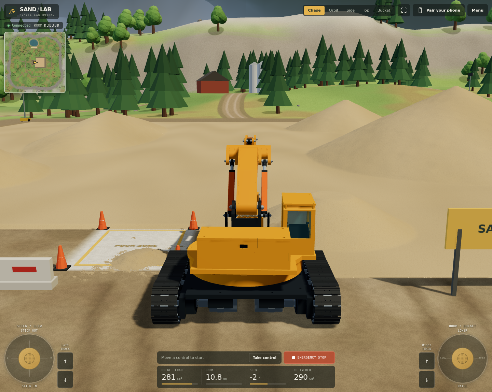
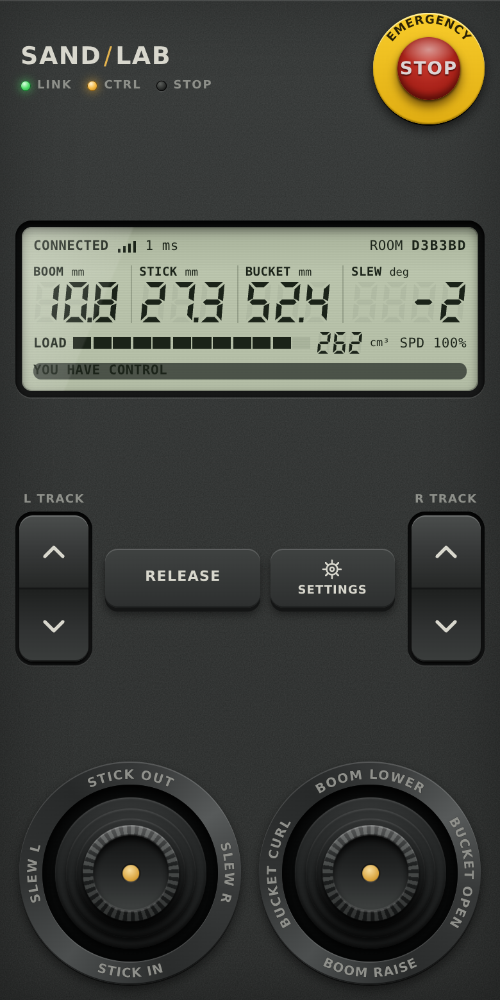
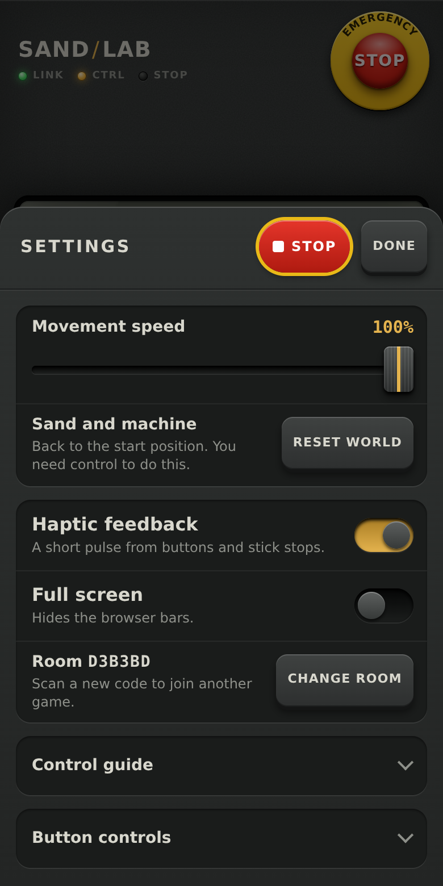
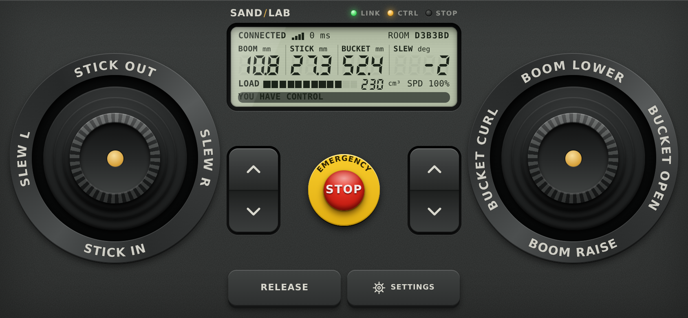

# Sand / Lab

An open-world excavator game with a phone remote, deployable with Docker. You drive the existing **ARM60 / Track R4 model, including all 644 CAD meshes**, around a 41 m valley (about 600 m at the model's 1:15 scale) with a 6.4 m sand yard, roads, a lake, a village and a ring of hills. A Node.js server simulates the machine, the ground and the sand: a height field that slumps to its angle of repose, and free grains wherever sand is cut, carried or poured. Browsers exchange controls and live state over WebSocket.



## Run with Docker

From this directory:

```sh
docker compose up --build -d
```

Open **http://localhost:8080** on your computer. A new game gets a six-character room code. Click **Pair your phone**, scan the QR code, and keep the simulator visible on the computer. The remote automatically takes control when the operator slot is free. If the desktop already has control, click **Release** first.

Both devices must be able to reach the server. From a phone, use the computer's LAN IP, for example `http://192.168.1.20:8080`. A phone's `localhost` points to the phone itself. The pairing dialog lets you correct the address; automatic address discovery inside Docker may show a container IP, so explicitly set the host address when needed:

```sh
PUBLIC_URL=http://192.168.1.20:8080 docker compose up --build -d
```

The simulator is at `/`; the touch remote is at `/remote`. You can also enter the displayed code on `/remote`, or share `/remote?room=A1B2C3`. Several simulator pages can observe the same room using `/?room=A1B2C3`. The physics continues when only a remote is connected.

```sh
docker compose logs --tail=100
docker compose down
```

The image runs as the unprivileged `node` user, supports a read-only filesystem, has a health check, and handles SIGTERM/SIGINT. No database, GPU, volume, or external CDN is required by the server. Building requires access to the npm registry and Docker base image; browser assets are served locally after the build.

## Operate

Move a joystick, hold a drive button, or press a movement key to take control when the operator slot is free, on either a computer or a phone. **Take control** is also available. If another operator is driving, they must select **Release** first. On a phone, use the two touch joysticks together; each supports an independent touch contact. Release a joystick or track button to stop that input. Movement starts only after the server grants control, using inputs that are still held.

| Control                       | Motion                     | Keyboard |
| ----------------------------- | -------------------------- | -------- |
| Left joystick up / down       | Stick out / in             | W / S    |
| Left joystick left / right    | Upper body slew            | A / D    |
| Right joystick up / down      | Boom lower / raise         | ↑ / ↓    |
| Right joystick left / right   | Bucket curl / open         | ← / →    |
| Left track forward / reverse  | Left track drive           | Q / Z    |
| Right track forward / reverse | Right track drive          | E / C    |
| Both tracks forward / reverse | Drive straight             | I / K    |
| Tracks opposed                | Turn on the spot           | J / L    |
| Emergency stop                | Latch all drive inputs off | Space    |

**Menu** holds the how-to-play notes, movement speed (it scales every axis), the stick and bucket strokes, **Reset world**, and keyboard-focusable buttons: hold Enter to operate them. Boom stroke, slew, bucket load and the sand delivered to the pour zone (both in cm³ of loose sand) are always in the telemetry at the bottom, and the map at the top left shows where you are. **Chase**, **Orbit**, **Side**, **Top** and **Bucket** choose the camera; drag to look around and scroll to zoom.

The bucket cannot be driven into the hard ground: the blocked motion stops and the game shows **BUCKET ON HARD GROUND · RAISE THE BOOM** until you change the command. The crawler stops at buildings, vehicles, tree trunks and rocks, at slopes past 37°, at deep water and at the edge of the map, with a message saying which. Backing away is always allowed.

**A first scoop from the start position:**

1. Lower the boom to **0 mm**.
2. Crowd the stick to approximately **20 mm** to cut into the pile.
3. Curl the bucket to approximately **52 mm**. Curling fully enough keeps the lip above the load during lifting.
4. Raise the boom to approximately **26 mm**.
5. Swing approximately **+45°** toward the outlined pour zone.
6. Open the bucket toward **0 mm** and watch the grains fall.

The deterministic physics test runs this cycle at full speed: the bucket scoops about 310 cm³ (its struck capacity is about 300 cm³), still carries about 290 cm³ after the lift and swing, and about 296 cm³ arrives in the pour zone, including the heap riding above the mouth. No sand is created or removed. A bucket held still while open or tilted slowly loses its heap: the sand above the mouth runs off at the angle of repose, as real sand does.

**Emergency stop** is available to every connected client. The current operator must explicitly select **Resume operation** to clear it. Resetting the world does not clear a latched stop. Input becomes neutral after 350 ms without a valid control packet, on socket disconnect, on touch cancellation, and when the page loses focus. Changing apps releases ownership; use a control after returning to reclaim it if the slot is free. An operator lease expires after five seconds without input. Reconnection starts with neutral controls and does not displace an existing operator.

## Phone remote

 



`/remote` is drawn as a hand-held radio controller. It fills one screen with no scrolling, upright or on its side, and appears as a controller on a dark surface on a tablet or computer.

- **Emergency stop.** The red mushroom on the yellow collar. It latches and lights up, and the control key becomes **Resume**.
- **LCD.** Boom, stick, bucket and slew; bucket load as a bar and in cm³; speed; link quality and ping; room code; and who has control. It also carries messages and the warning when the bucket is on the ground.
- **Track rockers.** One for each track, tipping on a centre pivot. Push the top end to drive forward and the bottom end to reverse.
- **Control key.** **Release** or **Take control**.
- **Settings key.** Opens a sheet with movement speed, **Reset world**, haptic feedback, full screen, the room code and a way to change it, the control guide, and hold-to-move buttons for keyboard and screen-reader users. Opening it stops this operator's movement, and the sheet has its own emergency stop because the face cannot be reached underneath it.
- **Joysticks.** A thumb landing on the cap grabs it where it is, so a press alone moves nothing; pressing beside the cap jumps the stick to the thumb. The rubber boot flexes as the stick tilts, the legend for the pushed direction lights up, and the stick springs back on release.

Haptic pulses mark key presses, leaving a stick's centre, reaching its stop and the bucket meeting hard ground. They use the browser's Vibration API, which Safari on iPhone does not offer, so that setting is hidden there. Full screen is hidden where the browser has no Fullscreen API, including on iPhone.

## Simulation and model

`scripts/export_model.py` extracts the committed offline viewer at `../excavator_60mm/3D_preview.html` and the original arm solver. It requires Python 3 only, not CadQuery. The exported `public/model.json.gz`, `shared/config.js`, and `shared/kinematics.js` are committed so this folder can be built independently of the rest of the repository. The compressed model includes the original viewer's SHA-256 for provenance. Run `npm run export:model` from the full repository to regenerate it.

The shared linkage solver retains all 0–60 mm actuator travel and independent ±150° slew. Rendering moves the boom, stick, bucket, four cylinders, linkage, slew gearing, track shoes and wheels. The crawler uses differential-drive kinematics across the whole valley, at up to 220 mm/s (about 12 km/h at 1:15). Both tracks together drive forward or backward; opposing tracks turn in place. Its rotated footprint stays inside the map. A plane fitted through 14 points under the tracks, on the ground and on any sand, sets the chassis height, pitch and roll, and the arm and bucket frames follow that tilt exactly. This is a simplified terrain model without suspension, traction limits or tipping. It does not replay or rerun the original MuJoCo track experiment. Track articulation is interpolated along the original chain poses, so the animation is a visual approximation between those poses.

**The world** is 40.96 m square. Its hard ground comes from `shared/landscape.js`, which the server and the browser both run, on a 160 mm triangle grid that is drawn exactly as the physics sees it. It holds a road loop with spurs, the sand yard, a lake with a beach and a pier, a village, a farm, a crushing plant, wind turbines and about a thousand trees and rocks, all generic low-poly scenery. The start position and the pour zone are on hard ground beside the yard.

The sand uses the **hybrid model common in excavation simulators**:

- **Sand bed.** Sand anywhere in the world is a height field of 10 mm cells over the hard ground: 4096 × 4096 cells, stored only in the 64-cell pages that have held sand (about 130 at the start, holding 9.2 m³ across the yard and the beach). Any slope steeper than dry sand's **34° angle of repose** avalanches downhill, so cut faces cave in, tipped loads form cones and nothing stays implausibly steep. The seven stockpiles start at a gentler 27° and stay put.
- **Cutting.** Each column of sand the bucket occupies is checked against how the sand entered the bucket's region. Sand met by the teeth or the open mouth is scooped into the cavity as free grains. Sand met by the closed back, floor or cheek plates is bulldozed ahead of the bucket into a berm. Sand lying on top of a buried bucket becomes grains that slide off or fall in. Moving tracks press a rut of about 4 mm and spread what they displace over a band beside them. Sand above the belly or inside the turning upper body is pushed aside the same way, so a wall of sand cannot stand inside the machine.
- **Free grains.** Moving sand is about 2,000 grains at most, of 4 mm radius (each costs about 14 µs per tick, and past that the bucket bulldozes instead of breaking up more bed), solved with position-based granular dynamics: gravity, grain contacts with Coulomb static and kinetic friction (about 32° internal friction), height-scaled mass for stable heaps, and friction against the bucket and the bed. Four 1/120 s substeps and three solver iterations run per 1/30 s tick. A grain that comes to rest on the bed, clear of the bucket, merges back into the bed.
- **Leak-proof bucket.** The bucket's shell, tooth row and cheek plates use the actual CAD plate surfaces (4 mm top plate, 6 mm back and floor). Every wall is two-sided, and each grain remembers which side it is on. A grain's membership of the cavity can change only along a path through the open mouth; any other change is rolled back. Fast grains or a fast bucket therefore cannot tunnel through the shell. Grains are never attached to the bucket or replaced by a fill animation.
- **Conservation.** The bed and the grains exchange exact volumes (each grain stands for 447 mm³ of loose sand), so the total sand volume is constant to floating-point rounding.

**Rendering.** The browser draws the bed as deformable chunks, created only where there is sand and simplified with distance, with a fine grain texture. Freshly cut or dumped sand looks damp and dries over about a minute, and thin sand breaks up into scattered grains at the edges.

The carried load is reconstructed from the density of the coarse physics particles as a continuous, matte sand surface, with the same fine texture scale as the bed. The reconstruction follows the bucket frame and is clipped to the inner CAD plate surfaces, with an open mouth for the heap. Loose material uses instanced 0.38–0.66 mm visual grains with scene lighting and shadows. Falling streams separate along the measured particle trajectories and use a short, velocity-dependent exposure. Soft pixel coverage avoids bright specks at a distance. Extra spread is bounded by the bucket plates and teeth and tapers before the current sand surface; these visual details add no mass or server collision work. Particle appearance and settling fade around the bed update instead of abruptly changing grain size. Reconstruction is limited to the bucket region; spilled sand remains fine visual grains until it rejoins the bed. Touch devices use a coarser reconstruction grid and 48 detail grains per parcel, versus 96 on desktop. Motion is derived from consecutive simulation snapshots when they arrive, so skipped display frames preserve flow direction. Reconnect gaps, position jumps and room resets clear that motion history.

Each binary frame carries the machine pose and the sand of the same tick. The browser plays frames back about 60 ms late and interpolates both together, so the bucket and its load always move as one.

This is an interactive approximation of dry sand, not a calibrated soil, load, traction or structural engineering model. Physics particles are clumps with a 4 mm radius (8 mm diameter, or 12 cm at full scale), the bed is one height per 10 mm cell (no overhangs or tunnels), and the machinery is kinematic. There is no two-way soil force feedback, water phase, rigid-body vehicle tipping or arm self-collision. The arm and bucket do not collide with buildings or trees, grains do not collide with the machine body, and the arm can pass through scenery the crawler cannot. Joints start and stop instantly instead of following hydraulic acceleration. The full independent boom/slew travel intentionally preserves the original model's operator-managed clearance. Only the hard ground stops the bucket. At high CPU load the fixed-step simulation runs slower than real time instead of increasing the step size.

The simulator needs WebGL2. The phone remote uses only HTML controls and telemetry; it does not download Three.js or the CAD asset. On touch devices the 3D simulator caps pixel ratio at 1 and disables shadows and antialiasing to reduce GPU cost while retaining all CAD parts. Rendering is skipped for an unchanged scene, and hidden tabs also skip scene updates. Software-only graphics can be slow; a hardware-accelerated browser is recommended, since the CAD assembly alone is 776,942 triangles and the whole scene peaks at about 1.2 million.

Control starts, reversals and stops send immediately. Continuous pointer motion is coalesced at 30 Hz, with a 100 ms heartbeat while holding controls. Each room runs physics in its own worker, leaving the HTTP/WebSocket thread free to process input, pings, ownership and watchdogs. Only one physics step per room can be in flight; slower hardware does not build a queue of old inputs. Machine state is published as JSON after each completed step (up to 30 Hz). Simulator clients also receive one binary frame per step: the machine pose, free grains (Int16, 0.1 mm, relative to an origin in the frame) and only the 16 × 16-cell bed tiles that changed (Uint16, 0.02 mm). The first frame on a connection carries all the sand there is, about 880 KB; digging then averages about 10 KB per frame. The server tracks which tile versions each client holds, so a congested socket can skip frames and later catch up on every change. Phones receive telemetry only. Worker resources are released on room expiry and server shutdown.

## Configuration and hosting

| Setting      | Default | Meaning                                                                                                     |
| ------------ | ------- | ----------------------------------------------------------------------------------------------------------- |
| `PORT`       | `8080`  | Native server port; Compose uses this for the published host port and keeps port 8080 inside the container. |
| `PUBLIC_URL` | empty   | Public or LAN origin encoded in the pairing QR code. Use an origin without a path prefix.                   |
| `MAX_ROOMS`  | `4`     | Maximum in-memory game rooms. Lower it on small CPUs.                                                       |

Each room permits eight clients and one active operator. Empty rooms expire after ten minutes. Rooms and sand state are held in memory and reset on server restart. Health status is available at `/api/health`.

Opening an expired simulator link, or reconnecting after a server restart, automatically creates a fresh game and updates the URL, room code and pairing links. Pair your phone again using the new code. An expired phone link displays an explanation and an **Enter room code** link; it never creates a separate game. Temporary connection failures retry the existing room. A persistent connection notice provides a manual retry when needed.

The six-character code is a pairing mechanism for a trusted network, not user authentication. For Internet hosting, place access control and HTTPS in front of the app. Serve it at the domain root and proxy `/ws` with WebSocket upgrades. The browser automatically selects `wss://` for HTTPS. Preserve the original Host header so the server's same-origin checks pass. An Nginx location inside an existing HTTPS server can use:

```nginx
location / {
    proxy_pass http://127.0.0.1:8080;
    proxy_http_version 1.1;
    proxy_set_header Host $http_host;
    proxy_set_header Upgrade $http_upgrade;
    proxy_set_header Connection "upgrade";
    proxy_read_timeout 60s;
}
```

If the phone cannot connect, first open the server's `/api/health` URL from the phone. Check the host IP/port, local firewall, Wi-Fi client isolation, and the QR address. If control is occupied, release it on the other device. A new game is created by opening `/` without a room query.

## Develop and verify

Use Node.js 22.12 or newer and npm:

```sh
npm ci --include=dev
npm run build
npm start
```

The production server serves the built `dist/` directory. Rebuild after client changes; restart after server changes. A separate Vite development server is unnecessary.

```sh
npm test
npx playwright install chromium
npm run test:browser
npm run test:sand
bash scripts/check_docker.sh
npm audit --include=dev
```

The browser tests start temporary servers and always close them. `npm run test:sand` replays deterministic bed, scoop, lift, early/middle/late pour and settled snapshots on desktop and touch renderers, checks for shader errors and stale loads after reset, and saves screenshots to `test-results/sand/`. `BROWSER_PATH` can select an existing Chromium executable. Screenshots are written to `test-results/`. `node scripts/capture_docs.mjs` digs two scoops in a temporary server and rewrites the README screenshots in `docs/`.

Checks cover:
- **Kinematics:** all 125 original CAD poses.
- **Bucket:** grains fired at 2.5 m/s through every wall and cheek in both directions, and the open mouth.
- **Bed:** the yard rests below the angle of repose, a tall heap avalanches back to it, sand dumped far from the yard stays there, storage stays sparse, and only tiles that really changed are published.
- **Full cycle:** a complete scoop/lift/swing/pour, instrumented so that every grain crossing must pass through the mouth (none crosses a wall), grain surfaces stay outside the CAD plates, and total sand volume is conserved. Aggressive dig/sweep/shake motions are checked the same way.
- **Machine:** the hard ground stop, independent slew/boom travel, the map limit at every heading, following the hills with exact tilted arm and bucket frames, the stops for steep slopes, scenery and water, ruts instead of walls of sand when driving over and turning on piles, the upper body clearing sand, grains falling off a tilted cheek, and the bulldozing fallback when the grain budget is used up.
- **World:** the physics and the drawn ground are the same surface, and nothing stands on the start position or grows in the water.
- **Network:** WebSocket ownership and validation, binary frames that carry far-away positions, delivery of all the sand, stale-input/disconnect stops, a latched E-stop, worker reset and cleanup, four-room phone round trips, and immediate/coalesced input.
- **Sand rendering:** isolated parcels stay fine grains, reconstructed surfaces respect the CAD plates at desktop and touch resolutions, snapshot origins and transfer fading are correct, room resets clear the load, falling detail respects bucket and bed clearance, and motion handles network origins, skipped display frames, reconnect gaps and reused particle slots.
- **Browser:** touch/multitouch/cancel, reconnect, keyboard driving, the following camera, the game menu, QR links, camera views, and desktop/mobile layouts and graphics settings.
- **Phone remote:** fits one screen at ten phone sizes in both orientations, with thumb-sized, non-overlapping controls; cap grab and spring return, rockers, haptics and their setting, the settings sheet and touch fader, emergency stops from the sheet and from another device, reset and the floor warning.
- **Docker:** the smoke test runs the actual server inside a non-root, read-only container and checks HTTP, model delivery and WebSocket operation.

## Files

| Path                         | Purpose                                                            |
| ---------------------------- | ------------------------------------------------------------------ |
| `server/index.js`            | HTTP, WebSocket rooms, operator leases, watchdogs and snapshots    |
| `server/simulation-runner.js`, `server/physics-worker.js` | Isolated room physics, bounded work, reset synchronization and cleanup |
| `server/physics.js`          | Machine motion, cutting, granular grain solver and bucket contacts |
| `server/terrain.js`          | Sparse sand height field, angle-of-repose avalanching, stockpiles  |
| `shared/bucket.js`           | Bucket frame, CAD plate surfaces and mouth-crossing tests          |
| `shared/protocol.js`         | Binary frame format: machine pose, grains and sand-bed tiles       |
| `shared/landscape.js`        | The world: hard ground, roads, lake, initial sand, scenery, colliders |
| `shared/`                    | Original configuration and kinematics; simulation dimensions       |
| `client/main.js`             | Game HUD and remote interfaces, pairing, touch and keyboard input  |
| `client/remote-face.js`, `client/remote.css` | The phone remote's faceplate, segment LCD, haptics and settings sheet |
| `client/scene.js`            | Three.js model, grains, synced playback, following cameras, minimap |
| `client/world-view.js`       | Ground, sky, water and scenery drawn from `shared/landscape.js`    |
| `client/sand-view.js`        | Sand chunks with level of detail, created only where sand exists   |
| `client/loose-sand-view.js`, `client/sand-surface.js` | Bucket load reconstruction, fine loose grains and transfer blending |
| `client/sand-material.js` | Fine sand texture shared by the bed and bucket load |
| `client/sand-stream.js`, `client/sand-flight.js` | Lit falling grains, bounded breakup, motion blur and snapshot velocities |
| `public/model.json.gz`       | Original CAD meshes and provenance                                 |
| `test/`                      | Numerical, network and browser checks                              |
| `Dockerfile`, `compose.yaml` | Production deployment                                              |

The existing model retains its original licensing status; this application does not assign it a new license. Three.js and the other npm packages retain their respective licenses.
