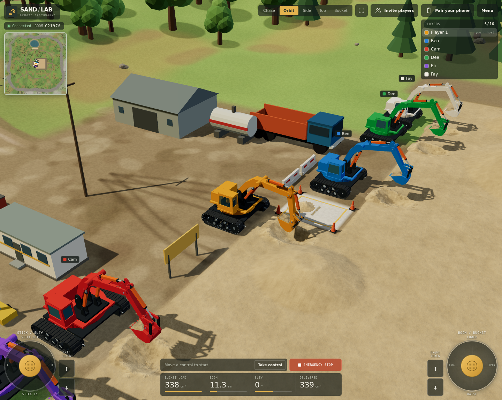

# Sand / Lab

An open-world excavator game for up to 16 people in a room, with a phone remote, deployable with Docker. Each player drives their own copy of the existing **ARM60 / Track R4 model, including all 644 CAD meshes**, around a 41 m valley (about 600 m at the model's 1:15 scale) with a 6.4 m sand yard, roads, a lake, a village and a ring of hills. A Node.js server simulates the machine, the ground and the sand: a height field on the ground that slumps to its angle of repose, a small one in each bucket that does the same, and falling sand wherever it spills or pours. Browsers exchange controls and live state over WebSocket.


## Run with Docker

From this directory:

```sh
docker compose up --build -d
```

Open **http://localhost:8080** on your computer. A new game gets a six-character room code. Click **Pair your phone**, scan the QR code, and keep the simulator visible on the computer. The remote automatically takes control when the operator slot is free. If the desktop already has control, click **Release** first.

Both devices must be able to reach the server. From a phone, use the computer's LAN IP, for example `http://192.168.1.20:8080`. A phone's `localhost` points to the phone itself. The pairing dialog lets you correct the address; automatic address discovery inside Docker may show a container IP, so explicitly set the host address when needed:

```sh
PUBLIC_URL=http://192.168.1.20:8080 docker compose up --build -d
```

The simulator is at `/`; the touch remote is at `/remote`. **Pair your phone** makes the phone a second set of controls for your own machine. To bring in other people, see [Play together](#play-together). The physics continues when only a remote is connected.

```sh
docker compose logs --tail=100
docker compose down
```

The image runs as the unprivileged `node` user, supports a read-only filesystem, has a health check, and handles SIGTERM/SIGINT. No database, GPU, volume, or external CDN is required by the server. Building requires access to the npm registry and Docker base image; browser assets are served locally after the build.

## Play together



A room holds up to 16 excavators in one world. They all dig the same sand, and whatever one of them pours or digs out, the others see and can use.

- **Inviting people.** Click **Invite players** and send the link or show the QR code. The link can open **the full game** (`/?room=A1B2C3`) or just **a phone controller** (`/remote?room=A1B2C3`); typing the code on `/remote` does the same. Each person who arrives this way gets a new excavator, with its own paint and a start position of its own, facing the sand. For friends elsewhere, the server must be reachable from where they are; see [Configuration and hosting](#configuration-and-hosting).
- **Your own phone.** **Pair your phone** is different: that link carries your player's secret key, so the phone drives your excavator and adds no new one. Keep that link to yourself. Once opened, the key moves out of the address bar, so the address shown there is safe to pass on, as an invitation for a new player.
- **Seeing who is who.** Other machines carry their driver's name, and every machine has an arrow on the map in its own paint. The **PLAYERS** list says who is here. Click a name to put the camera on that machine, and **Back to my excavator** to return; only the machine the camera follows is drawn with all its CAD parts. Change your name under **Menu** on a computer or **Settings** on a phone.
- **Your machine is yours.** Only your own devices can drive it, one at a time, and its emergency stop and resume belong to you too. A stop does not stop anybody else.
- **The host.** The first player in a room is its host, and only the host can **Reset world**, which puts the sand and every machine back at the start and tells everybody. When the host leaves, the player who has been there longest takes over. Anyone in control of their machine can use **Back to start** to return it to a free start position.
- **Getting in each other's way.** Crawlers stop at other crawlers, with a message saying so; moving apart is always allowed. Arms and buckets pass through other machines, as they do through scenery. A bucket held under somebody else's pour catches what falls into it.
- **Leaving and coming back.** A machine whose driver loses the connection stays where it is for 30 seconds, marked **offline**, with its controls stopped. Reconnecting or reloading the same tab gets it back. After that it is removed, whatever is in its bucket falls out, and its paint and start position are free again.
- **One big screen.** A computer page is a player too, so a shared screen owns one idle excavator. Everyone else can join with the phone-controller link while the big screen clicks through their names.

**Everybody digs a full bucket.** A bucket's load costs the same to simulate however much sand it holds, so machines do not compete for anything but the sand itself. With all 16 digging at once, from their start positions, each scoops 322–340 cm³, about what one does alone.

## Operate

Move a joystick, hold a drive button, or press a movement key to take control of your excavator when none of your other devices has it, on either a computer or a phone. **Take control** is also available. If another of your devices is driving, select **Release** there first. On a phone, use the two touch joysticks together; each supports an independent touch contact. Release a joystick or track button to stop that input. Movement starts only after the server grants control, using inputs that are still held.

| Control                       | Motion                     | Keyboard |
| ----------------------------- | -------------------------- | -------- |
| Left joystick up / down       | Stick out / in             | W / S    |
| Left joystick left / right    | Upper body slew            | A / D    |
| Right joystick up / down      | Boom lower / raise         | ↑ / ↓    |
| Right joystick left / right   | Bucket curl / open         | ← / →    |
| Left track forward / reverse  | Left track drive           | Q / Z    |
| Right track forward / reverse | Right track drive          | E / C    |
| Both tracks forward / reverse | Drive straight             | I / K    |
| Tracks opposed                | Turn on the spot           | J / L    |
| Emergency stop                | Latch all drive inputs off | Space    |

**Menu** holds your name, the how-to-play notes, movement speed (it scales every axis), the stick and bucket strokes, **Back to start**, **Reset world**, and keyboard-focusable buttons: hold Enter to operate them. Boom stroke, slew, bucket load and the sand delivered to the pour zone (both in cm³ of loose sand) are always in the telemetry at the bottom, and the map at the top left shows where you are. **Chase**, **Orbit**, **Side**, **Top** and **Bucket** choose the camera; drag to look around and scroll to zoom.

The bucket cannot be driven into the hard ground: the blocked motion stops and the game shows **BUCKET ON HARD GROUND · RAISE THE BOOM** until you change the command. The crawler stops at buildings, vehicles, other excavators, tree trunks and rocks, at slopes past 37°, at deep water and at the edge of the map, with a message saying which. Backing away is always allowed.

**A first scoop from the start position:**

1. Lower the boom to **0 mm**.
2. Crowd the stick to approximately **20 mm** to cut into the pile.
3. Curl the bucket to approximately **52 mm**. Curling fully enough keeps the lip above the load during lifting.
4. Raise the boom to approximately **26 mm**.
5. Swing approximately **+45°** toward the outlined pour zone.
6. Open the bucket toward **0 mm** and watch the sand fall.

The deterministic physics test runs this cycle at full speed: the bucket scoops about 338 cm³ (its struck capacity is about 307 cm³, and a heap takes it up to 357 cm³), still carries about 320 cm³ after the lift and swing, and about 321 cm³ arrives in the pour zone, including what spills on the way there. No sand is created or removed. A bucket held still while open or tilted slowly loses its heap: the sand above the mouth runs off at the angle of repose, as real sand does.

**Emergency stop** is available on every device of the machine's player. The operator must explicitly select **Resume operation** to clear it. Resetting the world does not clear a latched stop. Input becomes neutral after 350 ms without a valid control packet, on socket disconnect, on touch cancellation, and when the page loses focus. Changing apps releases ownership; use a control after returning to reclaim it if your other devices are not using it. An operator lease expires after five seconds without input. Reconnection starts with neutral controls and does not displace a device that is driving.

## Phone remote

 


`/remote` is drawn as a hand-held radio controller. It fills one screen with no scrolling, upright or on its side, and appears as a controller on a dark surface on a tablet or computer.

- **Emergency stop.** The red mushroom on the yellow collar. It latches and lights up, and the control key becomes **Resume**.
- **Player chip.** Your machine's paint and your name, beside the logo.
- **LCD.** Boom, stick, bucket and slew; bucket load as a bar and in cm³; speed; link quality and ping; room code; and who has control. It also carries messages and the warning when the bucket is on the ground.
- **Track rockers.** One for each track, tipping on a centre pivot. Push the top end to drive forward and the bottom end to reverse.
- **Control key.** **Release** or **Take control**.
- **Settings key.** Opens a sheet with your name, movement speed, **Back to start**, **Reset world** for the host, haptic feedback, full screen, the room code, how many others are here and a way to change room, the control guide, and hold-to-move buttons for keyboard and screen-reader users. Opening it stops this operator's movement, and the sheet has its own emergency stop because the face cannot be reached underneath it.
- **Joysticks.** A thumb landing on the cap grabs it where it is, so a press alone moves nothing; pressing beside the cap jumps the stick to the thumb. The rubber boot flexes as the stick tilts, the legend for the pushed direction lights up, and the stick springs back on release.

Haptic pulses mark key presses, leaving a stick's centre, reaching its stop and the bucket meeting hard ground. They use the browser's Vibration API, which Safari on iPhone does not offer, so that setting is hidden there. Full screen is hidden where the browser has no Fullscreen API, including on iPhone.

## Simulation and model

`scripts/export_model.py` extracts the committed offline viewer at `../excavator_60mm/3D_preview.html` and the original arm solver. It requires Python 3 only, not CadQuery. The exported `public/model.json.gz`, `shared/config.js`, and `shared/kinematics.js` are committed so this folder can be built independently of the rest of the repository. The compressed model includes the original viewer's SHA-256 for provenance. Run `npm run export:model` from the full repository to regenerate it.

The shared linkage solver retains all 0–60 mm actuator travel and independent ±150° slew. Rendering moves the boom, stick, bucket, four cylinders, linkage, slew gearing, track shoes and wheels. The crawler uses differential-drive kinematics across the whole valley, at up to 220 mm/s (about 12 km/h at 1:15). Both tracks together drive forward or backward; opposing tracks turn in place. Its rotated footprint stays inside the map. A plane fitted through 14 points under the tracks, on the ground and on any sand, sets the chassis height, pitch and roll, and the arm and bucket frames follow that tilt exactly. This is a simplified terrain model without suspension, traction limits or tipping. It does not replay or rerun the original MuJoCo track experiment. Track articulation is interpolated along the original chain poses, so the animation is a visual approximation between those poses.

**The world** is 40.96 m square. Its hard ground comes from `shared/landscape.js`, which the server and the browser both run, on a 160 mm triangle grid that is drawn exactly as the physics sees it. It holds a road loop with spurs, the sand yard, a lake with a beach and a pier, a village, a farm, a crushing plant, wind turbines and about a thousand trees and rocks, all generic low-poly scenery. The start position and the pour zone are on hard ground beside the yard.

The sand is **height fields, with parcels in the air between them**:

- **Sand bed.** Sand anywhere in the world is a height field of 10 mm cells over the hard ground: 4096 × 4096 cells, stored only in the 64-cell pages that have held sand (about 130 at the start, holding 9.2 m³ across the yard and the beach). Any slope steeper than dry sand's **34° angle of repose** avalanches downhill, so cut faces cave in, tipped loads form cones and nothing stays implausibly steep. The seven stockpiles start at a gentler 27° and stay put.
- **Cutting.** Each column of sand the bucket occupies is checked against how the sand entered the bucket's region. Sand met by the teeth or the open mouth goes into the bucket while that part of it has room. Sand met by the closed back, floor or cheek plates, or with no room to go to, is bulldozed ahead of the bucket into a berm. Sand lying over an open mouth falls in, and sand lying on a closed plate is pushed off. Moving tracks press a rut of about 4 mm and spread what they displace over a band beside them. Sand above the belly or inside the turning upper body is pushed aside the same way, so a wall of sand cannot stand inside the machine.
- **The load in a bucket.** A second height field, fixed to the bucket: 22 × 15 columns about 5 mm square, each standing on the inner surface of the actual CAD plates (4 mm top plate, 6 mm back and floor) and ending under the top plate where it closes over the cavity. However the bucket is tilted, the surface slumps until it lies within the angle of repose of level, as the bed does. Sand standing above a rim by more than that leaves over it: the lip, the far rim or either cheek, at a limited rate. Sand cannot pass through a plate, since a column's floor is the plate itself.
- **Down in the sand.** The bed holds the load in. A column under the bed fills to the mouth, and from the bed's edge and from each rim the sand stands at repose, a little higher where the bed props it up. That is all a bucket can hold at its present tilt, so the rest stays in the bed and is bulldozed, and more comes in as the bucket curls.
- **Falling sand.** What leaves a bucket falls as parcels of 447 mm³, on a ballistic path that touches nothing on the way down, and joins a bucket it falls into, if there is room, or the bed where it lands.
- **Conservation.** The bed, the loads and the falling parcels exchange exact volumes, so the total sand volume is constant to floating-point rounding.

**Rendering.** The browser draws the bed as deformable chunks, created only where there is sand and simplified with distance, with a fine grain texture and lumps from half a millimetre to a few centimetres. Sand gets lumpier the further it has moved, slopes near the angle of repose show lines running down them, and creases collect shade while crests catch the light. Freshly cut or dumped sand looks damp and dries in patches over about a minute, and thin sand breaks up into patches and scattered grains at the edges.

The carried load is one sheet drawn from its columns in the bucket's frame, with the same texture and lumps as the bed, so the sand in a bucket looks like the sand it came from and stays still on the bucket. Where the sand runs out, the sheet dips behind the plates, breaks up into patches, and a skirt closes its edge. About 2 mm of drawn relief, with no volume, keeps it from looking like a flat slab, and travels along the bucket as sand comes and goes. A load is 808 triangles. A bucket that has held sand never comes quite clean: it keeps a drawn dusting at the back and by the cheeks, with no volume, using the same sheet.

Falling sand is one streak per parcel, running along its velocity and overlapping the next, so a stream reads as a continuous curtain. Each streak's cover comes from the area the grains of a parcel could really hide, about 800 mm² for 447 mm³ of 0.5 mm sand, so a stream is nearly solid at the lip and thins into streamers as it speeds up and draws in. A repeating pattern of grains and clumps, faded by its mipmaps at a distance, and instanced fine grains with a 1/500 s exposure give it grit up close: 64 per parcel, or 24 on touch devices. Streaks keep clear of the bucket plates and teeth on the side they trail from, and the bed hides whatever runs into it. Motion is derived from consecutive simulation snapshots when they arrive, so skipped display frames preserve flow direction. Reconnect gaps, position jumps and room resets clear that motion history.

Loose grains and dust are what the eye expects around all that, and are drawn only: each browser works out its own, within 3.5 m of the camera, and they carry no sand. Grains are thrown up where a parcel lands, roll down a slope that has just moved, drop off a moving bucket's rim wherever its sand reaches the rim, and dribble off the lip for a second or two after a stream stops. Each one falls, bounces, then rolls with friction, so it runs on down a slope at the angle of repose and stops on anything flatter. There are at most 2,400 at a time, or 700 on touch devices, and a faint haze of soft sprites rises where sand lands or is turned over. `docs/sand-look-before-after.png` shows the difference, from `scripts/capture_comparison.mjs`.

Each binary frame carries every machine's pose and load, and the sand of the same tick. The browser plays frames back about 60 ms late, plus up to 200 ms more on a connection whose frames arrive unevenly, and interpolates both together, so a bucket and its load always move as one.

**The machines.** Only the machine the camera follows is the CAD assembly, with all 644 parts. From close up it is drawn in full (776,942 triangles). Further away, once its finest detail would be under about two pixels, it draws a simplified index of the same parts (about 165,000 triangles), and zooming in brings the full detail back. Its shadow always uses that simpler level, because a texel of the shadow map is about as wide. The 68 track links match to within 0.001 mm, so they are one set of meshes drawn as instances.

The other machines share a model simplified further by vertex clustering (about 35,000 triangles and 17 draw calls each, with one instanced track shoe) and differ only in a colour attribute. Their loads are drawn just as yours is.

This is an interactive approximation of dry sand, not a calibrated soil, load, traction or structural engineering model. The bed is one height per 10 mm cell and a load one height per 5 mm column, so neither has overhangs or tunnels, nor individual grains or clods; the grains, lumps and dust on screen are drawn only. Sand flows over rims but does not tumble inside the bucket, and the machinery is kinematic. There is no two-way soil force feedback, water phase, rigid-body vehicle tipping or arm self-collision. The arm and bucket do not collide with buildings or trees, falling sand passes through machines and their plates, and the arm can pass through scenery the crawler cannot. Joints start and stop instantly instead of following hydraulic acceleration. The full independent boom/slew travel intentionally preserves the original model's operator-managed clearance. Only the hard ground stops the bucket. At high CPU load the fixed-step simulation runs slower than real time instead of increasing the step size.

The simulator needs WebGL2. The phone remote uses only HTML controls and telemetry; it does not download Three.js or the CAD asset. On touch devices the 3D simulator caps pixel ratio at 1 and disables shadows and antialiasing to reduce GPU cost while retaining all CAD parts. Rendering is skipped for an unchanged scene, and hidden tabs also skip scene updates.

**What a frame costs.** From the default view, one machine is about 600,000 triangles and 290 draw calls, counting the shadow pass, and sixteen in view about 1.1 million and 430. With the camera pulled right back over all sixteen it reaches about 1.4 million and 680. To keep it there:

- Trees and rocks are drawn per 6 m block, so those out of view or too far away to shadow the machine are skipped.
- The sand casts no shadow. It lies at 34° at most under a sun at 49°, so what it would cast changes a dig by one colour level at most.
- The machine draws first and the ground last, so hidden ground is not shaded on a card that can reject it early.
- When frames stay under 45 fps, the drawing resolution drops a step at a time, as far as 0.75× the CSS pixels, and is tried higher again after a run of fast frames. If even the lowest setting is no faster, as on a 30 Hz display, it goes back to full and stops adjusting. The menu shows the frame rate and resolution.
- Shaders for a first dig and for other players are compiled at load, apart from one small shadow shader, which compiles during the first dig.

These counts and the savings come from software rendering and from counting, not from a real graphics card. Software-only graphics stay slow, about 1.7 s a frame on the 4-core test host, so a hardware-accelerated browser is recommended.

Control starts, reversals and stops send immediately. Continuous pointer motion is coalesced at 30 Hz, with a 100 ms heartbeat while holding controls. Each room runs physics for all its machines in one worker, leaving the HTTP/WebSocket thread free to process input, pings, ownership and watchdogs. Only one physics step per room can be in flight; slower hardware does not build a queue of old inputs. Each player's own machine state is published to that player's devices as JSON after each completed step (up to 30 Hz), and the player list when it changes. Simulator clients also receive one binary frame per step: every machine's pose, the load of each one that has any (330 columns, Uint16, 0.02 mm), falling parcels (Int16, 0.1 mm, in groups each carrying a 6.4 m world block and the machine whose bucket they left) and only the 16 × 16-cell bed tiles that changed (Uint16, 0.02 mm). The first frame on a connection carries all the sand there is, about 880 KB; digging then averages about 1.5 KB per frame with one machine and 17 KB with sixteen. The server tracks which tile versions each client holds, so a congested socket can skip frames and later catch up on every change. Phones receive telemetry only. Worker resources are released on room expiry and server shutdown.

A first visit downloads about 3.6 MB: the model at 2.6 MB, compressed scripts and styles, and that first frame. A reload only needs the first frame again, because unchanged files are revalidated rather than resent. Through a simulated link of 240 ms and 4 Mbit/s, sand appears after about 10 s on a first visit and 4 s on a reload. One machine digging takes about 80 KB/s, or 0.65 Mbit/s, and a slower link falls behind. The server gives up on a silent simulator page after 45 s, since it cannot answer while it builds the model or receives that first frame, and on a silent phone after 10 s. A machine still stops within 350 ms of its last input, and its control lease ends after 5 s.

## Configuration and hosting

| Setting      | Default | Meaning                                                                                                     |
| ------------ | ------- | ----------------------------------------------------------------------------------------------------------- |
| `PORT`       | `8080`  | Native server port; Compose uses this for the published host port and keeps port 8080 inside the container. |
| `PUBLIC_URL` | empty   | Public or LAN origin encoded in the pairing QR code. Use an origin without a path prefix.                   |
| `MAX_ROOMS`  | `4`     | Maximum in-memory game rooms. Lower it on small CPUs.                                                       |
| `MAX_PLAYERS` | `16`   | Excavators per room, up to 16: there are 16 paints.                                                         |

Each excavator allows four connected devices and one active operator. Empty rooms expire after ten minutes. Rooms and sand state are held in memory and reset on server restart. Health status is available at `/api/health`.

Opening an expired simulator link, or reconnecting after a server restart, automatically creates a fresh game and updates the URL, room code and pairing links. Pair your phone again using the new code. An expired phone link displays an explanation and an **Enter room code** link; it never creates a separate game. Temporary connection failures retry the existing room. A persistent connection notice provides a manual retry when needed.

**Playing over the Internet.** Host the server somewhere your friends can reach, set `PUBLIC_URL` to that address so the links and QR codes use it, and share an invite. With 16 machines digging, a room's physics takes a median 3.6 ms of each 33 ms tick and each browser running the full game receives about 4.2 Mbit/s. A phone controller receives only telemetry. `npm run test:load` measures this on your own server. With every machine digging at once on a 4-core machine, clients included, without rendering:

| Machines digging | Physics ticks/s (30 is real time) | Step median / p99 | Ping p99 | Per browser | Server memory |
| ---------------- | --------------------------------- | ----------------- | -------- | ----------- | ------------- |
| 1                | 30.2                              | 0.4 / 2.2 ms      | 0.8 ms   | 45 KB/s     | 115 MB        |
| 4                | 30.1                              | 1.0 / 4.7 ms      | 1.4 ms   | 102 KB/s    | 129 MB        |
| 8                | 30.1                              | 2.0 / 8.8 ms      | 1.9 ms   | 253 KB/s    | 144 MB        |
| 16               | 30.1                              | 3.6 / 16.7 ms     | 3.2 ms   | 517 KB/s    | 154 MB        |

So a full room of 16 browsers takes about 66 Mbit/s of upload from the server, and stays in real time when all of them dig at once. Control travels to the server and back, so a machine answers one round trip late, plus the playback delay. An input gap of 350 ms stops the machine, which a very poor connection will feel.

The six-character code is a way to find a room, not user authentication: anyone with the code can join, up to the limit, as a new player, though they cannot drive anybody else's machine without its key. For Internet hosting, place access control and HTTPS in front of the app. Serve it at the domain root and proxy `/ws` with WebSocket upgrades. The browser automatically selects `wss://` for HTTPS. Preserve the original Host header so the server's same-origin checks pass. An Nginx location inside an existing HTTPS server can use:

```nginx
location / {
    proxy_pass http://127.0.0.1:8080;
    proxy_http_version 1.1;
    proxy_set_header Host $http_host;
    proxy_set_header Upgrade $http_upgrade;
    proxy_set_header Connection "upgrade";
    proxy_read_timeout 60s;
}
```

If the phone cannot connect, first open the server's `/api/health` URL from the phone. Check the host IP/port, local firewall, Wi-Fi client isolation, and the QR address. If control is occupied, release it on your other device. A new game is created by opening `/` without a room query.

## Develop and verify

Use Node.js 22.12 or newer and npm:

```sh
npm ci --include=dev
npm run build
npm start
```

The production server serves the built `dist/` directory. Rebuild after client changes; restart after server changes. A separate Vite development server is unnecessary.

```sh
npm test
npx playwright install chromium
npm run test:browser
npm run test:sand
npm run test:load -- 16 40
bash scripts/check_docker.sh
npm audit --include=dev
```

The browser tests start temporary servers and always close them. `npm run test:sand` replays deterministic bed, scoop, lift, early/middle/late pour and settled snapshots on desktop and touch renderers, checks for shader errors and stale loads after reset, and saves screenshots to `test-results/sand/`. `BROWSER_PATH` can select an existing Chromium executable. Screenshots are written to `test-results/`. `npm run test:load -- [machines] [seconds]` has that many players digging over real sockets, without rendering, and prints what each would see. `node scripts/capture_docs.mjs` digs in a temporary server and rewrites the README screenshots in `docs/`. `node scripts/capture_comparison.mjs <older checkout>` renders the same dig from an older build and this one, in rows; `docs/height-field-before-after.png` shows the bucket load before and after it became a height field.

Checks cover:
- **Kinematics:** all 125 original CAD poses.
- **Bucket:** the load's columns stand on the CAD plate surfaces and hold the cavity's volume; a struck load stays put, slumps to repose at every tilt and leaves over the low rim with no favourite side; held mouth down it empties, and over-curled the back pocket keeps some; the bed lids the mouth and holds the load in; and any sequence of tilts, beds and additions conserves the sand exactly.
- **Bed:** the yard rests below the angle of repose, a tall heap avalanches back to it, sand dumped far from the yard stays there, storage stays sparse, and only tiles that really changed are published.
- **Full cycle:** a complete scoop/lift/swing/pour fills the bucket, keeps the load through the swing, lands it in the pour zone as a stream and conserves total sand volume. Aggressive dig/sweep/shake motions keep every column finite and within capacity, and every spilled parcel starts outside the plates.
- **Machine:** the hard ground stop, independent slew/boom travel, the map limit at every heading, following the hills with exact tilted arm and bucket frames, the stops for steep slopes, scenery and water, ruts instead of walls of sand when driving over and turning on piles, the upper body clearing sand, and bulldozing when a bucket has no room.
- **World:** the physics and the drawn ground are the same surface, and nothing stands on the start position or grows in the water.
- **Multiplayer:** every start position is clear, level, faces sand and blocks nobody's camera; a machine far away changes nothing about a solo dig, to the last bit; two machines digging keep separate loads and lose no sand; crawlers stop at crawlers, arms do not; a machine that leaves drops its load; all 16 machines digging at once each get a full scoop; own machines by key, pairing, grace, rejoining, host transfer, a full room, and host-only reset. In a browser: invite links, paint, names, map arrows, a paired phone and a phone-only player in one room, watching, per-machine stops, the collision banner, the player list at phone sizes, and reloading.
- **Network:** WebSocket ownership and validation, binary frames that carry far-away positions and loads, frame jitter estimates, delivery of all the sand, stale-input/disconnect stops, a latched E-stop, worker reset and cleanup, four-room phone round trips, and immediate/coalesced input.
- **Sand rendering:** a load's sheet stays level and within the plates, faces out of the mouth, is drawn between frames and in each machine's own bucket; snapshot origins and transfer fading are correct, room resets clear the load, falling detail respects bucket clearance, and motion handles network origins, skipped display frames, reconnect gaps and reused particle slots. Loose grains fall, roll on down a slope at repose and stop on the flat, keep to their pool, come from landings but not from sand caught by a bucket, from the bed in proportion to how far it moved, and from a bucket for a while after its stream stops; a bucket that has poured keeps only a dusting.
- **Browser:** touch/multitouch/cancel, reconnect, keyboard driving, the following camera, the game menu, QR links, camera views, the machine's two levels of detail, a frame budget of a million triangles and 400 draw calls, and desktop/mobile layouts and graphics settings.
- **Performance logic:** the resolution steps down only for a trend of slow frames, comes back more cautiously each time and gives up when fewer pixels do not help; simplified meshes stay closed and keep their hard edges; files are compressed and an unchanged one is not sent again; a page that is busy loading is not disconnected.
- **Phone remote:** fits one screen at ten phone sizes in both orientations, with thumb-sized, non-overlapping controls; cap grab and spring return, rockers, haptics and their setting, the settings sheet and touch fader, emergency stops from the sheet and from another device, reset and the floor warning.
- **Docker:** the smoke test runs the actual server inside a non-root, read-only container and checks HTTP, model delivery and WebSocket operation.

## Files

| Path                         | Purpose                                                            |
| ---------------------------- | ------------------------------------------------------------------ |
| `server/index.js`            | HTTP, WebSocket rooms, players, operator leases, watchdogs and snapshots |
| `client/resolution.js`       | Lowers and restores the drawing resolution to follow the frame rate |
| `server/simulation-runner.js`, `server/physics-worker.js` | Isolated room physics, bounded work, reset synchronization and cleanup |
| `server/physics.js`          | Machine motion, cutting and falling parcels                        |
| `server/bucket-load.js`      | The load in a bucket: slumping, spilling, and what the bed holds in |
| `server/terrain.js`          | Sparse sand height field, angle-of-repose avalanching, stockpiles  |
| `shared/bucket.js`           | Bucket frame and CAD plate surfaces                                |
| `shared/bucket-load.js`      | The load's grid, fitted to the CAD plates                          |
| `shared/players.js`          | Start positions, paints and player names                           |
| `shared/protocol.js`         | Binary frame format: machine poses and loads, falling parcels and sand-bed tiles |
| `shared/landscape.js`        | The world: hard ground, roads, lake, initial sand, scenery, colliders |
| `shared/`                    | Original configuration and kinematics; simulation dimensions       |
| `client/main.js`             | Game HUD and remote interfaces, pairing, touch and keyboard input  |
| `client/remote-face.js`, `client/remote.css` | The phone remote's faceplate, segment LCD, haptics and settings sheet |
| `client/scene.js`            | The world's machines, name labels, synced playback, following cameras, minimap |
| `client/machine-model.js`, `client/decimate.js` | The full CAD machine, and the simplified one for other players |
| `client/frame-jitter.js`     | How unevenly frames arrive, for the playback delay                 |
| `client/world-view.js`       | Ground, sky, water and scenery drawn from `shared/landscape.js`    |
| `client/sand-view.js`        | Sand chunks with level of detail, created only where sand exists   |
| `client/loose-sand-view.js`, `client/load-mesh.js` | Bucket loads and their dusting, falling sand, and where loose grains come from |
| `client/sand-material.js`, `client/sand-relief.js` | Grain, lump and stream textures; the lumps and slope lines shared by the bed and bucket load |
| `client/sand-stream.js`, `client/sand-flight.js` | Falling streaks and fine grains, bounded breakup, motion blur and snapshot velocities |
| `client/loose-grains.js` | Grains that bounce and roll on the bed, and dust; drawn only |
| `public/model.json.gz`       | Original CAD meshes and provenance                                 |
| `test/`                      | Numerical, network and browser checks                              |
| `scripts/load_test.mjs`      | How a room behaves with many excavators digging at once            |
| `scripts/capture_comparison.mjs` | The same dig rendered from two builds, side by side            |
| `scripts/capture_angles.mjs` | Stills of a dig and a pour from fixed cameras, in `docs/angles/`   |
| `Dockerfile`, `compose.yaml` | Production deployment                                              |

The existing model retains its original licensing status; this application does not assign it a new license. Three.js and the other npm packages retain their respective licenses.
