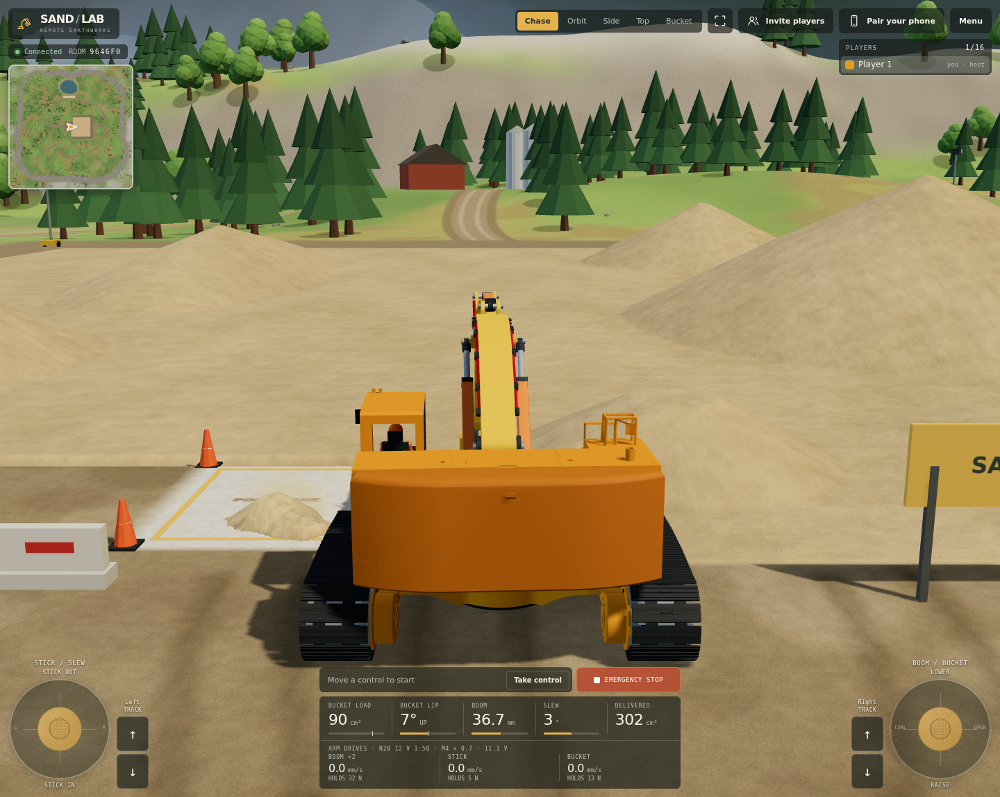
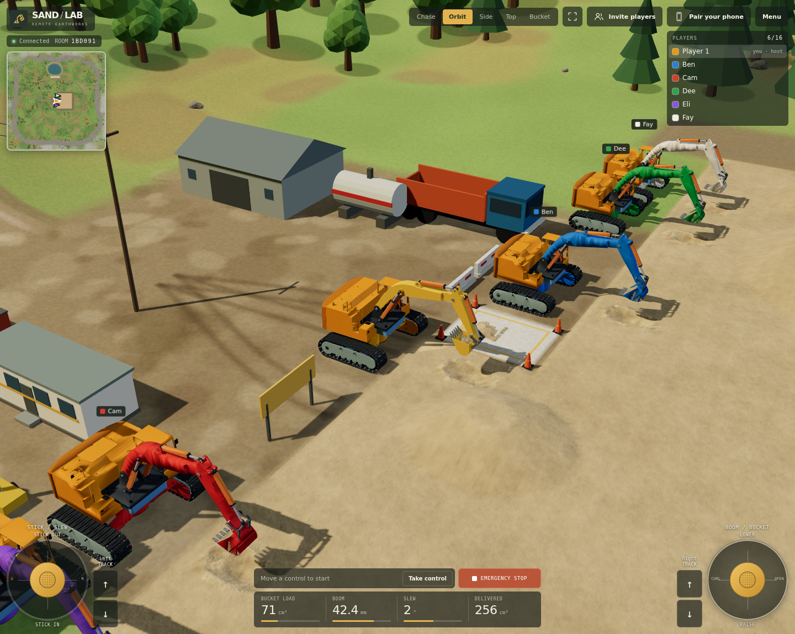
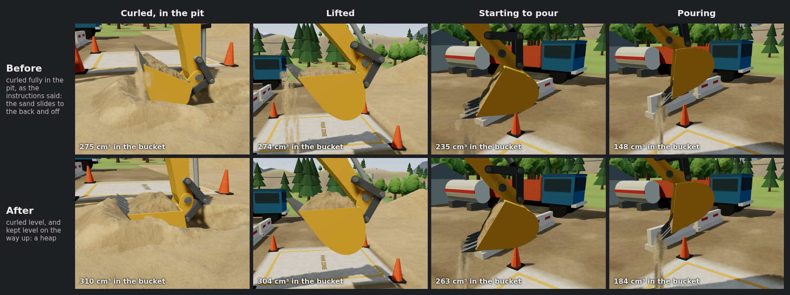
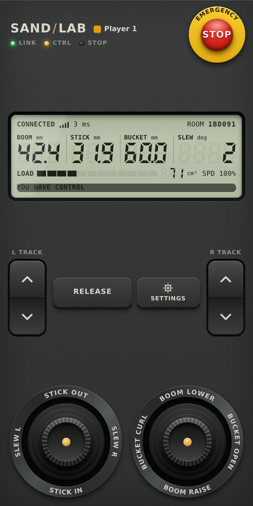
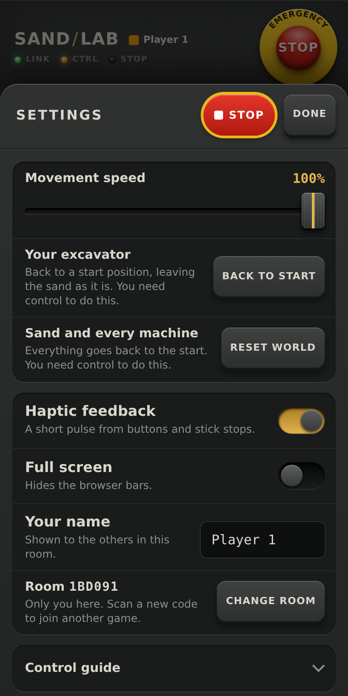
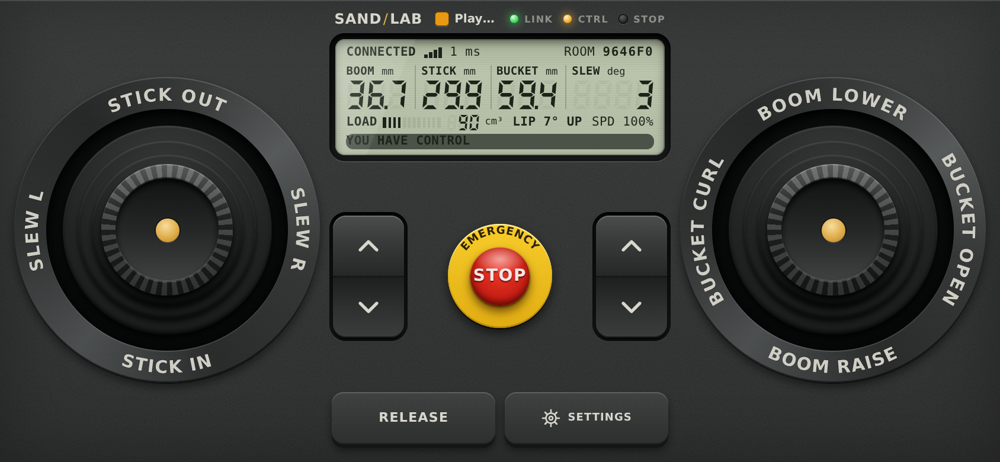

# Sand / Lab

An open-world excavator game for up to 16 people in a room, with a phone remote, deployable with Docker. Each player drives their own copy of the complete **X1 / J9 / R12 excavator assembly**, and a dump truck of their own to haul the sand away, around a 41 m valley (about 600 m at the model's 1:15 scale) with a 6.4 m sand yard, roads, a lake, a village and a ring of hills. A Node.js server simulates the machines, the ground and the sand: a height field on the ground that slumps to its angle of repose, a small one in each bucket that carries a heap and lets it slide when the bucket is tipped, one in each truck's body that the body tips out over its rear, and falling sand wherever it spills or pours. Browsers exchange controls and live state over WebSocket.



## Run with Docker

From this directory:

```sh
docker compose up --build -d
```

Open **http://localhost:8080** on your computer. A new game gets a six-character room code. Click **Pair your phone**, scan the QR code, and keep the simulator visible on the computer. The remote automatically takes control when the operator slot is free. If the desktop already has control, click **Release** first.

Both devices must be able to reach the server. From a phone, use the computer's LAN IP, for example `http://192.168.1.20:8080`. A phone's `localhost` points to the phone itself. The pairing dialog lets you correct the address; automatic address discovery inside Docker may show a container IP, so explicitly set the host address when needed:

```sh
PUBLIC_URL=http://192.168.1.20:8080 docker compose up --build -d
```

The simulator is at `/`; the touch remote is at `/remote`. **Pair your phone** makes the phone a second set of controls for your own machine. To bring in other people, see [Play together](#play-together). The physics continues when only a remote is connected.

```sh
docker compose logs --tail=100
docker compose down
```

The image runs as the unprivileged `node` user, supports a read-only filesystem, has a health check, and handles SIGTERM/SIGINT. No database, GPU, volume, or external CDN is required by the server. Building requires access to the npm registry and Docker base image; browser assets are served locally after the build.

## Play together



A room holds up to 16 excavators in one world. They all dig the same sand, and whatever one of them pours or digs out, the others see and can use.

- **Inviting people.** Click **Invite players** and send the link or show the QR code. The link can open **the full game** (`/?room=A1B2C3`) or just **a phone controller** (`/remote?room=A1B2C3`); typing the code on `/remote` does the same. Each person who arrives this way gets a new excavator, with its own paint and a start position of its own, facing the sand. For friends elsewhere, the server must be reachable from where they are; see [Configuration and hosting](#configuration-and-hosting).
- **Your own phone.** **Pair your phone** is different: that link carries your player's secret key, so the phone drives your excavator and adds no new one. Keep that link to yourself. Once opened, the key moves out of the address bar, so the address shown there is safe to pass on, as an invitation for a new player.
- **Seeing who is who.** Other machines carry their driver's name over the one they are in, and on the map every excavator has an arrow and every truck a block in its player's paint. The **PLAYERS** list says who is here, and who is in their truck. Click a name to put the camera on the machine that player is in, and **Back to my excavator** (or **truck**) to return; only the excavator the camera follows is drawn with all its CAD parts. Change your name under **Menu** on a computer or **Settings** on a phone.
- **Your machines are yours.** Only your own devices can drive your excavator and your truck, one at a time, and their emergency stop and resume belong to you too: a stop holds both of them, and nobody else's.
- **The host.** The first player in a room is its host, and only the host can **Reset world**, which puts the sand and every machine back at the start and tells everybody. When the host leaves, the player who has been there longest takes over. Anyone in control of their machine can use **Back to start** to return it to a free start position, or, in the truck, **Truck back to its bay**; sand in it stays where it was.
- **Getting in each other's way.** Crawlers stop at other crawlers and at trucks, and trucks at both, with a message saying so; moving apart is always allowed. Arms and buckets pass through other machines, as they do through scenery. A bucket held under somebody else's pour catches what falls into it.
- **Leaving and coming back.** A machine whose driver loses the connection stays where it is for 30 seconds, marked **offline**, with its controls stopped. Reconnecting or reloading the same tab gets it back. After that it is removed with its truck, whatever is in its bucket and its truck's body falls out, and its paint, start position and truck bay are free again.
- **One big screen.** A computer page is a player too, so a shared screen owns one idle excavator. Everyone else can join with the phone-controller link while the big screen clicks through their names.

**Everybody digs a full bucket.** A bucket's load costs the same to simulate however much sand it holds, so machines do not compete for anything but the sand itself. With all 16 digging at once, from their start positions, each scoops a heaped 304 cm³, what one does alone.

## Operate

Move a joystick, hold a drive button, or press a movement key to take control of your excavator when none of your other devices has it, on either a computer or a phone. **Take control** is also available. If another of your devices is driving, select **Release** there first. On a phone, use the two touch joysticks together; each supports an independent touch contact. Release a joystick or track button to stop that input. Movement starts only after the server grants control, using inputs that are still held.

| Control                       | Motion                     | Keyboard |
| ----------------------------- | -------------------------- | -------- |
| Left joystick up / down       | Stick out / in             | W / S    |
| Left joystick left / right    | Upper body slew            | A / D    |
| Right joystick up / down      | Boom lower / raise         | ↑ / ↓    |
| Right joystick left / right   | Bucket curl / open         | ← / →    |
| Left track forward / reverse  | Left track drive           | Q / Z    |
| Right track forward / reverse | Right track drive          | E / C    |
| Both tracks forward / reverse | Drive straight             | I / K    |
| Tracks opposed                | Turn on the spot           | J / L    |
| Emergency stop                | Latch all drive inputs off | Space    |

**Menu** holds your name, the how-to-play notes, movement speed (it scales every axis), the stick and bucket strokes, the arm drives' specification, **Back to start**, **Reset world**, and keyboard-focusable buttons: hold Enter to operate them. Bucket load and the sand delivered to the pour zone (both in cm³ of loose sand), how far the bucket's lip is from level, boom stroke and slew are always in the telemetry at the bottom, with **ARM DRIVES** under them (beside them on a phone held sideways): each leadscrew drive's speed in mm/s, the load it carries and its motor current, or that it is stalled or at its end stop, and the map at the top left shows where you are. **Chase**, **Orbit**, **Side**, **Top** and **Bucket** choose the camera (in the truck, **Body** looks into its body); drag to look around and scroll to zoom.

The bucket cannot be driven into the hard ground: the blocked motion stops and the game shows **BUCKET ON HARD GROUND · RAISE THE BOOM** until you change the command. The crawler stops at buildings, vehicles, other excavators, tree trunks and rocks, at slopes past 37°, at deep water and at the edge of the map, with a message saying which. Backing away is always allowed.

**A first scoop from the start position.** The machine starts in its carry pose, with the bucket curled.

1. Open the bucket to about **15 mm**.
2. Reach out: stick to about **9 mm**.
3. Lower the boom to about **29 mm**, until the teeth touch the sand.
4. Crowd the stick to about **33 mm**. The bucket fills as it comes in, and pushes a pile of sand ahead of it.
5. Curl the bucket until **BUCKET LIP** reads **LEVEL**, at about **56 mm**. The bucket turns up under that pile and takes a heap of it.
6. Raise the boom to about **49 mm**, curling a little more as it rises, to **60 mm** at the top. The boom alone would tip the lip down by 28° and pour the heap off, so keep **BUCKET LIP** within about 5° of level.
7. Swing about **+45°** toward the outlined pour zone.
8. Open the bucket toward **15 mm** and watch the sand fall.

**A heaped bucket.** The bucket holds about 247 cm³ filled level with its rims, and about 320 cm³ heaped, rated as ISO 7451 and SAE J296 rate an excavator's bucket: with a heap standing 1:1 on it. The **BUCKET LOAD** bar is full at that heaped load, and its mark is the level one. A heap stays on only while the bucket's mouth is close to level. Tipped more than about 5°, the side that has become too steep slides off, and a bucket curled or opened much further loses most of what stood above its rims. So the load depends on how you dig, as on a real machine. From the start position, curled level in the sand and kept level on the way up, the bucket carries about 304 cm³, 95 % of its rated heaped load. Curled fully while still in the pit, or lifted with the boom alone and curled afterwards, it carries about 290 cm³. Lifted with its lip left 47° down it carries 240 cm³, less than a level bucketful.



`shared/scoop.js` holds this cycle as seconds per control, timed for the arm's drives (see *Arm drives* below): the scoop takes 18.3 s and the whole cycle to the end of the pour 29.0 s. The tests, the load test and the pictures all dig with it. The deterministic physics test runs it: the bucket scoops about 310 cm³, still carries about 304 cm³ after the lift and swing, with the sand standing 23 mm above its rims, and about 300 cm³ arrives in the pour zone, including what spills on the way there. No sand is created or removed.

**Emergency stop** is available on every device of the machine's player. The operator must explicitly select **Resume operation** to clear it. Resetting the world does not clear a latched stop. Input becomes neutral after 350 ms without a valid control packet, on socket disconnect, on touch cancellation, and when the page loses focus. Changing apps releases ownership; use a control after returning to reclaim it if your other devices are not using it. An operator lease expires after five seconds without input. Reconnection starts with neutral controls and does not displace a device that is driving.

## Haul sand

Every player also has a dump truck: a **Volvo FMX13 6x4 rigid with a Schwarzmüller three-way tipper body**, at the excavator's 1:15. The first player's stands beside the start position, its body where the bucket swings 90° to the right. Everyone else's waits in one of two stands west of the yard, on the side of their own start position, facing the yard so that it drives straight out.

**Getting in.** Press **T**, or **Truck** beside the control button, or the **Truck** key on the phone. Your controls move to the truck and both machines stop; **T** again, or **Excavator**, takes you back. The camera goes with you and keeps its view. In the truck the telemetry shows **TRUCK LOAD**, the **BODY** angle and whether its rear wall is open, **SPEED**, **STEER** and **HAULED**.

| Control                     | Motion                   | Keyboard       |
| --------------------------- | ------------------------ | -------------- |
| Left joystick up / down     | Drive forward / reverse  | I / K or W / S |
| Left joystick left / right  | Steer                    | J / L or A / D |
| Right joystick up / down    | Raise / lower the body   | ↑ / ↓ or R / F |
| Change machine              | Excavator ↔ truck        | T              |
| Emergency stop              | Stops both your machines | Space          |

**Loading it.** From the start position, dig the first scoop as above. Then, instead of swinging to the pour zone, raise the boom on to about **55 mm**, so that the bucket clears the side wall, swing **90° right** over the middle of the body and open the bucket: about 98 % of a heaped bucket lands in the body. `shared/scoop.js` has this as `TO_TRUCK`. The body takes about **3,220 cm³** level with its side walls, eleven heaped buckets, and **TRUCK LOAD** is full at that. Other players' trucks can be loaded the same way wherever they stand, by anyone.

**Tipping.** Drive anywhere and hold **↑**. The body tips back about its rear hinge at 4° a second, up to 49°. As soon as it lifts, the rear wall, which hangs from bearings at the top of raised corner posts as on the Schwarzmüller body, swings free and opens at the bottom, and the load slides out over the end of the floor onto the ground behind; a full body is empty by about 46°. With the body up the truck only creeps, at 120 mm/s, to spread what it tips, and sand already heaped behind the open rear holds the rest back until the truck moves on. **↓** lowers the body at 6° a second and the rear wall latches again. **HAULED** counts the sand that left over the rear beyond the sand yard.

**Driving.** Up to 650 mm/s forward (about 35 km/h at 1:15) and 220 mm/s in reverse. The truck steers as a bicycle with the 292 mm (4,385 mm at full size) from its front axle to the middle of its tandem, at up to 40°: the lock that drives its outer front tyre round the sheet's 15.5 m turning circle. It rests on a plane fitted under its wheels, presses a 4 mm rut into loose sand, and pushes out what stands higher than its belly. It stops at buildings, trees, rocks, other machines, deep water and slopes over 25°, and backing away is always allowed. The sand in the body is a height field like a bucket's load: 34 × 16 columns of 10 mm on the flat floor, in the body's frame, holding at 34° and sliding to 31° as sand poured loose does, and leaving over any wall it stands above. It exchanges exact volumes with the bed and the falling parcels, so no sand is made or lost.

**Where its shape comes from.**

| Part     | Source | At full scale |
| -------- | ------ | ------------- |
| Chassis  | Volvo Trucks model range sheet *FMX13 6x4 Rigid - B/T Ride*, FMX 64R 3L (GBR, 2026-09-25) | 3,700 mm wheelbase, 1,370 mm between the rear axles, 1,520 mm from the bumper to the front axle, frame 1,111 mm high, 315/80R22.5 tyres on every axle, 15.5 m turning circle |
| Cab      | The same sheet's side and front views | Day cab 3,144 mm high and 2,500 mm wide, its back 515 mm behind the front axle; its outline, the leaning windscreen, the doors and their windows, the grille and the iron mark traced from the drawings |
| Body     | Schwarzmüller *3-way tipper body for 3A truck - building site* | 5,100 × 2,420 mm inside and 2,550 mm wide, 980 mm front and rear walls, 880 mm aluminium side walls, a rear wall swinging from raised upper bearings, about 11 m³, tipping to about 49° |
| Assumed  | Neither | 100 mm between the cab and the body, 60 mm walls, 2,050 and 1,830 mm tracks, twin tyres 350 mm apart, the hinge 100 mm ahead of the rear wall and 120 mm over the frame; the tanks, lamps, mirrors and the five-stage ram placed as on photographs of the type |

Its speeds and the body's rates are a game's, as the excavator's tracks and slew are. There is no suspension, load transfer, wheel slip or tipping over, and the body tips only backwards.

## Phone remote

 



`/remote` is drawn as a hand-held radio controller. It fills one screen with no scrolling, upright or on its side, and appears as a controller on a dark surface on a tablet or computer.

- **Emergency stop.** The red mushroom on the yellow collar. It latches and lights up, and the control key becomes **Resume**.
- **Player chip.** Your machine's paint and your name, beside the logo.
- **LCD.** Boom, stick, bucket and slew; bucket load as a bar, full at a heaped bucket, and in cm³; how far the bucket's lip is from level; speed; link quality and ping; room code; and who has control. It also carries messages and the warning when the bucket is on the ground.
- **Track rockers.** One for each track, tipping on a centre pivot. Push the top end to drive forward and the bottom end to reverse.
- **Control key.** **Release** or **Take control**.
- **Machine key.** **Truck** gets you into your dump truck and **Digger** back into the excavator. In the truck the left stick drives and steers, the right stick raises and lowers the body, the track rockers step aside, and the LCD shows speed, steering, the body's angle and the litres hauled, the load in litres, and whether the rear wall is open.
- **Settings key.** Opens a sheet with your name, movement speed, **Back to start**, **Reset world** for the host, haptic feedback, full screen, the room code, how many others are here and a way to change room, the control guide, and hold-to-move buttons for keyboard and screen-reader users. Opening it stops this operator's movement, and the sheet has its own emergency stop because the face cannot be reached underneath it.
- **Joysticks.** A thumb landing on the cap grabs it where it is, so a press alone moves nothing; pressing beside the cap jumps the stick to the thumb. The rubber boot flexes as the stick tilts, the legend for the pushed direction lights up, and the stick springs back on release.

Haptic pulses mark key presses, leaving a stick's centre, reaching its stop and the bucket meeting hard ground. They use the browser's Vibration API, which Safari on iPhone does not offer, so that setting is hidden there. Full screen is hidden where the browser has no Fullscreen API, including on iPhone.

## Simulation and model

`scripts/export_model.py` extracts the committed complete-machine viewer at `../excavator_complete/3D_preview.html` and its R12 linkage tables. It requires Python 3 only, not CadQuery or NumPy. The exported `public/model.json.gz`, `shared/config.js`, and `shared/kinematics.js` are committed so this folder can be built independently of the rest of the repository. The compressed model includes the generated viewer's SHA-256 for provenance. Run `npm run export:model` from the full repository to regenerate it.

The shared R12 linkage solver uses 0.1 mm tables across the complete 0–60 mm actuator travel and independent ±150° slew. Rendering moves the boom, stick, bucket, four cylinders, linkage, slew gearing, track shoes and wheels from the same frames as the offline viewer. The crawler uses differential-drive kinematics across the whole valley, at up to 220 mm/s (about 12 km/h at 1:15). Both tracks together drive forward or backward; opposing tracks turn in place. Its rotated footprint stays inside the map. A plane fitted through 14 points under the tracks, on the ground and on any sand, sets the chassis height, pitch and roll, and the arm and bucket frames follow that tilt exactly. This is a simplified terrain model without suspension, traction limits or tipping. It does not replay or rerun the original MuJoCo track experiment. Track articulation is interpolated along the original chain poses, so the animation is a visual approximation between those poses.

**Arm drives.** The boom, stick and bucket strokes move as fast as the leadscrew drives the X1 would carry: a 12 V N20 gearmotor, 1:50 and 800 rpm without load, turning an M4 × 0.7 leadscrew, on the 11.1 V battery (`shared/drives.js`). Movement speed sets their PWM duty, as on the X1's controller. Each drive carries its share of the weight of the arm and of the sand in the bucket, found by virtual work from the R12 CAD masses (the two boom drives share the boom's), so a stroke is slower against its load than with it, and slower with a full bucket.

| At full duty | Speed | 60 mm stroke | Current |
| --- | --- | --- | --- |
| No load | 8.2 mm/s | 7.3 s | 0.08 A |
| Boom raising the empty arm, 27 N | 6.8 mm/s | 8.9 s | 0.21 A |
| R12's 150 g design case, boom 38 N | 6.2 mm/s | 9.7 s | 0.27 A |
| Boom raising a heaped bucket of sand, 52 N | 5.5 mm/s | 11.0 s | 0.33 A |
| Main board's 0.5 A current limit | — | stalls above 86 N | 0.50 A |

The leadscrew is self-locking: lowering a load also takes motor torque, and a stopped drive holds its load with no current. A drive that would need more than the main board's 0.5 A, or more voltage than its duty gives, stalls: lifting a heaped bucket needs about 42 % duty, and the empty arm about 27 %. A drive pushed against hard ground stalls too, and one at the end of its stroke is switched off by its end stop. The motor's stall current (hidden in the seller's table, 1.1 A assumed), a 0.65 gearbox efficiency, a thread friction of 0.15, 0.35 V and 1.7 Ω lost in the end-stop board (actuator_v6 rev 6.2: its Schottky, 0.35 A fuse and MOSFET), the cable and the driver, and 1.6 g/cm³ loose sand are assumptions. Digging resistance, the 0.1 s duty ramp and the trip of the actuators' fuses are not simulated; the fuse holds 0.35 A, about 55 N. The slew and the tracks keep their game speeds.

**The world** is 40.96 m square. Its hard ground comes from `shared/landscape.js`, which the server and the browser both run, on a 160 mm triangle grid that is drawn exactly as the physics sees it. It holds a road loop with spurs, the sand yard, a lake with a beach and a pier, a village, a farm, a crushing plant, wind turbines and about a thousand trees and rocks, all generic low-poly scenery. The start position and the pour zone are on hard ground beside the yard.

The sand is **height fields, with parcels in the air between them**:

- **Sand bed.** Sand anywhere in the world is a height field of 10 mm cells over the hard ground: 4096 × 4096 cells, stored only in the 64-cell pages that have held sand (about 130 at the start, holding 9.2 m³ across the yard and the beach). Any slope steeper than dry sand's **34° angle of repose** avalanches downhill, so cut faces cave in, tipped loads form cones and nothing stays implausibly steep. Sand sliding towards a bucket standing in the bed stops at its plates and piles against them, instead of creeping underneath and being pushed out again. The seven stockpiles start at a gentler 27° and stay put.
- **Cutting.** Each column of sand the bucket occupies is checked against how the sand entered the bucket's region. Sand met by the teeth or the open mouth goes into the bucket while that part of it has room. Sand met by the closed back, floor or cheek plates, or with no room to go to, is bulldozed ahead of the bucket into a berm. Sand lying over an open mouth falls in, and sand lying on a closed plate is pushed off. Moving tracks press a rut of about 4 mm and spread what they displace over a band beside them. Sand above the belly or inside the turning upper body is pushed aside the same way, so a wall of sand cannot stand inside the machine.
- **The load in a bucket.** A second height field, fixed to the bucket: 22 × 15 columns about 3.6 × 5 mm, each standing on the inner surface of the R12 bucket's 2.4 mm printed wrapper, the Caterpillar US 8,201,350 profile at 1:15 taken from the arm's design source (`shared/world.js`), and ending under the support plate where it leans back over the cavity. The physics bucket, its five teeth and its 80 mm width are the same bucket the browser draws. Sand cannot pass through a plate, since a column's floor is the plate itself.
- **How steep it stands.** Sand that digging has pressed into a bucket is damp and packed. At rest it stands as steep as **45°**, the 1:1 slope by which a heaped bucket is rated, and a slope that lets go slides until it lies at **40°**. Between the two a heap stays where it is, so a carried load does not trickle away with every small movement of the bucket, and leaves in slides when the bucket is tipped too far. Sand that falls into a bucket arrives sliding, and stops at the lower angle. Sand standing above a rim by more than that leaves over it: the lip, the far rim or either cheek, at up to about 130 cm³/s over the lip. Poured onto the bed it is loose, and lies at 34° like the rest.
- **Down in the sand.** The bed holds the load in, as high as the bed stands itself. Beside each rim, and in front of the mouth, the bucket finds the first cell of the bed that is not under it and takes that cell's height. A mouth facing the bed fills to the mouth wherever the bed stands in front of it. A mouth turned up takes the heap its tilt could carry in the open and a 5 mm layer more, 350 cm³ at most; the sand over that is pushed aside, as is everything a full bucket meets. As the bucket comes out, the bed's hold on each rim sinks away with it, the layer runs off all round, and the heap stays. Nothing is ever handed back at once: whatever a tilt cannot hold leaves over the rims at the same limited rate as in the open, so a bed that gives way for a moment costs a little sand and not the load. Sand that would start its fall inside the bed, like sand pushed aside by a plate or a track, joins the bed over a small disc, so nothing stands up as a spike.
- **Falling sand.** What leaves a bucket falls as parcels of 447 mm³, on a ballistic path that touches nothing on the way down, and joins a bucket it falls into, if there is room, or the bed where it lands. What a stream leaves behind when it stops, less than a parcel at each place along a rim, is gathered there, so a slow trickle is a whole parcel now and then.
- **Conservation.** The bed, the loads and the falling parcels exchange exact volumes, so the total sand volume is constant to floating-point rounding.

**Rendering.** The browser draws the bed as deformable chunks, created only where there is sand and simplified with distance, with a fine grain texture and lumps from half a millimetre to a few centimetres. Sand gets lumpier the further it has moved, slopes near the angle of repose show lines running down them, and creases collect shade while crests catch the light. Freshly cut or dumped sand looks damp and dries in patches over about a minute, and thin sand breaks up into patches and scattered grains at the edges.

The carried load is one sheet drawn from its columns in the bucket's frame, with the same texture and lumps as the bed, so the sand in a bucket looks like the sand it came from and stays still on the bucket. Where the sand runs out, the sheet dips behind the plates, breaks up into patches, and a skirt closes its edge. At the lip and the cheeks the sheet comes down to the plate where the slope of the sand does, so a heap meets its rims as a heap and not as a step. About 2 mm of drawn relief, with no volume, keeps it from looking like a flat slab, and travels along the bucket as sand comes and goes. A load is 808 triangles. A bucket that has held sand never comes quite clean: it keeps a drawn dusting at the back and by the cheeks, with no volume, using the same sheet.

Falling sand is one streak per parcel, running along its velocity and overlapping the next, so a stream reads as a continuous curtain. Each streak's cover comes from the area the grains of a parcel could really hide, about 800 mm² for 447 mm³ of 0.5 mm sand, so a stream is nearly solid at the lip and thins into streamers as it speeds up and draws in. A repeating pattern of grains and clumps, faded by its mipmaps at a distance, and instanced fine grains with a 1/500 s exposure give it grit up close: 64 per parcel, or 24 on touch devices. Streaks keep clear of the bucket plates and teeth on the side they trail from, and the bed hides whatever runs into it. Motion is derived from consecutive simulation snapshots when they arrive, so skipped display frames preserve flow direction. Reconnect gaps, position jumps and room resets clear that motion history.

Loose grains and dust are what the eye expects around all that, and are drawn only: each browser works out its own, within 3.5 m of the camera, and they carry no sand. Grains are thrown up where a parcel lands, roll down a slope that has just moved, drop off a moving bucket's rim wherever its sand reaches the rim, and dribble off the lip for a second or two after a stream stops. Each one falls, bounces, then rolls with friction, so it runs on down a slope at the angle of repose and stops on anything flatter. There are at most 2,400 at a time, or 700 on touch devices, and a faint haze of soft sprites rises where sand lands or is turned over. `docs/sand-look-before-after.png` shows the difference, from `scripts/capture_comparison.mjs`.

Each binary frame carries every machine's pose and load, and the sand of the same tick. The browser plays frames back about 60 ms late, plus up to 200 ms more on a connection whose frames arrive unevenly, and interpolates both together, so a bucket and its load always move as one.

**The machines.** Only the machine the camera follows is the complete CAD assembly: 419 rigid part records, 104 J9 track-module records and two link meshes instanced across 68 positions. From close up it is drawn in full. Further away, once its finest detail would be under about two pixels, its rigid parts use a clustered index of the same geometry, and zooming in brings the full detail back. The 68 track links remain instanced, with the same chain interpolation as the offline viewer.

The other machines share a model simplified further by vertex clustering and differ only in a colour attribute. Their loads are drawn just as yours is. The geometry of both levels is built once when the page loads, in slices of about 40 ms so that the connection keeps answering while it is built, and is shared by every machine in the room: another player, or a change of the machine the camera follows, costs a few meshes and a paint rather than a rebuild.

This is an interactive approximation of sand, not a calibrated soil, load, traction or structural engineering model. The two angles of the sand in a bucket come from the rating convention for heaped buckets and from commonly quoted figures for damp sand, not from measurements, and are constant: sand in a bucket does not dry out. The bed is one height per 10 mm cell and a load one height per 5 mm column, so neither has overhangs or tunnels, nor individual grains or clods; the grains, lumps and dust on screen are drawn only. Sand flows over rims but does not tumble inside the bucket, and the machinery is kinematic. There is no two-way soil force feedback, water phase, rigid-body vehicle tipping or arm self-collision. The arm and bucket do not collide with buildings or trees, falling sand passes through machines and their plates, and the arm can pass through scenery the crawler cannot. Joints start and stop instantly instead of following hydraulic acceleration. The full independent boom/slew travel intentionally preserves the original model's operator-managed clearance. Only the hard ground stops the bucket. At high CPU load the fixed-step simulation runs slower than real time instead of increasing the step size.

The simulator needs WebGL2. The phone remote uses only HTML controls and telemetry; it does not download Three.js or the CAD asset. On touch devices the 3D simulator caps pixel ratio at 1 and disables shadows and antialiasing to reduce GPU cost while retaining all CAD parts. Rendering is skipped for an unchanged scene, and hidden tabs also skip scene updates.

**What a frame costs.** From the default view, one machine is about 600,000 triangles and 290 draw calls, counting the shadow pass, and sixteen in view about 1.1 million and 430. With the camera pulled right back over all sixteen it reaches about 1.4 million and 680. To keep it there:

- Trees and rocks are drawn per 6 m block, so those out of view or too far away to shadow the machine are skipped.
- The sand casts no shadow. It lies at 34° at most under a sun at 49°, so what it would cast changes a dig by one colour level at most.
- The machine draws first and the ground last, so hidden ground is not shaded on a card that can reject it early.
- When frames stay under 45 fps, the drawing resolution drops a step at a time, as far as 0.75× the CSS pixels, and is tried higher again after a run of fast frames. If even the lowest setting is no faster, as on a 30 Hz display, it goes back to full and stops adjusting. The menu shows the frame rate and resolution.
- Shaders for a first dig and for other players are compiled at load, apart from one small shadow shader, which compiles during the first dig.

These counts and the savings come from software rendering and from counting, not from a real graphics card. Software-only graphics stay slow, about 1.7 s a frame on the 4-core test host, so a hardware-accelerated browser is recommended.

Control starts, reversals and stops send immediately. Continuous pointer motion is coalesced at 30 Hz, with a 100 ms heartbeat while holding controls. Each room runs physics for all its machines in one worker, leaving the HTTP/WebSocket thread free to process input, pings, ownership and watchdogs. Only one physics step per room can be in flight; slower hardware does not build a queue of old inputs. Each player's own machine state is published as JSON to that player's phones after each completed step (up to 30 Hz), and to their simulator pages at most every third step, since those draw the machines from their frames; the player list goes out when it changes. A device whose socket is behind with its frames skips that periodic state, but a change of who has control, of the emergency stop or of the host always reaches it, as notices and errors do. Simulator clients also receive one binary frame per step: every machine's pose, the load of each one that has any (330 columns, Uint16, 0.02 mm), every truck's pose and the load of each one that has any (544 columns), falling parcels (Int16, 0.1 mm, in groups each carrying a 6.4 m world block and the machine whose bucket they left) and only the 16 × 16-cell bed tiles that changed (Uint16, 0.02 mm). The first frame on a connection carries all the sand there is, about 880 KB; digging then averages about 1.5 KB per frame with one machine and 17 KB with sixteen. The server tracks which tile versions each client holds, so a congested socket can skip frames and later catch up on every change. Phones receive telemetry only. Worker resources are released on room expiry and server shutdown.

Every page acknowledges each update it has handled, a simulator page each frame and a phone each state, and is sent no more than its connection carries (`server/delivery.js`): an update waits while the oldest one not yet acknowledged has been on its way longer than the quickest round trip of the last 10 to 20 s plus 100 ms, and until the first acknowledgement only one is on its way. The updates that wait are skipped, and the next one carries everything that changed. The server cannot see the buffers on the way, in the kernel, a proxy such as Docker's port mapping, or a router in front of a slow line. Before this, a line slower than the stream filled them with seconds of old frames, and a command showed on the computer seconds late while the phone, whose ping is measured on its own quiet connection, still read 170 ms. A page from before acknowledgements, or a script that does not send them, is sent what its socket takes, as then.

A first visit downloads about 6.9 MB: the complete model at about 5.8 MB, compressed scripts and styles, and that first frame. A reload only needs the first frame again, because unchanged files are revalidated rather than resent. Through a simulated link of 240 ms and 4 Mbit/s, sand appears after about 14 s on a first visit and 4 s on a reload. One machine digging takes about 44 KB/s, or 0.35 Mbit/s, frames and readouts together. A slower line gets fewer frames rather than older ones: through 600 kbit/s with a 170 ms round trip, `npm run test:latency` has each frame reach the computer a median 98 ms after its step and 0.5 s at most, and each command from the phone show there after a median 0.2 s and 0.5 s at most, where a page that does not acknowledge falls 2 to 5 s behind. The server gives up on a silent simulator page after 45 s, since it cannot answer while it builds the model or receives that first frame, and on a silent phone after 10 s. A machine still stops within 350 ms of its last input, and its control lease ends after 5 s.

## Configuration and hosting

| Setting      | Default | Meaning                                                                                                     |
| ------------ | ------- | ----------------------------------------------------------------------------------------------------------- |
| `PORT`       | `8080`  | Native server port; Compose uses this for the published host port and keeps port 8080 inside the container. |
| `PUBLIC_URL` | empty   | Public or LAN origin encoded in the pairing QR code. Use an origin without a path prefix.                   |
| `MAX_ROOMS`  | `4`     | Maximum in-memory game rooms. Lower it on small CPUs.                                                       |
| `MAX_PLAYERS` | `16`   | Excavators per room, up to 16: there are 16 paints.                                                         |

Each excavator allows four connected devices and one active operator. Empty rooms expire after ten minutes. Rooms and sand state are held in memory and reset on server restart. Health status is available at `/api/health`.

Opening an expired simulator link, or reconnecting after a server restart, automatically creates a fresh game and updates the URL, room code and pairing links. Pair your phone again using the new code. An expired phone link displays an explanation and an **Enter room code** link; it never creates a separate game. Temporary connection failures retry the existing room. A persistent connection notice provides a manual retry when needed.

**Playing over the Internet.** Host the server somewhere your friends can reach, set `PUBLIC_URL` to that address so the links and QR codes use it, and share an invite. With 16 machines digging, a room's physics takes a median 5.1 ms of each 33 ms tick and each browser running the full game receives about 1.6 Mbit/s. A phone controller receives only telemetry. `npm run test:load` measures this on your own server. With every machine digging at once, in a container limited to 4 CPUs of a shared virtual machine, clients included, without rendering:

| Machines digging | Physics ticks/s (30 is real time) | Step median / p99 | Ping p99 | Per browser | Server memory |
| ---------------- | --------------------------------- | ----------------- | -------- | ----------- | ------------- |
| 1                | 30.0                              | 0.8 / 3.5 ms      | 1.3 ms   | 43 KB/s     | 128 MB        |
| 4                | 30.0                              | 1.8 / 13 ms       | 3.2 ms   | 138 KB/s    | 140 MB        |
| 8                | 28.4                              | 2.9 / 79 ms       | 6.4 ms   | 194 KB/s    | 149 MB        |
| 16               | 26.9                              | 5.1 / 88 ms       | 58 ms    | 202 KB/s    | 161 MB        |

So a full room of 16 browsers takes about 26 Mbit/s of upload from the server. The load test has every bucket enter the sand at the same moment, which is the worst case: those ticks take up to 90 ms and the physics drops to 27 ticks a second while it lasts; players digging at their own pace do not line up like that, and four or fewer stay in real time even when they do. Control travels to the server and back, so a machine answers one round trip late, plus the playback delay. An input gap of 350 ms stops the machine, which a very poor connection will feel.

A command from a phone reaches the computer's screen by way of the server: the phone's trip there, up to one tick, the trip on to the computer and the playback delay. With a server 170 ms from both that is about 0.3 to 0.5 s, although the phone's ping reads 170 ms: the ping on a phone is that phone's own round trip, and the one in the computer's menu the computer's. For the quickest answer, run the server close to its players, on the same network when they are together, and on a CPU of its own. On a busy host, or on a virtual machine whose host takes its CPU back (`st` in `top`), the physics runs slower than real time: with about half its CPU taken, one machine digging got 13 to 16 ticks a second.

The six-character code is a way to find a room, not user authentication: anyone with the code can join, up to the limit, as a new player, though they cannot drive anybody else's machine without its key. For Internet hosting, place access control and HTTPS in front of the app. Serve it at the domain root and proxy `/ws` with WebSocket upgrades. The browser automatically selects `wss://` for HTTPS. Preserve the original Host header so the server's same-origin checks pass. An Nginx location inside an existing HTTPS server can use:

```nginx
location / {
    proxy_pass http://127.0.0.1:8080;
    proxy_http_version 1.1;
    proxy_set_header Host $http_host;
    proxy_set_header Upgrade $http_upgrade;
    proxy_set_header Connection "upgrade";
    proxy_read_timeout 60s;
}
```

If the phone cannot connect, first open the server's `/api/health` URL from the phone. Check the host IP/port, local firewall, Wi-Fi client isolation, and the QR address. If control is occupied, release it on your other device. A new game is created by opening `/` without a room query.

## Develop and verify

Use Node.js 22.12 or newer and npm:

```sh
npm ci --include=dev
npm run build
npm start
```

The production server serves the built `dist/` directory. Rebuild after client changes; restart after server changes. A separate Vite development server is unnecessary.

```sh
npm test
npx playwright install chromium
npm run test:browser
npm run test:sand
npm run test:load -- 16 40
npm run test:latency -- 600 170 60
bash scripts/check_docker.sh
npm audit --include=dev
```

The browser tests start temporary servers and always close them. Software WebGL can take several seconds a frame, so each of their waits allows up to three or four minutes. `npm run test:sand` replays deterministic bed, scoop, lift, early/middle/late pour and settled snapshots on desktop and touch renderers, checks for shader errors and stale loads after reset, and saves screenshots to `test-results/sand/`. `BROWSER_PATH` can select an existing Chromium executable. Screenshots are written to `test-results/`. `npm run test:load -- [machines] [seconds]` has that many players digging over real sockets, without rendering, and prints what each would see. `npm run test:latency -- [kbit/s] [round trip ms] [seconds]` puts an emulated line of that speed and round trip between a temporary server and a computer, and one of that round trip in front of a phone, has the phone drive the standard dig, and prints how old the computer's frames are when they arrive and how long each command takes to reach it; `--no-acks` connects the way pages did before acknowledgements. `node scripts/capture_docs.mjs` digs in a temporary server and rewrites the README screenshots in `docs/`. `node scripts/capture_comparison.mjs <older checkout>` renders the standard dig from an older build and this one, in rows, each digging the way its own `shared/scoop.js` says and seen side-on from the same cameras; `docs/heaped-bucket-before-after.png` shows the bucket before and after its load could stand as a heap, and `docs/height-field-before-after.png` before and after the load became a height field. `node scripts/capture_angles.mjs` takes nine stills of the dig and the pour into `docs/angles/`.

Checks cover:
- **Kinematics:** the R12 table solver reproduces the 125 poses the complete viewer was validated against, to 0.001 mm.
- **Bucket:** the load's columns stand on the CAD plate surfaces and hold the cavity's volume, and the heaped rating is the ISO 7451 one; a struck load stays put, holds through small tilts, slides out over the low rim at bigger ones with no favourite side, and comes to rest between the two angles; held mouth down it empties, and over-curled the back pocket keeps some; a heap holds through a small tilt and slides at a bigger one; pressed-in sand stands steeper than sand that fell in; down in the sand the bucket fills to the mouth and no further, loses little when the bed gives way for a moment, and empties when lifted clear; buried over its rims it takes a heap and a layer more, and keeps the heap when it comes out; the bed holds a load in only as high as it stands; and any sequence of tilts, beds and additions conserves the sand exactly.
- **Bed:** the yard rests below the angle of repose, a tall heap avalanches back to it, sand dumped far from the yard stays there, storage stays sparse, and only tiles that really changed are published.
- **Full cycle:** a complete scoop/lift/swing/pour heaps the bucket to within 7 % of its rated heaped load with its mouth level, keeps the heap through the lift and the swing, lands it in the pour zone as a stream and conserves total sand volume. The load only grows while the bucket crowds and curls in the sand; a carried heap sheds nothing, and what leaves a bucket leaves as whole parcels; out of deep sand a bucket comes up heaped and the rest runs off it. Aggressive dig/sweep/shake motions keep every column finite and within capacity, and every spilled parcel starts outside the plates.
- **Machine:** the hard ground stop, independent slew/boom travel, the map limit at every heading, following the hills with exact tilted arm and bucket frames, the stops for steep slopes, scenery and water, ruts instead of walls of sand when driving over and turning on piles, the upper body clearing sand, and bulldozing when a bucket has no room.
- **World:** the physics and the drawn ground are the same surface, and nothing stands on the start position or grows in the water.
- **Truck:** its dimensions are the Volvo sheet's and Schwarzmüller's; every bay is level hard ground, in no start's or camera's way, and its truck drives straight out with every other truck parked; it drives, steers round the bicycle radius of its full lock, reverses slower, and stops at an excavator, which stops at it in turn; sand poured into the body stays in it and on the road; raising the body opens the rear wall, empties it over the rear into a heap behind, and counts what left beyond the yard as hauled; the first excavator loads the first truck from the start and the truck hauls it away; a truck that leaves or jumps back to its bay leaves its load on the ground; frames carry trucks and their loads exactly; and over WebSocket only the operator changes machine, the truck drives alone, a stop holds both machines, **Back to start** returns the truck to its bay, and a player who leaves takes theirs along. No sand is made or lost in any of it.
- **Multiplayer:** every start position is clear, level, faces sand and blocks nobody's camera; a machine far away changes nothing about a solo dig, to the last bit; two machines digging keep separate loads and lose no sand; crawlers stop at crawlers, arms do not; a machine that leaves drops its load; all 16 machines digging at once each get a full scoop; own machines by key, pairing, grace, rejoining, host transfer, a full room, and host-only reset. In a browser: invite links, paint, names, map arrows, a paired phone and a phone-only player in one room, watching, per-machine stops, the collision banner, the player list at phone sizes, and reloading.
- **Network:** WebSocket ownership and validation, binary frames that carry far-away positions and loads, frame jitter estimates, delivery of all the sand, stale-input/disconnect stops, a latched E-stop, worker reset and cleanup, four-room phone round trips, immediate/coalesced input, and acknowledged delivery: one update on its way until the first round trip, every frame to a page that keeps up, nothing more into a stalled line, a catch-up to the latest tick at once, a phone that is behind still told about control, and the round trip kept from a quick moment rather than a queue.
- **Sand rendering:** a load's sheet stays level and within the plates, faces out of the mouth, is drawn between frames and in each machine's own bucket; snapshot origins and transfer fading are correct, room resets clear the load, falling detail respects bucket clearance, and motion handles network origins, skipped display frames, reconnect gaps and reused particle slots. Loose grains fall, roll on down a slope at repose and stop on the flat, keep to their pool, come from landings but not from sand caught by a bucket, from the bed in proportion to how far it moved, and from a bucket for a while after its stream stops; a bucket that has poured keeps only a dusting.
- **Browser:** touch/multitouch/cancel, reconnect, keyboard driving, the following camera, the game menu, QR links, camera views, the machine's two levels of detail, a frame budget of a million triangles and 400 draw calls, and desktop/mobile layouts and graphics settings.
- **Performance logic:** the resolution steps down only for a trend of slow frames, comes back more cautiously each time and gives up when fewer pixels do not help; simplified meshes stay closed and keep their hard edges; files are compressed and an unchanged one is not sent again; a page that is busy loading is not disconnected.
- **Phone remote:** fits one screen at ten phone sizes in both orientations, with thumb-sized, non-overlapping controls; cap grab and spring return, rockers, haptics and their setting, the settings sheet and touch fader, emergency stops from the sheet and from another device, reset and the floor warning.
- **Docker:** the smoke test runs the actual server inside a non-root, read-only container and checks HTTP, model delivery and WebSocket operation.

## Files

| Path                         | Purpose                                                            |
| ---------------------------- | ------------------------------------------------------------------ |
| `server/index.js`            | HTTP, WebSocket rooms, players, operator leases, watchdogs and snapshots |
| `server/delivery.js`         | How far behind each connection is: updates wait for a slow line instead of queueing in it |
| `client/resolution.js`       | Lowers and restores the drawing resolution to follow the frame rate |
| `server/simulation-runner.js`, `server/physics-worker.js` | Isolated room physics, bounded work, reset synchronization and cleanup |
| `server/physics.js`          | Machine motion, cutting and falling parcels                        |
| `server/bucket-load.js`      | The load in a bucket: heaping, sliding, spilling, and what the bed holds in |
| `server/terrain.js`          | Sparse sand height field, angle-of-repose avalanching, stockpiles  |
| `shared/bucket.js`           | Bucket frame and CAD plate surfaces                                |
| `shared/bucket-load.js`      | The load's grid, fitted to the CAD plates                          |
| `shared/players.js`          | Start positions, truck bays, paints and player names               |
| `shared/protocol.js`         | Binary frame format: machine and truck poses and loads, falling parcels and sand-bed tiles |
| `shared/truck.js`            | The dump truck's dimensions and their sources, its body's frame, footprint and load grid |
| `server/trucks.js`, `server/truck-load.js` | The truck's driving, footing, ruts and tipping, and the sand in its body |
| `client/truck-model.js`, `client/truck-load-mesh.js` | The truck drawn from the Volvo and Schwarzmüller drawings, and the sand in its body |
| `shared/landscape.js`        | The world: hard ground, roads, lake, initial sand, scenery, colliders |
| `shared/`                    | Original configuration and kinematics; simulation dimensions       |
| `client/main.js`             | Game HUD and remote interfaces, pairing, touch and keyboard input  |
| `client/remote-face.js`, `client/remote.css` | The phone remote's faceplate, segment LCD, haptics and settings sheet |
| `client/scene.js`            | The world's machines, name labels, synced playback, following cameras, minimap |
| `client/machine-model.js`, `client/decimate.js` | The full CAD machine, and the simplified one for other players |
| `client/frame-jitter.js`     | How unevenly frames arrive, for the playback delay                 |
| `client/world-view.js`       | Ground, sky, water and scenery drawn from `shared/landscape.js`    |
| `client/sand-view.js`        | Sand chunks with level of detail, created only where sand exists   |
| `client/loose-sand-view.js`, `client/load-mesh.js` | Bucket loads and their dusting, falling sand, and where loose grains come from |
| `client/sand-material.js`, `client/sand-relief.js` | Grain, lump and stream textures; the lumps and slope lines shared by the bed and bucket load |
| `client/sand-stream.js`, `client/sand-flight.js` | Falling streaks and fine grains, bounded breakup, motion blur and snapshot velocities |
| `client/loose-grains.js` | Grains that bounce and roll on the bed, and dust; drawn only |
| `public/model.json.gz`       | Complete X1/J9/R12 CAD meshes and viewer provenance                |
| `test/`                      | Numerical, network and browser checks                              |
| `scripts/load_test.mjs`      | How a room behaves with many excavators digging at once            |
| `scripts/latency_test.mjs`   | How late a phone's commands reach the computer through a slow, distant line |
| `scripts/capture_comparison.mjs` | The standard dig rendered from two builds, side by side        |
| `scripts/capture_angles.mjs` | Stills of a dig and a pour from fixed cameras, in `docs/angles/`   |
| `scripts/fixed-camera.mjs`   | Fixed cameras and simulated time for those two scripts' pictures   |
| `Dockerfile`, `compose.yaml` | Production deployment                                              |

The existing model retains its original licensing status; this application does not assign it a new license. Three.js and the other npm packages retain their respective licenses.
