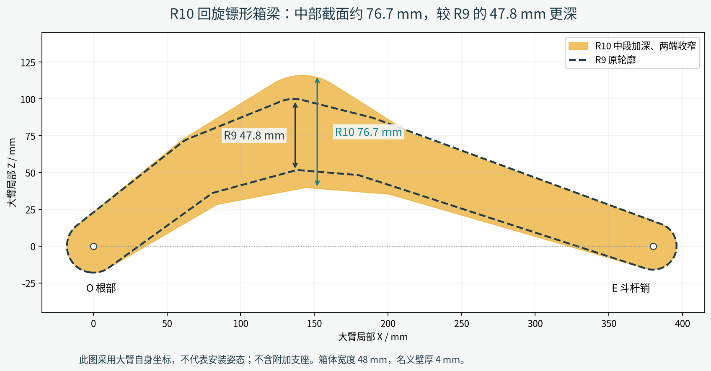
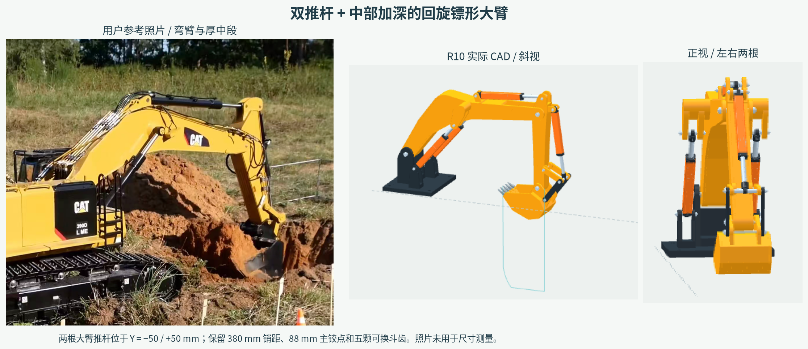
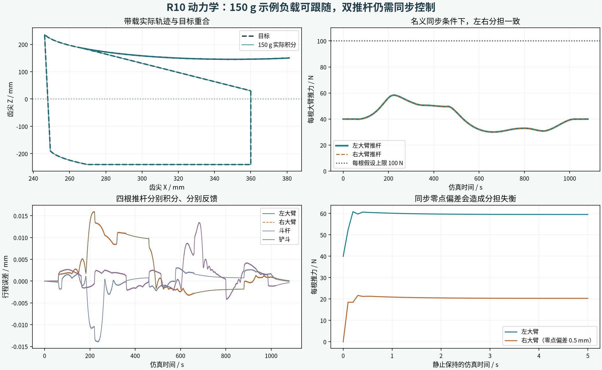

# R10：双推杆与回旋镖形大臂

本版按用户要求，将大臂改为**左右两根推杆**，并将大臂箱梁改成**中部更深、两端收窄的回旋镖形轮廓**。保留斗杆上置推杆、铲斗四连杆及五颗可更换斗齿。两个大臂执行器分别建模、分别驱动，重新计算新增自重并运行整臂动力学。

本版的尺寸是现有模型的设计尺寸；用户提供的 CAT 390D 照片用于外形与布局参考，没有从照片测量工厂尺寸。

## 查看文件

- [54 秒带载运动视频](images/motion_simulation_r10.mp4)：150 g 示例负载的实际动力学状态回放，20 倍速呈现 1,080 秒仿真。开头用正视和斜视展示两根推杆，随后展示完整作业动作。720p、24 帧/秒、中文说明、无音频。
- [离线交互预览](3D_preview.html)：支持 150 g、空载动力学以及目标运动学；可切换视角、阶段、暂停和拖动。四根推杆分别回放各自的实际行程与位置。
- [完整装配 STEP](step/excavator_arm_assembly.step)：单位 mm；独立结构件 STEP、打印 STL 分别位于 `step/`、`stl/`。
- [装配说明](ASSEMBLY.md)：两侧销轴、隔套、四套 U60 和同步要求。



## 结构改动

| 项目 | R10 |
|---|---|
| 大臂推杆 | 两根，对称位于 Y = −50 / +50 mm |
| 执行器总数 | 4：大臂 2、斗杆 1、铲斗 1；均为 V6-U60 |
| 行程与销距 | 每根行程 60 mm，销距 140–200 mm |
| 大臂两主销间距 | 380 mm，保持原运动基准 |
| 根部主铰点 O | X/Y/Z = 0/0/88 mm，安装面 Z = 0 |
| 大臂轮廓中段 | 局部 X = 142 mm 处截面高度由 R9 的 47.8 mm 增至约 76.7 mm |
| 根部与末端截面高度 | 约 41.2 mm、33.0 mm，向两端收窄 |
| 箱梁 | 宽 48 mm，名义壁厚 4 mm，内部保留空腔 |
| 两侧上支点 B | 大臂局部 X/Y/Z = 170/±50/40 mm |
| 两侧下支点 A | 全局 X/Y/Z = 33.564/±50/61.293 mm |
| 斗杆、铲斗 | 斗杆销距 193.333 mm，斗宽 80 mm，五颗独立齿套 |

截面高度沿大臂本地 Z 方向测量，排除附加耳座，详见 `shape_revision.json`。加深的是空心梁外轮廓，不能据此直接认定强度已通过。上部连接结构横贯两侧支座，两根推杆各使用双耳支承。最终轮廓为斗杆推杆保留了预留超行程间隙。



## 运动与负载验证

目标动作保持为：下放到安装面下 240 mm → 水平向机身收挖 90 mm → 固定斗销收斗 → 保持铲斗姿态抬升 → 高位翻斗 → 返回。安装面不是实测的车辆地面。

MuJoCo 模型包含四个独立伸缩关节、四套执行器质量/惯性、四个限力驱动，以及两根大臂推杆分别与刚性大臂闭合的约束。仅初始化时赋予关节位置；运动过程由动力学积分产生。没有用一个 200 N 驱动代替两根推杆，也没有在每一帧强制赋值左右行程。

每根推杆仍假设最大推力 100 N、空载速度 1.25 mm/s，控制器使用理想行程反馈和重力补偿。两个大臂驱动共享同一目标行程，名义情况下平分大臂的总重力补偿。最终数值见 `simulation/validation.json` 和各场景报告，视频回放的是新模型的 **150 g 带载循环**。

| 最终仿真结果 | 空载 | 150 g 示例负载 |
|---|---:|---:|
| 大臂左 / 右推杆峰值 | 48.94 / 48.94 N | 58.37 / 58.37 N |
| 斗杆 / 铲斗推杆峰值 | 11.51 / 2.12 N | 17.52 / 6.28 N |
| 四根推杆的最大行程跟随误差 | 0.0142 mm | 0.0159 mm |
| 齿尖相对目标轨迹的最大偏差 | 0.141 mm | 0.169 mm |
| 完整 1,080 秒循环 | 通过 | 通过 |

更新后的 CAD 总质量约 1.701 kg，其中运动部分约 1.214 kg，均为材料密度和内部零件质量假设下的计算值。150 g 工况的齿尖最低到达安装面下约 240.04 mm；这只是当前演示路径的深度，不是实物挖掘能力或整车离地深度。



`sync_bias_0p5mm` 是独立对照：在静止带载时给一根大臂推杆的反馈零点加入 0.5 mm 偏差。刚性机构仍使两侧实际长度接近，但两个电机出现明显推力差和残余偏心力矩。这说明“左右行程看起来一样”不代表两台电机没有互相顶压。实物需验证同步与负载分担。

该对照的左右峰值推力差约 43.03 N，残余偏心电机力矩约 2.15 N·m。这里没有计算弹性卡滞或材料应力。

## 检查范围与限制

- 结构件逐件检查有效实体、STL 封闭性及 STEP 往返导入，完整装配包含两个大臂执行器及各自销轴/隔套。
- `validation.json` 检查 134 个独立行程和超行程姿态；`path_validation.json` 另查 14 个不同的作业端点/中点姿态。这些是精确实体的抽样干涉检查，不是连续扫掠证明。
- `motion_validation.json` 检查 2,593 个目标轨迹点、闭环、行程范围和插值误差。
- 动力学包括空载、150 g 循环、带载保持、每根仅 20 N 的弱驱动、无动力重力、零重力、半步长及反馈偏差八组场景；检查销轴闭合、限力、CAD/动力学一致性和同步分担。
- 使用新的 CAD 质量中心和三维惯性。PETG 密度假设为 1,270 kg/m³，钢件 7,850 kg/m³，每根 U60 内部质量另假设 35 g；实际打印质量、推力—速度曲线和摩擦未标定。
- 底座固定、构件刚性，未计算打印层间强度、弹性弯曲/扭转、丝杆屈曲、背隙、整车倾覆或土壤切削阻力。无动力测试假设丝杆可回驱，不代表实物自锁表现。
- 对称名义工况的两侧偏心驱动力矩会互相抵消；单个耳座仍承担局部力，负载不均时也会出现残余扭矩，因此不构成支座强度认证。
- 仿真里的反馈控制不是已交付的硬件同步控制器。当前执行器端点限位不能代替全行程同步反馈。100 N 是试验参数，不是 N20/M3 丝杆的实测额定值。

## 复现

完整包包含本目录及同级 `actuator_v6/` 的必要源码、前端库、U60 打印件和执行器装配文档。离线 HTML、视频和 STEP 可直接使用。重建需要 `source/requirements.txt`，浏览器渲染还需 Node.js、Playwright 和 Chromium。

```sh
python excavator_arm_dual/source/build_arm.py
python excavator_arm_dual/source/build_motion.py
python excavator_arm_dual/source/check_shape.py
python excavator_arm_dual/source/validate_arm.py
python excavator_arm_dual/source/check_path.py
python excavator_arm_dual/source/physics_model.py
python excavator_arm_dual/source/simulate_arm.py unloaded
python excavator_arm_dual/source/simulate_arm.py payload
python excavator_arm_dual/source/simulate_arm.py hold
python excavator_arm_dual/source/simulate_arm.py weak
python excavator_arm_dual/source/simulate_arm.py gravity
python excavator_arm_dual/source/simulate_arm.py zero_gravity
python excavator_arm_dual/source/simulate_arm.py convergence
python excavator_arm_dual/source/simulate_arm.py sync_bias
python excavator_arm_dual/source/check_physics.py
python excavator_arm_dual/source/build_viewer.py
node excavator_arm_dual/source/render_motion.cjs review /tmp/r10-review
for frame_start in 0 162 324 486 648 810 972 1134; do
  node excavator_arm_dual/source/render_motion.cjs frames /tmp/r10-frames "$frame_start" "$((frame_start + 162))"
done
python excavator_arm_dual/source/encode_motion.py --frames /tmp/r10-frames
python excavator_arm_dual/source/build_figures.py
python excavator_arm_dual/source/package_delivery.py
```

更新预览后，将检查生成的 `oblique.png` 和 `front.png` 同步到 `images/oblique_preview.png`、`images/front_preview.png`，再重建对照图。CAD 可能需要系统图形库；`NODE_PATH` / `BROWSER_PATH` 可指定浏览器工具位置。以上任务都会结束，无需后台服务。
