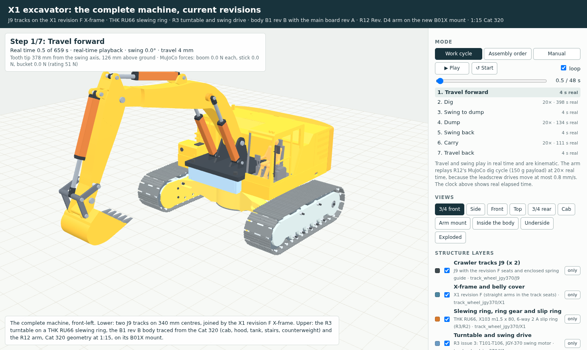
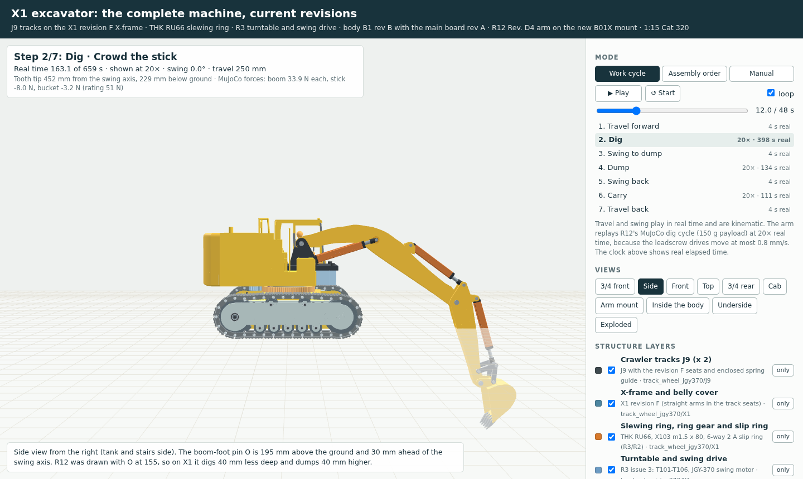
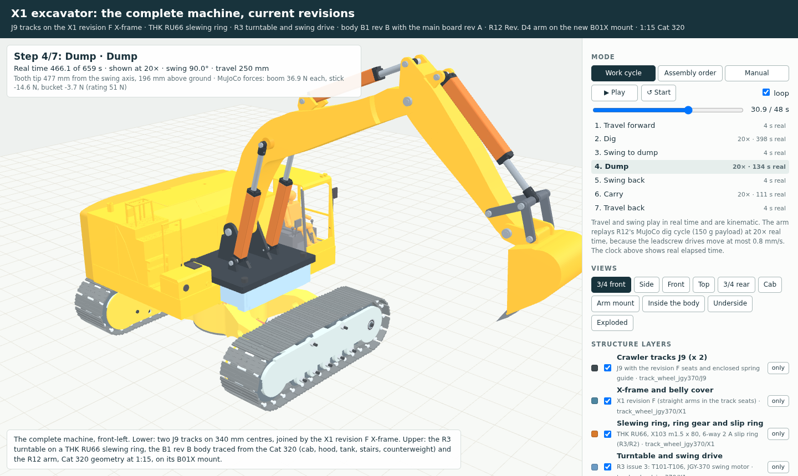
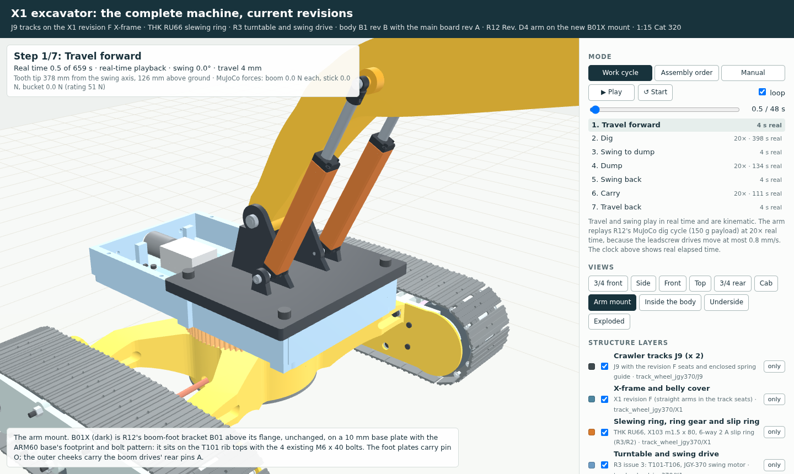
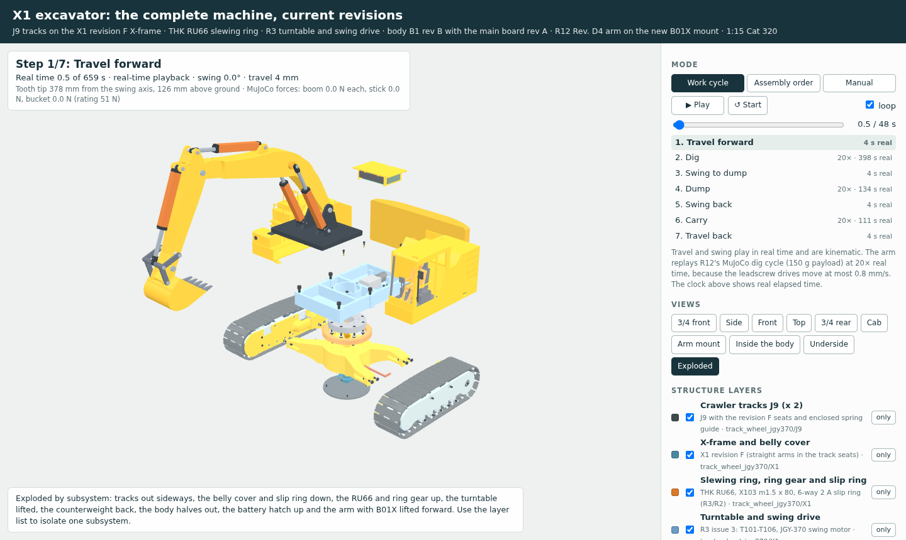
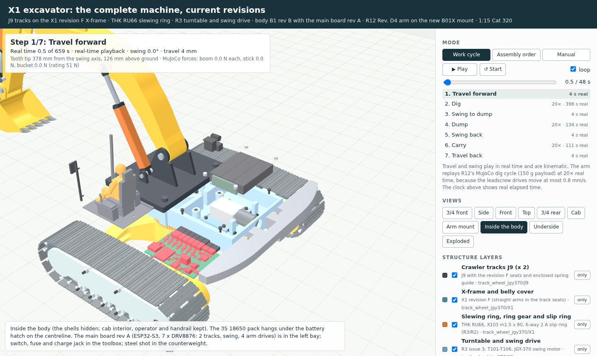
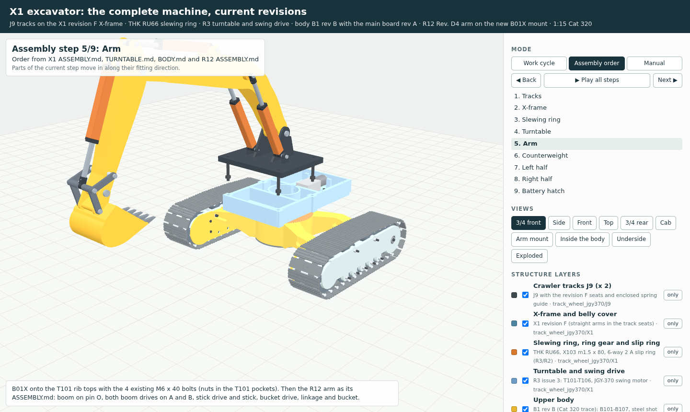

# The complete X1 excavator: current revision of every subsystem

This folder puts the newest design of every part of the machine together and demonstrates it working. It contains:

- one offline 3D demonstration, [3D_preview.html](3D_preview.html);
- the checks that only make sense on the whole machine;
- the one new part the combination needs.



**Video:** [images/complete_demo.mp4](images/complete_demo.mp4) is 68 s long, 1280 × 720 and 9 MB. It shows three things:
- the assembly order;
- the full work cycle: travel, dig, swing, dump, swing back, carry, travel back;
- the exploded view.

It is rendered from the same page. Its provenance is in `video_validation.json`.

| Subsystem | Revision used | Read from |
|---|---|---|
| Crawler tracks (× 2) | J9, with the revision F seats and the enclosed idler spring guide; the right track is the mirrored J901 / J909 prints | `track_wheel_jgy370/J9` |
| X-frame and belly cover | X1 revision F, with straight arms in the track seats | `track_wheel_jgy370/X1` |
| Slewing ring, ring gear and slip ring | THK RU66, X103 (m1.5 × 80) and a 6-way 2 A slip ring | `track_wheel_jgy370/X1` |
| Turntable and swing drive | R3 issue 3: T101–T106, with the JGY-370 swing motor at 4:1 | `track_wheel_jgy370/X1` |
| Upper body | B1 rev B, traced from the Cat 320: B101–B107 and the steel shot | `track_wheel_jgy370/X1` |
| Battery and main board | Main board rev A (ESP32-S3, 7 × DRV8876) and a 3S 18650 pack under the hatch | `track_wheel_jgy370/X1/controller` |
| Excavator arm | R12 Rev. D4: Cat 325 pins and the Caterpillar bucket of US 8,201,350, driven by 4 × V6-U60 | `excavator_arm_r12` |
| **Arm mount (new)** | **B01X**, described below | this folder |

The meshes are read from those folders when the demonstration is built, so a rebuild there flows through here. Nothing has been printed, assembled or run under power.

## What changed: R12 replaces the ARM60

Until now, the X1 viewer carried the older ARM60 arm. R12 is the current arm, but it had never been mounted on X1:
- R12's foot bracket B01 stands on a 6 mm flange, drawn for a bare turntable face at Z 100.
- On X1 that space is now taken by the T101 centre frame (Z 103–136).
- T101 carries the arm on its rib tops at Z 136, with 4 × M6 bolts on the ARM60 base pattern.

**B01X** (`source/build_adapter.py`) solves this with as little change as possible:

- **Above the flange top, it is B01 unchanged.** That includes the foot plates, the outer cheeks, and the bores for pin O and the pressed-in A pins.
- **The flange is replaced by a 10 mm base plate.**
  - Its footprint is the ARM60 base's: X −21..111, |Y| ≤ 82. The body halves therefore fit round it as checked in BODY.md, still 0.5 mm away.
  - It has 4 × Ø6.6 holes on the T101 pattern, so the existing M6 × 40 bolts and T101's nut pockets are reused.
  - It is 10 mm thick, like the ARM60 base, so the bolt length and the thread past the nut stay as checked.
- **Print:** PETG, base plate on the bed, 132 × 164 × 72 mm. It weighs 196 g by R12's print rule (6 perimeters + 10 % gyroid). B01 weighs 93.5 g.
- **Files:**
  - `step/B01X_boom_foot_bracket.step`, in the R12 base frame with O at the origin;
  - `stl/B01X_boom_foot_bracket.stl`, in print orientation;
  - `cad/B01X_report.json`: the solid is valid, the STL is watertight and the STEP round-trips.
- **Assembly** is the same as for the ARM60 base (TURNTABLE.md, step 8):
  - press the body's four M3 inserts into the rib tops first;
  - then fit B01X with the 4 × M6 × 40 bolts, nuts in the T101 pockets;
  - then build the arm as in R12's ASSEMBLY.md.
- **Service:** the plate covers T101's hub well as the ARM60 base did. To re-tighten the eight hub screws, take B01X off first.

**One consequence to accept or change:** the boom-foot pin O sits at vehicle (30, 0, 195). That is 59 mm above the rib tops, and 40 mm higher than R12's drawings, which put O 155 mm above the ground.
- Reach is unchanged.
- The dig depth is 40 mm less: 321 mm across the stroke grid, and 240 mm in the dig cycle.
- The dump height is 40 mm more.

Lowering the arm would mean cutting into T101's ribs. That is a turntable change, and I have not proposed it. **B01X is my proposal and has not been reviewed yet.**

## Open the demonstration

[3D_preview.html](3D_preview.html) is a single 15 MB file. It works offline in any desktop browser, but it is heavy, so give it a few seconds to load. It has three modes.

**Work cycle** (48 s on screen, 659 s of real time). The steps are listed with their time, and you can click one to jump to it.
1. Travel forward 250 mm on both tracks.
2. Dig: reach out, penetrate, crowd the stick, curl the bucket, raise.
3. Swing 90° to the left (the cab side).
4. Dump over the left track.
5. Swing back.
6. Return the arm to the carry pose.
7. Travel back to the start.

How each part is played:
- Travel and swing play at real time and are kinematic minimum-jerk moves. Travel peaks at 117 mm/s (the J9 tracks run at 88–120 mm/s). Swing peaks at 42°/s, under the 45°/s no-load limit.
- The chain moves so that the ground run stays still on the ground.
- The pinion turns 4:1 with the upper.
- The arm replays R12's MuJoCo dig cycle with 150 g of payload, at 20 × speed (the leadscrew drives move at most 0.8 mm/s). The display shows the live drive forces.

**Assembly order.** The 9 steps follow the X1, turntable, body and R12 assembly notes: tracks, X-frame lowered into the seats, slewing ring, turntable, B01X and the arm, counterweight, left half with the main board, right half, battery hatch. In each step the parts move in along their fitting direction.

**Manual.** Sliders for the boom, stick, bucket, swing and travel, plus the dig-cycle poses.

Also available:
- Views: 3/4 front, side, front, top, 3/4 rear, cab, arm mount, inside the body, underside and exploded.
- A layer for each subsystem, with "only" to isolate it.
- A see-through body.
- Click any part to see its name and source folder.

| Dig, side view | Dump over the left track |
|---|---|
|  |  |

| Arm mount B01X on T101 | Exploded by subsystem |
|---|---|
|  |  |

| Inside the body | Assembly order, step 5: the arm |
|---|---|
|  |  |

## Integration checks: [integration_check.json](integration_check.json), PASS

These checks cover only what is new when the subsystems are combined. Each subsystem's own report stays authoritative: J9 `validation.json`, X1 `arc_seat_mount_validation.json`, `turntable_validation.json`, `body_validation.json`, and R12 `validation_summary.json`. All five currently read PASS.

The method is FCL mesh-mesh collision and distance on the viewer meshes. Their chord error is 0.05 mm for R12 and B01X, 0.1 mm for the turntable and hardware, and 0.15 mm for the body prints.

| Check | Result |
|---|---|
| Interface | T101 rib tops measure Z 136.000. The bolt axes match the R3 pattern within 0.03 mm. B01X is seated on the ribs and under the bolt heads with no overlap. Against all other 560 parts, the closest are the body halves at 0.5 mm (as with the ARM60 base). |
| Arm against the upper | 0 overlaps in 447 poses: R12's 5 × 5 × 5 stroke grid, plus the MuJoCo dig cycle every 2 s, against the turntable, body, electronics and B01X. The closest gaps are the boom root to the foot plates at 0.5 mm (R12's designed side gap) and the boom drives to B01X at 1.15 mm. |
| Work cycle against the lower | 0 overlaps in 718 states, and nothing comes within 5 mm of the tracks or the X-frame. The states are: dig at 0° every 1 s; swing out every 2.5° holding the raise pose; dump at 90°; swing back holding the dump pose; return to carry. |
| Carry pose, swung all round | 0 overlaps at 5° steps through 360°. |
| Stroke grid over the tracks | This is a map of reach, not a pass/fail. At 0° and 180° no pose reaches the lower. At 45°, 90° and 135°, 4 to 6 of the 125 poses do; see the operating limit below. |
| Static balance | Checked over 2,000 states: the stroke grid × 8 swing angles, with and without 150 g. The whole machine's CG stays inside the track footprint by at least 106 mm, and by 111 mm in the cycle. |

**Operating limit found.** When the upper is swung over a track (about 45° to 135° either way), do not crowd the stick fully while the boom is low.
- On the 15 mm stroke grid, every pose that reached the lower had the stick fully crowded (60 mm) and the boom at 30 mm or less. The bucket then reaches the track shoes, idler or rollers.
- Every pose with the stick at 45 mm was clear. The exact boundary lies between those grid points.
- The demonstration cycle stays clear of this.
- This replaces the estimate in R12's drawings ("keep the boom above 4 mm of stroke when slewed over a track") with a measurement on the real tracks and the 40 mm higher pin O.

**Mass and balance:**
- The machine weighs 9.20 kg: the upper 4.54 kg and the lower 4.66 kg.
- R12 with B01X weighs 1.06 kg, by R12's print rule. The ARM60 with its base weighed 1.64 kg, but X1's mass file counts it at full PETG density.
- The body's steel-shot pocket was sized to put the upper's CG on the swing axis with the heavier ARM60 stretched forward.
  - With R12 in its stretched pose ("reach out", strokes 32 / 6 / 8), the upper's CG is at X −0.1 mm, still on the axis. R12 is lighter but reaches further, and the two effects cancel.
  - The shot therefore needs no trim (the computed trim is 4 g).
  - In the other poses the CG sits 4–14 mm behind the axis: 8.9 mm in the carry pose, 13.8 mm when raised.
  - These figures are in `integration_check.json`, under `balance.upper_cg_mm_by_waypoint` and `shot_trim_estimate`.
- The masses come from the subsystem mass files. The ARM60's centre of mass is estimated from its meshes at uniform density, so these figures are estimates. Nothing has been weighed.

**Not checked:** loads and digging forces, swing dynamics with R12 (the R3 swing simulation used the ARM60), print fit, cable routing to the arm drives, and anything on real parts.

## Files

- `3D_preview.html`: the offline demonstration.
- `integration_check.json`: the whole-machine checks above.
- `browser_validation.json`: the demonstration tested in headless Chromium. It checks:
  - no errors and no network requests;
  - R12's kinematic reference cases;
  - the timeline, swing, pinion and travel;
  - that the ground run does not slip;
  - the assembly steps and the exploded view.
- `images/`: screenshots from that test, and `complete_demo.mp4`.
- `video_validation.json`: the video's frames, its duration, and the hash of the page it was rendered from.
- `step/`, `stl/`, `cad/`: B01X.
- `source/`:
  - `common.py`: constants;
  - `machine.py`: loads the subsystem meshes;
  - `build_adapter.py`, `check_complete.py`, `build_viewer.py` with `viewer.html`, `check_viewer.cjs` and `render_video.cjs`.

## Rebuild

Use the R12 interpreter, which has CadQuery 2.8, fcl, trimesh and mujoco (on this machine, `~/.cache/arm-design-tools/venv`). Run from `source/`, in order:

```sh
python build_adapter.py        # B01X STEP/STL/mesh/report                 (~20 s)
python check_complete.py       # integration_check.json                     (~5 min, 6 processes)
python build_viewer.py         # ../3D_preview.html
NODE_PATH=<dir containing playwright> node check_viewer.cjs   # browser_validation.json + images/ (slow: software WebGL)
# optional video: 814 frames, about 2 h on this machine; reruns skip frames already rendered
NODE_PATH=... node render_video.cjs /tmp/complete-frames 0 2 & NODE_PATH=... node render_video.cjs /tmp/complete-frames 1 2; wait
ffmpeg -framerate 12 -i /tmp/complete-frames/f%05d.jpg -c:v libx264 -preset slow -pix_fmt yuv420p -crf 22 -movflags +faststart ../images/complete_demo.mp4
```

Rebuild here after any change to the tracks, X-frame, turntable, body or R12. Their scenes are read fresh each time.
