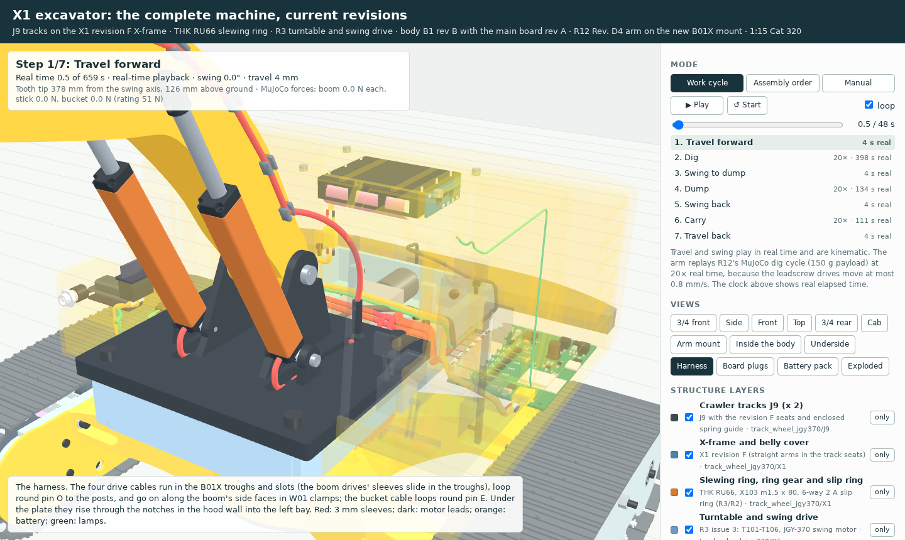

# Wiring of the complete X1 excavator

Every cable of the machine: where it runs, what it plugs into, how long to cut it, and the checks that say it fits and keeps clear of the moving parts. The routes are defined in `source/harness.py`, checked by `source/check_wiring.py` (results in [wiring_check.json](wiring_check.json)), listed in [wiring/harness.csv](wiring/harness.csv), and drawn in [3D_preview.html](3D_preview.html) (the **Harness** view and the **Wiring harness** layer; the moving cables are rebuilt in the page from the same anchors and rules).

Nothing has been wired yet. The lengths include the service slack the body notes ask for; measure once on the real parts before cutting the rest.

## 1. What goes where

Every connector is named by its model number here; the full catalogue (maker, contacts, crimp tool, position, fitting step, source drawing) is [CONNECTORS.md](CONNECTORS.md), and the 3D models in the viewer and in `step/connectors/` are drawn from the makers' drawings.

| # | Cable | From | To | Wire | Connector at the board / joint |
|---|---|---|---|---|---|
| 1 | Boom drive L | V6-U60 boom L rear cap (its own 3 mm sleeve) | J104 | 2 × 28 AWG PTFE in the sleeve | JST S2B-XH-A header ← XHP-2 housing, 2 × SXH-001T-P0.6 |
| 2 | Boom drive R | V6 boom R | J105 | same | same |
| 3 | Stick drive | V6 stick (on the boom top) | J106 | same | same |
| 4 | Bucket drive | V6 bucket (on the stick) | J107 | same | same |
| 5 | Swing motor | JGY-370 tabs behind T101 | J103 | 2 × 26 AWG silicone, 100 nF across the tabs | S2B-XH-A ← XHP-2 |
| 6 | Tracks | slip-ring rotor leads | J102 | the ring's 6 leads, 4 used | JST S4B-XH-A ← XHP-4, 4 × SXH-001T-P0.6 |
| 7 | Track motors (lower) | each JGY-370 in its pod | the slip-ring stator leads, beside the ring | 2 × 26 AWG silicone, 100 nF across the tabs | JST SM 2-pin: SMR-02V-B (pins, stator) ← SMP-02V-BC (sockets, motor), two joints |
| 8 | 12 V link | main switch KCD1-101 (toolbox) | J101 on the board's front edge | 2 × 20 AWG silicone | Amass XT30PW-M (board) ← XT30U-F (cable) |
| 9 | Battery feed | 5 A MINI fuse in the Littelfuse MINI FHM holder (toolbox) | the feed socket hanging in the hood cavity | 2 × 20 AWG silicone | Amass XT30U-M (feed) |
| 10 | Battery hatch lead | HX-3S-01 BMS on the hatch | that socket | the hatch's own 150 mm lead, 20 AWG | Amass XT30U-F (hatch lead) |
| 11 | Charge jack | 5.5 × 2.1 metal panel jack (DC-022B pattern, M8) | fuse (battery side of the switch) and GND | 2 × 22 AWG | solder lugs |
| 12 | Toolbox lamp | J108 pins 1, 3 | LED in the B103 toolbox front | 2 × 26 AWG | JST S3B-PH-K-S ← PHR-3, 3 × SPH-002T-P0.5S; SM joint in the right bay (SMR-02V-B on the board side, SMP-02V-BC on the lamp side) |
| 13 | Roof lamps | J108 pins 1, 2 | 2 LEDs in the B102 cab roof | 2 × 0.2 mm enamelled wire inside the cab shell, spliced to 26 AWG | the same PHR-3 |
| 14 | Expansion | J109 | — | — | JST S4B-PH-K-S, not fitted (PHR-4 when used) |
| 15 | USB service | J201 through the B102 slot | — | — | Korean Hroparts TYPE-C-31-M-12 |

The cut lengths, the pins of every plug and the notes are in [wiring/harness.csv](wiring/harness.csv) (routed length + service slack, rounded up to 10 mm). Connector pin assignments:

- **J104–J107 (actuators):** pin 1 = OUT1 = V6 wire A (red), pin 2 = OUT2 = wire B (black). The firmware drives OUT1 high for a positive command, A positive extends, and extension is boom up, stick in (crowd) and bucket curl: the app's positive axes. No `flip` should be needed.
- **J102 (tracks):** 1 ring 1 = left motor +, 2 ring 2 = left motor −, 3 ring 3 = right motor +, 4 ring 4 = right motor −. Rings 5 and 6 are spare; tape their leads at both ends. **Both motors are wired the same way.** The right motor sits mirrored and the firmware inverts channel 2 for it; reversing its leads as well would cancel that (X1/ASSEMBLY.md 4.2 is corrected to say so).
- **J103 (swing):** 1 = motor +, 2 = motor −. The sense of rotation for a positive command depends on the worm and the pinion; set it on the bench with `flip 3` if the upper turns the wrong way.
- **J108 (lamps):** 1 = +5 V through the board's 0.5 A PTC, 2 = roof-lamp return, 3 = toolbox-lamp return. Each LED gets its own 100 Ω in series (3 mm white LED at about 18 mA); the two roof LEDs are in parallel on pin 2.
- **J101 (power):** XT30, 1 = +, 2 = GND. The path is cells → BMS → hatch lead → feed socket → fuse → switch → link → J101. The charge jack joins between the fuse and the switch, so the pack charges in place with the switch off.

## 2. The routes

Coordinates are the vehicle frame (X forward, Y left, Z up, origin on the ground under the swing centre), swing 0, unless a body frame is named.

### 2.1 The four drive cables on the arm

The V6 sleeve leaves each drive's rear cap sideways on its board side: 7 mm ahead of the rear pin, 9.8 mm off the axis, pointing away from the body. R12 puts the boom drives' board side down-forward and the stick and bucket drives' board side up, so:

- **Boom drives.** Their exits point at the B01X plate. At full boom-down (−35°) the exit is 2.8 mm above the plate pointing straight down; at full boom-up it is 18 mm above it pointing forward. B01X issue 3 therefore has a **trough** in the plate top on each side, 7 mm deep: a 9 mm wide mouth at the drive's own |Y| 34 from O-frame x 47 back to x 20, where the sleeve lands and slides, then 5 wide and easing outboard to the slot at |Y| 39.5. The sleeve turns on R 9 to vertical, drops into the mouth and turns rearward in it on R 7.7–9. As the boom moves the sleeve **slides 20 mm in the mouth**; it is tied at the two tie-slot pairs (one in the mouth behind the slide, one further back). The trough leads to the side's slot.
- **Stick drive.** The cable leaves the clamp upward, loops over the boom's C bracket and lands on the boom's **left side face**, 8 mm below the top edge, in the first W01 clamp at boom x 215. Six W01 clamps carry it back along that face (x 215, 180, 140, 95, 55, 28); from the last one a **92 mm loop round pin O** reaches the top of the left post on B01X (O-frame (−34, 39.5, −26)), then down into slot S3.
- **Bucket drive.** The cable leaves the clamp on the stick upward, comes over the stick's right edge and lands in a W01 clamp on the stick's **right side face** (stick x 27, z 28). From there a **110 mm loop round pin E** reaches the boom's right side lane at boom x 324 (just outside the stick's head plates, R 56 from E); eight W01 clamps carry it back along the right face (x 324, 285, 240, 195, 150, 100, 55, 28); then a 92 mm loop round O to the right post and down into slot S4.
- **Why those lanes.** The side faces are the only free faces of the boom: the top carries the stick drive (|Y| ≤ 7.35) and the C bracket (|Y| 8–13), the stick's head plates (|Y| 11–16) sweep round the nose within R 52 of E, and the B pads and boom-drive rod eyes sit at |Y| ≥ 20 round pin B, which the lanes pass 17.6 mm above. The loops' two clamps are at nearly equal radii on opposite sides of the pin, so the chord changes only 11 mm (O) and 10 mm (E) over the joint's travel; each loop bulges away from the pin A / pin D side.

### 2.2 From the plate into the body

T101 has two full-width bulkheads under the plate (X −38..−30 and 30..38) and the plate covers X −21..111, so the space under the plate is three closed compartments and a cable can only leave through the 9 mm gap behind the plate's rear edge. The hood's inboard front wall stands in that gap (X −25..−23), which is why body B1 rev B **issue 2** raises that wall's bottom edge to Z 156 over |Y| 38–56 on each half (`x1_body.py HARNESS_NOTCH`).

Each side's **slot** (8 × 7 at vehicle X 0..8, |Y| 36..43) takes the post cable and the trough cable down into the middle compartment. They run rearward on T101's floor, rise at X −24.5 through the notch, bend back over T101's rear bulkhead at Z 149, cross the left rib at X −36 and −32 (two cables at Z 142, two at 146.5, between the hood wall at −25 and the front body sleeve at −40; the right side's pair first crosses over the hub well at Z 144–149), descend to the bay run (Y 76, Z 122, above the mated plugs) and turn down into their plugs. The last 25 mm are the bare wires in the 3 mm gap between the T101 rib (Y 69) and the plug ends (Y 72).

### 2.3 The upper's other cables

- **Slip-ring rotor leads:** up through T104's Ø15 hole and the hub well, out of T101's 10 mm lead slot behind the well (X −35..−29), up and across to the rib crossing at X −62, into the bay and forward to J102.
- **Swing motor:** from the can end through T101's Ø20 rear window, up the counterweight's lead channel, over the rear bulkhead through the halves' rear-wall notch (|Y| < 14), over the rib at X −131 (between the two body sleeves) and to J103.
- **12 V link and toolbox lamp:** over both ribs at X −58 and −56 (between the sleeves), across the hood cavity at Z 143–146 above the hub well, down the right bay to the toolbox's Ø12 deck hole. **Battery feed:** from the fuse down the same hole, rearward in the right bay, over the right rib at X −100 to the socket waiting at (−100, −42, 166) under the hatch.
- **Roof lamps:** forward along the left bay, into the hollow behind the cab's rear wall, through a Ø2 hole drilled at (−6, 150, 142), up the cab's rear-left corner and along the roof's left corner to the two lamps (enamelled wire, barely visible from outside).
- **Lower:** each track motor's leads leave the pod nose, run forward beside the front X-frame arm and into the carbody's Ø10 side hole (X1 ASSEMBLY.md 3.2, the reserved route), where a JST SM 2-pin joins them to the stator leads.

### 2.4 Slack and service

- 150 mm of slack on every cable that ends at the main board, coiled in the bay: the left half is unplugged standing beside the machine (BODY.md). The right half's two cables (link, toolbox lamp) have their 150 mm too, and the toolbox lamp has an inline SM plug in the right bay (CONNECTORS.md SM-LAMP), made with the half held beside the machine.
- The hatch lead's 150 mm lets the hatch be turned over without unplugging.
- The boom-drive sleeves need 30 mm free between the trough tie and the slot so that the 20 mm slide is not pulled against the tie.
- The arm comes off with its four cables: unplug at the board, free the rib crossings, lift B01X with the arm and the cables.

## 3. Checks: [wiring_check.json](wiring_check.json)

Method: every cable as a tube of its radius (the 3 mm sleeve at Ø3.5; the plug tails as one 0.9 mm wire) along the routes above; FCL collision and distance against the viewer meshes of every part; the arm cables at R12's 5 × 5 × 5 stroke grid and the dig cycle every 2 s (447 poses). Rules: no overlap and at least 1.0 mm to any part a cable is not attached to (R12's rule); loops never taut (≥ 4 mm slack at the longest chord) and bent on at least R 9; the boom-drive sleeve's second bend at least R 7.5; exits at least R 5.

| Cable part | Poses | Closest other part | Loop / bend |
|---|---|---|---|
| Stick exit (V6 clamp to the first W01) | 447 | 10.8 mm (boom) | R ≥ 5.0 |
| Stick lane, boom left face | 447 | 13.7 mm (boom L rod eye) | on the face |
| Stick loop at O | 447 | 10.8 mm (left half) | chord 75.3–86.6, cable 92, R ≥ 42.8 |
| Bucket exit (clamp to the stick W01) | 447 | 11.1 mm (stick) | R ≥ 6.0 |
| Bucket loop at E | 447 | 19.3 mm (bucket drive body) | chord 92.3–101.9, cable 110, R ≥ 54.5 |
| Bucket lane, boom right face | 447 | 14.0 mm (boom R rod eye) | on the face |
| Bucket loop at O | 447 | 10.8 mm (right half) | as the stick loop |
| Boom L / R drops into the troughs | 447 | 8.2 mm (pin A spacers) | R 9 then ≥ 7.7; 20 mm slide |
| Post to slot, both sides | 447 | 10.7 mm (T101) | |
| Fixed cables (upper and lower), 15 runs | carry pose | ≥ 1.1 mm (plug tails to the rib) | holes they use are excluded by name |

Space probes: 26 mm of clear height under each slot; the middle compartment floor (X −28..8, |Y| 38–54, Z 111–135) and the rise gap through the notch (X −29..−22, |Y| 39–55, Z 110–154) are empty; so is the crossing over the hub well (X −38..−28, Z 139–149).

**Not checked:** the real sleeve's stiffness and sag (the loops are taken as circular arcs; a real cable hangs a little lower and may swing), wear where the boom-drive sleeves slide, and anything on real parts. The exits are bent once at assembly and flex only a few millimetres; the loops flex with every move.

## 4. Fitting the harness (the order is in ASSEMBLY.md)

1. **V6 cables.** Make each actuator's cable the cut length from harness.csv (W1 red = A, W2 black = B, in the 3 mm sleeve), terminate the board end in a JST XHP-2 housing with two SXH-001T-P0.6 contacts (pin 1 = A; 1.2 mm heat-shrink over the Ø0.8 wires first, CONNECTORS.md 4), and check the actuator's direction on the bench (V6 ASSEMBLY.md step 9) before it goes on the arm.
2. **Clamps.** Glue the 15 W01 clamps on the boom and stick faces at the stations above (CA; the base flat on the face, the slot up). Snap the stick and bucket cables in.
3. **B01X.** Lay each boom-drive sleeve in its trough mouth and along the trough, down through the slot; the stick and bucket cables over the posts (one cable tie through each post's hole) and down the slots; tie each pair at the tie slots behind the slot and the boom-drive sleeves at the two trough tie pairs, leaving the mouth free so the sleeve can slide. Do this on the bench before the arm unit goes onto T101.
4. **Into the body.** When the unit is lowered onto the ribs, feed the four cables rearward on T101's floor and up through the hood-wall notches; the halves slide in around them later. Route the rest as in section 2 and plug in with each half standing beside the machine.
5. **Before the first power-up**, check every plug against the table above and the `show` console output of the firmware.
