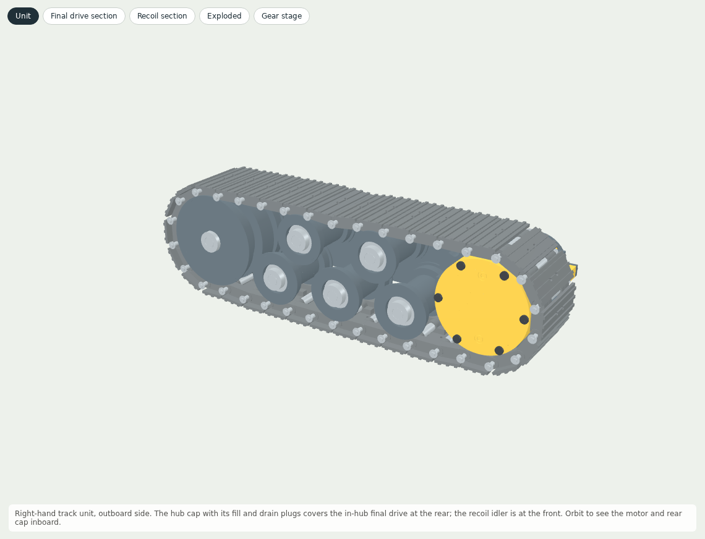
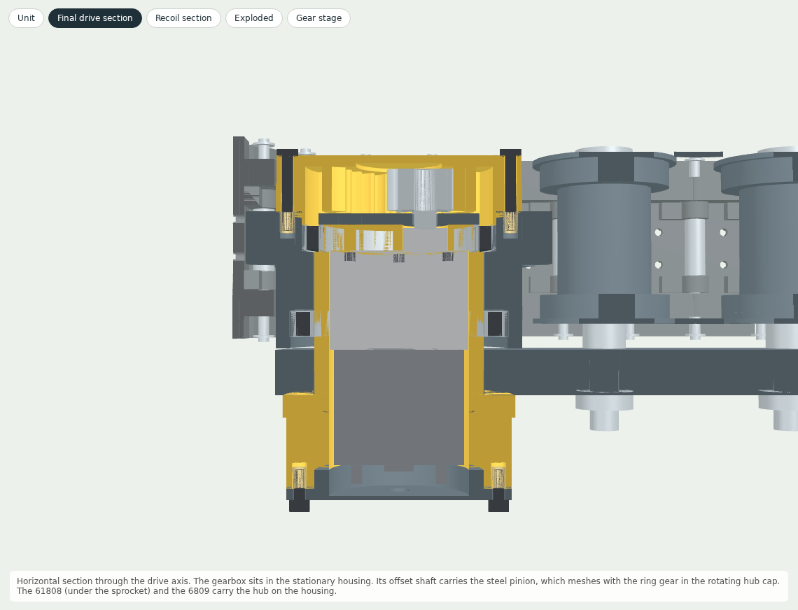
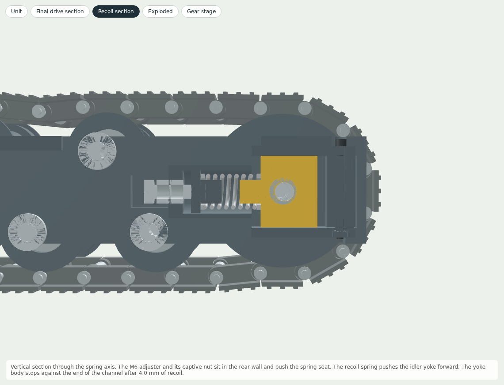
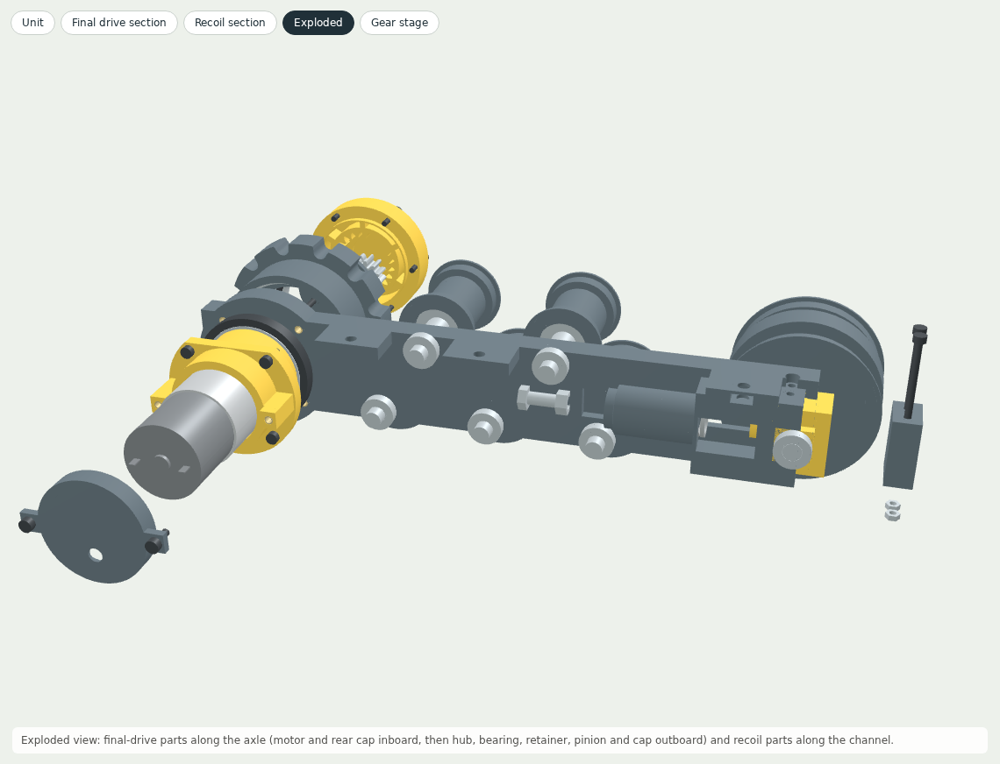
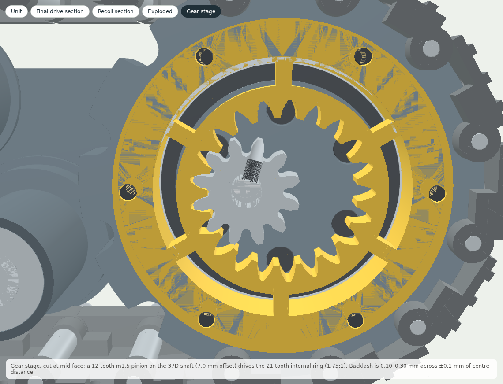
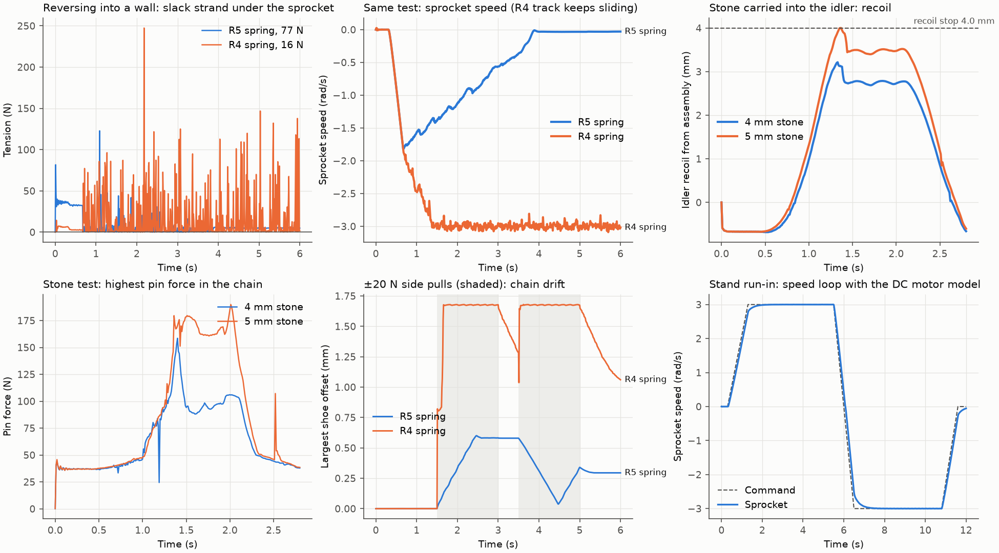
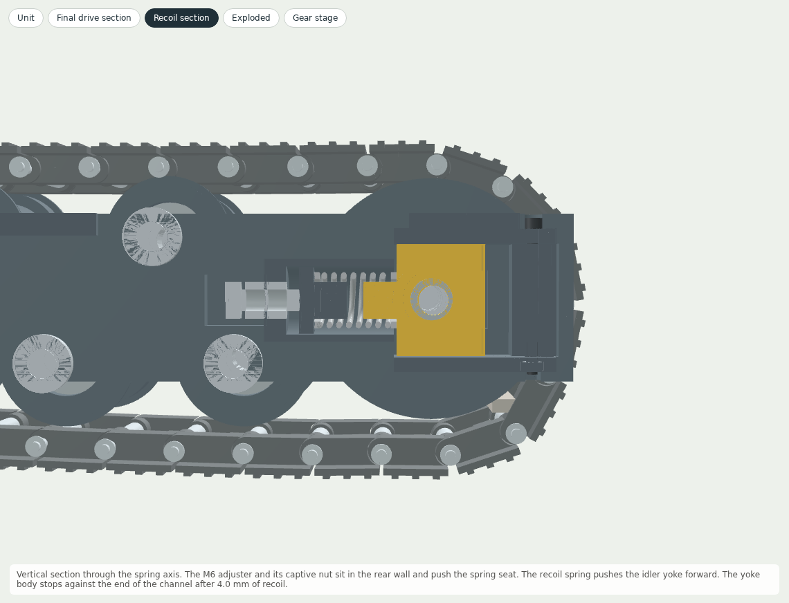
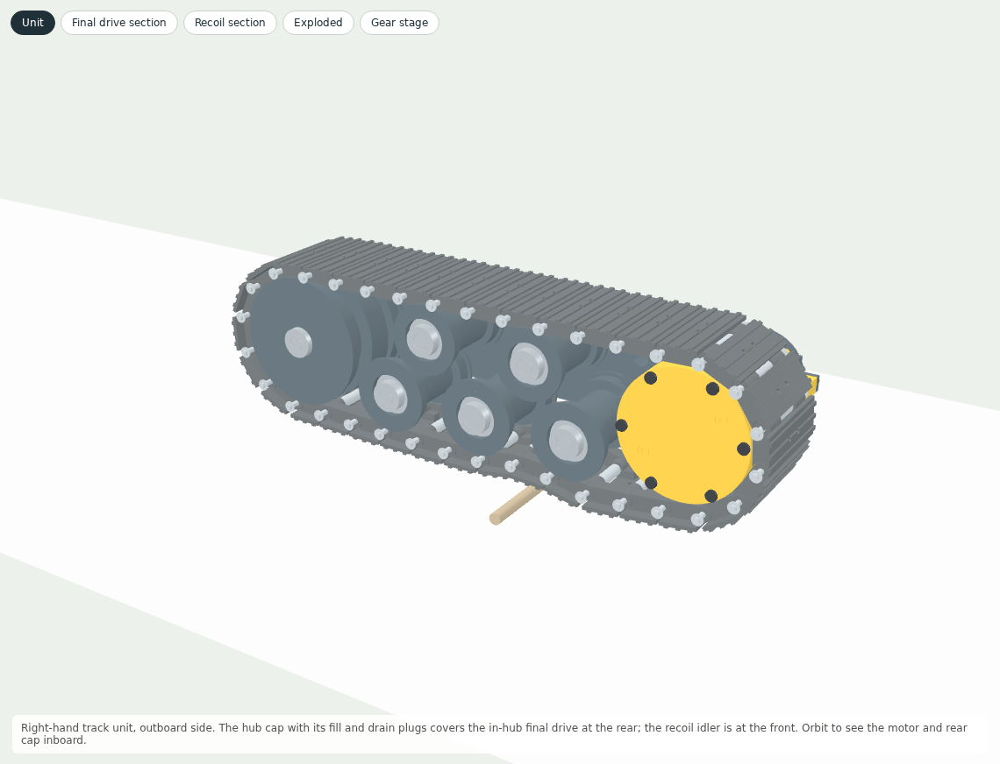

# Track wheel R5: in-hub final drive and recoil idler

One complete track side for `excavator_60mm/`. The gearmotor and its final reduction sit inside the sprocket hub. A spring-loaded recoil idler at the front keeps the chain tight so it stays on the sprocket. This folder holds the unit on its own: CAD, print files, checks and a MuJoCo physics model, plus an offline viewer that shows the internal structure.

**Digital validation: PASS. Nothing here has been built or physically tested yet.**



## Open it

- `3D_preview.html` opens offline in any browser. Views:
  - the whole unit;
  - a horizontal section through the final drive;
  - a vertical section through the recoil spring;
  - an exploded view;
  - the gear stage.
- An x-ray switch and a chain toggle show the parts inside. Playback replays four recorded MuJoCo cases with time, speed, motor current, recoil, spring force and pin force readouts.
- `step/track_wheel_unit.step` is the whole unit. `step/` and `stl/` have every printed part; the STL files are already in print orientation. `TW06_track_frame_left` is the mirrored rail for the left track.
- [BOM.md](BOM.md) lists the printed parts and the purchased hardware for one unit.

| Final drive section | Recoil section |
|---|---|
|  |  |
|  |  |

## How it copies a real machine

On a full-size excavator the final drive is "the hydraulic motor and gearbox that turns the sprocket", and the sprocket bolts to it. The track adjuster "sits in the frame between a bulkhead and the idler". It has a spring pack that absorbs impact and a yoke that holds the idler ([Astrak: excavator undercarriage parts explained](https://astrak.com/blogs/news/excavator-undercarriage-parts-explained)). The recoil spring is "held under pressure at all times" and "contracts upon impact" ([H&R Parts: what are track springs](https://www.hrparts.com/blog/post/what-are-track-springs-diagram)). This unit has the same layout at model scale:

| Full-size part | Here |
|---|---|
| Travel motor and reduction gearbox (final drive) at the sprocket | Pololu 37D 150:1 gearmotor inside the stationary housing TW01, plus a 12:21 internal gear stage in the rotating hub |
| Sprocket on the final-drive hub | Sprocket teeth and hub drum in one part (TW02), on two thin-section bearings around the housing |
| Track frame, bulkhead, recoil spring, adjuster | Rail TW06 with the spring bore and rear wall, a C-600-072-1500 spring, and an M6 adjuster pushing the spring seat TW08 |
| Idler yoke sliding in the frame | Yoke TW07 in a channel closed by the nose TW09; a hard stop after 4.0 mm of recoil |

One difference is deliberate. A full-size adjuster sets the idler position with a grease cylinder and keeps the spring caged at a much higher preload. Here the spring floats the idler, as the brief asked: the chain tension is the spring force all the time, and the M6 screw only sets the preload.

## Final drive

- **Gearmotor.** [Pololu 37D metal gearmotor 150:1, 12 V (#2829)](https://www.pololu.com/product/2829): 12 V, 150:1, Ø36.8 mm gearbox, Ø6 mm D-shaft offset 7.0 mm from the gearbox axis ([Pololu 37D dimension drawing](https://www.pololu.com/file/0J1735/37d-metal-gearmotors-dimension-diagram.pdf)). It slides into the Ø37.3 mm bore of the stationary housing TW01 from the inboard end.
- **Locating the gear centre distance.** The Ø12 output bushing locates in a Ø12.15 mm hole in the housing end wall, which fixes the gear centre distance at 7.0 ± 0.1 mm.
- **Fixing the gearmotor.** Six M3 × 10 button screws pass through the bearing retainer TW04 and the end wall into the gearbox face. They engage 2.4 mm; Pololu allows 3 mm.
- **Hub stage.** A steel m1.5, 12-tooth pinion on the motor shaft meshes with a 21-tooth internal ring printed in the hub cap TW03, giving 1.75:1. The ring profile is the envelope of the pinion at the real 7.0 mm centre distance, with 0.22 mm backlash. It does the job of the reduction gearing in a full-size final drive.
- **Hub bearings.**
  - A 61808-2RS1 (40 × 52 × 7) sits under the sprocket and locates the hub both ways ([SKF 61808-2RS1, RS 207-6965](https://uk.rs-online.com/web/p/ball-bearings/2076965)).
  - A 6809-2RS (45 × 58 × 7) floats at the inboard end ([6809-2RS 45 × 58 × 7 (Quality Bearings Online)](https://www.qualitybearingsonline.ca/6809-2rs-fbj-thin-section-bearing-45x58x7mm/)).
  - Both sit on the stationary housing; the hub carries their outer rings. The motor shaft carries no wheel load.
- **Ratings at the sprocket** (Pololu datasheet values through the hub stage at 95 % efficiency):

| Quantity | Value |
|---|---|
| No-load speed at 12 V | 38.3 rpm, 0.155 m/s track speed |
| Torque per amp | 1.51 N m/A |
| Driver current limit | 1.0 A: 1.21 N m, 31.2 N chain pull |
| Pololu continuous guidance (10 kg cm) | 1.63 N m |
| Stall (extrapolated, never used) | 8.0 N m |
| Excavator requirement | 0.57 N m on a 10° grade, 0.39 N m skid turn (excavator_60mm/validation.json) |

Run each motor from a driver with a 1.0 A current limit. Everything here is checked at that limit. Without it, a stall puts 540 N on the gear mesh and the 61808 static safety drops to 3.6.

## Recoil idler

- **Spring.** [Associated/Lee Spring C-600-072-1500 (Taylor Spring listing)](https://taylorspring.com/spring/associatedlee-spring-c-600-072-1500-compression-spring-music-wire/): music wire, OD 15.24 mm, wire 1.83 mm, free length 38.1 mm, 6.29 N/mm, catalogue maximum load 117.8 N, solid 17.0 mm.
- **Guidance.** The spring is guided on Ø10 spigots inside an Ø18.6 mm bore. Its slenderness is 2.84, so it does not buckle.
- **Assembled.** 25.8 mm long, pushing 77.3 N. The idler can recoil 4.0 mm until the yoke body meets the end of the channel: spring 21.8 mm, 102.5 N, 4.28 mm from solid. It can move forward 4.2 mm to the nose.
- **Why 77 N.** The idler is free to turn and slide, so the top strand and the front lower strand each carry half the spring force. In reverse the sprocket pulls the top strand, and the strand under the sprocket is left with spring/2 − pull. At the 1.0 A limit the pull is 31.2 N, so the preload must exceed 62.4 N or that strand goes slack and the chain can climb the teeth. In service the idler settles 0.68 mm forward of the assembly pose, where the spring pushes 73 N, so the rule predicts 5.3 N in that strand. The reverse-into-a-wall simulation measured 5.1 N. The old R4 spring (15 N) fails the same test.
- **Adjuster.** The M6 adjuster screws through a captive nut in the rear wall and pushes the spring seat. Its range is 0–4 mm. Run it at 3.5 mm: screw in until the tip is flush with the front of the rear wall, then 3.5 more turns (M6 × 1.0), and lock the outer nut. Below about 2.9 mm a spring at −10 % rate no longer keeps the reverse strand tight once the idler has settled, so use the low end only while fitting the chain. The table gives the margins at the assembly pose; the settle takes about 2 N off the strand.

| Adjuster | Rate | Preload | Force on the stop | Reverse-stall strand, assembly pose |
|---|---|---|---|---|
| 0 mm | 90% | 49.8 N | 72.4 N | -6.3 N (slack) |
| 0 mm | 100% | 55.3 N | 80.5 N | -3.6 N (slack) |
| 0 mm | 110% | 60.8 N | 88.5 N | -0.8 N (slack) |
| 3.5 mm | 90% | 69.6 N | 92.2 N | +3.6 N |
| 3.5 mm | 100% | 77.3 N | 102.5 N | +7.4 N |
| 3.5 mm | 110% | 85.0 N | 112.7 N | +11.3 N |
| 4 mm | 90% | 72.4 N | 95.0 N | +5.0 N |
| 4 mm | 100% | 80.5 N | 105.6 N | +9.0 N |
| 4 mm | 110% | 88.5 N | 116.2 N | +13.0 N |

- **Carriers.** At this tension the top run pulls straight between the sprocket and the idler. The R4 carriers would sit 2–3 mm below it and neither carry nor guide it. The R5 carriers have Ø33 mm rims on the same axles, 0.5 mm above the straight run, and the assembly pose puts the run's slack in a dip between them. The excavator simulations confirm the carriers stay loaded and turning.

## Checks (`validation.json`)

| Check | Result |
|---|---|
| Exact interference, assembly pose | 497 solid pairs, 0 intersections |
| Clearance | No gap below 0.05 mm except 7 intended contacts, each listed with its reason; 36 running gaps of 0.10–1 mm (e.g. bushings in the sprocket pockets, pinion to cap) |
| Idler travel | Recoil stop, forward stop and both adjuster ends: no intersections; idler 1.35 mm from the front road roller on the stop |
| Gear mesh, centre distance 6.9 / 7.0 / 7.1 mm | 0.302 / 0.217 / 0.098 mm minimum backlash, no clash |
| Involute contact ratio | 1.28 at 25.0° working pressure angle |
| Fits (gearmotor, bushing, bearings, spring, yoke) | 19 of 19 pass |
| Fastener thread engagement | 7 of 7 pass; gearbox face screws 2.4 mm of the 3.0 mm Pololu allows |
| Spring at the stop, all adjuster settings and ±10 % rate | 72.4–116.2 N, below the 117.8 N catalogue maximum; 4.28 mm from solid |
| Hub bearings, worst case at the current limit | 61808 static safety 14.5, 6809 92.7 (without the limit, stall: 3.6) |
| Printed ring gear at the current limit | 5.72 MPa at the highest point of single-tooth contact, safety 1.40 on an assumed 8 MPa; 11.5 MPa tip-load bound; Hertz 24.3 MPa |
| Motor shaft bending at the current limit | 40 MPa (Pololu gives no radial rating) |
| Browser check of 3D_preview.html | PASS: all views, x-ray, playback of 4 cases, offline |
| Unit mass | 2.00 kg including 0.43 kg of track |

Open items from the checks:
- Printed ring-gear allowable (8 MPa) and the PETG/PA seat fits are assumptions: print a test cap and hub, run the gear at the current limit.
- Pololu publishes no radial load rating for the 37D output shaft; the mesh load at the 1.0 A limit is about 81 N.
- Spring rate tolerance ±10 % is assumed (distributor sheet gives none); set the preload by spring length.
- Track tension, sprocket engagement and recoil come from the MuJoCo model; measure them on the built unit.

## Physics simulation (`simulation/`)

MuJoCo 3.3.7, 0.5 ms steps. The R4 chain (34 shoes, steel bushings, 68 hinge constraints) runs on this unit's final drive and idler:
- **Drive.** A DC motor model from the Pololu data through the hub stage, with a PI speed loop, the 1.0 A current limit and the reflected rotor inertia (estimated) as armature.
- **Idler.** A slide joint with the spring rate, preload, hard stop and nose.
- **Measurements.** Chain tension comes from the hinge constraint forces. Tooth skips are found by comparing chain travel with sprocket rotation.

| Case | What happens | Result |
|---|---|---|
| fixture | Stand, no floor: run-in both ways at 3 rad/s, ±5 N side pulls | Strands 36.8 / 36.3 N; drift 0.26 mm; 0 tooth skips; PASS |
| reverse_wall | Half machine (6.0 kg) reverses into a wall; drive stalls at the 1.0 A limit | Strand under the sprocket 5.1 N at stall (min 4.5, rule predicts 5.3); 0 skips; PASS |
| reverse_wall_r4spring | Negative control: the same with the Track R4 spring (15 N) | Strand goes slack (5th percentile 0.28 N); sprocket keeps turning at -3.0 rad/s against the wall; peaks 278 N; FAIL (expected) |
| obstacle | Half machine drives over a Ø6 mm rod at the current limit | Crosses (0.48 m); recoil 0.0 mm; peak pin force 221 N in one 10 ms impact sample (99th percentile 120 N); PASS |
| debris | Reverse with a 7 × 4 × 40 mm stone on the lower run, carried round the idler | Recoil 3.2 mm at 97.5 N; stone passes; peak pin force 159 N; PASS |
| debris_5mm | The same with a 5 mm stone | Idler on its stop (4.0 mm, 102.5 N); stone passes; peak pin force 190 N; PASS |
| lateral | Stand: ±20 N side pulls while running | Drift 0.60 mm (R4 spring control: 1.68 mm); PASS |



The largest pin forces come from the stone and rod cases, and the pin bending they cause decides the pin material:
- A 4 mm stone: 159 N, about 260 MPa in a Ø3 pin.
- A 5 mm stone: 190 N, 312 MPa.
- The rod impact spike: 221 N, 362 MPa.

Use silver steel (yield at least 400 MPa) or hardened pins, not mild steel. The model has rigid contacts and no printed-part compliance, so impact peaks are pessimistic. It also has no soil or wear.

| Stone at the idler | Rod crossing |
|---|---|
|  |  |

## Assembly

1. **Test prints.** Print a hub cap and a hub first. Check the bearing seats: the hub's 6809 and 61808 seats are light press fits, and the housing seats are slide fits. Also check the ring-gear mesh with the real pinion.
2. **Inserts.** Fit the heat-set inserts: six in the cap face of TW02, four in the boss of TW06, two in the pillar ends of TW01.
3. **Gearmotor.** Slide it into TW01 from the inboard end so the output bushing enters the Ø12.15 hole. Lead the motor wires out of the rear.
4. **Housing to frame.** Pass the housing tube through the TW06 boss from the inboard side. Fix the flange with four M3 × 10 socket screws.
5. **Hub.** Press the 6809 and the 61808 into TW02 against their shoulders. Slide the hub over the housing.
6. **Retainer.** Put TW04 on the 61808 inner ring. Drive the six M3 × 10 button screws through TW04 and the end wall into the gearbox face.
7. **Pinion.** Fit the pinion flush with the end of the motor shaft. Tighten the M3 set screw onto the D-flat.
8. **Hub cap.** Fit TW03 so its ring gear meshes with the pinion. Fix it with six M3 × 20 button screws into the hub inserts.
9. **Rear cap.** Fit TW05 over the motor terminals with a grommet for the cable. Fix it with two M3 × 8 socket screws into the pillar inserts.
10. **Recoil idler.**
    - Put the M6 nut in the rear-wall pocket and thread the adjuster with its lock nut.
    - Insert the spring seat, the spring and the yoke with the idler wheel, axle, spacers and collars.
    - Close the channel with the nose TW09: two M3 × 40 bolts and nuts.
11. **Rollers.** Fit the road rollers and carriers on Ø8 × 79 shafts with spacers and collars, as in Track R4.
12. **Chain.**
    - Wrap it and push the idler back to fit the last pin. Backing the adjuster off makes this easier.
    - Set the adjuster to 3.5 mm.
    - Turn the sprocket by hand through several full circuits in both directions before powering it.

This is a sequence derived from the CAD, not a verified assembly animation. Check tool access on the first build.

## Commissioning

- Set the driver current limit to 1.0 A per motor before the first run.
- Run lifted, then on the floor, at low speed in both directions. Watch the bushings enter and leave the sprocket, and check that the idler moves freely and returns.
- Measure the motor current at steady speed and check the hub for heat.
- Recheck the adjuster and the set screw after the first hour.

## Rebuild

From `track_wheel/source/` with the same Python environment as `excavator_60mm/` (CadQuery, MuJoCo, trimesh, shapely, matplotlib) and Node with Playwright for the browser check. Each command finishes in under ten minutes:

```sh
python build_track_wheel.py                     # STEP, STL, assembly, viewer scene
python validate_track_wheel.py                  # CAD, gear, fits, fasteners, spring, loads
python simulate_track_wheel.py --case fixture   # repeat for each case listed above
python simulate_track_wheel.py --case report    # summary.json and the plot
python build_viewer.py
node check_viewer.cjs
python build_docs.py
```

The chain, rollers and idler wheel come from `../excavator_60mm/source/design.py`, and the viewer bundles three.js from `../actuator_v6/source/vendor/`. Keep the folders together.

## Sources

- [Pololu 37D metal gearmotor 150:1, 12 V (#2829)](https://www.pololu.com/product/2829)
- [Pololu #2829 specifications](https://www.pololu.com/product/2829/specs)
- [Pololu 37D dimension drawing](https://www.pololu.com/file/0J1735/37d-metal-gearmotors-dimension-diagram.pdf)
- [Pololu 37D gearmotor datasheet](https://www.pololu.com/file/0J1736/pololu-37d-metal-gearmotors-rev-1-2.pdf)
- [Associated/Lee Spring C-600-072-1500 (Taylor Spring listing)](https://taylorspring.com/spring/associatedlee-spring-c-600-072-1500-compression-spring-music-wire/)
- [SKF 61808-2RS1, RS 207-6965](https://uk.rs-online.com/web/p/ball-bearings/2076965)
- [SKF 61808-2RS1 40 × 52 × 7 (Quality Bearings Online)](https://www.qualitybearingsonline.ca/61808-2rs1-skf-deep-groove-bearings-40x52x7/)
- [6809-2RS 45 × 58 × 7 (Quality Bearings Online)](https://www.qualitybearingsonline.ca/6809-2rs-fbj-thin-section-bearing-45x58x7mm/)
- [SKF 6809-2RZ 45 × 58 × 7 (Quality Bearings Online)](https://www.qualitybearingsonline.ca/6809-2rz-skf-deep-groove-bearings-45x58x7mm/)
- [Astrak: excavator undercarriage parts explained](https://astrak.com/blogs/news/excavator-undercarriage-parts-explained)
- [H&R Parts: what are track springs](https://www.hrparts.com/blog/post/what-are-track-springs-diagram)
- Berco and Caterpillar 320 references for the chain, rollers and sprocket: `../excavator_60mm/references/TRACK_SYSTEM.md`
