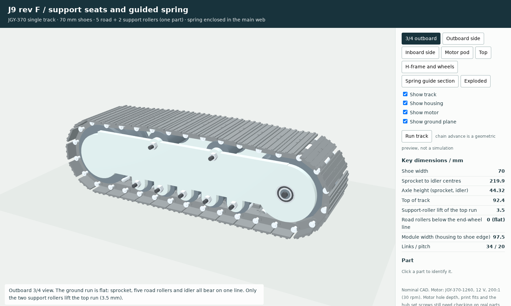
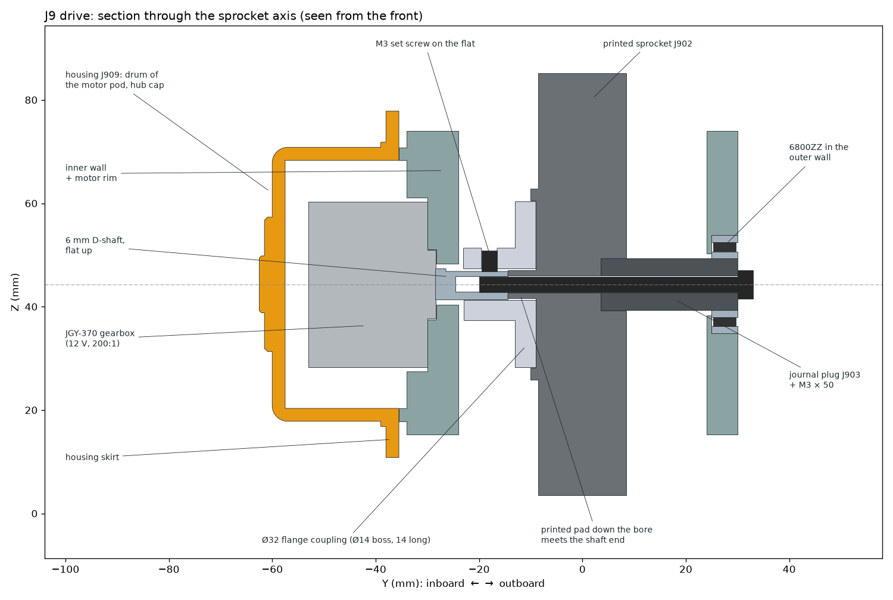
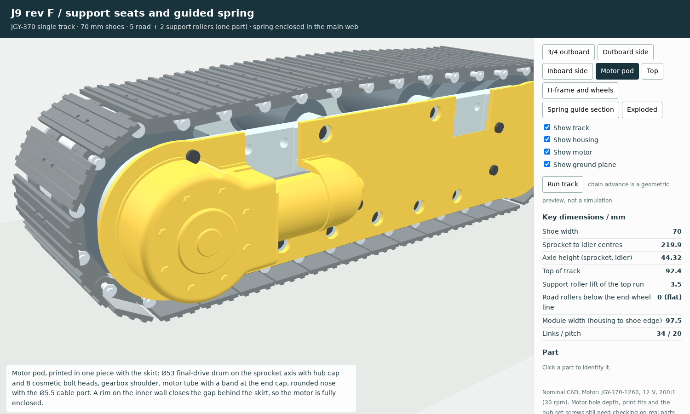

# JGY-370 single track — J9: one printed H-frame

**Building the tracks:** [TRACK_KIT.md](TRACK_KIT.md) lists what to print and what to buy for both tracks (the right track uses the mirrored J901 and J909 files in `X1/stl`), [install_animation.html](install_animation.html) plays the fitting order step by step, offline, and [parts_showcase.html](parts_showcase.html) shows every part in 3D with its dimensions, material and print settings.

**Status (revision F mounting interface):** J901 has plain 1.5 mm receiving seats for the flat ends of the straight X1 arms, with plain mounting holes and external nuts. A screw on each side of the arm's centre web clamps each connection. J909 has matching clearance openings. The accepted enclosed spring guide is retained. Current track verification and its fresh/inherited scope are recorded in [validation.json](validation.json). Chassis-connection checks are in [X1/arc_seat_mount_validation.json](../X1/arc_seat_mount_validation.json). Nothing has been printed, assembled or run under power yet.

- **Motor:** the JGY-370-1260 12 V 200:1 (30 rpm), motor only. See [Motor choice](#motor-choice).
- **Sprocket drive:** the sprocket now bolts to a bought Ø32 / Ø6 aluminium flange coupling on the D-shaft (a Pololu #1999 hub until 2026-11-12). The printed D-bore was too weak for any useful ratio. See [Drive hub](#drive-hub-replaces-the-printed-d-bore).
- **Motor enclosure:** the housing now closes over the motor with a pod styled on the Cat 320's final drive. See [Motor enclosure](#motor-enclosure).
- **Chassis interface (revision F):** two plain 1.5 mm deep rectangular seats in the inner main plate receive the flat ends of the X1 arms at X ±63.5. Two screws pass either side of each arm's centre web, with external washers and nuts behind the plate. Use matching revision F X101, J901 and J909 parts.
- **Spring guide (rev B):** the tension spring is fully contained in a Ø16.4 axial pocket in the main web. An integral Ø15.6 piston on the yoke enters the pocket, retaining the original 25.8 mm spring length and 4.2 mm recoil.

J9 replaces J8's machined side plates, axles, spacer stacks and bearing carrier with the core parts only:
- the JGY-370 gear motor;
- a one-piece housing that closes over the motor;
- a sprocket on the motor shaft;
- one printed H-frame;
- a spring-loaded idler;
- two support rollers above the H and five road rollers below it.

The layout follows the concept drawing the user approved (`output/jgy370_J9_discussion/J9_concept_drawing.pdf`), with the changes listed below.



## Change requested after the concept review: flat ground run

The user's feedback was: "the bottom support wheels also seem to protrude slightly — unnecessary, only the top needs it."

The concept kept J8's 2 mm end-wheel rise, which put the road rollers 2 mm below the sprocket and idler. J9 removes it:
- **One straight running line.** The sprocket's bottom chord, all five road rollers and the idler sit on the same line (road rollers 0 mm below the end wheels). The axles are now at Z 44.32 instead of 46.32.
- **Support rollers keep their lift.** Only the two support rollers lift the track: the top run sits 3.5 mm above the line over the sprocket and idler tops. Their centres moved to Z 70.14.
- **Chain re-solved.** The 34 links still close exactly (length error 2e-14 mm). The taut chain now puts the idler at X 109.90 (was 109.80), so the fitted spring length and its 77 N preload are unchanged.
- **Lower track.** The top of the track is 92.4 mm (concept: 94.4).

Two side effects of a flat bottom, for information:
- **Ground load on the end wheels.** On hard floors the sprocket and idler now share ground load with the road rollers.
- **Bobbing at the sprocket end.** The 12-tooth sprocket's polygon effect reaches the ground, so that end can rise and fall by up to 1.3 mm per tooth. The old 2 mm rise hid this. If it shows up in testing, raising only the sprocket by about 1.3 mm would remove it.

## Recessed spring guide

The spring pocket has a Ø21.2 outside diameter (2.4 mm wall). Its seat is recessed 8 mm behind the former web face, at X28; the guide extends to X56.8. At normal extension the spring ends 3 mm inside the guide, and at maximum recoil the guide mouth clears the yoke crossbar by 0.8 mm. The spring has 0.58 mm radial clearance and the piston has 0.4 mm. Print the bore cleanly, remove any bridging/support material, and check free sliding before fitting the spring. Use the revised J901 frame and J908 yoke together; the old yoke does not retain the revised preload.

The dedicated `spring_guide_validation.json` checks the spring's complete annular envelope at eleven positions through the stroke, free-spring insertion, and roller clearance. These nominal clearances still need physical print and debris testing.

The accepted guide dimensions and full-stroke checks are recorded in `spring_guide_validation.json`. The original spring-guide drawing remains in the repository; the current offline viewer shows the guide within the revised frame.
The offline viewer's **Spring guide section** view removes the outboard half of the H-frame so the spring, bore and piston are visible. Switching views restores the complete frame.

## Motor choice

From the shop listing and the ZENG WHCD tables the user sent, the pick is:
- **Listing options:** "12V 电机" (motor only, ¥15.5) with "每分钟/30转 6KG.CM".
- **Vendor table row:** JGY-370-1260, 200:1.

| Listing option (12 V) | Vendor row | Track speed, rated load / no load (mm/s) | Pull per track, rated / stall (N) | Fit with J9 |
|---|---|---|---|---|
| 68 rpm, 2.8 kg·cm | 1260 87:1 | 204 / 272 | 7.1 / 20.3 | Fast and weak |
| 40 rpm, 4.5 kg·cm | 1260 150:1 | 120 / 160 | 11.4 / 38.1 | Faster than scale |
| **30 rpm, 6 kg·cm** | **1260 200:1** | **88 / 120** | **15.2 / 50.8** | **Chosen** |
| 18 rpm, 12 kg·cm | 1260 340:1 | 52 / 72 | 30.5 / 86.3 | Stall pull beyond what the idler holds in reverse |
| 6 rpm, 25 kg·cm (the 6 V default shown on the page) | 1260 1000:1 | 16 / 24 | 63.5 / 231 | Far too slow; stall pull would overload the chain |

How the numbers are worked out:
- Vendor 12 V ratings.
- Track speed = 4 mm/s per sprocket rpm: 12 teeth × 20 mm per revolution.
- Pull = torque ÷ the sprocket's 38.6 mm pitch radius.
- The full motor comparison, including the 90–375 rpm options, is in [motor_selection.json](motor_selection.json).

Why this one:
- **12 V.**
  - The vendor tables cover only the 12 V motors, so 12 V is the only voltage whose performance is documented.
  - The 60 mm excavator already has a regulated 12 V rail for its travel motors.
  - A 6 V motor run from 2S Li-ion (7.4–8.4 V) would be over-volted. A 24 V motor would be weak.
  - If a 12 V motor is run straight from 2S, it simply gives about 60 % of the speeds and pulls above.
- **Motor only.**
  - J9 screws the gearbox face straight to the inner wall, so the L-bracket isn't used.
  - The "调速器" is a one-way speed knob; a tracked vehicle needs a reversible H-bridge for each track.
- **Speed.**
  - The Cat 320's top travel speed is 5.7 km/h (`excavator_arm_60mm/references/cat320_specifications.pdf`, page 2). At the project's 1:15 scale that is 106 mm/s.
  - The 30 rpm motor gives 88–120 mm/s, from rated load to no load, so it covers that speed.
  - The 40 rpm motor runs faster than scale even when loaded.
- **Pull.**
  - In reverse, the drive force goes round the spring idler. The idler starts to move back at 38.7 N of pull and reaches its recoil stop at 51.9 N.
  - The 30 rpm motor's 50.8 N stall pull stays just inside that.
  - The 18 rpm motor's 86 N would leave the slack side loose at the sprocket, so the chain could jump teeth.
- **Vehicle mass.** It is still unspecified, so no load rating is claimed.
  - A guide only: a skid turn on a hard floor needs roughly μ·m·g·L / (4·B) per track. Here L is the ground contact length (220 mm) and B is the track gauge.
  - With μ ≈ 0.5 and B = 300 mm, that is about 0.9 N per kg of vehicle.
- **Heat.** The motor is rated for 0.2 A continuous. Its stall current is 1.3 A.

## Drive hub: replaces the printed D-bore

The torque from any ratio slow enough for a track was too high for a printed D-bore.
- **Contact pressure on the flat.** With an elastic, linear pressure over the loaded half of the 3.3 mm flat, it is p = 12T / (L·w²).
- **With the chosen motor:** the old 9.1 mm printed bore would see 71 MPa at rated torque and 235 MPa at stall. PETG yields at about 50 MPa.
- **Correction.** The 2026-11-02 table used 6T / (L·w²), which understated these pressures by half. Even the 40:1 motor would have reached 47 MPa at stall.



J9 now uses a **Ø32 / Ø6 aluminium flange coupling** as its drive hub. The Pololu #1999 hub used until 2026-11-12 could not be bought.
- **Sized from the seller's drawing.** Every value was checked on the real part (`track_wheel_jgy370/references/flange_coupling_32/`):
  - flange Ø32 × 4 with six M3 tapped holes on a Ø23 circle;
  - boss Ø14 × 10 (14 overall), bore 6 mm;
  - one radial M3 set screw in the boss, 5 mm from its end, halfway between two holes.
  The build probes the modelled coupling against these values: outline, flange, boss, bore, holes and set screw.
- **On the shaft.**
  - The coupling's boss faces the motor and stops 1.0 mm short of the wall, as the Pololu boss did. Its flange face is therefore 4.8 mm further outboard (Y −9.0).
  - The shaft engages it over 8.6 mm.
  - The set screw points up onto the D-flat, 3.6 mm from the shaft end, well inside the 12 mm flat.
- **On the sprocket.**
  - The Ø32 flange sits in a Ø32.4 × 1 mm recess in a Ø37 × 1.5 ring on the sprocket's inner face. The old Ø30 hub boss is gone.
  - Three **M3 × 20** screws go from the sprocket's outer face into every other tapped hole (0°, 120°, 240°), with heads flush in counterbores: 4 mm of thread, tip 1.5 mm past the flange.
  - At the motor's stall torque each screw carries 57 N. That is about 6 MPa on the printed hole wall, ignoring clamp friction.
- **Axial position.** A printed Ø5.4 × 5.4 pad reaches down the coupling bore to the shaft end. Slide the sprocket on until it stops, then tighten the set screw.
- **Unchanged.** The plug, the 6800ZZ and the M3 × 50 are as before, and so are J901, J909 and the chain.
- **Not rated.** The coupling has one set screw (the Pololu hub had two) and the seller gives no torque rating on a D-flat, so this is an item to check on the real part (open item 1).

## Motor enclosure

The user's feedback was that the track left the motor exposed, and that its enclosure "has to look good".

The housing (J909) now has a closed motor pod, printed in one piece with the inboard skirt. It replaces the thin shroud that followed the motor's outline. The pod is styled on the Cat 320's final drive: a round drive housing on the sprocket axis, with the motor tucked in behind it.



- **Drum on the sprocket axis.**
  - Ø53, with a 3 mm rounded front edge.
  - A raised Ø26 hub cap with a centre boss.
  - Eight hex bolt heads on a Ø39 circle. They are printed and purely cosmetic.
- **Gearbox shoulder.** It follows the gearbox's 46 × 32 mm block and blends into the drum with R6 fillets.
- **Motor tube.**
  - Ø30.6 around the can.
  - A raised band where the can meets its end cap.
  - A rounded nose over the 10 mm terminal space.
- **Cable port.** A Ø5.5 hole through a boss at the nose tip, on the can axis. The two motor leads pass through it; a plug will not.
- **Closed all round.**
  - The pod clears the gearbox, the can and the terminal space by 0.8 mm.
  - A rim on the inner wall (part of J901) fills the 5.5 mm gap between the skirt and the wall around the pod.
  - The only opening is the cable port.
- **Fitting.** The pod's cavity has no undercut toward the frame, so the housing slides straight on over the motor. The build checks this path at six positions.
- **Fastening.** Four M3 × 8 button heads go through the skirt into heat-set inserts in four standoffs on the inner wall. Each screw engages 5.5 mm of its 5.7 mm insert.
- **Printing.**
  - The flat skirt face goes on the bed and the pod rises 27 mm.
  - Supports are needed only inside the pod. They come out through its open side.
  - Current print bounds and volume are recorded in the revision F export/preservation reports.
- **Effects elsewhere.**
  - **Width.** The module is 4 mm wider: 97.5 mm from the hub cap to the outer shoe edge (was 93.5).
  - **Chassis.** The pod reaches Y −62.5, inboard of the original main-plate face at Y −34 and recessed contact face at Y −32.5. The revision F X1 connection must clear this retained envelope; other chassis adapters must also clear it.
  - **Heat.** The motor's heat stays inside the pod (open item 7).

Two faults in the previous housing came to light during this redesign. Both are now fixed:
- **It could not be fitted.** Its motor tube wrapped past the can's axis, so it could not slide over the motor. No check covered the fitting path; the new `housing_fitting` check does.
- **Its print orientation was wrong.** It put the shroud on the bed with the skirt 20 mm in the air. The STL now has the skirt face on the bed.

## Changes found while building the CAD

1. **Sprocket outer support.**
   - In the concept, the sprocket's own boss ran in the 6800ZZ bearing in the outer wall. With a one-piece H-frame that cannot be assembled: the sprocket would have to move outboard into the bearing and inboard onto the motor shaft at the same time.
   - J9 fits the sprocket, with its hub already bolted on, from the rear between the walls and slides it onto the D-shaft. A printed **journal plug** (J903) then goes in from outside through the 6800ZZ into a socket in the sprocket.
   - One **M3 × 50** screw clamps the plug and sprocket onto the motor shaft. It replaces the concept's M3 × 30.
2. **Idler axle.**
   - An M8 bolt through slots in both walls would clamp the walls and stop the idler from recoiling.
   - J9 uses a plain **Ø8 × 55 steel pin** carried by the U-yoke arms. Its ends run in shallow tracks in the groove floors, so the walls keep it in place and nothing sits outside them.
   - Two printed spacers (J907) locate the idler between the arms.
3. **Motor face.**
   - The JGY-370 has four Ø7 × 2 mm screw bosses and a Ø13.2 × 1.6 mm boss on its output face.
   - These nest in counterbores in the inner wall, which locate the motor and take its torque reaction.
   - Four **M3 × 6** screws go in from inside the H. This gives 3 mm thread engagement, the same assumption as J8.
4. **Housing skirt.** (The motor pod is described under [Motor enclosure](#motor-enclosure).)
   - The skirt sits at Y −35.5 to −38 so that it clears the M4 roller-bolt heads.
   - It has Ø8 holes so the roller bolts can be reached and removed with the housing fitted.
   - Two openings expose the revision F receiving seats at X ±63.5 and follow the X1 arms with 0.5 mm clearance; beside the rear arm a 0.9 mm deep lane in the pod shell lets the joint screws slide in.

## Key numbers (mm)

| Item | J9 |
|---|---|
| Shoe width / module width (housing hub cap to shoe edge) | 70 / 97.5 |
| Sprocket to idler centres | 219.9 (recoil 4.2 to a hard stop) |
| Axle height / top of track | 44.32 / 92.4 |
| Road rollers: 5 at X −58, −29, 0, 29, 58; centre Z | 22 (tangent to the ground run) |
| Support rollers: 2 at X ±35; centre Z; lift of the top run | 70.14; 3.5 |
| Wheel part | one roller, Ø22 tread / Ø26 flanges × 46, Ø8 centre bore, 2 × 624ZZ, M4 bolt |
| Main walls / inside gap / original web | Inner plate 10 thick, 8.5 behind the 1.5-deep support seats, with mechanism recesses; outer wall 6 / 48 / 18 × 102 |
| Spring (R5 part, kept) | 25.8 fitted, 77 N; 21.6 and 104 N at the recoil stop; max 118 N, solid 17.0 |
| Chain | unchanged: 34 × 20 mm links, Ø3 pins, Ø6 bushings, 12-tooth sprocket form |
| Motor | JGY-370-1260 12 V 200:1: 30 rpm no load, 22 rpm at 6 kgf·cm rated, 20 kgf·cm stall; 88–120 mm/s track speed |
| Drive hub | Ø32 / Ø6 flange coupling, Ø32 × 14; shaft engagement 8.6; 3 × M3 × 20 into the sprocket; 1 M3 set screw on the D-flat |
| Reverse pull the idler holds | 38.7 N before it moves; 51.9 N at its recoil stop |
| Motor pod | Ø53 drum, Ø30.6 motor tube, 2.5 walls, 0.8 clearance to the motor; drum face 22 proud of the skirt; Ø5.5 cable port |

## Parts

There are 15 printed pieces (9 designs) and 52 bought pieces, plus the track. The concept estimated 12 + 51; J8 had 148. Full list: [BOM.md](BOM.md).

Changes since the concept:
- **Printed pieces added:** two small ones, the journal plug (1) and the idler spacers (2).
- **Bought pieces added on 2026-11-03:** the drive hub with its two set screws, and three M3 × 25 screws.
- **Drive hub changed on 2026-11-12:** the Pololu #1999 hub could not be bought. A Ø32 / Ø6 flange coupling with one set screw replaces it, and the sprocket screws are now M3 × 20.
  - J902 changed to suit: a Ø37 ring with a Ø32.4 recess replaces the Ø30 hub boss, the screw holes moved to a Ø23 circle at the same angles, and the shaft-end pad grew from 0.6 to 5.4 mm.
  - The teeth are unchanged. The print is 22.9 mm tall (was 23.3) and 2.9 cm³ smaller.
- **Bought pieces changed on 2026-11-03:** the four housing screws are now M3 × 8 (were M3 × 12). Their inserts sit in standoffs on the inner wall.
- **Roller changed on 2026-11-11:** the J904 centre bore is now Ø8 (was Ø6).
  - Each 624ZZ seat ends on a shoulder of that bore. At Ø6 the shoulder also touched the stationary inner ring, whose face is Ø6.95 across (SKF 624-2Z d1). A side load then pressed the turning roller against it.
  - At Ø8 the shoulder bears only on the outer ring, and still reaches well inside SKF's Ø11.2 limit for backing it.
  - The seats, tread and flanges are unchanged. Each roller is about 0.8 cm³ (1 g) lighter.

## Open items: check before relying on them

1. **Coupling set screw on the D-flat.**
   - The seller gives no torque rating, and the coupling has one set screw (the Pololu hub had two). This motor's stall torque is 1.96 N·m.
   - Tighten the set screw firmly on the flat and mark it with paint. Check it after the first runs and after any stall.
   - The pull figures above come from vendor ratings. Measure the real motor's current and pull on the bench.
2. **Motor screw holes.** The 3 mm thread engagement in the gearbox holes is assumed (as in J8). Measure the real hole depth.
3. **Print fits.** Check these on test prints and tune them to the printer:
   - the 6800ZZ, 624ZZ and 608 press fits;
   - the Ø9.95 plug in the 6800ZZ;
   - the Ø32.4 coupling recess in the sprocket. The seller gives no tolerance for the Ø32 flange.
4. **Roller bolts.** The rollers float 0.3 mm between small wall bosses. Tighten the nyloc nuts only until snug; clamping the walls would preload the bearings.
5. **Chassis.**
   - [X1](../X1/README.md) seats the flat ends of two straight arms per track at X ±63.5 in shallow main-plate recesses. Each arm has one screw on each side of its centre web. Fit the road/support rollers and their axles, motor and housing first. Hold both tracks at their final spacing and lower bare X101 vertically into the seats before fastening the joints, with the rear sprocket and chain removed; see the current X1 assembly guide.
   - Any other chassis must match the revision F interface: seats from local Y−34 to Y−32.5, joint centres X ±63.5, and two Ø4.5 screw holes per station at X54/X73 and their rear mirrors, all at Z67.75. External nuts and both washers must clear the wheels. See `source/j9_mounts.py` and the X1 assembly guide.
   - It must also leave room for the motor pod, which stands out to Y −62.5 over X −137.5 to −18.6 and Z 16.8 to 71.8.
6. **Reverse stall.**
   - At stall in reverse, the chosen motor pulls 50.8 N; the idler holds 51.9 N at its recoil stop, so there is almost no margin.
   - Limiting the motor driver's current to about 1.0 A caps the pull near 38 N, which is about where the idler starts to move.
   - That estimate assumes torque rises linearly with current, scaled from the vendor's no-load and stall points.
7. **Heat in the closed pod.**
   - The pod has no vents, and the 0.8 mm air gap carries little heat away. PETG starts to soften at about 70–80 °C.
   - At its rated 0.2 A the motor's winding loss is about 0.4 W, which is harmless.
   - A held stall is not: about 9 W at the suggested 1.0 A limit (winding resistance 12 V ÷ 1.3 A ≈ 9.2 Ω). The motor driver should cut the current when the track stalls.
   - On the first bench runs, check the can's temperature; four screws take the housing off. If it runs hot, vent slots can go on the underside of the tube.
8. **Not checked.** Loads, wear, print tolerances and powered running. The vehicle mass is not specified, so no load rating is claimed.

## Current verification

The revision F `validation.json` is a fresh full run of the `build_j9.py` trial block on the delivered STEP parts (`source/check_revf_track.py`): static interference, drive rotation, idler travel and stop, spring at recoil, chain phases, assembly routes and tool access, with every candidate pair computed. It also checks the clearances of the thickened main-plate seats, and probes the modelled flange coupling against the seller drawing's values (outline, flange, boss, bore, six holes, set screw on the shaft flat). The checked source and exported files are bound by SHA-256. Exact counts and minimum clearances are in the report.

`spring_guide_validation.json` checks the complete spring envelope at eleven positions through the 4.2 mm stroke, spring insertion and roller clearance. `browser_validation.json` checks the offline viewer and records its current HTML, scene and screenshots.

The assembled X1 joints are checked separately in [arc_seat_mount_validation.json](../X1/arc_seat_mount_validation.json). Support-roller access differs when mounted on X1: the X101 arms may block a straight driver and full bolt withdrawal. Detach the prepared track using the vertical service route in X1/ASSEMBLY.md: independently support the chassis, remove the specified drive/joint hardware and disconnect its wiring, lower the track at least 80 mm, then slide it outward.

These are nominal geometry checks. Printed fit, strength, wear, spring friction and powered operation require physical tests; no payload rating is assigned.

## Files

- `J9_layout.pdf`: side-view layout drawn from the CAD; `J9_spring_guide_detail.pdf`: the enclosed spring guide. Use the STEP and viewer for the recessed support seats and external mounting fasteners.
- `3D_preview.html` — offline 3D viewer. It has views, show/hide toggles, an exploded view, click-to-identify and a "Run track" animation.
- `images/` — screenshots from the viewer (including `J9_pod.png`, the motor pod), the retained `J9_drive_section.png` reference for the unchanged drivetrain.
- `step/` — one STEP per printed part, plus `JGY370_track_J9.step` (the full coloured assembly, 277 solids).
- `stl/` — print-oriented STL files for each printed part.
- `BOM.md`, `ASSEMBLY.md`, `validation.json`, `browser_validation.json`.
- `TRACK_KIT.md`, `track_kit.csv` — print list and standard parts for two tracks; `install_animation.html` — offline installation animation (left, mirrored right, or both on X101). Built by `source/build_track_kit.py` (`--package` also writes `output/track_print_kit.zip`), which cross-checks the list against the STL files and the CAD scene (`track_kit_report.json`); `source/check_track_kit.cjs` checks the animation in Chromium, including that no bushing, pin, E-clip or link passes through another (sections of the CAD shoe), and the fitting order of each joint (`track_kit_browser.json`, `images/kit_*.png`).
- `parts_showcase.html` — offline parts showcase: every part to print or buy in 3D, on the print bed or as fitted, with a section cut, its dimensions drawn on the model and its material, settings and place in the track. Built by `source/build_parts_showcase.py` from the kit lists (build it after `build_track_kit.py`, before `--package`), which checks every drawn dimension against the STL or CAD mesh and each print file against the CAD scene (`parts_showcase_report.json`); `source/check_parts_showcase.cjs` checks the page in Chromium against `track_kit.csv` and `TRACK_KIT.md` (`parts_showcase_browser.json`, `images/showcase_*.png`).
- `source/` — the source scripts:
  - `j9_design.py`: layout and the exact chain solver;
  - `j9_parts.py`: CadQuery parts and the assembly;
  - `build_j9.py`: full rebuild (exports and checks);
  - `export_revf_track.py`, `check_revf_track.py`: revision F J901/J909 exports and the fresh validation of the delivered parts;
  - `build_viewer.py`, `viewer.html`, `check_viewer.cjs`: viewer build and test;
  - `draw_layout.py`, `draw_spring_guide.py`: the layout sheet and spring-guide detail;
  - `draw_drive_section.py`: the drive section image.
- `track_wheel_jgy370/references/flange_coupling_32/` — the seller's drawing of the drive coupling and the values checked on the part. `build_j9.py` probes the model against them. `references/pololu_1999/` keeps the Pololu hub used until 2026-11-12; the X1 turntable pinion is still drawn on it.

## Rebuild

From `track_wheel_jgy370/J9/source/`, with CadQuery 2.7 (`/tmp/sw-venv/bin/python` with `LD_LIBRARY_PATH=/tmp/sw-tools/root/usr/lib/x86_64-linux-gnu` in this workspace):

```
python build_j9.py          # STEP, STL, validation.json, viewer data
python build_viewer.py      # ../3D_preview.html
NODE_PATH=<playwright node_modules> node check_viewer.cjs   # screenshots + browser_validation.json
```

`build_j9.py` reuses `track_wheel/source/tw_parts.py` (geometry helpers, the J8/R5 idler wheel, whose two 608 seats `j9_parts.py` opens to the faces, and the R4 sprocket outline), `tw_checks.py` and `build_track_wheel.py`.
