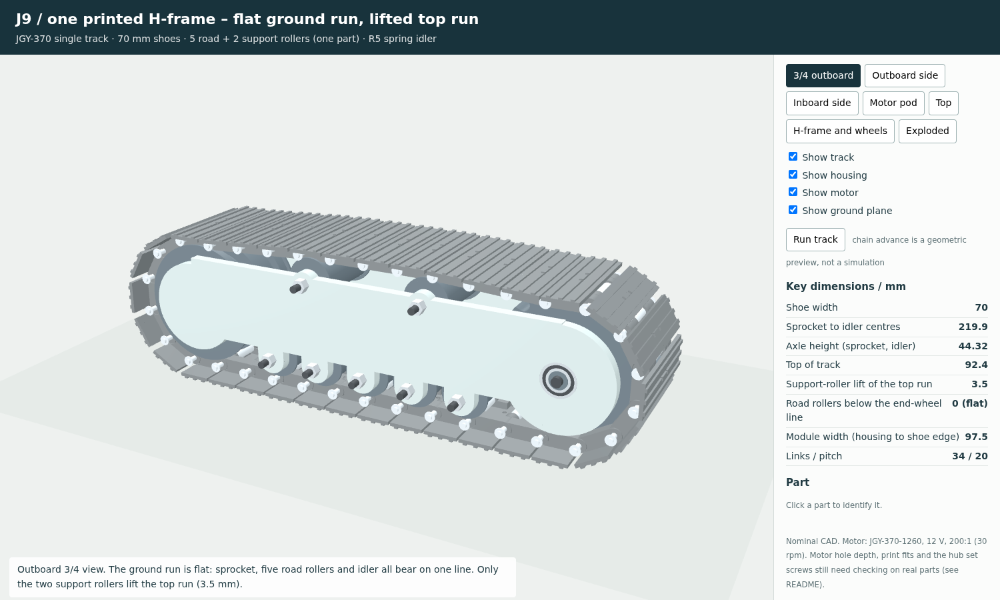
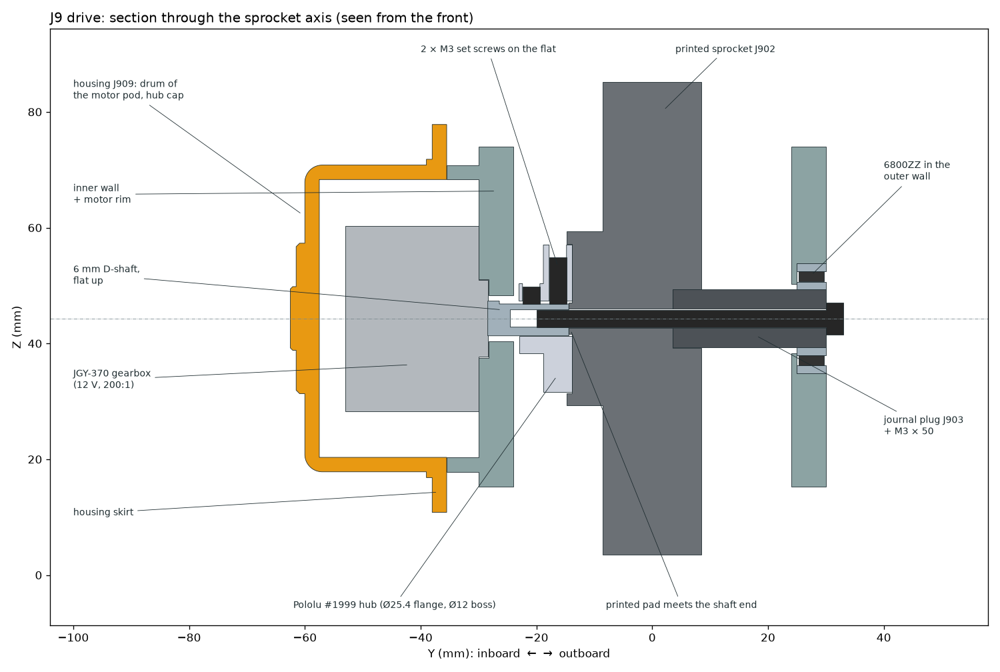
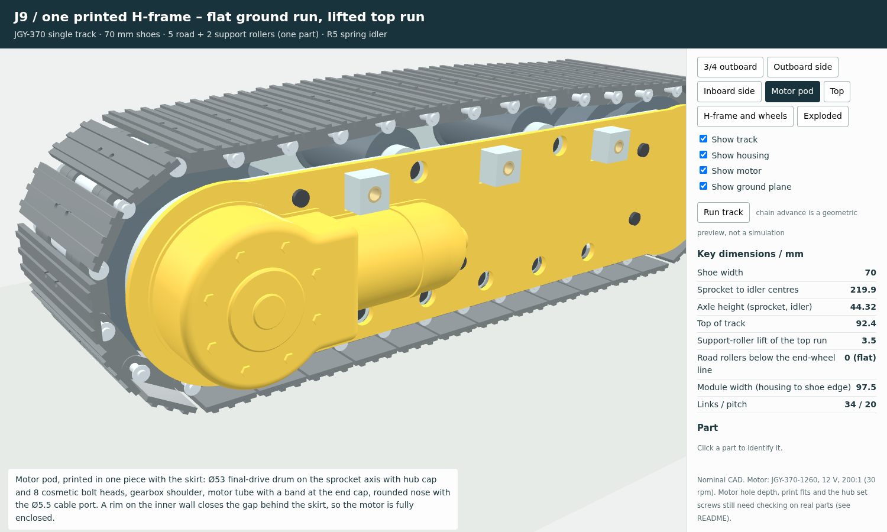

# JGY-370 single track — J9: one printed H-frame

**Status (2026-11-03):** the J9 CAD is complete and every geometry check in `validation.json` passes. Nothing has been printed, assembled or run under power yet.

- **Motor:** the JGY-370-1260 12 V 200:1 (30 rpm), motor only. See [Motor choice](#motor-choice).
- **Sprocket drive:** the sprocket now bolts to a bought Pololu #1999 aluminium hub on the D-shaft. The printed D-bore was too weak for any useful ratio. See [Drive hub](#drive-hub-replaces-the-printed-d-bore).
- **Motor enclosure:** the housing now closes over the motor with a pod styled on the Cat 320's final drive. See [Motor enclosure](#motor-enclosure).

J9 replaces J8's machined side plates, axles, spacer stacks and bearing carrier with the core parts only:
- the JGY-370 gear motor;
- a one-piece housing that closes over the motor;
- a sprocket on the motor shaft;
- one printed H-frame;
- a spring-loaded idler;
- two support rollers above the H and five road rollers below it.

The layout follows the concept drawing the user approved (`output/jgy370_J9_discussion/J9_concept_drawing.pdf`), with the changes listed below.



## Change requested after the concept review: flat ground run

The user's feedback was: "the bottom support wheels also seem to protrude slightly — unnecessary, only the top needs it."

The concept kept J8's 2 mm end-wheel rise, which put the road rollers 2 mm below the sprocket and idler. J9 removes it:
- **One straight running line.** The sprocket's bottom chord, all five road rollers and the idler sit on the same line (road rollers 0 mm below the end wheels). The axles are now at Z 44.32 instead of 46.32.
- **Support rollers keep their lift.** Only the two support rollers lift the track: the top run sits 3.5 mm above the line over the sprocket and idler tops. Their centres moved to Z 70.14.
- **Chain re-solved.** The 34 links still close exactly (length error 2e-14 mm). The taut chain now puts the idler at X 109.90 (was 109.80), so the fitted spring length and its 77 N preload are unchanged.
- **Lower track.** The top of the track is 92.4 mm (concept: 94.4).

Two side effects of a flat bottom, for information:
- **Ground load on the end wheels.** On hard floors the sprocket and idler now share ground load with the road rollers.
- **Bobbing at the sprocket end.** The 12-tooth sprocket's polygon effect reaches the ground, so that end can rise and fall by up to 1.3 mm per tooth. The old 2 mm rise hid this. If it shows up in testing, raising only the sprocket by about 1.3 mm would remove it.

## Motor choice

From the shop listing and the ZENG WHCD tables the user sent, the pick is:
- **Listing options:** "12V 电机" (motor only, ¥15.5) with "每分钟/30转 6KG.CM".
- **Vendor table row:** JGY-370-1260, 200:1.

| Listing option (12 V) | Vendor row | Track speed, rated load / no load (mm/s) | Pull per track, rated / stall (N) | Fit with J9 |
|---|---|---|---|---|
| 68 rpm, 2.8 kg·cm | 1260 87:1 | 204 / 272 | 7.1 / 20.3 | Fast and weak |
| 40 rpm, 4.5 kg·cm | 1260 150:1 | 120 / 160 | 11.4 / 38.1 | Faster than scale |
| **30 rpm, 6 kg·cm** | **1260 200:1** | **88 / 120** | **15.2 / 50.8** | **Chosen** |
| 18 rpm, 12 kg·cm | 1260 340:1 | 52 / 72 | 30.5 / 86.3 | Stall pull beyond what the idler holds in reverse |
| 6 rpm, 25 kg·cm (the 6 V default shown on the page) | 1260 1000:1 | 16 / 24 | 63.5 / 231 | Far too slow; stall pull would overload the chain |

How the numbers are worked out:
- Vendor 12 V ratings.
- Track speed = 4 mm/s per sprocket rpm: 12 teeth × 20 mm per revolution.
- Pull = torque ÷ the sprocket's 38.6 mm pitch radius.
- The full list, including the 90–375 rpm options, is in `validation.json → motor_selection`.

Why this one:
- **12 V.**
  - The vendor tables cover only the 12 V motors, so 12 V is the only voltage whose performance is documented.
  - The 60 mm excavator already has a regulated 12 V rail for its travel motors.
  - A 6 V motor run from 2S Li-ion (7.4–8.4 V) would be over-volted. A 24 V motor would be weak.
  - If a 12 V motor is run straight from 2S, it simply gives about 60 % of the speeds and pulls above.
- **Motor only.**
  - J9 screws the gearbox face straight to the inner wall, so the L-bracket isn't used.
  - The "调速器" is a one-way speed knob; a tracked vehicle needs a reversible H-bridge for each track.
- **Speed.**
  - The Cat 320's top travel speed is 5.7 km/h (`excavator_arm_60mm/references/cat320_specifications.pdf`, page 2). At the project's 1:15 scale that is 106 mm/s.
  - The 30 rpm motor gives 88–120 mm/s, from rated load to no load, so it covers that speed.
  - The 40 rpm motor runs faster than scale even when loaded.
- **Pull.**
  - In reverse, the drive force goes round the spring idler. The idler starts to move back at 38.7 N of pull and reaches its recoil stop at 51.9 N.
  - The 30 rpm motor's 50.8 N stall pull stays just inside that.
  - The 18 rpm motor's 86 N would leave the slack side loose at the sprocket, so the chain could jump teeth.
- **Vehicle mass.** It is still unspecified, so no load rating is claimed.
  - A guide only: a skid turn on a hard floor needs roughly μ·m·g·L / (4·B) per track. Here L is the ground contact length (220 mm) and B is the track gauge.
  - With μ ≈ 0.5 and B = 300 mm, that is about 0.9 N per kg of vehicle.
- **Heat.** The motor is rated for 0.2 A continuous. Its stall current is 1.3 A.

## Drive hub: replaces the printed D-bore

The torque from any ratio slow enough for a track was too high for a printed D-bore.
- **Contact pressure on the flat.** With an elastic, linear pressure over the loaded half of the 3.3 mm flat, it is p = 12T / (L·w²).
- **With the chosen motor:** the old 9.1 mm printed bore would see 71 MPa at rated torque and 235 MPa at stall. PETG yields at about 50 MPa.
- **Correction.** The 2026-11-02 table used 6T / (L·w²), which understated these pressures by half. Even the 40:1 motor would have reached 47 MPa at stall.



J9 now uses a **Pololu #1999 universal aluminium mounting hub** (6 mm bore, M3 holes, sold in pairs).
- **Datasheet-sized.** The CAD uses Pololu's drawing and STEP model; copies and source links are in `track_wheel_jgy370/references/pololu_1999/` (`references/pololu_1999/` in the download package). The build places Pololu's STEP in the J9 pose and compares it with the modelled hub:
  - bounding box within 0.0001 mm;
  - 0.03 mm³ of vendor material missing from the model;
  - 16 mm³ of model material where Pololu's part has edge chamfers.
- **On the shaft.**
  - The hub's boss faces the motor and stops 1.0 mm short of the wall.
  - The shaft engages it over 8.6 mm.
  - Both of the hub's M3 set screws point the same way, so both bear on the D-flat: 1.9 mm and 6.5 mm from the shaft end, well inside the 12 mm flat.
- **On the sprocket.**
  - The Ø25.4 flange sits in a Ø25.8 × 1 mm recess in the sprocket's inner face.
  - Three **M3 × 25** screws go from the sprocket's outer face into the hub's threads, with heads flush in counterbores.
  - At the motor's stall torque each screw carries 69 N. That is about 8 MPa on the printed hole wall, ignoring clamp friction.
- **Axial position.** A printed pad inside the hub bore meets the shaft end. Slide the sprocket on until it stops, then tighten the set screws.
- **Unchanged.** The plug, the 6800ZZ and the M3 × 50 are as before.
- **Not rated by Pololu.** Pololu gives no torque rating for the set screws on a D-flat, so this is an item to check on the real part (open item 1).

## Motor enclosure

The user's feedback was that the track left the motor exposed, and that its enclosure "has to look good".

The housing (J909) now has a closed motor pod, printed in one piece with the inboard skirt. It replaces the thin shroud that followed the motor's outline. The pod is styled on the Cat 320's final drive: a round drive housing on the sprocket axis, with the motor tucked in behind it.



- **Drum on the sprocket axis.**
  - Ø53, with a 3 mm rounded front edge.
  - A raised Ø26 hub cap with a centre boss.
  - Eight hex bolt heads on a Ø39 circle. They are printed and purely cosmetic.
- **Gearbox shoulder.** It follows the gearbox's 46 × 32 mm block and blends into the drum with R6 fillets.
- **Motor tube.**
  - Ø30.6 around the can.
  - A raised band where the can meets its end cap.
  - A rounded nose over the 10 mm terminal space.
- **Cable port.** A Ø5.5 hole through a boss at the nose tip, on the can axis. The two motor leads pass through it; a plug will not.
- **Closed all round.**
  - The pod clears the gearbox, the can and the terminal space by 0.8 mm.
  - A rim on the inner wall (part of J901) fills the 5.5 mm gap between the skirt and the wall around the pod.
  - The only opening is the cable port.
- **Fitting.** The pod's cavity has no undercut toward the frame, so the housing slides straight on over the motor. The build checks this path at six positions.
- **Fastening.** Four M3 × 8 button heads go through the skirt into heat-set inserts in four standoffs on the inner wall. Each screw engages 5.5 mm of its 5.7 mm insert.
- **Printing.**
  - The flat skirt face goes on the bed and the pod rises 27 mm.
  - Supports are needed only inside the pod. They come out through its open side.
  - Print bounds 287 × 67 × 27 mm; 71 g if printed solid in PETG.
- **Effects elsewhere.**
  - **Width.** The module is 4 mm wider: 97.5 mm from the hub cap to the outer shoe edge (was 93.5).
  - **Chassis.** The pod reaches Y −62.5, which is 16.5 mm beyond the chassis boss faces at Y −46, so the vehicle side needs a cut-out for it (open item 5). The bare gearbox already reached Y −53. The pod clears the rear chassis boss by 2.4 mm.
  - **Heat.** The motor's heat stays inside the pod (open item 7).

Two faults in the previous housing came to light during this redesign. Both are now fixed:
- **It could not be fitted.** Its motor tube wrapped past the can's axis, so it could not slide over the motor. No check covered the fitting path; the new `housing_fitting` check does.
- **Its print orientation was wrong.** It put the shroud on the bed with the skirt 20 mm in the air. The STL now has the skirt face on the bed.

## Changes found while building the CAD

1. **Sprocket outer support.**
   - In the concept, the sprocket's own boss ran in the 6800ZZ bearing in the outer wall. With a one-piece H-frame that cannot be assembled: the sprocket would have to move outboard into the bearing and inboard onto the motor shaft at the same time.
   - J9 fits the sprocket, with its hub already bolted on, from the rear between the walls and slides it onto the D-shaft. A printed **journal plug** (J903) then goes in from outside through the 6800ZZ into a socket in the sprocket.
   - One **M3 × 50** screw clamps the plug and sprocket onto the motor shaft. It replaces the concept's M3 × 30.
2. **Idler axle.**
   - An M8 bolt through slots in both walls would clamp the walls and stop the idler from recoiling.
   - J9 uses a plain **Ø8 × 55 steel pin** carried by the U-yoke arms. Its ends run in shallow tracks in the groove floors, so the walls keep it in place and nothing sits outside them.
   - Two printed spacers (J907) locate the idler between the arms.
3. **Motor face.**
   - The JGY-370 has four Ø7 × 2 mm screw bosses and a Ø13.2 × 1.6 mm boss on its output face.
   - These nest in counterbores in the inner wall, which locate the motor and take its torque reaction.
   - Four **M3 × 6** screws go in from inside the H. This gives 3 mm thread engagement, the same assumption as J8.
4. **Housing skirt.** (The motor pod is described under [Motor enclosure](#motor-enclosure).)
   - The skirt sits at Y −35.5 to −38 so that it clears the M4 roller-bolt heads.
   - It has Ø8 holes so the roller bolts can be reached and removed with the housing fitted.
   - The three chassis bosses on the inner wall pass through it.

## Key numbers (mm)

| Item | J9 |
|---|---|
| Shoe width / module width (housing hub cap to shoe edge) | 70 / 97.5 |
| Sprocket to idler centres | 219.9 (recoil 4.2 to a hard stop) |
| Axle height / top of track | 44.32 / 92.4 |
| Road rollers: 5 at X −58, −29, 0, 29, 58; centre Z | 22 (tangent to the ground run) |
| Support rollers: 2 at X ±35; centre Z; lift of the top run | 70.14; 3.5 |
| Wheel part | one roller, Ø22 tread / Ø26 flanges × 46, 2 × 624ZZ, M4 bolt |
| Walls / gap / web | 6 thick / 48 apart / 18 × 102 |
| Spring (R5 part, kept) | 25.8 fitted, 77 N; 21.6 and 104 N at the recoil stop; max 118 N, solid 17.0 |
| Chain | unchanged: 34 × 20 mm links, Ø3 pins, Ø6 bushings, 12-tooth sprocket form |
| Motor | JGY-370-1260 12 V 200:1: 30 rpm no load, 22 rpm at 6 kgf·cm rated, 20 kgf·cm stall; 88–120 mm/s track speed |
| Drive hub | Pololu #1999, Ø25.4 × 9.2; shaft engagement 8.6; 3 × M3 × 25 into the sprocket; 2 M3 set screws on the D-flat |
| Reverse pull the idler holds | 38.7 N before it moves; 51.9 N at its recoil stop |
| Motor pod | Ø53 drum, Ø30.6 motor tube, 2.5 walls, 0.8 clearance to the motor; drum face 22 proud of the skirt; Ø5.5 cable port |

## Parts

There are 15 printed pieces (9 designs) and 56 bought pieces, plus the track. The concept estimated 12 + 51; J8 had 148. Full list: [BOM.md](BOM.md).

Changes since the concept:
- **Printed pieces added:** two small ones, the journal plug (1) and the idler spacers (2).
- **Bought pieces added on 2026-11-03:** the drive hub with its two set screws, and three M3 × 25 screws.
- **Bought pieces changed on 2026-11-03:** the four housing screws are now M3 × 8 (were M3 × 12). Their inserts sit in standoffs on the inner wall.

## Open items: check before relying on them

1. **Hub set screws on the D-flat.**
   - Pololu publishes no torque rating for its hub. This motor's stall torque is 1.96 N·m.
   - Tighten both set screws firmly on the flat and mark them with paint. Check them after the first runs and after any stall.
   - The pull figures above come from vendor ratings. Measure the real motor's current and pull on the bench.
2. **Motor screw holes.** The 3 mm thread engagement in the gearbox holes is assumed (as in J8). Measure the real hole depth.
3. **Print fits.** Check these on test prints and tune them to the printer:
   - the 6800ZZ, 624ZZ and 608 press fits;
   - the Ø9.95 plug in the 6800ZZ;
   - the Ø25.8 hub recess in the sprocket. Pololu gives no tolerance for the Ø25.4 flange.
4. **Roller bolts.** The rollers float 0.3 mm between small wall bosses. Tighten the nyloc nuts only until snug; clamping the walls would preload the bearings.
5. **Chassis.**
   - [X1](../X1/README.md) (2026-11-03) is the chassis for two J9 tracks. Its X-frame rails bolt to the three bosses with M4 × 12 and clear the motor pod by 1.5 mm.
   - Any other chassis has to match the same mounting: three M4 bosses at X −60 / 0 / 60, Z 68, face at Y −46.
   - It must also leave room for the motor pod, which stands out to Y −62.5 over X −137.5 to −18.6 and Z 16.8 to 71.8.
6. **Reverse stall.**
   - At stall in reverse, the chosen motor pulls 50.8 N; the idler holds 51.9 N at its recoil stop, so there is almost no margin.
   - Limiting the motor driver's current to about 1.0 A caps the pull near 38 N, which is about where the idler starts to move.
   - That estimate assumes torque rises linearly with current, scaled from the vendor's no-load and stall points.
7. **Heat in the closed pod.**
   - The pod has no vents, and the 0.8 mm air gap carries little heat away. PETG starts to soften at about 70–80 °C.
   - At its rated 0.2 A the motor's winding loss is about 0.4 W, which is harmless.
   - A held stall is not: about 9 W at the suggested 1.0 A limit (winding resistance 12 V ÷ 1.3 A ≈ 9.2 Ω). The motor driver should cut the current when the track stalls.
   - On the first bench runs, check the can's temperature; four screws take the housing off. If it runs hot, vent slots can go on the underside of the tube.
8. **Not checked.** Loads, wear, print tolerances and powered running. The vehicle mass is not specified, so no load rating is claimed.

## Verification (`validation.json`)

All of these were run on the exact CAD solids, and the result is **PASS**:
- **Chain closure:** 34 links close with 2e-14 mm length error; the support-roller lift is 3.500 mm.
- **Static assembly:** no overlap among 449 candidate pairs (exact solid intersection, with the track included).
- **Drive rotation:** sprocket, hub, hub screws, set screws, plug, screw and shaft turned through a full tooth in 5° steps, without the chain, against the frame, motor and rollers.
- **Idler recoil:** the idler moves 2.1 and 4.2 mm to the stop. Pushed 0.3 mm further, the yoke hits only the H-frame groove ends, which is the intended hard stop. The spring at its recoil length clears everything.
- **Chain phases:** the chain advanced by ¼, ½ and ¾ pitch was checked against all fixed parts. This uses a conveyor approximation: pins follow the pitch circles on the wraps and straight lines elsewhere.
- **Assembly paths:**
  - motor-screw hex key, from inside the open H before the sprocket goes in;
  - sprocket and hub entry from the rear between the walls, then the slide onto the D-shaft;
  - journal plug and M3 × 50 through the 6800ZZ;
  - yoke, idler and pin sliding in from the front;
  - the housing sliding straight on over the motor, checked 40, 25, 15, 8, 4 and 1.5 mm short of home.
- **Tool access:** 25 paths, all clear:
  - housing screws;
  - roller bolts through the skirt holes;
  - nyloc socket;
  - plug screw;
  - motor-screw key;
  - the 1.5 mm key straight down onto both hub set screws, between the walls, before the track goes on.
- **Hub against Pololu's STEP:** the vendor model, placed in the J9 pose, matches the modelled hub (see [Drive hub](#drive-hub-replaces-the-printed-d-bore)).
- **Minimum clearances:**
  - track pins and clips to the H-frame: 3.5 mm;
  - shoes to the housing: 7.8 mm;
  - end road rollers to the sprocket and to the idler at full recoil: 4.8 / 4.5 mm;
  - roller flanges to the web: 2.0 / 2.1 mm;
  - yoke base to road roller: 2.1 mm;
  - hub boss to the inner wall: 1.0 mm;
  - hub and hub-screw tips to the motor screw heads: 2.5 mm;
  - sprocket tooth tips to the web end: 3.2 mm;
  - motor pod to motor, and the frame rim behind the skirt to motor: 0.8 mm;
  - motor pod to the rear chassis boss: 2.4 mm.
- **Printability:** every printed part is one valid solid, its STEP round-trips, and its STL is watertight.
- **3D viewer:** it loads offline with no errors or network requests, and its views, toggles and run animation work (`browser_validation.json`).

## Files

- `J9_layout.pdf` — dimensioned side view, flat-ground and support-roller details, and the concept-vs-J9 table.
- `3D_preview.html` — offline 3D viewer. It has views, show/hide toggles, an exploded view, click-to-identify and a "Run track" animation.
- `images/` — screenshots from the viewer (including `J9_pod.png`, the motor pod), the layout sheet and `J9_drive_section.png` (section through the drive axis).
- `step/` — one STEP per printed part, plus `JGY370_track_J9.step` (the full coloured assembly, 280 solids).
- `stl/` — print-oriented STL files for each printed part.
- `BOM.md`, `ASSEMBLY.md`, `validation.json`, `browser_validation.json`.
- `source/` — the source scripts:
  - `j9_design.py`: layout and the exact chain solver;
  - `j9_parts.py`: CadQuery parts and the assembly;
  - `build_j9.py`: exports and checks;
  - `build_viewer.py`, `viewer.html`, `check_viewer.cjs`: viewer build and test;
  - `draw_layout.py`: the layout sheet;
  - `draw_drive_section.py`: the drive section image.
- `track_wheel_jgy370/references/pololu_1999/` (in the package: `references/pololu_1999/`) — Pololu's hub drawing and STEP, with their source links. `build_j9.py` compares the model against the STEP.

## Rebuild

From `track_wheel_jgy370/J9/source/`, with CadQuery 2.8 (`/tmp/venv` in this workspace):

```
python build_j9.py          # STEP, STL, validation.json, viewer data (about 4 min)
python build_viewer.py      # ../3D_preview.html
NODE_PATH=<playwright node_modules> node check_viewer.cjs   # screenshots + browser_validation.json
python draw_layout.py       # ../J9_layout.pdf
python draw_drive_section.py   # ../images/J9_drive_section.png
```

`build_j9.py` reuses `track_wheel/source/tw_parts.py` (geometry helpers, the J8/R5 idler wheel and the R4 sprocket outline), `tw_checks.py` and `build_track_wheel.py`.
