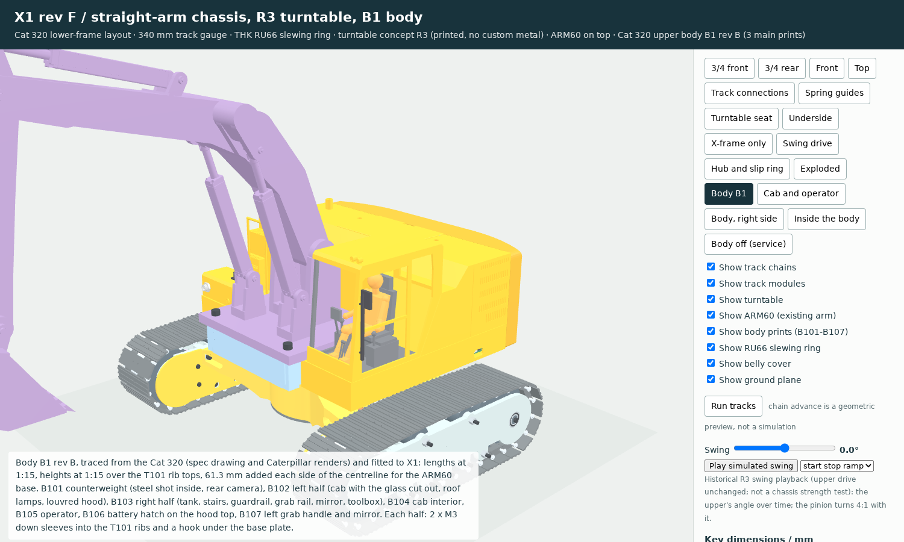
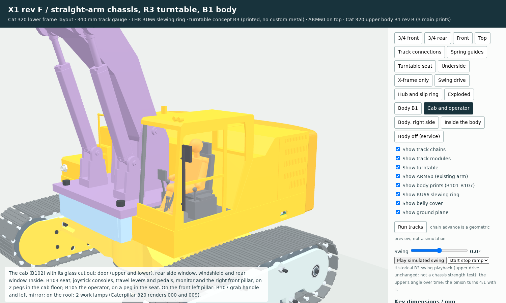
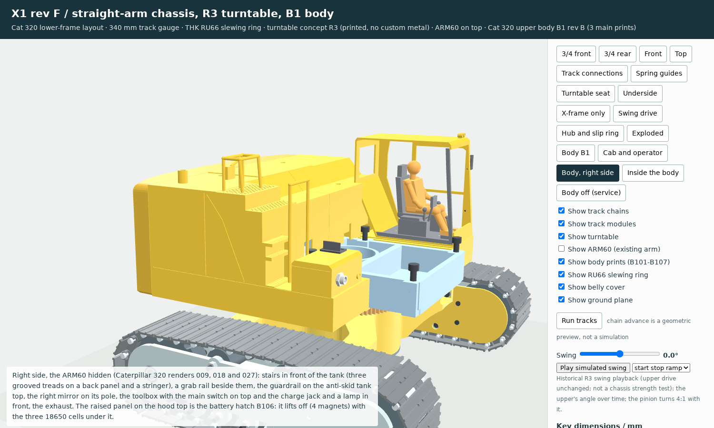
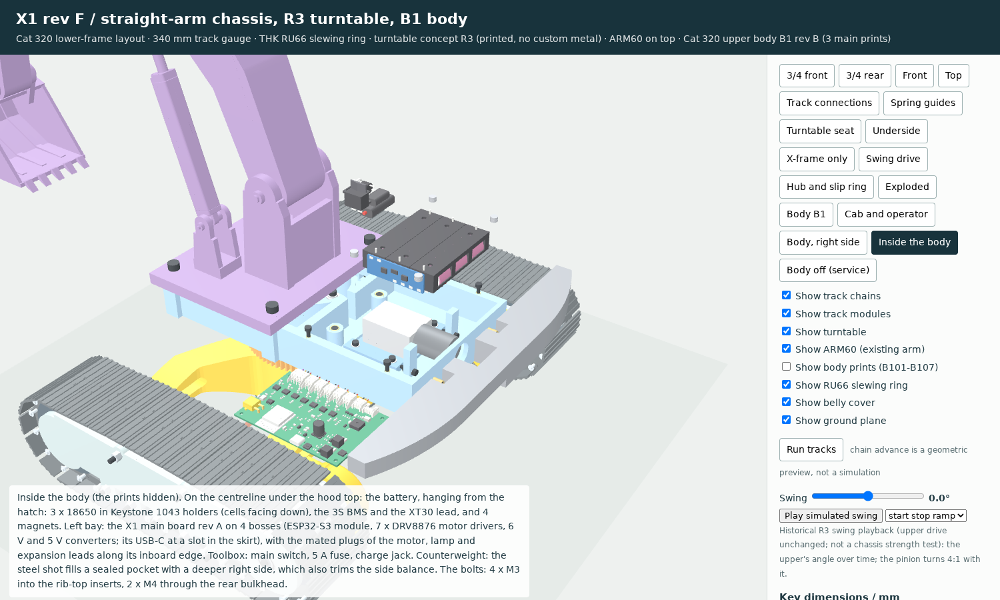
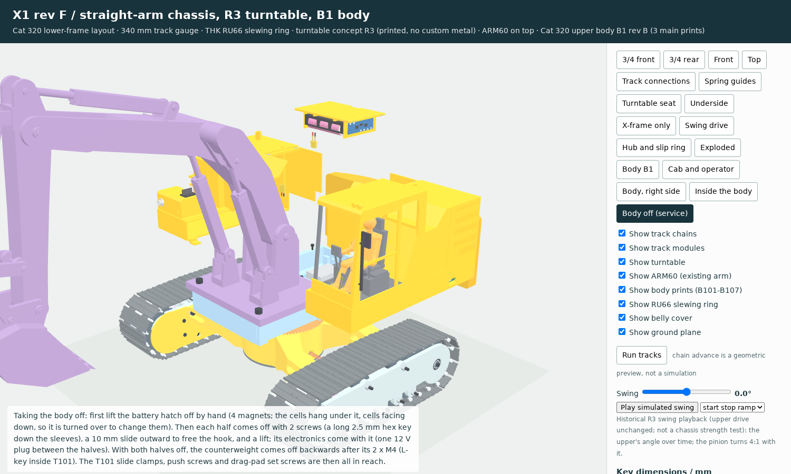

# X1 body B1 (rev B): CAD, checks and how to build it

The upper body from concept B1 issue 2 (`body_concept/`), in CAD.

**The three structural prints agreed on sheet 5:**
- **B101 counterweight**, with a sealed steel-shot pocket.
- **B102 left half:** the cab, the left hood half with the louvres, the left skirt and the controller bay.
- **B103 right half:** the right hood half, doors, tank, stairs, guardrail, toolbox, exhaust and right skirt.

**Rev B adds four small prints, after the user's review of rev A:**
- **B104 cab interior:** seat, joystick consoles, levers, pedals and monitor.
- **B105 operator.**
- **B106 battery hatch:** the battery hangs under it.
- **B107 left handrail and mirror.**

Every outline is copied from the real Caterpillar 320 (sources in `excavator_arm_60mm/references/SOURCES.md`):
- **Main outline:** Caterpillar's spec-sheet dimension drawing and its right-side product render.
- **Rev B details:** traced from Caterpillar's own 320 renders: view 000 (left), 009 (front), 018 (right) and 027 (rear).

`x1_body.py` imports the concept script's numbers, so the drawings and the CAD cannot drift apart.

**Status (2026-11-07):** rev B issue 2 is modelled (the harness notch in each half's inboard hood wall, see Wiring), and every check in `body_validation.json` passes. Nothing has been printed, assembled or powered.



| The cab and the operator | The right side: stairs, rails, mirror, hatch |
|---|---|
|  |  |

| Inside the body (prints hidden) | Taking it off (the hatch first) |
|---|---|
|  |  |

## What changed in rev B (the user's four points)

1. **18650 size and weight, and the centre of gravity.**
   - The cells are now taken at the Samsung INR18650-35E datasheet maxima: Ø18.55 × 65.25 mm, 50 g each. Rev A used typical figures: Ø18.4 × 65 mm, 47 g.
   - In rev A the pack sat in the right bay, and the solid cab outweighed it: the upper's CG was 1.7 mm left of the swing axis.
   - **Now the battery is on the swing centreline**, under the hood top, in the hatch.
   - The rest of the side imbalance is trimmed by the counterweight. Its shot pocket has a higher floor on the left (Z 116.0) than on the right (Z 108.0), so 449 g of shot sits on the right and 286 g on the left.
   - The mass stage solves both balances together. **The upper's CG is now on the swing axis both ways: X 0.0, Y 0.0.** Before the trim it was 2.3 mm left: the cab, its interior and the controller are all on the left.
2. **The battery is easy to get at.**
   - Lift the hatch off the hood top by hand. It is held by 4 magnet pairs, and a finger notch at its rear edge gives you a grip.
   - The three cells hang under the hatch in three Keystone 1043 spring holders (snapped into the hatch's sled), cells facing down. Turn the hatch over and pull the cells out of the springs or press new ones in. No tools, no soldering.
   - The BMS (HX-3S-01, 3S 10 A) rides on the hatch. A 150 mm lead with an Amass XT30U-F connects it to the feed's XT30U-M hanging in the hood cavity.
3. **The cab glass is cut out, and there is a seat and an operator.**
   - B102's cab is now a shell with real openings: the door's upper and lower glass, the rear side window, the windshield and the rear window.
   - Inside are B104 (seat, consoles, joysticks, levers, pedals, monitor) and B105, a seated operator in a hard hat.
4. **Stairs and similar details, all from Caterpillar's renders:**
   - stairs with a back panel and a stringer, and anti-skid grooves on the treads;
   - a grab rail beside the stairs;
   - the right mirror on its pole;
   - an anti-skid crosshatch on the tank top and its step;
   - a toolbox lamp;
   - two work lamps on the cab roof;
   - the left grab handle with its mirror;
   - a rear-view camera on the counterweight;
   - the raised engine hood, which is the battery hatch.

## How the Cat becomes X1 (from the concept)

- **Lengths** stay at 1:15.
- **Heights** above the deck are at 1:15 over the T101 rib tops (Z 136). The Cat's 11.5 mm frame band is stretched to a 31 mm skirt (Z 105–136) that covers the T101 sides.
- **Width:** 61.3 mm is added each side of the centreline, so the 164 wide ARM60 base fits between the halves. Each Cat part keeps its own width.
- **Main heights:** hood top Z 219, cab roof Z 252 (lamps to 257.5), guardrail top Z 252.
- **Overall size:** 323 wide over the left mirror (308 over the body), and 284 long (X −190.7 to 92).

## The prints

| Part | Print | Bed footprint × height | Printed mass | Supports |
|---|---|---|---|---|
| B101_counterweight | Upright on its bottom face, turned 45°. PETG, 4 perimeters, 15 % gyroid. **Pause at 24.9 mm** to pour the shot. | 231.5 × 231.5 × 114 | 453 g | None. The pocket ceiling prints over the shot; the camera has a 45° underside. |
| B102_left_half | On its outer (left) side face. PETG, 3 perimeters (the 2 mm walls print solid). | 236.7 × 157.0 × 160 | 336 g | None. The rear window's top edge is a 36 mm bridge; the sleeve bores are small bridges. |
| B103_right_half | On its outer (right) side face. PETG, 3 perimeters, 15 % gyroid (the tank is solid with infill). | 204.7 × 150.3 × 153.8 | 341 g | Tree supports under the guardrail, the grab rail and the mirror. The toolbox's inner wall is a 36 mm bridge. |
| B104_cab_interior | Upright on its floor plate. PETG (dark grey), 3 perimeters, 15 % gyroid. | 92.6 × 66.4 × 107 | 46 g | None. |
| B105_operator | Upright on its feet. PETG or PLA (orange), 3 perimeters, 15 % gyroid. | 61.2 × 54.6 × 82.2 | 17 g | Tree supports under the thighs, arms and chin. |
| B106_battery_hatch | Upside down, the hatch top on the bed. PETG, 3 perimeters. | 70.8 × 109.4 × 27.5 | 37 g | None. |
| B107_left_handrail | Flat on its side. PETG (black), 100 % infill. | 72.0 × 16.7 × 3.0 | 1 g | None. |

- All seven fit a 256 × 256 × 256 bed. Filament: about 1.25 kg of PETG.
- The masses are estimates:
  - 2 mm walls are taken as printed solid.
  - Solid blocks (tank, counterweight, seat and figure) are perimeters plus 15 % infill.
- Overhang flatter than 45° (`body_validation.json`), in mm²:
  - B101: 9713, of which 9100 is the pocket ceiling over the shot.
  - B102: 1913 (window and bore ceilings, the roof lamps).
  - B103: 3649 (guardrail, grab rail, mirror).
  - B104: 73; B105: 949; B106: 108; B107: 12.

### B101 counterweight
- **Plan:** the Cat's tail arc (R 188.7) is split on the centreline and the halves are moved out by 61.3 mm. The corners reach R 225 (decision D4).
- **Edges:** the front face is the T101 rear face, X −145. The rear top edge is rounded R 8, and the bottom edge has a 45° chamfer for the bed.
- **Shot pocket:**
  - Inset 3 mm from every face, up to Z 129.9. It leaves out the lead channel and the two insert bosses.
  - **Rev B:** the pocket floor is Z 116.0 on the left and Z 108.0 on the right. This step trims the side balance.
  - It holds **735 g of steel shot** (163 cm³ at 4.5 g/cm³ poured): 286 g on the left and 449 g on the right. That puts the upper's CG on the swing axis, fore-aft and sideways, with the arm stretched.
- **Lead channel:**
  - X −165 to −145, |Y| < 12, Z 110 to 152, open in the front face.
  - It takes the swing motor's leads from the T101 Ø20 window, up and over the T101 rear bulkhead into the hood.
- **Fixing:** 2 × M4 heat-set inserts in the front face at Y ±40, Z 122.2, behind the existing T101 bulkhead holes.
- **Rear lamps:** two 0.8 mm recesses, to paint red.
- **Rear-view camera (rev B, view 027):** a 10 × 6.5 housing at the top centre of the rear face, with two lens recesses.

**Filling the shot (print pause):**
1. Weigh out 735 g of steel shot.
2. In the slicer, add a pause at **24.9 mm** above the bed. That is the pocket rim, Z 129.9.
3. When the printer pauses, pour the shot in and level it about 0.3 mm below the rim.
   - The left side of the pocket is 9.3 mm shallower; the same level everywhere is right.
   - About 449 g ends up on the right and 286 g on the left. The weight matters, not the level: if your shot is lighter or denser, weigh 735 g and spread it level.
4. Wick a few drops of thin CA or laminating epoxy into the top layer so no ball moves under the nozzle.
5. Resume. The pocket ceiling prints over the shot.

Copper shot (about 5.4 g/cm³) also works. Weigh the same 735 g, keep the same left/right split, and lock it with epoxy before resuming.

### B102 left half
- **Cab (rev B):**
  - The traced Cat 320 cab: 124.5 long, 69 wide, roof at Z 252, with its sloping front and the rear-lower diagonal.
  - It is now a 2 mm shell with a floor, open on the boom side, so it prints on its side without supports. The ARM60 base stands 3 mm from that side.
  - **Glass cut out**, from the drawing and the renders:
    - **Door:** upper and lower glass, split by a 3 mm bar at Z 184–187 (57 % of the cab height, view 000).
    - **Rear side window.**
    - **Windshield:** Y to 149, Z 152–244. It is open to the boom side; B104 carries the right front pillar.
    - **Rear window:** Y 94–141, Z 203–239. The rear view hides its bottom behind the hood, so it is taken 4 mm above the hood step.
  - **Fittings:**
    - 2 pegs on the cab floor for B104.
    - 2 Ø2.2 holes on the front-left pillar for B107.
    - 2 work lamps on the roof's front-left corner (views 000 and 009).
- **Hood half:**
  - Flat top at Z 219, the slope from X −73.6 to −55.6, then the step at Z 198.8.
  - Its front face stands 2 mm behind the ARM60 base (X −23).
  - Its 5 louvre panels are through slits that vent the hood.
  - The door seam and the deck line are grooves.
- **Hatch seat (rev B):**
  - The flat hood top is open between the rear face and the slope, for |Y| < 55. Each half carries its share of the seat.
  - A 6.5 × 4 ledge runs along the side and the front of the opening, under the skin. The rear wall's top is the rear ledge.
  - 2 magnet pockets (Ø6.2 × 2.1) sit in the side ledge.
- **Skirt and bay:**
  - Z 105–136, floor 2.5 thick, from |Y| 77 out to the side.
  - The controller board sits on 4 bosses (Ø2.2 holes for M2.5 self-tapping screws).
  - The main board's USB-C is behind a 15 × 9 slot in the skirt at Z 113.2, under the louvres. A plug with an overmould up to 14.4 × 8.4 fits. The slot was at Z 123.3 for a devkit on headers (spec C1 B4).
- **Seam:** a 1.5 mm lap under the right half's hood skin, 6 mm wide, along the centreline: the rear wall, slope, step and front face. It is cleared under the hatch, where the battery hangs.

### B103 right half
- **Hood and doors:**
  - The right hood half: flat top at Z 219 back to the tank, and the step inboard.
  - The engine-door seam at X −76.2 and the pump door's curved front edge (traced) are grooves.
  - It carries its share of the hatch seat, as on the left.
- **Tank:**
  - X −63.1 to −12.5, top at Z 218.6, stepping down to Z 204.6 at the front. It is solid with infill.
  - **Rev B:** both walkways have an anti-skid crosshatch (0.8 mm grooves, 0.4 deep, 5 mm pitch), kept clear of the rail and mirror feet (render 018).
- **Stairs (rev B, renders 009 and 018):**
  - The three traced treads, stacked like a ladder on the tank front.
  - A back panel against the tank (4 mm) behind them, and a 2 mm stringer along their inboard ends.
  - Three anti-skid grooves in each tread's top.
- **Guardrail:** a frame on the tank top, Ø3 rails to Z 252, at Y −110.9 and −142.8 as traced.
- **Grab rail (rev B, renders 009 and 018):** a Ø3 hoop beside the stairs, at X 3 from the deck to Z 228, with its legs at Y −131 and −97.
- **Right mirror (rev B, renders 018 and 027):**
  - A Ø3 pole on the tank top at the guardrail's rear (X −57, Y −122), to Z 247.
  - An arm out and down to a 12 × 12 mirror at Y −133 to −145. It stays inside the body's width, so it prints with the half.
- **Exhaust stack:** Ø9.5 to Z 231.7, at X −122.9, Y −126.3.
- **Toolbox:** X 18.1 to 57.9, top at Z 164.8.
  - The main rocker switch (KCD1-101) is in its top, in a 19 × 13 cut-out.
  - The 5.5 × 2.1 metal charge jack (DC-022B pattern, M8 thread, Ø8 hole, nut and lock washer outside) is in its front face; the wall is 2.0 mm (the jack takes up to 2.1).
  - The fuse (Littelfuse MINI FHM in-line holder, 5 A MINI fuse) sits on the toolbox floor on VHB tape beside the Ø12 hole in the deck that takes the wires down into the bay.
  - **Rev B:** a Ø6 lamp low on its front, inboard (render 009).
- **Skirt and bay:** the wiring from the hatch lead to the toolbox. In rev A this bay held the battery, which is now in the hatch.

### B104 cab interior (rev B)
- It sits inside the cab, 0.3 mm clear of B102's walls.
- **Seat:**
  - A pedestal with a 45° flare to the cushion (Z 164.5).
  - A backrest leaning back 6°, and a headrest to Z 219.
- **Consoles:** two, with armrests at Z 163 and joysticks (Ø5 knobs at Z 173).
- **At the front:** a pedal block, and two travel levers between the operator's feet.
- **Monitor:** on a post from the right console.
- **Right side:** the cab's right front pillar and sill, which B102 leaves open.
- **Fitting:** it slides in from the open boom side, 2.1 mm up, and drops onto B102's 2 floor pegs. If the pegs are loose, add a drop of glue.

### B105 operator (rev B)
- **Size:** a seated 1.75 m person at 1:15. The head top (hard hat) is at Z 225, 25 mm under the roof.
- **Pose:** hands on the joysticks, 0.6 mm clear; feet on the pedal block.
- **Fixing:** a Ø2.8 peg into the seat.

### B106 battery hatch (rev B)
- **The plate:**
  - It is the Cat's raised engine hood (rear view 027): a 3 mm plate, 1 mm proud of the hood top.
  - X −144.7 to −73.9 (flush with the rear face; 0.3 mm short of the slope), |Y| < 54.7. Its top edges have a 0.6 mm chamfer.
  - It seats on the halves' ledges at Z 217.0, with 0.3 mm gaps to the hood skin.
- **Under the plate:**
  - Two end walls and two 4 mm standoff ribs.
  - The three Keystone 1043 holders (77.05 × 20.65 × 14.86, Keystone drawing rev C; THM version with PC pins) press up between the two sled walls against the ribs and snap behind 1.0 × 0.8 lips on the walls (12 long under each end wall), open side down; no glue. Their PC pins (Ø1.57 × 3.3, at 71.64 pitch) point up into the 4 mm standoff space and carry the series links and the BMS taps.
  - The HX-3S-01 BMS (50 × 16) is taped (1 mm VHB) to the outer face of the +Y sled wall; the XT30U-F lead leaves at the −Y side. The whole pack, the connectors and the toolbox parts are drawn from the makers' drawings (`source/stdparts.py`), the main board from its KiCad STEP (`source/board_step.py`).
- **Fixing:** 4 Ø6 × 2 magnets in the plate, over 4 in the halves' ledges.
- **Lifting:** a finger notch at the rear edge.
- **Mass:** the hatch with the battery is 223 g (hatch 37 g, three cells 150 g, holders, BMS and lead). Its CG is on the centreline, 110 mm behind the swing axis, at Z 205.

### B107 left handrail and mirror (rev B)
- **What it is:** the grab handle on the cab's front-left pillar, with the left mirror on its top (renders 009 and 027).
- **Why it is a separate print:** the mirror stands 15 mm outboard of the cab side, below the bed when B102 prints on that side.
- **Fixing:** 2 Ø2 pegs into the pillar's Ø2.2 holes, plus a drop of glue.

### Fixing (halves and counterweight)
- **2 × M3 × 12 socket screws per half**, down sleeves in the hood top into M3 heat-set inserts in the T101 rib tops at X −120 and −45, Y ±65.
  - The sleeves are Ø10 teardrops, braced by a web out to the side wall.
  - The screw head sits on a 6 mm floor at the rib top.
  - Reach it with a 2.5 mm hex key at least 90 mm long, down the Ø6.4 bore.
- **A front hook per half** (X 44 to 56): a tongue 5 mm under the T101 base-plate edge, 0.3 below it, so the front cannot lift.
- **To remove a half:** lift the hatch off, take the 2 screws out, slide the half 10 mm outward (the hook comes free), then lift. Its electronics come with it.
- **The counterweight:** 2 × M4 × 12 from inside T101, through the existing rear-bulkhead holes, into its inserts. It comes off backwards once both halves are off.

## Bought parts

| Item | Qty | Where |
|---|---|---|
| M3 heat-set insert (Ø4.0 × 5.7 hole, as J9) | 4 | T101 rib tops, X −120 and −45, Y ±65 |
| M3 × 12 socket head screw (ISO 4762) | 4 | Halves to T101, down the sleeves |
| M4 heat-set insert (Ø5.6 × 8.1 hole, as J9) | 2 | Counterweight front face |
| M4 × 12 socket head screw (ISO 4762) | 2 | Counterweight, from inside T101 through the rear bulkhead |
| M2.5 × 6 self-tapping screw | 4 | Controller board to the left bay bosses |
| NdFeB disc magnet, Ø6 × 2 (N42 or N52) | 8 | 4 in the hatch, 4 in the halves' ledges, glued with CA |
| Steel shot, poured (about 4.5 g/cm³), or copper shot | 735 g | Counterweight pocket |
| Thin CA or laminating epoxy | a few g | Locks the shot's top layer; the magnets; B104, B105 and B107 if loose |
| 18650 Li-ion cell, flat or button top, up to 65.3 mm long (unprotected cells are fine: the BMS protects them) | 3 | In the hatch (3S1P) |
| Keystone 1043 single 18650 holder, THM (PC pins) | 3 | Snapped into the hatch sled, open side down |
| HX-3S-01 3S 10 A BMS board (50 × 16) | 1 | On the hatch's +Y sled wall, VHB tape |
| Amass XT30U-F (2) and XT30U-M (1) | 3 | The hatch lead (female) into the feed socket (male) in the hood cavity; the 12 V link's female onto the board's XT30PW-M |
| X1 main board rev B, 96 × 64, JLCPCB-assembled ([controller/main_board](controller/main_board/DESIGN.md)) | 1 | Left bay: ESP32-S3, 7 × DRV8876, the rails; USB-C at the skirt slot |
| Rocker switch KCD1-101 (21.2 × 15.1 bezel, 19 × 13 cut-out) | 1 | Toolbox top |
| Littelfuse MINI FHM in-line fuse holder with a 5 A MINI fuse | 1 | Toolbox floor, VHB tape |
| 5.5 × 2.1 metal panel DC jack, M8 thread, Ø8 hole (DC-022B pattern) | 1 | Toolbox front; charge with a 12.6 V CC/CV Li-ion charger (3S) |
| Wire (silicone, 20 and 26 AWG), heat-shrink | — | About 60 g in the model |

The cell figures are the Samsung INR18650-35E datasheet maxima (Ø18.55, 65.25 long, 50 g). The holders follow the Keystone 1043 drawing (rev C), the connectors the JST and Amass drawings, the switch the Finglai KCD1 drawing (`source/stdparts.py` lists every source). The main board is the KiCad STEP (`source/board_step.py`: the PCB, every part's 3D model and the mated JST plugs of its inboard headers); its courtyard boxes (`X1_main_board_B_parts.json`) and the old plug envelopes remain the shapes the interference checks use. The body scene and checks were last built with rev A's STEP. Rev B (2026-11-10) keeps that board's outline, holes, connectors and every part position, and only removes 16 parts (the 6 V buck's 13 and the 6 V sense's 3), so the fit results stand until the next body rebuild. The fuse holder's body is the one envelope taken from photographs. Masses are assumptions, listed in `simulation/body_mass_properties.json`; the complete-machine catalogue is `excavator_complete/CONNECTORS.md`.

## Wiring

The complete harness, including the four arm cables, is routed and checked in `excavator_complete/WIRING.md`. The points below are the body's part of it.

0. **Rev B issue 2 (2026-11-07): harness notch.** The inboard hood's front wall (X −25..−23) of each half has its bottom edge raised to Z 156 over |Y| 38–56 (`x1_body.py HARNESS_NOTCH`). T101's rear bulkhead (X −38..−30) and the B01X plate's rear edge (X −21) leave that wall standing in a 9 mm gap, which is the only way the arm cables can rise out of T101's interior into the hood. Nothing else of the half is in that corner; the body checks were re-run.
1. **Power:** cells (in the hatch) → BMS (in the hatch) → XT30 lead → fuse → main switch (toolbox) → XT30 link → controller board (12 V bus) → the seven drivers and the 5 V buck. The charge jack goes to the BMS's charge input through the same lead.
2. **Balance taps:** solder the BMS's B1 and B2 wires to the joints between the holders. Single-cell holders give direct access to every cell terminal.
3. **Swing motor:** its leads leave the T101 Ø20 window into the counterweight's channel. They come up and out over the T101 rear bulkhead (the cable notch in the halves' rear walls, |Y| < 14), then go over T101 into the left bay.
4. **Track motors:** their 4 leads come up the slip ring through the hub. They go over T101 into the left bay.
5. **Slack:**
   - Leave 150 mm on the hatch lead, so the hatch can be lifted and turned over without unplugging.
   - Leave 150 mm on the 12 V link between the halves, so a half can be set beside the machine before unplugging.

## Assembly order (each step checked in CAD)

1. **T101.** Press the 4 new M3 inserts into the rib tops at X −120 and −45. Do this before the ARM60 goes on: the ribs are easier to reach.
2. **Counterweight.**
   - Press the 2 M4 inserts into B101's front face.
   - Hold it against the T101 rear face and feed the swing motor's leads into the channel.
   - Fit 2 × M4 × 12 from inside T101 with a 3 mm L-key.
3. **Halves on the bench.**
   - **Magnets:** glue 2 magnets into each half's ledge pockets and 4 into the hatch, all hatch magnets the same way up and all ledge magnets so that they attract. Check by placing the hatch before the glue sets.
   - **Left half:**
     - Screw the controller board onto its 4 bosses.
     - Push the operator's peg into the seat.
     - Slide B104 in from the open boom side, holding it 2 mm up, and drop it onto the 2 floor pegs.
     - Press B107's 2 pegs into the front-left pillar.
   - **Right half:** fit the switch, fuse and charge jack in the toolbox.
   - Wire each half.
4. **Right half.**
   - Plug the 12 V link and the hatch lead's machine end, and lay the slack over T101.
   - Lower the half 10 mm outboard of its place, with the hook beside the base-plate edge.
   - Slide it inward until the sleeves stand on the ribs, then fit 2 × M3 × 12 down the sleeves.
5. **Left half:** the same. Its seam lap slides in under the right half's hood skin.
6. **Battery hatch.**
   - Put the cells into the holders, checking the polarity marks.
   - Plug the XT30.
   - Lower the hatch into the opening, where the magnets pull it down onto the ledges.

## Service

- **Changing or charging the cells:**
  - Lift the hatch (finger notch at its rear edge) and turn it over beside the machine. The 150 mm lead stays plugged.
  - Swap the cells, then put the hatch back.
  - You can also charge in place at the toolbox's front jack, with the main switch off.
- **A half off:** hatch off, then as above in reverse: 2 screws, slide out 10, lift. Either half can come off first, with the other in place.
- **T101 adjustments** (slide clamps, push screws, drag-pad set screws): they are all in reach with both halves off. The counterweight can stay on.
- **Counterweight off:** both halves off, the 2 × M4 out from inside T101 (L-key), then pull it back.
- **USB:** the ESP32 is reached through the skirt slot. Nothing opens.

## Checks (`body_validation.json`): PASS

All run on the exact CAD solids (`build_body.py`).

- **Static fit:** no overlap among 192 candidate pairs (those whose boxes touch), at swing 0. They cover every body solid (prints, shot, battery and electronics, magnets, screws and inserts) against T101, the motor, the ARM60 (base and stretched arm) and each other.
- **Swing sweep:** the body turned every 15°. Its lowest point (the hook tongues, Z 100.5) is above every chassis and chassis-side turntable part (630 parts). Outside r 70 the chassis' highest point is the track top, Z 92.4: 8.1 mm below the body.
- **Assembly paths:** 27 positions, all clear.
  - The hatch, with the battery, lifts 1, 3, 10, 30 and 60 mm with everything else in place.
  - Each half (hatch off) slides out 2, 5 and 10 mm, then lifts 5, 20 and 60 mm, with everything else in place.
  - The counterweight comes back 2, 5 and 15 mm and up 40 mm, with the halves off.
  - On the bench, B104 with B105 slides into the left half's cab from 75 mm out (2.1 mm up), then drops onto the pegs.
- **Tool and plug access:** 12 paths, all clear.
  - The hex key down each sleeve, and the screw head out through the bore.
  - The counterweight's L-key inside T101 with the halves off.
  - The charge plug, and a slim USB-C plug through the skirt slot.
- **Bed fit:** all seven fit a 256 bed (sizes above).
- **Printability:** each print is one valid solid, its STEP round-trips and its STL is watertight with one shell. B101 has 2 shells: its outside, and the sealed pocket filled during the pause.
- **Clearances (mm):**

| Between | mm |
|---|---|
| Halves to the ARM60 base (hood front, cab, deck strip) | 0.5 |
| Halves to the ARM60 arm, stretched | 34.5 |
| Left half to right half (the seam lap) | 0.15 |
| Halves to the counterweight | 0.3 |
| Hook tongues to the T101 base plate | 0.3 |
| Counterweight to the swing motor's lead space | 3.0 |
| Hatch plate edges to the hood skin (side and front gaps) | 0.3 |
| Battery sled (under the hatch) to the halves | 0.6 |
| Battery (cells, holders, BMS, lead) to the halves | 1.1 |
| Cells to T101 below | 57.1 |
| Cab interior to the cab shell, above its floor plate | 0.3 |
| Cab interior (right front pillar) to the ARM60 base | 3.3 |
| Operator to the cab interior above the seat (hands to the joysticks) | 0.6 |
| Operator to the cab shell | 5.0 |
| B107 pegs to their pillar holes, radial (the handle stands 2.2 off the cab side) | 0.1 |
| Grab rail to the ARM60 base / to the stretched arm | 13.5 / 56.8 |
| Main board parts / its mated plugs to the left half / PCB edges to its walls | 1.6 / 2.7 / 4.0 |
| Fuse holder to the right half | 3.9 |
| Body tail radius / front radius (largest) | 225.2 / 187.8 |
| Body lowest point / chassis highest point outside r 70 | Z 100.5 / Z 92.4 (8.1 clear) |
| Body top (the roof lamps) | Z 257.5 |

## Mass and balance (`simulation/body_mass_properties.json`)

| | Rev B | Rev A |
|---|---|---|
| Prints (all seven) | 1231 g | 1309 g (three) |
| Steel shot | 735 g (left 286, right 449) | 777 g |
| Battery set in the hatch (3 cells, holders, BMS, lead) | 182 g, on the centreline | 156 g (47 g cells, BMS, foam pad), in the right bay |
| Electronics, magnets, screws, wiring (without the battery) | 160 g | 156 g |
| Body total | 2.30 kg | 2.40 kg |
| Upper (turntable, ARM60, body), arm stretched | 5.12 kg; **CG X 0.0, Y 0.0**, Z 178.2 | 5.22 kg; CG X 0.0, Y 1.7, Z 175.1 |
| Upper CG with the arm tucked (bound: every arm part at the base) | X −42.6 | X −41.8 |
| Whole machine CG: arm stretched / tucked bound | X −1.5 / −24.2 | X −1.5 / −23.9 |
| Upper inertia about the swing axis | 0.154 kg·m² | 0.159 kg·m² |

- **Why the body got lighter:** B102 is 185 g lighter than in rev A (521 g). The cab is now a 2 mm shell instead of being solid with infill, and the hatch opening removes part of the hood top. B104, B105 and B107 add 65 g back, and less shot is needed (735 g against 777 g).
- **The side balance**, as moments about the swing axis (kg·m, + = left; `lateral` in the mass file):

| Group | What is in it | Moment (kg·m) | As a CG shift of the 5.12 kg upper (mm) |
|---|---|---|---|
| Left half | B102, B104 cab interior, B105 operator, B107, the main board with its parts and mated plugs, 2 ledge magnets | +0.0496 | +9.7 |
| Right half | B103 with the tank, the switch, fuse and charge jack, 2 ledge magnets | −0.0397 | −7.7 |
| Steel shot | 286 g on the left, 449 g on the right | −0.0120 | −2.3 |
| Counterweight print | B101: there is more plastic on the left, where the pocket floor is higher | +0.0010 | +0.2 |
| Wiring and fixings | 25 g of wiring in the left bay, 15 g in the right; screws and inserts | +0.0012 | +0.2 |
| Hatch with the battery | B106, cells, holders, BMS, lead, 4 magnets: the BMS and the lead sit at opposite ends | −0.0001 | 0.0 |
| Turntable, ARM60, motor | | 0.0000 | 0.0 |
| **Upper** | | **0.0000** | **0.0** |

With a level pocket floor, the same body would have its CG 2.3 mm left of the axis.

**Swing simulation, re-run with this body** (`X1_turntable_simulation.pdf`): the upper is 5.10 kg with 0.154 kg·m² about the axis; the pinion's parts are a separate body in the model. Rev A gave 5.20 kg and 0.159 kg·m². A stop from full speed without the ramp peaks at 204 N on a pinion tooth (208 N with rev A), and 35 N with the 0.4 s ramp. A full-speed swing into a rock reaches 259 N (258 N before the 2026-11-07 re-run on the revision F chassis with MuJoCo 4.0), about PETG's yield, as before. The worm holds the upper on a 15° side slope with the motor off. The full table is in [TURNTABLE.md](TURNTABLE.md).

## Changes from the concept (issue 2, sheet 5)

- **Front sleeve moved from X −60 to −45,** so both screw heads sit on flat hood (top Z 219, step Z 198.8), not on the slope.
- **The counterweight's captive M4 nuts are now M4 heat-set inserts.** X1 uses inserts everywhere, and the pocket is a sealed void with no way in for a nut.
- **The shot goes in during a print pause.** A closed counterweight has nothing to open.
- **The ESP32's USB is behind its own slot in the skirt, under the louvres.** The louvres stand above the deck and the board is below it.
- **The tank and counterweight are solid with infill, not 2 mm shells.** Their inner faces then print without supports.
- **The tank is flush with the doors.** It was 2.5 mm inboard in the concept, but on its side that would print floating. The door outlines are grooves instead.
- **The deck in front of the hood is a full plate** from the side wall in, so it grows from the bed when printed on the side.
- **Rev B (user review):**
  - The battery moved from the right bay to a lift-off hatch on the centreline, held by magnets. The concept's issue 1 had magnet lids; rev A had none.
  - The cab is an open-glass shell with an interior and an operator; rev A's cab was solid with painted window grooves.
  - The shot pocket has two floor heights.
  - The Cat details listed above were added.

## Open items: check before relying on them

1. **Print fits.** Test-print a sleeve and hook on a T101 rib offcut:
   - the sleeve floor on the rib top;
   - the hook under the base plate (0.3 mm);
   - the lap (0.15 mm);
   - the M3 and M4 insert holes (J9's sizes).
   Also test-fit the hatch on its ledges (0.3 mm gaps) and the B104 and B107 pegs.
2. **The 0.5 mm gap** between the raised deck and the ARM60 base's side edge. It is set by the sleeve screws' Ø3.4 clearance holes. If a half rubs the base, file the deck edge.
3. **Shot density.** 4.5 g/cm³ is a typical figure for poured steel shot. Weigh it: the mass and the left/right split matter, not the level.
4. **Magnet hold.** Four Ø6 × 2 pairs face to face hold the 220 g hatch many times over, but the hatch is not latched. If the machine can tip over, add a strip of tape over the hatch seam or use Ø8 magnets.
5. **The cells hang face down in spring holders.** Keystone's holders grip well, but check that a cell does not drop out when the hatch is shaken. If one does, put a cable tie around the holders.
6. **Electronics.** Test-fit the main board on its bosses, with its plugs mated, and check that a USB-C cable reaches the receptacle through the slot (X −98, Z 113.2). Check the BMS (about 45 × 16) fits the hatch's end wall.
7. **Charging.** Use a 3S (12.6 V) CC/CV Li-ion charger into a BMS with a charge port. A 3S pack straight on 12 V motors runs from 12.6 V down to about 9 V.
8. **Fragile details.** These are thin:
   - the guardrail, grab rail and mirror pole (Ø3);
   - the exhaust stack;
   - the joysticks and levers in the cab;
   - B107.
   Print them with tree supports where listed, and expect to reprint a small part if it is knocked hard.
9. **Not checked:** loads, print tolerances, magnet force, heat (the battery now sits under the hood top, away from the motors), and powered running.

## Files

- **STEP:** `step/B101_counterweight.step` to `step/B107_left_handrail.step`, one per print. `step/X1_body_assembly.step` is the body with its shot, battery, electronics, magnets, screws and inserts at swing 0 (196 solids: each part box of the main board is a solid of its own). Load it with `X1_turntable_assembly.step`.
- **STL:** `stl/B10x_*.stl`, each print in its print orientation.
- **Checks and masses:** `body_validation.json` holds the checks above. `simulation/body_mass_properties.json` holds every body item's mass, centre and inertia, the shot sizing and the side balance.
- **Source:** `source/x1_body.py` is the body CAD; `source/build_body.py` does the exports and checks.
- **Concept:** `body_concept/` holds concept B1 (sketch, issue 2) with the Cat 320 traces.

## Rebuild

From `track_wheel_jgy370/X1/source/` (CadQuery 2.7 in `/tmp/sw-venv`):

```
python build_body.py mass export static sweep paths tools clearances final   # about 60 to 80 min on a shared machine; writes ../body_validation.json
python build_turntable.py mass      # the turntable's mass file takes the body from body_mass_properties.json
python simulate_swing.py && python draw_swing_report.py && python build_turntable.py final
python build_viewer.py              # then check_viewer.cjs (about 7 to 13 min)
```

- Stage results are cached in `/tmp/sw-render/body_cache_<hash>`, keyed by the contents of the CAD sources (X1, J9, swing and body concept), so a CAD change starts a fresh cache.
- The built models (chassis, turntable) are kept as BREP in `/tmp/sw-render/model_cache`, keyed by their source files' contents. The chassis key covers all of `J9/source`, so the revision F seats in `j9_mounts.py` are included.
- Run `mass` first: the shot's fill height and the two pocket floors set the counterweight's pocket, which every other stage uses.
- A stage that runs longer than about 10 minutes needs a background run; each stage is cached, so a stopped run can restart.
