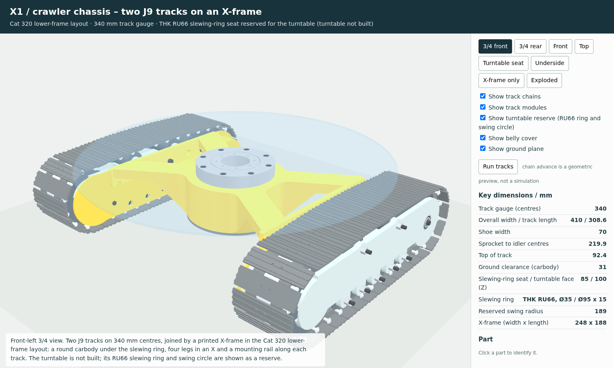

# JGY-370 crawler chassis — X1: two J9 tracks on an X-frame

**Status (2026-11-03):** the X1 CAD is complete and every geometry check in `validation.json` passes. Nothing has been printed, assembled or run yet.

X1 is the lower half of an excavator, laid out like the undercarriage of a Caterpillar 320:
- **Tracks:** two J9 track modules on 340 mm centres. The left one is J9 as built; the right one is its mirror image.
- **X-frame (X101):** one printed part. It has a round carbody under the slewing ring, four legs in an X and a rail along each track. Each rail bolts to its track's three J9 chassis bosses.
- **Belly cover (X102):** a round guard under the carbody.
- **Turntable: not built.** Its mounting is reserved: a seat for a THK RU66 cross-roller ring, the bolt pattern the turntable screws to, a Ø25 cable passage at the swing centre and the swing envelope. See [Turntable interface](#turntable-interface-reserved).



## Reference: the Cat 320 lower frame

The layout and the main proportions come from the Cat 320 (07H) technical specifications, pages 2 and 4 (`excavator_arm_60mm/references/cat320_specifications.pdf`). X1 takes these features from the machine:
- a round carbody at the swing centre that carries the swing bearing;
- four legs in an X, out to the track frames;
- the final drives at the rear of the tracks (here, the J9 motor pods);
- a guard under the carbody;
- a passage at the swing centre. On the Cat 320 the centre swivel joint sits there and feeds the travel motors' hydraulic lines; on X1 the motor leads go through it.

| Item | Cat 320 (mm) | At 1:15 | X1 |
|---|---|---|---|
| Track length | 4,450 | 296.7 | 308.6 |
| Length to centre of rollers | 3,650 | 243.3 | 219.9 (sprocket to idler) |
| Track gauge | 2,380 | 158.7 | 340 |
| Undercarriage width (790 mm shoes) | 3,170 | 211.3 | 410 |
| Shoe width | 790 | 52.7 | 70 |
| Ground clearance | 470 | 31.3 | 31.0 (under the belly cover) |
| Counterweight clearance | 1,050 | 70.0 | at least 100 (the swing envelope starts at the turntable face) |
| Tail swing radius | 2,830 | 188.7 | 189 (reserved swing circle) |
| Track / carrier rollers per side | 8 / 2 | | 5 / 2 |

## Decisions

1. **Track gauge 340 mm, not the scaled 159.**
   - Each J9 motor pod stands 62.5 mm inboard of its track centre. With a 159 mm gauge the two pods would be only 34 mm apart, leaving no room for the carbody.
   - 340 mm is the track spacing of the 60 mm excavator (`excavator_60mm`), so a turntable sized for that machine keeps its stance.
   - As a result, X1 is wider than a scaled Cat 320: 410 mm over the shoes instead of 211.
2. **Slewing ring: a bought THK RU66 cross-roller ring.**
   - One bearing takes the turntable's axial, radial and tilting loads. It replaces a spindle with its stack of bearings and spacers, which is how the 60 mm excavator's slew is built.
   - All its dimensions come from THK's catalogue, pages A18-20 and A18-21. The pages and the source link are in `references/thk_ru66/`.
   - RU66 is the smallest RU ring whose bore (Ø35) clears the Ø25 cable passage. The next size down, the RU42, has a Ø20 bore.
3. **Ring arrangement: as in THK's mounting drawing.**
   - The outer ring bolts down onto the X-frame with 8 × M4 × 16 through its counterbores, into heat-set inserts.
   - The inner ring is left for the turntable. Its 8 M4 holes are tapped through, so the turntable screws down onto it from above.
   - Everything goes on from above: first the ring onto its seat, then the turntable onto the ring.
4. **Right track: a mirror image of J9.**
   - Only two J9 parts are handed: the H-frame (J901) and the housing (J909). X1 supplies mirrored prints of both.
   - Every other J9 part works on both sides:
     - In CAD, the mirror images of the roller, idler, idler spacer, yoke and shoe match the originals with zero volume difference.
     - The sprocket's mirror image is the original turned over, and the journal plug is a plain turned shape.
   - The motor is the same part, turned 180° about its own axis. Its four screw holes are symmetric about the axle height, so it fits the mirrored seat.
5. **X-frame printed in one piece, upside down.** The flat top (the bearing seat) goes on the bed. That makes the seat as flat as the bed, and the part needs no supports.

## The X-frame (X101)

- **Carbody.**
  - Ø120 and hollow, with a 6 mm wall and a 6 mm top plate.
  - The top, at Z 85, is the bearing seat. The open bottom, at Z 34, is closed by the belly cover (4 × M3).
- **Legs.**
  - Four 32 mm legs in an X run from the carbody to the rail ends at X ±73.5, with R 15 fillets where they meet the carbody.
  - Their undersides slope up from the carbody's bottom (Z 34) to Z 73 at 100 mm from the swing centre. The legs are deep at the carbody and thin at the tracks.
- **Rails.**
  - Each rail is 6 mm thick and runs along the inboard side of its track (Y ±118 to ±124) from X −93 to 95.
  - It sits on the track's three J9 chassis bosses (X −60, 0 and 60; Z 68) and is held by three M4 × 12 socket screws fitted from the inboard side.
  - Behind X −70, the rail's lower edge steps up from Z 61.5 to Z 67.5 to clear the motor pod.
- **Holes.**
  - Ø8 access holes in each rail, lined up with the two J9 support-roller bolts and the two upper housing screws. A key reaches all four with the track fitted.
  - A Ø10 cable hole in each side of the carbody wall (X 0, Z 46) for the motor leads.
  - The Ø25 cable passage through the top plate at the swing centre.
  - 8 M4 inserts for the bearing on a Ø83 circle, in a thickened ring under the seat.
  - 4 M3 inserts for the belly cover, in bosses inside the carbody.

## Turntable interface (reserved)

| Item | Value |
|---|---|
| Swing centre | X 0, Y 0: midway between the tracks, over the middle road rollers |
| Slewing ring | THK RU66: Ø35 bore, Ø95 outside, 15 high. Radial load ratings C 17.5 kN and C0 22.3 kN; mass 0.62 kg |
| Seat (top of the X-frame) | Z 85, flat. The outer ring sits on it |
| Outer ring to X-frame | 8 × M4 × 16 socket screws from above on a Ø83 circle, into M4 heat-set inserts. The heads end 0.4 below the ring's top face |
| Turntable face (top of the inner ring) | Z 100 |
| Turntable to inner ring | 8 × M4 on a Ø45 circle, tapped through the ring. The turntable's flange must stay within Ø59 (THK's "ds max") so that it touches only the inner ring |
| Turntable screw tips | Up to 2 mm below the ring. A Ø75 × 2.5 relief in the seat clears them and the inner ring |
| Cable passage | Ø25 through the X-frame, inside the ring's Ø35 bore |
| Swing envelope | R 189 above Z 100 (the Cat 320's 2,830 mm tail swing radius at 1:15). The chassis stays out of it: track tops 7.6 below, X-frame 15 below |

These are not part of X1:
- **Swing drive.** X1 has no swing gear or motor. The turntable's drive has to push against something fixed to the chassis, and that part will be designed together with the turntable.
- **Slip ring.** The motor leads come up the passage. The turntable design decides between a slip ring and a limited swing angle.

A concept sketch for both is in `swing_concept/X1_swing_concept.pdf`. It is a proposal only: nothing in it is modelled yet.

The 60 mm excavator's R3 upper body (`excavator_60mm`) uses the same 340 mm track centres and the same 189 mm tail swing radius. It was built for that machine's own slew, though: two 6004 bearings on a Ø20 spindle, with the ring gear on the deck and the slew motor on the lower bridge. To go on X1 it would need an adapter to the RU66 inner ring and a new swing drive.

## Wiring

- **From the motor pod to the carbody.**
  - Each motor's two leads leave the J9 pod through its nose port (Ø5.5) and run forward to X 0.
  - They pass under the rail and enter the carbody through the Ø10 hole in its wall.
  - The CAD reserves a Ø5 path for them: 95 mm from the port to the inside of the wall, 2.3 mm clear of the X-frame.
- **Up to the turntable.**
  - Inside the carbody, the leads turn up through the Ø25 passage and the ring's bore.
  - From the inside of the wall to the turntable face is about 80 mm more. Add whatever the turntable needs beyond that.
- **Motor direction.** The right motor is turned over, so for the same direction of travel it must run the opposite way to the left one. Swap its leads, or set it as reversed in the motor driver.

## Service

- **Taking a track off:** pull its motor leads back out of the carbody (or unplug them), then remove its three M4 × 12 from inside the rail. The track slides straight out sideways.
- **Road rollers:** their bolts come out inboard with the track still on the chassis.
- **Support rollers:** the X-frame legs are in the way of their bolts. Take the track off first; the bolt heads can still be reached with a key through the rail's access holes.
- **Housing and motor:**
  - The housing screws are reachable with the track fitted: the upper two through the rail's access holes, the lower two below the rail.
  - The housing itself comes off inboard, where the rail is, so take the track off the chassis first.
- **Bearing:** with the turntable off, remove the 8 seat screws from above and lift the ring out.
- **Belly cover:** 4 × M3 from below.

## Key numbers (mm)

| Item | X1 |
|---|---|
| Track gauge (centres) / width over the shoes | 340 / 410 |
| Track length / sprocket to idler centres | 308.6 / 219.9 |
| Shoe width / top of track | 70 / 92.4 |
| Ground clearance under the belly cover | 31 |
| X-frame: width between the boss faces × length | 248 × 188 |
| Carbody | Ø120; 6 mm wall and top plate; bottom at Z 34 |
| Legs / rails | 32 wide / 6 thick, X −93 to 95 |
| Seat / turntable face | Z 85 / Z 100 |
| Reserved swing circle | R 189 above Z 100 |
| Track to X-frame | 3 × M4 × 12 per side at X −60, 0 and 60; Z 68 |

## Parts

There are 32 printed pieces plus 68 track shoes, and 143 bought pieces plus the track hardware. Full list: [BOM.md](BOM.md).

| Part | How it prints | Size |
|---|---|---|
| X101_X_frame | Upside down, seat on the bed, no supports | 188 × 248, 51 high; 444 cm³ (564 g if printed solid in PETG) |
| X102_belly_cover | Flat, countersinks up | Ø120 × 3; 43 g solid |
| J901_H_frame_right, J909_housing_right | As the J9 originals, mirrored | 275 × 64, 76 high / 287 × 67, 27 high |

## Open items: check before relying on them

1. **Printer bed.** X101 needs 188 × 248 mm. On a 256 × 256 bed it fits square. The long J9 parts (275 and 287 mm) fit that bed diagonally. Check this in your slicer.
2. **Joint between track and frame.**
   - Each track hangs on one row of three M4 × 12 at Z 68, and the rail bears only on the faces of the three bosses, which are 12 mm tall.
   - The track's ground load acts 46 mm outboard of that joint (track centre at Y 170, boss faces at Y 124), so the joint carries it as a bending moment.
   - On the first assembly, check that the tracks don't rock on the frame.
3. **Seat flatness and inserts.** The ring must sit flat on its seat. Press the 8 M4 inserts flush with the seat or just below it. A proud insert or a warped print would tilt the ring and preload it when the screws are tightened.
4. **The bearing.**
   - The RU66 is a precision bearing, probably the costliest single part, and it weighs 0.62 kg.
   - Other makers sell rings labelled as RU66 equivalents. Before buying one, check its hole pattern and counterbore side against `references/thk_ru66/SOURCE.md`.
5. **Print fits.** The insert holes are J9's (M4: Ø5.6 × 8.1; M3: Ø4.0 × 5.7). Tune them on a test print. The seat relief and the passage are clearances, not fits.
6. **Swing drive and slip ring.** Not part of X1; see [Turntable interface](#turntable-interface-reserved).
7. **Not checked.**
   - Loads, wear, print tolerances and powered running were not checked. The vehicle mass is not specified, so no load rating is claimed.
   - The RU66's catalogue ratings are for the bearing only. They say nothing about the printed frame.

## Verification (`validation.json`)

All of these were run on the exact CAD solids, and the result is **PASS**:
- **Static assembly:** no overlap among 126 candidate pairs. The checks cover every X1 part, screw, insert and both cable paths, against each other and against every part of both tracks. Fits inside the tracks were checked in J9.
- **Assembly paths:** no overlaps on any of these:
  - each track sliding on from the side, checked 40, 20, 10, 4 and 1 mm out;
  - the RU66 lowering onto its seat, checked 40, 15, 5 and 1 mm above it;
  - the belly cover coming up from below, checked 20, 5 and 1 mm below it.
- **Tool access:** 46 paths, all clear with the chassis assembled:
  - the M4 key on all six chassis screws, and room to offer each screw to its hole;
  - J9's housing-screw keys (8) and road-roller bolt withdrawal (10), now with the X-frame in place;
  - the support-roller bolt keys (4), through the rail's access holes;
  - the keys for the bearing's 8 seat screws and the cover's 4 screws.

  The four support-roller bolts cannot be pulled out with the track fitted (see [Service](#service)). This is the only path that is blocked, and it is expected.
- **Turntable reserve:** nothing on the chassis enters R 189 above Z 100.
- **Minimum clearances (mm):**
  - X-frame to the motor pod and skirt (J909): 1.5;
  - X-frame to the motor: 5.4;
  - X-frame to the chain and shoes: 11.0;
  - swing envelope to the track tops: 7.6; to the X-frame: 15.0; to the RU66 screw heads: 0.4;
  - RU66 inner ring to the X-frame relief: 1.0 (the outer ring sits on the seat by design);
  - cable paths to the X-frame: 2.3;
  - ground clearance under the belly cover: 31.0.
- **Printability:** every printed part is one valid solid, its STEP round-trips and its STL is watertight. The mirrored J901 and J909 have the same bed contact as J9's originals.
- **3D viewer:** it loads offline with no errors or network requests, and its views, toggles and run animation work (`browser_validation.json`).

Scope: these are nominal CAD checks with exact solid intersections. They are not load, print-tolerance or powered tests.

## Files

- `X1_layout.pdf`: plan view, front section through the swing centre, turntable-seat detail and the Cat 320 table.
- `3D_preview.html`: offline 3D viewer. It has views (including the turntable seat, the underside and the X-frame alone), show/hide toggles, an exploded view, click-to-identify and a "Run tracks" animation.
- `images/`: screenshots from the viewer, and the layout sheet.
- `step/`: one STEP per X1 print (X101, X102 and the mirrored J901 and J909), plus `X1_crawler_chassis.step` (the full coloured assembly, 594 solids).
- `stl/`: a print-oriented STL for each X1 print.
- `BOM.md`, `ASSEMBLY.md`, `validation.json`, `browser_validation.json`.
- `references/thk_ru66/`: THK catalogue pages A18-20 and A18-21, with `SOURCE.md`.
- `source/`:
  - `x1_parts.py`: parts and assembly;
  - `build_x1.py`: exports and checks;
  - `build_viewer.py`, `viewer.html`, `check_viewer.cjs`: viewer build and test;
  - `draw_layout.py`: the layout sheet.
- `swing_concept/`: the swing drive and wiring concept sketch (not modelled), with its source and the slip-ring datasheet pages.
- The track modules are J9: `track_wheel_jgy370/J9/` (prints, BOM and assembly). In the download package, J9's prints, documents and source are in `J9/`.

## Rebuild

From `track_wheel_jgy370/X1/source/`, with CadQuery 2.8 (`/tmp/venv` in this workspace):

```
python build_x1.py        # STEP, STL, validation.json, viewer data (about 3.5 min)
python build_viewer.py    # ../3D_preview.html
NODE_PATH=<playwright node_modules> node check_viewer.cjs   # screenshots + browser_validation.json
python draw_layout.py     # ../X1_layout.pdf
python ../swing_concept/source/draw_swing_concept.py   # ../swing_concept/X1_swing_concept.pdf (about 7 s)
```

`x1_parts.py` imports J9's `j9_parts.py` and `j9_design.py` from `../../J9/source/`. Those in turn use `track_wheel/source/` (`tw_parts.py`, `tw_checks.py`). `build_x1.py` also reads J9's viewer data, `J9/source/j9_scene.json.gz`.
