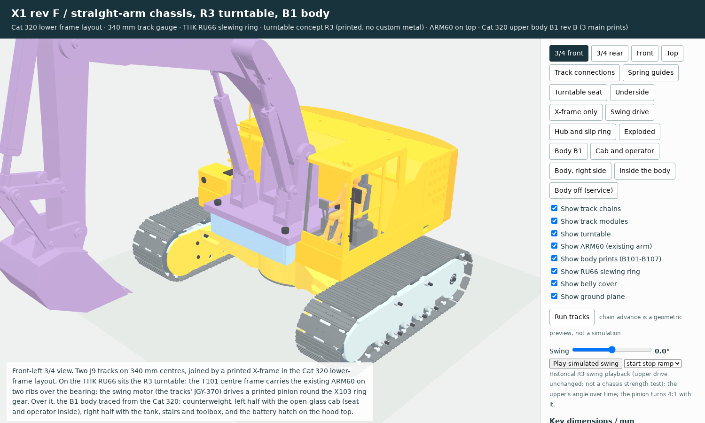

# X1 revision F — straight arms seated in the track main beam

Each X101 arm runs straight at its full 28 mm width into the track main plate and ends flat in a plain 1.5 mm recess. The deck and the arched underside are single smooth curves. One screw on each side of the arm's centre web clamps the joint through plain holes; the heads and washers sit in side slots under the closed deck, and the rear washers and nuts are external. The accepted enclosed spring guide is retained.



The R3 turntable sits on the RU66 seat, and the upper body B1 rev B sits on it. The body is traced from the Cat 320: three main prints (counterweight, left half with the cab, right half with the tank), four small ones, and the 18650 battery on the swing centreline under a lift-off hatch. Rev B issue 2 (2026-11-07) adds a cable notch in each half's inboard hood wall for the arm harness of the complete machine (`excavator_complete/WIRING.md`). See [TURNTABLE.md](TURNTABLE.md) and [BODY.md](BODY.md).

**Control system: spec C1 issue 4; main board rev B designed (schematic, PCB and firmware).**
- The main board (rev B) sits in the left bay: ESP32-S3, 7 × DRV8876 on the battery, 5 V / 3.3 V rails, lamps, buzzer and an expansion header. Its motor, lamp and expansion headers are top entry since 2026-11-14, so the plugs go on from above.
- Its KiCad 9 schematic is complete and checked: ERC clean, and KiCad's netlist matches the source netlist pin for pin. The BOM uses verified LCSC parts.
- The 4-layer, 96 × 64 mm PCB is routed. KiCad's DRC finds no errors and no unconnected items, and the board matches the schematic. Gerbers, drill files, BOM and CPL for JLCPCB are in `controller/main_board/fab/`; nothing has been ordered. See [controller/main_board/DESIGN.md](controller/main_board/DESIGN.md).
- Its firmware (`controller/firmware/`) compiles for the ESP32-S3 and its logic tests pass; it has not run on hardware.
- The board is modelled in the body CAD from its layout, and the body checks pass ([BODY.md](BODY.md)).
- **Plain-language guide:** [controller/X1_controller_guide.html](controller/X1_controller_guide.html) explains the board, the program and the installation with pictures, animations and a simulator of the firmware's rules. Open it in a browser; it works offline. It is built by `controller/source/build_guide.py`.
- The handle is parked; only its ESP-NOW link and control behaviour are fixed. The later 4G remote is deferred.
- Requirements: [controller/SPEC.md](controller/SPEC.md) and `controller/X1_control_spec_C1.pdf`.

## Open the current model

- [3D_preview.html](3D_preview.html) is an offline interactive viewer. Select **Track connections**, **X-frame only** or **Spring guides** for the chassis, and **Body B1**, **Cab and operator**, **Inside the body** or **Body off for service** for the upper body.
- [step/X1_crawler_chassis.step](step/X1_crawler_chassis.step) contains the complete coloured chassis and both tracks.
- [step/X1_turntable_assembly.step](step/X1_turntable_assembly.step) contains the revised X101, retained R3 turntable and fixed ARM60 pivot base. The moving arm shown in the viewer is a reference model; it is not embedded in this STEP.
- [step/X1_body_assembly.step](step/X1_body_assembly.step) contains the body B1 prints (B101–B107), their hardware and electronics.
- [X1_arc_mount_detail.pdf](X1_arc_mount_detail.pdf) shows sections taken from the exported CAD.
- [X1_layout.pdf](X1_layout.pdf) is the plan, front section and turntable-seat layout with the Cat 320 reference table.
- [ASSEMBLY.md](ASSEMBLY.md), [BOM.md](BOM.md) and [REV_F_NOTES.md](REV_F_NOTES.md) describe the current connection.

Use the revision F X101, J901 and J909 parts together. X1 supplies the mirrored right J901 and J909; their left counterparts are in J9.

## Connection geometry

The four joints are centred at X ±63.5. Each arm is 28 mm wide and straight from vehicle Y ±96 to its end at Y ±137.5. Its deck falls in one curve from Z85 at the carbody to Z74 at the plate; its underside arches from the carbody rim (Z34) to a crown at Z57.5 over the motor pod, then curves down to Z53 at the plate. The flat 28 × 21 mm end (Z53–74) is the contact face.

The receiving seat is a plain rectangle, 1.5 mm deep from the original main-plate face at local Y−34 to Y−32.5, with 0.15 mm side clearance and an open top. The plate's inner surface remains at Y−24, leaving 8.5 mm behind the recessed contact face. The joints mate at vehicle Y ±137.5. Mechanism recesses retain the original motor, roller and yoke positions.

Each joint uses two horizontal M4 × 25 ISO 4762 socket screws, with one Ø9/Ø4.4 × 0.8 mm washer beneath each head and each external M4 nut. The heads sit in side slots (Z62.75–72.75, vehicle Y ±97 to ±127) either side of a 9 mm centre web, with 10.5 mm of arm stock clamped between the washer face and the seat. There are no mounting screw-head counterbores or recessed nut pockets. The front screw axes are X54 and X73, with mirrored rear positions, all at Z67.75.

Through the slots the arm section is a closed deck, a 9 mm web and a full-width base. Arm section properties are recorded in [revf_leg_sections.json](revf_leg_sections.json) as geometry only. Printed fit, root bending capacity, fastener preload retention, creep and strength still require physical testing. The cosmetic housing is relieved around the arm with about 0.5 mm clearance (0.41 mm measured minimum) and carries no chassis load.

## Accepted spring and retained mechanisms

The spring guide keeps its Ø16.4 bore, Ø21.2 exterior and 8 mm recessed seat. The J908 yoke retains its Ø15.6 piston. Fitted spring length is 25.8 mm and recoil is 4.2 mm, with approximately 77 N nominal preload. Use the matching guide and yoke, and check clean, free movement through the whole stroke.

Track centres remain 340 mm apart, shoe width is 70 mm and overall shoe width is 410 mm. The chassis retains the THK RU66 seat at Z85, turntable mounting face at Z100, Ø25 centre passage, belly cover and R3 upper drive. See [TURNTABLE.md](TURNTABLE.md) and the [bearing reference](references/thk_ru66/SOURCE.md).

The older R3 swing playback concerns the upper drive. It does not establish revision F chassis strength.

## Printing and assembly

X101 remains one part, printed with its bearing seat on the bed. Its current print bounds are **155 × 275 × 51 mm**; check printer capacity against `revf_part_exports.json`. In this inverted orientation, the arm decks and the head-slot roofs need support; keep scars off the arm end faces, receiving seats and washer faces. No split-frame design is supplied.

Install the road and support rollers with their axles, the motor and housing first. Hold both tracks at their final spacing and lower the bare X101 frame vertically into their open-top receiving seats; sideways fitting clashes with the motor and housing. Leave the rear sprocket and chain off. Slide each screw and washer sideways into its head slot and push it through; a compact 7 mm nut-holding tool holds the external nut while a 3 mm L-key, handle out of the slot, turns the screw. Fit the sprocket and chain after tightening. Follow [ASSEMBLY.md](ASSEMBLY.md) for the fitting sequence and tool route. For later service, prepare the affected track as specified in ASSEMBLY.md, lower it at least 80 mm relative to the independently supported chassis, then slide it outward.

The print list and standard parts for both tracks are in [J9/TRACK_KIT.md](../J9/TRACK_KIT.md), with an offline [installation animation](../J9/install_animation.html) whose "Both on X101" mode shows this joint step, and a [parts showcase](../J9/parts_showcase.html) with every part's dimensions and material.

Use fit samples for the arm end in its seat, the through-holes and the spring piston before complete prints. No material, infill, layer orientation, payload or tightening torque has been physically qualified.

## Verification and rebuilding

All reports below are computed fresh on the delivered revision F files; none inherit results from earlier designs.

| Report | What it checks |
|---|---|
| [arc_seat_mount_validation.json](arc_seat_mount_validation.json) | Joint seating and contact, fasteners, key and socket access, vertical frame fitting and track service routes, sprocket fitting, idler recoil, chain phases, upper swing, RU66 seat and belly-cover screw access, clearances |
| [../J9/validation.json](../J9/validation.json) | Every track trial: static fit, drive rotation, idler travel and stop, spring at recoil, chain phases, assembly paths and tools; spring envelope and main-plate seat clearances; the drive coupling against the seller drawing; the chain joints (J910 revision B: neighbouring links, screw heads, nuts and seat bosses against the roller flanges, the sprocket between the ears) |
| [revf_part_exports.json](revf_part_exports.json) | The ten changed STEP/STL designs (X101, both J901, both J909, J902, J904, J906, J908, J910) match the current source, are single solids and watertight meshes; X101 fills its required envelope |
| [revf_refresh_validation.json](revf_refresh_validation.json) | The three STEP assemblies and both viewer scenes hold the current parts, the joint hardware, the drive group (J902 on its flange coupling) and the chain (J910 revision B shoes, each joint with its M3 × 60 screw, sleeve and nyloc nut), with no parts of the old hub or the old pin joints left |
| [revf_leg_sections.json](revf_leg_sections.json) | Arm cross-section properties (geometry only, not a strength check) |
| [turntable_validation.json](turntable_validation.json) | The R3 turntable on the revision F chassis: fits, assembly paths, tools and the swing envelope |
| [body_validation.json](body_validation.json) | The body B1 on the turntable: fits, the swing sweep over the tracks, assembly and service paths, tools, clearances |
| [browser_validation.json](browser_validation.json) | The offline viewer and its screenshots |

Primary source files are `source/x1_parts.py`, `../J9/source/j9_mounts.py` and `../J9/source/j9_parts.py`. Run from `source/` with CadQuery and the original repository (it supplies `track_wheel/source`):

```sh
python export_arc_frame.py                     # X101 STEP/STL
python ../../J9/source/export_revf_track.py    # left and mirrored right J901/J909
(cd ../../J9/source && python -c "import build_j9 as B, j9_parts as P; B.export_parts({n: dict(shape=P.PRINTED[n][0](), color=P.PRINTED[n][1], quantity=P.PRINTED[n][2], material=P.PRINTED[n][3], note=P.PRINTED[n][4]) for n in ('J902_sprocket', 'J904_roller', 'J906_idler_wheel', 'J908_U_yoke', 'J910_track_shoe_70')})")   # J902/J904/J906/J908/J910 STEP/STL
python check_revf_exports.py                   # verify the ten parts against the source
python refresh_revf.py                         # rebuild assemblies and scenes; --verify only checks them
python ../../J9/source/check_revf_track.py     # fresh J9 track validation
python check_arc_sections.py
python draw_arc_mounts.py                      # X1_arc_mount_detail.pdf
python check_arc_seat_mounts.py                # joint acceptance (long; resumes from checkpoints)
python draw_layout.py                          # X1_layout.pdf
python package_revf.py                         # review PDF, ZIP and manifest in ../../../output
```

`build_x1.py` is now a helper library for the exporter and the turntable builder. Its own `main()` predates the revision F joint and refuses to run.

The turntable, the body and the swing simulation sit on top of the chassis. Rebuild them after a chassis change, in this order:

```sh
python build_body.py mass                            # body masses, used by the turntable mass stage and the simulation
python build_turntable.py                            # turntable STEP/STL, turntable_validation.json, mass properties, viewer data (long)
python build_body.py export static sweep paths tools clearances final   # body STEP/STL, body_validation.json (see BODY.md -> Rebuild)
python simulate_swing.py                             # ../simulation/turntable_swing_*.json (MuJoCo)
python draw_swing_report.py                          # ../X1_turntable_simulation.pdf
python build_viewer.py                               # ../3D_preview.html, with the turntable, the body and the swing traces
node check_viewer.cjs                                # screenshots + browser_validation.json (NODE_PATH must contain playwright)
```

STEP/STL files and the offline viewers work on their own; rebuilding is only needed after a design change.
