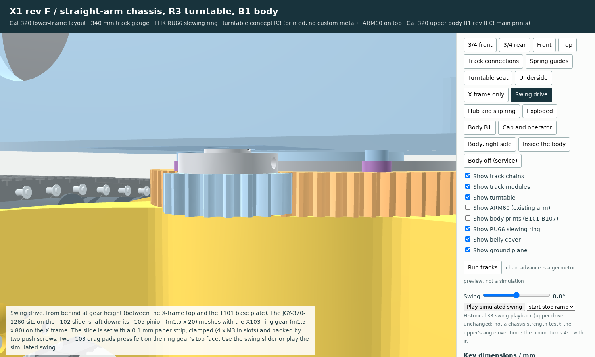
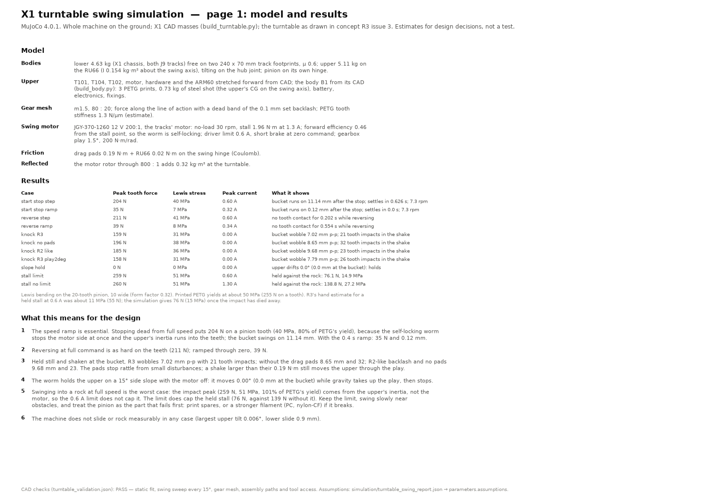

# X1 turntable (concept R3, issue 3): CAD, checks and swing simulation

The R3 upper drive is retained on X101 revision F. On 2026-11-07, with the body B1 merged in, the turntable CAD checks (`turntable_validation.json`) and the swing simulation below were re-run on the revision F chassis; they cover the upper mechanism and do not establish the revised track connections' strength. The upper mechanism's compatibility with the revision F lower frame, including a full turn at 15° steps, is checked in [arc_seat_mount_validation.json](arc_seat_mount_validation.json). The supplied current STEP assembly includes the retained upper mechanism on the revision F frame, and the upper assembly instructions below still apply.


The turntable from `swing_concept/X1_swing_concept_R3.pdf`, built in CAD and checked:
- **Upper:** printed centre frame T101 and hub adapter T104 on the RU66 inner ring.
- **Swing motor:** the tracks' JGY-370-1260 12 V 200:1 on a slide T102. Its pinion T105 (m1.5 × 20) drives the ring gear X103 (m1.5 × 80) at 4:1.
- **Drag pads:** two spring-loaded drag pads T103 on the ring gear's top face.
- **Slip ring:** the bought 6-way 2 A slip ring in the X-frame's collar, driven through the TPU dog T106 (R2).
- **Chassis:** the X-frame is X101 revision F; the R3 bearing and drive interfaces are retained (see [README](README.md#retained-chassis-and-turntable-layout)).
- **No custom metal parts.**

Nothing has been printed, assembled or run under power. The checks are nominal CAD. The swing dynamics come from a simulation with stated assumptions, not from tests.





## Parts

| Part | Qty | Material | Print orientation | Size (print bounds) | Volume; solid mass |
|---|---|---|---|---|---|
| T101_centre_frame | 1 | PETG, 4 walls, 30 % infill; solid within 10 mm of every bolt | base plate down; no supports | 252 × 148 × 33 | 411.4 cm³; 522 g |
| T102_motor_slide | 1 | PETG, 100 % infill | body down, ears up | 52 × 72 × 12 | 20.7 cm³; 26 g |
| T103_drag_plunger | 2 | PETG, 100 % infill | head down | 7.6 × 7.6 × 10 | 0.37 cm³; 0.5 g |
| T104_hub_adapter | 1 | PETG, 100 % infill | flange face down; spigot and prongs grow upwards | 59 × 59 × 19.5 | 11.8 cm³; 15 g |
| T105_pinion | 1 | PETG or PA12, 100 % infill | flat | 32.7 × 32.7 × 10 | 5.9 cm³; 7.5 g |
| X103_ring_gear | 1 | PETG or PA12, 100 % infill | top face (drag track) on the bed | 123 × 123 × 12 | 49.3 cm³; 63 g |
| T106_rotor_dog_TPU | 1 | TPU 95A | top web down | 13 × 19 × 8 | 0.83 cm³; 1.0 g |

What each part does is in the R3 drawings (sheets 2 and 3) and in `x1_turntable.py → PRINTED`.

The STEP for each print is in `step/` and the print-oriented STL in `stl/`. `step/X1_turntable_assembly.step` is the turntable on the X-frame, without the tracks and with only the ARM60's fixed base (the full arm and the tracks would push it past 100 MB).

### Bought

| Joint / part | Hardware | Qty |
|---|---|---|
| RU66 to X-frame | M4 × 30 socket; M4 nut; DIN 6796 M4; DIN 9021 M4 (Ø12) | 8 each (in [BOM.md](BOM.md)) |
| T101 + T104 to RU66 inner ring | M4 × 20 socket; DIN 6796 M4; DIN 9021 M4 (Ø12) | 8 each |
| X103 ring gear | M3 × 12 countersunk (ISO 10642), from below; M3 heat-set insert in the gear | 6 each |
| T102 slide clamps | M3 × 12 socket; M3 washer; M3 heat-set insert in the base plate | 4 each |
| T102 push screws | M3 × 12 socket; M3 nut (lock); M3 heat-set insert in the lug | 2 each |
| JGY-370 on T102 | M3 × 8 button head (ISO 7380), from below | 4 |
| T105 pinion | Pololu #1999 hub (M3 cup-point set screws, supplied); M3 × 10 socket | 1; 4 |
| T103 drag pads | spring Ø4.5 × 12, wire 0.5 (about 1.2 N/mm); M6 × 8 set screw; M6 heat-set insert (Ø8 hole, 9 long); felt Ø8 × 3 | 2 each |
| ARM60 base | M6 × 40 socket; M6 nut; M6 washer | 4 each |
| Counterweight B101 (body) | M4 × 12 socket, from inside T101; M4 heat-set insert in B101 | 2 each (in [BODY.md](BODY.md)) |
| Body halves B102, B103 | M3 × 12 socket down the sleeves; M3 heat-set insert in the T101 rib tops (X −120 and −45, Y ±65) | 4 each (in [BODY.md](BODY.md)) |
| Slip ring (R2) | M3 × 8 socket; M3 washer; M3 heat-set insert in the collar | 3 each |
| Bought assemblies | THK RU66 (in BOM.md), 6-way 2 A slip ring, a third JGY-370-1260 12 V 200:1 | 1 each |

**T105 hub availability (2026-11-12).** The Pololu #1999 hub could not be bought. The Ø32 flange coupling now used on the J9 sprockets does not fit here: the shaft leaves 10.4 mm between the pinion and the gearbox boss, and the coupling is 14 mm long. Any substitute must be no bigger than:
- flange Ø26 × 5.5;
- boss Ø13;
- 9.9 mm overall;
- bore 6 mm.

Its set screw must be in the flange, below the T102 slide: a set screw in the boss sits inside T102's Ø14 hole, where no key reaches it. Only T105's holes would then change. Until then, the CAD shows the Pololu hub.

## Assembly order (each step checked in CAD)

1. **Slip ring.** X-frame upside down. Press 3 M3 inserts into the collar. Fit the slip ring with its TPU dog T106 on the rotor, then 3 × M3 × 8 with washers. Run the leads through the passage.
2. **Ring gear.** Press 6 M3 inserts into X103 from below. Lower it onto the X-frame top, then fit 6 × M3 × 12 countersunk from below. The heads and the key pass the scallops in the mount ring and wall.
3. **Bearing.** Lower the RU66 into the ring gear's bore onto the seat. Fit 8 × M4 × 30 from above; the washers, spring washers and nuts go below, using a 7 mm socket. Tighten crosswise to about 0.3 N·m.
4. **Hub.** Lower T104 onto the inner ring, with its spigot in the bore and the prongs past the dog's lugs. Put T101 on top and feed the rotor leads up and out of the rear slot. Fit 8 × M4 × 20 with both washers and tighten crosswise. The key comes from above through the hub well.
5. **Drag pads.** Drop each plunger T103, felt glued on, into its housing while the insert hole is still empty. Press in the M6 insert; the plunger hangs on its lip 7 mm below. Drop the Ø4.5 spring through the insert's thread and fit the set screw loose.
6. **Motor.** On the bench, mount the JGY-370 on T102 with 4 × M3 × 8 button heads from below, then the hub and pinion. With the slide 2 mm back, lower the group into the opening; the pinion goes down beside the ring gear.
7. **Mesh.** Put a strip of 80 g/m² paper (about 0.1 mm) between the teeth. Push the slide in until it pinches, and tighten the 4 × M3 × 12 clamp screws (with washers, in the slots). Turn the 2 push screws in until they touch the ears and lock each with its nut. Pull out the paper and turn the upper by hand through a full turn: there should be no tight spot.
8. **Drag.** Set the drag with a spring scale on the upper, 100 mm from the axis: about 1.9 N. Then fit the ARM60 base with 4 × M6 × 40 from above into the nut pockets. The counterweight and the two body halves follow ([BODY.md](BODY.md)); press the body's 4 M3 inserts into the rib tops before the ARM60 goes on.
9. **Run in.** After about 1 h and 10 h of running, re-tighten both bearing joints and check the mesh.

## Service

- **Hub screws (8 × M4 × 20):** the ARM60's fixed base covers the hub well. To re-tighten them, take the ARM60 off first (4 × M6). The CAD check confirms the key is blocked with the arm fitted and clear without it.
- **RU66 nuts:** from below, with the belly cover off (7 mm socket).
- **Mesh and drag:** the slide clamps, push screws and drag set screws are all reachable from above with the arm fitted.

## Verification (`turntable_validation.json`): PASS

T101 gained 4 M3 insert holes in its rib tops for the body halves (2026-11-03). Its export, the static fit, the clearances and the mass properties were run again. The swing sweep, assembly paths, tool access and gear mesh are kept from the run before: the change only removes T101 material, so it cannot create an overlap.

All checks run on the exact CAD solids:
- **Static fit:** no overlap among 305 candidate pairs. These are every turntable solid against each other and against the chassis, both tracks and the ARM60.
- **Gear mesh:** 10 positions through one ring-tooth pitch (4.5°). The teeth never overlap, and the smallest gap is 0.047 mm at every position. That is half the normal backlash, with the mesh set to 0.1 mm circumferential backlash at a centre distance of 75.137 mm.
- **Swing sweep:** the upper, with the ARM60, against the chassis and the chassis-side turntable parts at every 15° through 360°. There are no hits at any of the 24 angles. The pinion turns 4:1 with the upper, and the RU66 inner ring turns with the upper.
- **Assembly paths:** 36 positions, all clear. They cover the 8 steps of the assembly order above:
  - the ring gear onto the seat;
  - the RU66 into its bore;
  - T104 and T101 lowered onto the bearing;
  - the motor group lowered at the opening's rear stop (1.86 mm behind the set position);
  - the slide pushed in to the mesh;
  - the plungers dropped in before the inserts;
  - the springs dropped through the inserts;
  - the ARM60 lowered onto the ribs.
- **Tool access:** 51 key and socket paths, all clear except one: the hub-screw key with the ARM60 fitted, which is the service limit above.
  - The keys reach the hub screws (before the ARM60 goes on), the ring-gear screws from below, the slip-ring screws, the slide clamps, the push screws, the drag set screws and the ARM60 bolts.
  - The ring-gear screw heads pass through the scallops.
  - A 7 mm deep socket reaches the RU66 nuts from below.
- **Clearances (mm):**
  - pinion to the X-frame arm tops: 2.0;
  - T101 to the RU66 outer ring: 3.0, and to the seat-screw heads: 3.4;
  - T104 to the outer ring: 0.5;
  - T104 prongs to the X-frame relief: 1.803, and to the rotor dog (free play): 0.999;
  - ring-gear bore to the RU66: 0.1 (the centring fit);
  - hub flange to the slide: 1.0, and hub boss to the gearbox: 1.2;
  - motor lead space to the Ø20 window: 0.3;
  - RU66 washers to the carbody wall: 6.5, and to the collar: 13.5;
  - the turntable's rear reaches R 162.8, inside the reserved tail-swing circle R 189. The body B1's counterweight reaches R 225 at its corners (decision D4); the chassis has nothing above Z 92.4 out there ([BODY.md](BODY.md)).
- **Printability:** each print is one valid solid, its STEP round-trips and its STL is watertight.

**Fixes the modelling found** (the R3 drawings, issue 3, now match):
- The ring-gear screw heads could not pass the mount ring: added Ø7.2 scallops in the mount ring and wall.
- The drag plunger could not pass an M4 insert hole: now an M6 insert with an Ø8 hole, a Ø7.6 head and an M6 × 8 set screw.
- The drag spring would have needed fitting before the hot insert: it is now a Ø4.5 spring dropped through the insert's thread. The drag falls from 0.24 to about 0.19 N·m nominal and is still set with the screw.
- The motor's solder tabs and leads hit the rear bulkhead: the window is now Ø20.
- The push-screw lock nut hit the base plate: the screw axis is now Z 113 and the slide ears are 6 thick.
- The gearbox's screw bosses needed pockets in the slide: the motor now sits on M3 × 8 button heads in counterbores.

**Not checked:** print tolerances, loads on the printed parts (except the tooth estimates below), wear and powered running.

## Swing simulation (`X1_turntable_simulation.pdf`)

`simulate_swing.py` builds a MuJoCo model of the whole machine.
- **Lower:** 4.48 kg, free on two track footprints.
- **Upper:** 5.10 kg, tilting on the hub joint, with 0.154 kg·m² about the swing axis (body B1 rev B; re-run on 2026-11-07 on the revision F chassis with MuJoCo 4.0.0, which moved the knock cases by up to 3 %).
  - 2.80 kg comes from the turntable CAD: the turntable, motor, hardware and the ARM60 stretched forward.
  - 2.30 kg is the body B1 rev B from its CAD ([BODY.md](BODY.md)): the seven prints, 0.73 kg of steel shot that puts the upper's CG on the swing axis (fore-aft and sideways), the battery, electronics and fixings. Rev A's body was 2.40 kg (upper 5.20 kg, 0.159 kg·m²); every peak tooth force below moved by less than 7 % with rev B, and the conclusions stand.
  - Until 2026-11-03 the simulation used placeholders here (R3's 1.8 kg counterweight and the 60 mm excavator's shells and electronics, 5.52 kg and 0.152 kg·m² in all). Every result below moved by a few per cent with the real body.
- **Gear mesh:** the 80:20 mesh with its 0.1 mm backlash and PETG tooth stiffness.
- **Drive:** the JGY-370's worm gearbox, self-locking, with an assumed 1.5° of output play, and a DC motor model with a 0.6 A driver limit.
- **Friction:** the drag pads (0.19 N·m).

| Case | Peak tooth force | Lewis stress | Result |
|---|---|---|---|
| Stop from full speed, no ramp | 204 N | 40 MPa | bucket runs on 11.15 mm |
| Stop with the 0.4 s ramp | 35 N | 7 MPa | bucket runs on 0.1 mm; swing 7.3 rpm |
| Reverse, no ramp / ramped | 212 / 39 N | 41 / 8 MPa | |
| Knock and shake at the bucket, R3 | 159 N | 31 MPa | 6.94 mm p-p wobble, 21 tooth impacts |
| The same without drag pads | 197 N | 39 MPa | 8.71 mm, 34 impacts |
| R2-like (0.3 mm backlash, no pads) | 185 N | 36 MPa | 9.61 mm, 25 impacts |
| 15° side slope, motor off | 0 N | — | holds: with the body the upper's CG is on the swing axis, so gravity does not turn it |
| Into a rock at full speed, 0.6 A limit | 259 N | 51 MPa | held stall 79 N (15 MPa) |
| The same without a current limit | 259 N | 51 MPa | held stall 139 N (27 MPa) |

Printed PETG yields at about 50 MPa (255 N on a pinion tooth, by Lewis).

**What it means:**
1. **The speed ramp is essential.** Without it a stop or a reversal puts about 80 % of the yield load on a tooth, because the self-locking worm stops the motor side at once. With the 0.4 s ramp the peak falls to about 14 %.
2. **The drag pads help.** They cut the wobble when the bucket is shaken (6.9 against 8.7 mm) and the tooth impacts (21 against 34). They cannot stop a shake larger than their 0.19 N·m from moving the upper through the play.
3. **Swinging into a rigid obstacle at full speed loads the pinion to about its yield.** The current limit does not help, because the impact comes from the upper's inertia. The limit does nearly halve the held stall (79 against 139 N).
   - Swing slowly near obstacles.
   - Treat the pinion as the part that fails first: it is a 7.5 g print in front of the gearbox. Keep spares, or print it in a stronger filament (PC, nylon-CF) if it breaks.
4. **The worm holds the upper on a 15° slope with the motor off.** The machine does not slide or tip in any case.

**Assumptions:** they are listed in `simulation/turntable_swing_report.json → parameters.assumptions`:
- the mesh stiffness;
- the gearbox play and stiffness;
- the motor's no-load current and rotor inertia;
- the felt friction;
- the ground friction;
- the rock's stiffness;
- the body's electronics masses (assumed; see `simulation/body_mass_properties.json`).

The gearbox play is a guess; measure it on a track motor. These are estimates for design decisions, not a test.

## Rebuild

From `track_wheel_jgy370/X1/source/`. CadQuery 2.7 is in `/tmp/sw-venv` in this workspace (no `LD_LIBRARY_PATH` needed on the current machine). MuJoCo 4.0 is in the same venv.

```
python build_turntable.py      # all stages: STEP, STL, turntable_validation.json, mass properties, viewer data (about 40 min)
python build_turntable.py static     # or one stage at a time (export static mesh paths tools clearances mass sweep final);
                                     # results are cached in /tmp/sw-render/tt_cache: delete it after changing the CAD
python simulate_swing.py       # simulation/turntable_swing_report.json, _traces.json and the MJCF model (about 2 min)
python draw_swing_report.py    # ../X1_turntable_simulation.pdf and images/X1_swing_sim_p1..5.png
python build_viewer.py         # ../3D_preview.html (needs x1_scene.json.gz from build_x1.py and the files above)
NODE_PATH=<playwright node_modules> node check_viewer.cjs   # headless Chromium; software WebGL takes about 2.5 min
python ../swing_concept/source/draw_swing_concept_r3.py   # the R3 drawings; the CAD imports their constants
```
