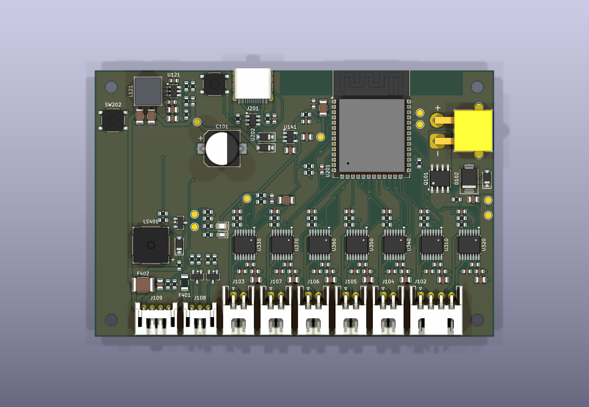

# X1 main board, revision B: circuit design

This is the controller board in the left bay of the X1 body. It carries:
- an ESP32-S3 module (ESP-NOW link to the handle);
- seven DRV8876 H-bridges: tracks, swing, boom left/right, stick, bucket;
- 5 V and 3.3 V rails, with all seven drivers on the 12 V battery bus;
- two lamp outputs, a buzzer and the expansion header.

The requirements are in [../SPEC.md](../SPEC.md) (spec C1, issue 5).

**Revision B (2026-11-10).** The arm's V6-U60 actuators now use the 12 V N20 gearmotor (1:50, 800 rpm) with an M4 leadscrew (actuator_v6 rev 6.2). Their four DRV8876s therefore run from VBAT like the other three. The 6 V buck (U111 and its 12 parts: C111–C117, L111, R111–R114) is gone, along with the 6 V sense (R131, R132, C131 on GPIO7): 16 parts, 148 to 132 assembled. C130 stays where it was, as VBAT bulk at the four actuator drivers. Every other part keeps its value and position. The board was rebuilt from rev A's routing session with the removed parts' tracks taken out, so nothing else moved (see Routing).

**Status:** rev B's schematic and routed PCB are complete and checked, and its Gerbers, BOM, pick-and-place and board STEP are generated (2026-11-10). The X1 body has not yet been rebuilt around the rev B STEP (BODY.md).

## Files

| File | What it is |
|---|---|
| `X1_main_board_B_schematic.pdf` | The schematic: 4 sheets plus the root, exported by KiCad 9 |
| `kicad/` | The KiCad 9 project: schematic sheets and project symbol library. It opens in KiCad. |
| `X1_main_board_B_schematic_checks.json` | KiCad ERC, plus KiCad's netlist compared with `netlist.py` pin by pin |
| `X1_main_board_B_design_checks.json` | Electrical checks against the datasheet limits (below) |
| `BOM.md`, `X1_main_board_B_BOM_JLCPCB.csv` | Bill of materials, grouped, with LCSC numbers and JLCPCB library type |
| `PINMAP.md`, `x1_main_pins.h` | The firmware pin map, generated from the netlist |
| `source/netlist.py` | **Single source of truth:** parts, pins, nets, GPIO plan, netlist rules |
| `source/calcs.py` | Design calculations and datasheet constants |
| `source/build_schematic.py`, `source/kicad_sch.py` | Draw the KiCad schematic from the netlist |
| `source/check_kicad.py` | Runs KiCad (Docker `kicad/kicad:9.0`): ERC, netlist export, PDF |
| `source/check_design.py`, `source/bom.py`, `source/pinmap.py` | Checks, BOM, pin map |
| `kicad/X1_main.kicad_pcb` | The routed board (KiCad 9), with the board rules and net classes in `X1_main.kicad_pro` |
| `kicad/X1_main.pretty/`, `kicad/3d/` | Project footprints (ESP32 module with the ±22 mm keep-out, buzzer) and 3D models of parts KiCad has none for |
| `fab/` | Gerbers and drill zip, JLCPCB BOM and CPL |
| `X1_main_board_B.step` | The board with its parts, for the body CAD |
| `X1_main_board_B_layout.pdf`, `X1_main_board_B_top.png`, `X1_main_board_B_bottom.png` | Copper layers, and renders of both sides |
| `X1_main_board_B_pcb_checks.json` | DRC with schematic parity, and the board's checks against SPEC.md and the body |
| `X1_main_board_B_parts.json` | Each part's position and box, for placing the board in the body CAD |
| `source/layout.py` | Floor plan: positions, planes, pours, rules, net classes |
| `source/footprints.py`, `source/models_3d.py` | Project footprints; 3D models (CadQuery) |
| `source/build_pcb.py`, `source/pcb_make.py` | Place, strap, fan out and route the board (KiCad 9 and Freerouting 2.1.0 in Docker) |
| `source/freerouting_patch.py` | Builds Freerouting 2.1.0 with its command-line timeout fixed |
| `kicad/X1_main.ses`, `kicad/X1_main_repair.ses`, `kicad/X1_main_route.json` | The routing sessions the board was built from (main and ground-pad repair), and the hashes of their DSNs |
| `source/check_pcb.py` | DRC, checks, Gerbers, drill, CPL, STEP, PDF, renders |

### Rebuilding

The KiCad symbol libraries are read from the official image. To extract them once:

```sh
docker run --rm -v /tmp/kicad-lib:/out kicad/kicad:9.0 cp -r /usr/share/kicad/symbols /out/
```

Then run these from `source/`:
1. `python build_schematic.py`
2. `python check_kicad.py`
3. `python check_design.py`
4. `python bom.py`
5. `python pinmap.py`

Python 3 is needed; nothing outside the standard library is required. `KICAD_SYMBOL_DIR` overrides the library path.

For the PCB, also from `source/`:
1. `python models_3d.py`, only if a project 3D model changes. It needs CadQuery.
2. `python build_pcb.py`: footprints, placement, straps, fan-out, then the saved routing sessions (`kicad/X1_main.ses`, and `kicad/X1_main_repair.ses` for the boxed-in ground pads). With `--reroute` it routes again for 40 minutes (`--minutes`). It uses the Docker images `kicad/kicad:9.0`, `ghcr.io/freerouting/freerouting:2.1.0` and, once, `eclipse-temurin:21-jdk` to build the patched router.
3. `python check_pcb.py`: DRC and the output files. It downloads the KiCad 3D models it needs once, into `/tmp/kicad-3d` (`KICAD9_3DMODEL_DIR` overrides).

## Block design

### Power input (sheet 2)
- **Input.** The 12 V link arrives on an XT30PW-M (J101). Upstream are the battery, BMS, 5 A fuse and main switch in the toolbox (BODY.md, Wiring).
- **Reverse polarity.** Q101 is an AO4407A P-MOSFET. Its drain is on the input and its source on the bus, so the body diode conducts with the right polarity. R101 pulls the gate to GND; D101 (12 V zener) limits VGS when the bus rises.
  - Loss at the 4.45 A worst case is 0.26 W (13 mΩ max at −10 V).
  - With the battery reversed, the gate sits above the source and the FET stays off.
- **Clamp and bulk.** D102 (SMBJ15A) clamps the bus after the FET: 15 V stand-off, 24.4 V at 24.6 A. C101 (220 µF 35 V) is the bulk capacitor.
  - Every part on the bus is rated above 24.4 V.
- **Battery sense.** 100k/22k into GPIO8: 12.6 V reads 2.27 V, 9.6 V reads 1.73 V, 2.3 mV per LSB.

### Rails
- **VBAT.** All seven drivers take VM straight from the bus: tracks, swing and, since rev B, the four 12 V actuators. VM's 4.5–37 V range covers the 9.6–12.6 V pack and the 24.4 V clamp.
- **5 V buck (U121).** TPS54302 at 400 kHz with the TI reference values (SLVSDG6C, Table 7-2):
  - 10 µH inductor;
  - 2 × 22 µF output;
  - 100k upper feedback resistor and 68 pF feed-forward.
- **Feedback.** The lower resistor is 13.3k, for 5.08 V.
- **Inductor.** Bourns SRP6060FA-100M, Isat 7.6 A, which is above the converter's 6 A maximum current limit.
- **Enable divider (100k/22k).** The buck starts at 7.03 V and stops at 6.21 V, so it does not run from a collapsing pack.
- **Load.** About 0.65 A for logic, lamps and buzzer, plus the 2 A expansion reserve = 2.65 A of 3 A.
- **Rev A** had a second, identical buck (U111, 11k lower resistor, 6.01 V) for the four 6 V actuators.
- **3.3 V.** U141 (AP2112K-3.3, 600 mA) is fed from 5 V or from USB VBUS through Schottky diodes. The ESP32 can then be flashed with no battery, and USB never back-feeds the synchronous buck.
  - Headroom is 1.3 V from the buck and 1.0 V from USB at 4.75 V. Maximum dropout is 0.4 V at 600 mA.
  - The module needs a supply of at least 0.5 A (WROOM-1 datasheet, section 6.2).
  - At an assumed 0.15 A average radio load, the LDO rises about 46 °C (184 °C/W). That is a bench item.
- **VREF.** 3.3 V × 10k/13.3k = 2.481 V, shared by all seven drivers.

### Controller (sheet 3)
- **Module.** ESP32-S3-WROOM-1-N8: 8 MB flash, no PSRAM. GPIO35–37 are therefore free (WROOM-1 Table 3-1, note b).
  - Decoupling is 22 µF + 100 nF, as in the Espressif reference.
  - EN has a 10k × 1 µF delay and a RESET button.
  - GPIO0 has a 10k pull-up and a BOOT button.
- **USB-C.** USB device on the native USB pins (GPIO19/20), with no USB-serial chip.
  - 5.1k on CC1 and CC2; both D+/D− pairs are joined.
  - USBLC6-2SC6 ESD array.
- **Strap pins.**
  - GPIO45 must be low at power-up on modules without PSRAM (VDD_SPI 3.3 V). GPIO46 must be low for download mode.
  - Both drive the lamp MOSFET gates, whose 100k pull-downs hold them low.
  - GPIO3 is a JTAG strap. It is ignored with the default eFuse and carries a current-sense input.
- **Enables.** The PWM enables and nSLEEP avoid two kinds of pin (ESP32-S3 datasheet Tables 2-1 and 2-2):
  - pins that glitch high at power-up (GPIO18/19);
  - pins with a pull-up at reset (GPIO0, GPIO39 MTCK, GPIO43/44).
- **Sleep line.** nSLEEP is shared and has a 100k pull-down, so the drivers sleep (outputs Hi-Z) until the firmware arms them.
- **Fault line.** nFAULT is a shared open-drain line with a 10k pull-up.
- **Pin count.** 35 of the 36 GPIO are assigned; GPIO7 has been free since rev B removed the 6 V sense. See [PINMAP.md](PINMAP.md). UART0 (GPIO43/44) goes only to test pads, for the boot log.

### Motor drivers (sheet 4)
- **Drivers.** Seven TI DRV8876PWPR (SLVSDS7B).
  - PMODE = GND selects PH/EN mode: EN = PWM, EN = 0 brakes (low-side slow decay), PH = direction.
  - IMODE = GND selects fixed off-time current regulation (25 µs) with automatic retry after overcurrent (Table 6). This works at any duty, including 100 %. Cycle-by-cycle mode would hold the bridge off until the next input edge.
- **Current limit.** ITRIP = VREF / (R_IPROPI × 1000 µA/A). At the limit, IPROPI equals VREF (2.48 V), inside the ADC1 range at 12 dB (0–2.9 V).

  | Channel | Supply | R_IPROPI | ITRIP | Spec |
  |---|---|---|---|---|
  | Tracks | VBAT | 2.4k (Basic part) | 1.034 A | 1.0 A |
  | Swing | VBAT | 4.12k | 0.602 A | 0.6 A |
  | Boom L/R, stick, bucket | VBAT | 4.99k | 0.497 A | 0.5 A |

- **ADC filter.** A 1k / 100 nF filter (100 µs) between IPROPI and the ADC smooths the 20 kHz PWM. The IPROPI node itself is left unloaded, so the driver's own regulation keeps its speed.
- **Per-driver parts:** 100 nF + 10 µF on VM, 100 nF VCP–VM, 22 nF CPH–CPL (datasheet Table 1).

### Outputs (sheet 5)
- **Motor connectors.** JST-XH, side entry (6.1 mm tall):
  - one 4-way for the tracks: 1-2 left, 3-4 right, matching the slip-ring plug;
  - five 2-way: swing, boom L, boom R, stick, bucket.
- **Lamps.** JST-PH 3-way: 5 V common through a 0.5 A PTC, and two low-side AO3400A returns (PWM).
- **Buzzer.** 5 V passive magnetic part (32 Ω, 2.7 kHz) driven directly on the low side, with a flyback diode. R420 is a 0 Ω link, so a resistor can lower the volume.
- **Expansion.** JST-PH 4-way: 5 V through a 2 A PTC, GND, then TX (100 Ω) and RX (1k, which limits a 5 V source). It is reserved for the later serial link.

## PCB layout



### Board
- **Outline.** 96 × 64 × 1.6 mm, the `BOARD` placeholder of `x1_body.py`, with Ø2.7 holes on the four bosses. Components are on the top only (SPEC B1).
- **Frame.** `layout.py` places parts in (u, v): u runs from the rear edge forward (machine X + 136), v from the outboard edge inward (148 − machine Y). Seen from above, this is the machine's top view with outboard at the top. The Gerber, drill and CPL origin is the rear-inboard corner.
- **Silkscreen.** The bottom names each connector along the inboard edge, with its pin order on a second, smaller line where the label is long (TRACKS "L 1-2  R 3-4", LAMPS, EXP). The board's name, revision and date, and the XT30 input range, are on the bottom too.
- **Layers.** Four layers, JLCPCB's standard 1.6 mm stack-up (1 oz outer, 0.5 oz inner):

  | Layer | Use |
  |---|---|
  | F.Cu | parts, signals, supply pours, ground pour |
  | In1 | solid ground plane |
  | In2 | VBAT, the whole board. (Rev A split off a +6V area from the 6 V buck along a band under the module to the four actuator drivers.) |
  | B.Cu | signals, ground pour |

### Floor plan
- **Outboard edge.** USB-C at machine X −98 (SPEC C3), face 0.5 mm proud. The module is at the front end with its antenna over the edge: 15 mm from its side to the USB-C shell, 14 mm to the front boss screw. The copper keep-out is ±22 mm about the module's centre, on every layer.
- **Front edge.** The XT30, with the reverse-polarity FET, TVS and gate parts behind it. A 1.5 mm VBAT_IN pour runs from the XT30 to the FET's drains, and a VBAT pour from its sources to four vias into In2.
- **Rear-outboard corner.** The 5 V buck, with its input capacitors beside the IC, a short switch node on a pour, and the inductor and output capacitors on an output pour. Below it is the empty place of rev A's 6 V buck. The RESET button is beside the USB-C.
- **Inboard edge.** The eight connectors in the SPEC C2 order. Each motor connector has its H-bridge cell 1.5 mm in front of the connector's centre:
  - the driver's logic pins face the module and its outputs face the connector;
  - above it, the IPROPI resistor and the ADC filter;
  - below it, the VM, charge-pump and VCP capacitors.
- **Under the module.** Only tracks: its 12 bottom pads fan straight down to the stick, boom and nSLEEP lines.
- **Rear end of the driver row.** The two LEDs, the nFAULT pull-up and nSLEEP pull-down, and their test pads.
- **Rear-inboard corner.** Buzzer, lamp switches and the expansion supply; the BOOT button is on the free strip along the rear edge.
- **The pin map follows the floor plan.** Each channel uses the module pads that face its driver:

  | Module side | Faces | GPIO |
  |---|---|---|
  | Right (front) | track drivers | EN/PH 35–38, current 1, 2; nFAULT 39, LED 40, expansion UART 41/42, UART0 43/44, BOOT 0 |
  | Bottom | stick, boom R, boom L | EN/PH 11–14, 21, 47; current 3, 9, 10; nSLEEP 48; lamps 45, 46 |
  | Left (rear) | swing, bucket, sense, USB | EN/PH 15–18; current 5, 6; battery sense 8; buzzer 4; USB 19/20; GPIO7 free (rev A: 6 V sense) |

### Rules and net classes
Rules follow JLCPCB's standard 4-layer process ([capabilities](https://jlcpcb.com/capabilities/pcb-capabilities), read 2026-11-05):
- clearance 0.15 mm, minimum track 0.15 mm, copper 0.4 mm from the edge (JLCPCB asks for 0.2);
- vias 0.45/0.2 mm. JLCPCB asks for a pad 0.1 mm (0.15 preferred) larger than the hole, and does not charge extra for a 0.2 mm hole with a pad of 0.45 or more;
- plated component holes have at least a 0.15 mm ring, JLCPCB's absolute minimum for 1 oz multilayer; the smallest here are the drivers' thermal vias, at 0.15.

| Class | Track | Nets |
|---|---|---|
| Default | 0.15 mm | signals |
| Motor | 0.4 mm | OUT1/OUT2 of all seven drivers: 1 A on 1 oz outer copper rises about 10 °C |
| Supply | 0.4 mm | VBAT branches, +3V3, LDO_IN, VBUS, +5V_LAMP, buck SW and BST |
| Supply5 | 0.8 mm | +5V and +5V_EXP (2 A expansion reserve) |
| Input | 1.5 mm | VBAT_IN, XT30 to the FET |

### Routing
`build_pcb.py` builds the board in these steps, all scripted:
1. KiCad exports the schematic's netlist. The board takes its net names and symbol links from it.
2. `pcb_make.py` places the parts at the `layout.py` positions and draws the outline, inner planes, keep-outs and silkscreen labels.
3. **Straps.** Each supply pour on F.Cu gets a locked wide track along its copper path first:
   - XT30 to the FET drains, 3.6 mm;
   - FET sources to five vias into In2;
   - the buck's switch node, and its inductor-to-output-capacitor path.
   
   Freerouting 2.1 treats a pour as passable and cut the VBAT pours into islands in a trial. A strap is an obstacle to it and already joins the pour's pads.

   The USB-C data pins get two straps too. Each data line has a pad in both rows, so the plug works either way up (D+ on A6 and B6, D− on A7 and B7). The pads interleave (B6, A7, A6, B7), so one link must pass outside the row: D+ above it, D− below it. Left to the router, A7 once ended up boxed in between the D+ link and the VBUS track.
4. **Supply fan-out.** Every VBAT pad is joined to the In2 plane before routing, in this order of preference:
   - a short track to a same-net pad that already reaches the plane (a driver's thermal pad with its vias);
   - a fan-out via already placed beside it;
   - a new via just outside the pad, inside its plane's area and clear of every keep-out.
   
   The fan-out is locked, so the router only has to avoid it.
5. **GND is hidden from the router.** About 120 GND pads would each need a via. Placed before routing, those vias blocked both signal layers: the router stalled at 17 to 26 unrouted. `pcb_make.py` removes GND from the DSN instead; its pads stay in as obstacles.
   - The exception is a short list, `layout.EARLY_FANOUT`: the ground pads that the routes boxed in last time, so they found no room for a via afterwards. These get their via before routing. The router sees each via and its stub as a keep-out.
   - A pad inside another net's outer pour (R101, inside the VBAT pour) gets a short stub and via in that pour, which then flows around them. A long stub across the pour would cut it.
6. Freerouting 2.1.0 routes the signals (Docker, no network) for a fixed time, with neck-down off. It runs a patched jar (below).
7. The session is imported. GND is then fanned out the same way as step 4, into the free space the routes left.
8. **Repair of boxed-in ground pads.** Each route boxes a few ground pads in on both layers, a different few each time, so step 7 finds no room for their via. Such a pad gets its via anyway:
   - at the candidate spot that cuts the fewest routed tracks and vias, which are then removed;
   - a short repair route (6 minutes) puts the cut nets back. It may redraw the cut nets whole and move any track within 3 mm of the pads; everything else is locked. GND is hidden again, so the new vias are keep-outs.
   
   The repair session is kept as `kicad/X1_main_repair.ses`, with its DSN's hash, like the main session. An earlier repair that only freed the tracks near the pads, without placing the via first, never made room.
9. The router's leftover track ends are removed: track segments with a free end, repeatedly, since removing one can free the next. Locked straps and fan-out are never touched. The supply pours then go over their straps, ground pours go on both outer layers, and every zone is filled. Last, vias joined on one layer only are removed with their stubs. This runs only with the zones filled, so a via into a plane is never taken for a loose one.

**The USB-C shell tabs join the ground pours solid** (`layout.SOLID_PADS`), not by thermal spokes: the routes leave room for only one of the two spokes KiCad asks for. A custom DRC rule asking for one spoke on plated ground pins was tried first; KiCad 9's starved-thermal check ignored it.

Freerouting versions, on the same design:
- 2.1.0 routes best, but its command line ignores the pass limit, so the job timeout ends each run.
- 2.5.0 honours the pass limit but routed worse here: 44 unrouted after 25 minutes, against 11 for 2.1.0.
- 2.2.4 crashed (stack overflow); 2.3.0 and 2.4.1 spent their time in slow fan-out passes.

**The 2.1.0 timeout fix (`source/freerouting_patch.py`).** At the timeout, a monitor thread in 2.1.0 asks the job to stop, waits up to 30 s, then sets the job to TIMED_OUT. It does this even when the job has just set COMPLETED. The command line waits only for COMPLETED, so a run either writes its session or sleeps for ever, depending on which thread wins. Two 40-minute runs hung this way; a thread dump showed the router finished and the main thread still waiting.
- The patch changes one method, `Freerouting.InitializeCLI`. It also accepts TIMED_OUT, waits for the job's last pass, then writes the session of the final board.
- `freerouting_patch.py` builds the jar once, into `/tmp/x1-freerouting`:
  - the original source comes from GitHub at the jar's build revision, checked against a SHA-256;
  - it compiles in the `eclipse-temurin:21-jdk` image, with no network;
  - the new class goes into a copy of the jar; every other entry is unchanged.
- A 3-minute test run ended TIMED_OUT and wrote its session.

**The session is kept.** Routing takes 40 minutes and is not repeatable, so `build_pcb.py` saves the session as `kicad/X1_main.ses`. `kicad/X1_main_route.json` holds the SHA-256 of the DSN it was routed from. A plain `python build_pcb.py` re-imports that session while the placement still exports the same DSN; otherwise it stops and asks for `--reroute`. The repair session is kept the same way.
- **Rev B** was not routed again. Its DSN differs from rev A's only by the removed 6 V parts, so rev A's session was imported with `--ses` after the wiring of the removed nets (the 6 V buck's and the 6 V sense's) had been taken out of it. The repair step then ran again (6 minutes) and `X1_main_route.json` now holds rev B's hashes.
- Everything else is repeatable. The fan-out visits the footprints in a fixed order, the order `place` builds them in. A saved board lists them by their random ids, and the order decides which of two neighbouring pads gets a new via and which shares it.
- The repair DSN comes from a saved board, so from build to build it lists the same nets' pins and the same wires in another order, and joins different wire segments into one path. Its hash (`build_pcb.dsn_fingerprint`) is taken after sorting the pins, cutting every path into segments and sorting the lines.

### Manufacturing files (`fab/`)
- `X1_main_board_B_gerbers.zip`: four copper layers, masks, silkscreens, top paste, outline, and separate plated and unplated Excellon drill files with their maps.
- `X1_main_board_B_BOM_JLCPCB.csv` and `X1_main_board_B_CPL_JLCPCB.csv`: JLCPCB's assembly BOM and placement. The CPL rotations are KiCad's. Check them in JLCPCB's placement preview before ordering; some library parts need an offset there.

## Checks

| Check | Result |
|---|---|
| KiCad 9 ERC | 0 errors, 0 warnings. One accepted item: the buzzer footprint lives in the board's footprint library, which arrives with the PCB. |
| KiCad netlist vs `netlist.py` | 106 nets, identical pin for pin |
| Footprints and LCSC numbers in KiCad vs `netlist.py` | identical |
| Netlist rules | every net has 2 or more pins; one use per GPIO; ADC1 only; enables avoid glitching pins; straps held low; driver mode pins; voltage ratings |
| Electrical checks (`X1_main_board_B_design_checks.json`) | 51 checks, all pass: ITRIP vs spec, IPROPI current and voltage, VM, logic levels, PWM, buck output, start/stop, inductor peak and saturation, crossover and feed-forward, rail load, LDO headroom and heat, sense range, battery budget, FET loss, clamps, PTCs, part height |
| KiCad 9 DRC on the routed board (`X1_main_board_B_pcb_checks.json`, 2026-11-10) | 0 errors, 0 unconnected items, schematic parity 0. Four accepted warnings: the outline silk of the USB-C and the module crosses the edge they overhang. |
| Board against SPEC.md and the body | All pass: outline and holes on the `x1_body.py` bosses; USB-C at X −98 with its face at the edge; antenna at the edge; XT30 on the front edge; the inboard connectors in the spec's order; tallest part 10.5 mm (C101); motor tracks 0.4 mm and 5 V tracks 0.8 mm; plated rings at least 0.15 mm; Gerbers complete; the CPL lists all 132 assembled parts. |

**Worst-case battery current is 4.45 A, under the 5 A fuse.** It assumes:
- tracks and swing at their limits;
- the four actuators at 0.35 A each. That is the hold current of their own PTC (actuator_v6 F1), so it is the most an actuator carries for long;
- the radio peak, both lamps and the buzzer;
- a 90 % efficient 5 V buck, at 9.6 V.

**Every channel at its board limit at once is 5.04 A.** A stalled 12 V actuator reaches its 0.497 A limit, but only for the seconds until its PTC trips or the firmware's stall cut-out (S4) switches it off. A 5 A MINI fuse carries 101 % indefinitely. The spec's own figure, with round limits, is 4.94 A (SPEC P4, issue 5). A 2 A expansion load raises the 4.45 A to 5.63 A, so the fuse is reviewed in the 4G phase, as SPEC P4 already says.

## Differences from spec C1
- **Track limit 1.034 A, not 1.0 A.** It uses a 2.4k Basic resistor instead of 2.49k Extended. The firmware's stall cut-out uses the real limit, from `x1_main_pins.h`.
- **35 of 36 GPIO are used.** The spec's preliminary budget was 33. The extras are the UART0 test pads; UART0 is otherwise unused. (Rev A also sensed the 6 V rail on GPIO7.)
- **The buzzer is a 5 V part** (XHXDZ SMD8530-32Ω) instead of the 3.6 V MLT-8530, so it needs no dropping resistor.
- **Connector orientation.** Side-entry JST-XH/PH are entered in the BOM as the first choice (lower). SPEC B5 leaves the final choice to the CAD phase; top-entry part numbers are in the sources below.

## Bench items
1. LDO temperature with the radio running (the 0.15 A average is assumed).
2. Range check with the board in the bay (SPEC B3).
3. Buzzer volume, adjusted with R420.
4. Actuator current readings at 0.08 A, the 12 V N20's no-load current. The IPROPI offset error below 0.15 A is ±7.5 mA, about 9 %.
5. The expansion PTC's hold current with the real 4G stick.

## Sources
- **Datasheets.** Read for this design; extracted text in `/tmp/ctrl-dl` during the session.
  - TI DRV8876 SLVSDS7B (Nov 2019): 6.1–6.5, 7.3.2–7.3.4, Tables 2, 3, 6 and 7, 8.2.1.
  - TI TPS54302 SLVSDG6C (Mar 2026): 4, 5.3, 5.5, 6.3.6–6.3.10, 7.2, Table 7-2.
  - Espressif ESP32-S3-WROOM-1 v1.8: Table 1-1, Table 3-1, 4.1, 6.2, section 9.
  - Espressif ESP32-S3 Series v2.2: Tables 2-1 and 2-2, Table 5-5 (ADC).
  - Diodes AP2112 DS39724: pin descriptions, θJA, dropout.
- **LCSC / JLCPCB part numbers.** Each was confirmed on 2026-11-05 at `https://www.lcsc.com/product-detail/<C#>.html` and `https://jlcpcb.com/partdetail/<C#>`. Every LCSC number is in `source/netlist.py` and `BOM.md`.
  - Top-entry alternatives: B2B-XH-A C158012, B4B-XH-A C144395, B3B-PH-K-S C131339, B4B-PH-K-S C131334.
  - Vertical XT30UPB-M: C428721.
  - Second-source inductor: TAI-TECH TMPA0605S-100MN-D, C2880077 (Isat 6.0 A).
  - Stock note: the genuine AOS AO4407A had about 510 in stock. UMW makes a same-named part with different specs; do not substitute it unchecked.
- **Buzzer land pattern.** From the LCSC/EasyEDA footprint of C49246949:
  - 4 pads of 1.8 × 1.8 mm on a 6.975 mm square;
  - pad 1 (+) bottom-right and pad 2 (−) top-right, viewed from the top; pads 3 and 4 are mounting only.
